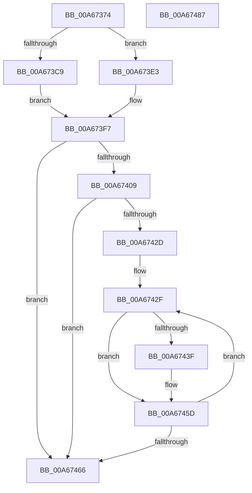

# EtwpUpdatePerProcessTracing

- RVA: `0x00A67374`–`0x00A67488` (길이 `276` bytes)
- VA: `0x0000000140A67374`
- 실행 섹션: `PAGE`
- PDB 이름 있음: `예`; PDB Function 태그: `아니요`
- unwind 정보 RVA: `0x000B3C3C`
- 디코드: `74`개 명령, `276/276` bytes 표시
- 미해석 바이트: `0` (있으면 어셈블리에 `.byte`로 보존)

> 이 문서는 커널 이미지의 기계어와 PDB 기호를 분석해 생성했습니다. 4번과 5번은 함수 원형과 자료형을 바이너리 사용 방식에서 추정한 C 해석이며 원본 소스 복구 결과는 아닙니다.

## 1. Dependencies

- 직접 호출 지점: **6**; 고유 호출 대상: **6**
- 직접 호출자로 확인된 함수: **2**
- RIP 상대 이미지 참조: **3**

### Outgoing calls
- `0x00A673B7` → [KeWaitForSingleObject](../../text/20/KeWaitForSingleObject_function_0020E6B0.md) (function, `0x0020E6B0`)
- `0x00A673FF` → [EtwpGetFlagExtension](EtwpGetFlagExtension_function_00A67748.md) (function, `0x00A67748`)
- `0x00A67436` → [PsLookupProcessByProcessId](../8A/PsLookupProcessByProcessId_function_008A2AA0.md) (function, `0x008A2AA0`)
- `0x00A67449` → [EtwpUpdateProcessTracingCallback](../7B/EtwpUpdateProcessTracingCallback_function_007B8F40.md) (function, `0x007B8F40`)
- `0x00A67458` → [ObfDereferenceObjectWithTag](../../text/2F/ObfDereferenceObjectWithTag_function_002F78E0.md) (function, `0x002F78E0`)
- `0x00A6746F` → [KeReleaseMutex](../../text/39/KeReleaseMutex_function_00396810.md) (function, `0x00396810`)

### Direct callers
- [EtwpStartLogger](../A9/EtwpStartLogger_function_00A99D80.md) at `0x00A9ADDF`
- [EtwpUpdateTrace](../AB/EtwpUpdateTrace_function_00ABCC7C.md) at `0x00ABCF38`

### Static image references
- `0x00A673AE` → RVA `0x00EFF220` (`.data`; read)
- `0x00A673BC` → RVA `0x00FC6AA8` (`ALMOSTRO`; read)
- `0x00A673E3` → RVA `0x00FC5008` (`ALMOSTRO`; read)

## 2. Other-region calls and transfers

- 다른 실행 섹션으로 향하는 call: **3**
  - `0x00A673B7` → [KeWaitForSingleObject](../../text/20/KeWaitForSingleObject_function_0020E6B0.md) (`PAGE` → `.text`)
  - `0x00A67458` → [ObfDereferenceObjectWithTag](../../text/2F/ObfDereferenceObjectWithTag_function_002F78E0.md) (`PAGE` → `.text`)
  - `0x00A6746F` → [KeReleaseMutex](../../text/39/KeReleaseMutex_function_00396810.md) (`PAGE` → `.text`)
- 별도 외부 분기/꼬리 이동을 확인하지 못했습니다.

## 3. Assembly (complete function range)

```asm
00A67374  48 8B C4                        mov rax, rsp
00A67377  48 89 58 08                     mov qword ptr [rax + 8], rbx
00A6737B  48 89 68 20                     mov qword ptr [rax + 0x20], rbp
00A6737F  56                              push rsi
00A67380  57                              push rdi
00A67381  41 56                           push r14
00A67383  48 83 EC 40                     sub rsp, 0x40
00A67387  45 33 F6                        xor r14d, r14d
00A6738A  41 8B F1                        mov esi, r9d
00A6738D  41 8B D8                        mov ebx, r8d
00A67390  4C 89 70 10                     mov qword ptr [rax + 0x10], r14
00A67394  48 8B FA                        mov rdi, rdx
00A67397  4C 89 70 D8                     mov qword ptr [rax - 0x28], r14
00A6739B  48 8B E9                        mov rbp, rcx
00A6739E  66 44 89 74 24 70               mov word ptr [rsp + 0x70], r14w
00A673A4  45 33 C9                        xor r9d, r9d
00A673A7  4C 89 70 C8                     mov qword ptr [rax - 0x38], r14
00A673AB  45 33 C0                        xor r8d, r8d
00A673AE  48 8D 0D 6B 7E 49 00            lea rcx, [rip + 0x497e6b]
00A673B5  33 D2                           xor edx, edx
00A673B7  E8 F4 72 7A FF                  call 0x14020e6b0
00A673BC  48 3B 3D E5 F6 55 00            cmp rdi, qword ptr [rip + 0x55f6e5]
00A673C3  88 5C 24 70                     mov byte ptr [rsp + 0x70], bl
00A673C7  74 1A                           je 0x140a673e3
00A673C9  48 8B 47 08                     mov rax, qword ptr [rdi + 8]
00A673CD  48 8B 88 08 05 00 00            mov rcx, qword ptr [rax + 0x508]
00A673D4  0F B7 44 24 70                  movzx eax, word ptr [rsp + 0x70]
00A673D9  66 89 84 71 26 02 00 00         mov word ptr [rcx + rsi*2 + 0x226], ax
00A673E1  EB 14                           jmp 0x140a673f7
00A673E3  48 8B 05 1E DC 55 00            mov rax, qword ptr [rip + 0x55dc1e]
00A673EA  0F B7 4C 24 70                  movzx ecx, word ptr [rsp + 0x70]
00A673EF  66 89 8C 70 80 03 00 00         mov word ptr [rax + rsi*2 + 0x380], cx
00A673F7  BA 02 00 00 00                  mov edx, 2
00A673FC  48 8B CD                        mov rcx, rbp
00A673FF  E8 44 03 00 00                  call 0x140a67748
00A67404  48 85 C0                        test rax, rax
00A67407  74 5D                           je 0x140a67466
00A67409  48 8D 58 04                     lea rbx, [rax + 4]
00A6740D  89 74 24 68                     mov dword ptr [rsp + 0x68], esi
00A67411  0F B7 00                        movzx eax, word ptr [rax]
00A67414  8D 6A 02                        lea ebp, [rdx + 2]
00A67417  66 C1 E0 02                     shl ax, 2
00A6741B  66 2B C5                        sub ax, bp
00A6741E  C6 44 24 6C 01                  mov byte ptr [rsp + 0x6c], 1
00A67423  0F B7 C8                        movzx ecx, ax
00A67426  C1 E9 02                        shr ecx, 2
00A67429  85 C9                           test ecx, ecx
00A6742B  74 39                           je 0x140a67466
00A6742D  8B F9                           mov edi, ecx
00A6742F  8B 0B                           mov ecx, dword ptr [rbx]
00A67431  48 8D 54 24 30                  lea rdx, [rsp + 0x30]
00A67436  E8 65 B6 E3 FF                  call 0x1408a2aa0
00A6743B  85 C0                           test eax, eax
00A6743D  78 1E                           js 0x140a6745d
00A6743F  48 8B 4C 24 30                  mov rcx, qword ptr [rsp + 0x30]
00A67444  48 8D 54 24 68                  lea rdx, [rsp + 0x68]
00A67449  E8 F2 1A D5 FF                  call 0x1407b8f40
00A6744E  48 8B 4C 24 30                  mov rcx, qword ptr [rsp + 0x30]
00A67453  BA 44 66 6C 74                  mov edx, 0x746c6644
00A67458  E8 83 04 89 FF                  call 0x1402f78e0
00A6745D  48 03 DD                        add rbx, rbp
00A67460  48 83 EF 01                     sub rdi, 1
00A67464  75 C9                           jne 0x140a6742f
00A67466  33 D2                           xor edx, edx
00A67468  48 8D 0D B1 7D 49 00            lea rcx, [rip + 0x497db1]
00A6746F  E8 9C F3 92 FF                  call 0x140396810
00A67474  48 8B 5C 24 60                  mov rbx, qword ptr [rsp + 0x60]
00A67479  48 8B 6C 24 78                  mov rbp, qword ptr [rsp + 0x78]
00A6747E  48 83 C4 40                     add rsp, 0x40
00A67482  41 5E                           pop r14
00A67484  5F                              pop rdi
00A67485  5E                              pop rsi
00A67486  C3                              ret
00A67487  CC                              int3
```

## 4. C-style interpretation (structured pseudocode)

```c
__int64 __fastcall EtwpUpdatePerProcessTracing(__int64 a1, __int64 a2, int a3, int a4)
{
    __int64 result;
    __int64 v_r14;
    __int64 v_rbx;
    __int64 v_rdi;
    __int64 v_rsp;
    unsigned __int64 v_stack_m28;
    unsigned int v_stack_p10;
    unsigned __int8 v_stack_p14;
    unsigned __int16 v_stack_p18;
    unsigned __int64 v_stack_p20;
    unsigned __int64 v_stack_p8;

    *(unsigned __int64 *)(v_rsp + 8) = v_rbx;
    *(unsigned __int64 *)(v_rsp + 32) = v_rbp;
    v_rsp = (v_rsp) - (64);
    v_r14 = 0;
    *(unsigned __int64 *)(v_rsp + 16) = 0;
    *(unsigned __int64 *)(v_rsp - 40) = 0;
    v_stack_p18 = 0;
    a4 = 0;
    *(unsigned __int64 *)(v_rsp - 56) = 0;
    a3 = 0;
    a2 = 0;
    result = KeWaitForSingleObject(v_rip + 4816491, a2, a3, a4);
    v_stack_p18 = (unsigned __int8)((unsigned int)(a3));
    if (0 == (*(unsigned __int64 *)(v_rip + 5633765))) goto loc_00A673E3;
    *(unsigned __int16 *)(*(unsigned __int64 *)(*(unsigned __int64 *)(a2 + 8) + 1288) + (unsigned int)(a4) * 2 + 550) = (unsigned __int16)(v_stack_p18);
    goto loc_00A673F7;
loc_00A673E3:
    *(unsigned __int16 *)(*(unsigned __int64 *)(v_rip + 5626910) + (unsigned int)(a4) * 2 + 896) = (unsigned __int16)(v_stack_p18);
loc_00A673F7:
    result = EtwpGetFlagExtension(a1, 2, a3, a4);
    if (result == 0) goto loc_00A67466;
    v_stack_p10 = (unsigned int)((unsigned int)(a4));
    result = (unsigned __int16)((*(unsigned __int16 *)(result)) << (2));
    result = (unsigned __int16)((result) - ((unsigned __int16)(2 + 2)));
    v_stack_p14 = 1;
    a1 = (unsigned int)(((unsigned __int16)(result)) >> (2));
    if ((unsigned int)(a1) == 0) goto loc_00A67466;
loc_00A6742F:
    result = PsLookupProcessByProcessId((unsigned int)(*(unsigned int *)(result + 4)), v_stack_m28, a3, a4);
    if (!(sign_flag)) {
        a1 = v_stack_m28;
        a2 = v_stack_p10;
        result = EtwpUpdateProcessTracingCallback(a1, a2, a3, a4);
        a1 = v_stack_m28;
        a2 = 0x746C6644ULL;
        result = ObfDereferenceObjectWithTag(a1, a2, a3, a4);
    }
    v_rbx = (result + 4) + (2 + 2);
    v_rdi = ((unsigned int)((unsigned int)(a1))) - (1);
    if (condition_is_not_equal) goto loc_00A6742F;
loc_00A67466:
    a2 = 0;
    result = KeReleaseMutex(v_rip + 4816305, a2, a3, a4);
    v_rsp = (v_rsp) + (64);
    return result;
}
```

## 5. (Beta) C Style

```c
int64_t EtwpUpdatePerProcessTracing(int64_t Arg1, int64_t Arg2, int32_t Arg3, int32_t Arg4)
{
    int64_t result;
    int64_t local_r14;
    int64_t local_rbx;
    int64_t local_rdi;
    int64_t local_rsp;
    uint64_t v_stack_m28;
    uint32_t v_stack_p10;
    uint8_t v_stack_p14;
    uint16_t v_stack_p18;
    uint64_t v_stack_p20;
    uint64_t v_stack_p8;

    *(uint64_t *)(local_rsp + 0x8) = local_rbx;
    *(uint64_t *)(local_rsp + 0x20) = local_rbp;
    local_rsp = (local_rsp) - (64);
    local_r14 = 0;
    *(uint64_t *)(local_rsp + 0x10) = 0;
    *(uint64_t *)(local_rsp - 0x28) = 0;
    v_stack_p18 = 0;
    Arg4 = 0;
    *(uint64_t *)(local_rsp - 0x38) = 0;
    Arg3 = 0;
    Arg2 = 0;
    result = KeWaitForSingleObject(v_rip + 4816491, Arg2, Arg3, Arg4);
    v_stack_p18 = (uint8_t)((uint32_t)(Arg3));
    if (0 == (*(uint64_t *)(v_rip + 0x55F6E5))) goto loc_00A673E3;
    *(uint16_t *)(*(uint64_t *)(*(uint64_t *)(Arg2 + 0x8) + 0x508) + (uint32_t)(Arg4) * 2 + 0x226) = (uint16_t)(v_stack_p18);
    goto loc_00A673F7;
loc_00A673E3:
    *(uint16_t *)(*(uint64_t *)(v_rip + 0x55DC1E) + (uint32_t)(Arg4) * 2 + 0x380) = (uint16_t)(v_stack_p18);
loc_00A673F7:
    result = EtwpGetFlagExtension(Arg1, 2, Arg3, Arg4);
    if (result == 0) goto loc_00A67466;
    v_stack_p10 = (uint32_t)((uint32_t)(Arg4));
    result = (uint16_t)((*(uint16_t *)(result)) << (2));
    result = (uint16_t)((result) - ((uint16_t)(2 + 2)));
    v_stack_p14 = 1;
    Arg1 = (uint32_t)(((uint16_t)(result)) >> (2));
    if ((uint32_t)(Arg1) == 0) goto loc_00A67466;
loc_00A6742F:
    result = PsLookupProcessByProcessId((uint32_t)(*(uint32_t *)(result + 0x4)), v_stack_m28, Arg3, Arg4);
    if (!(sign_flag)) {
        Arg1 = v_stack_m28;
        Arg2 = v_stack_p10;
        result = EtwpUpdateProcessTracingCallback(Arg1, Arg2, Arg3, Arg4);
        Arg1 = v_stack_m28;
        Arg2 = 0x746C6644ULL;
        result = ObfDereferenceObjectWithTag(Arg1, Arg2, Arg3, Arg4);
    }
    local_rbx = (result + 4) + (2 + 2);
    local_rdi = ((uint32_t)((uint32_t)(Arg1))) - (1);
    if (condition_is_not_equal) goto loc_00A6742F;
loc_00A67466:
    Arg2 = 0;
    result = KeReleaseMutex(v_rip + 4816305, Arg2, Arg3, Arg4);
    local_rsp = (local_rsp) + (64);
    return result;
}
```

## 6. Execution-region graph

[열기: 2D/3D 그래프와 함수 탐색 컨트롤 패널](../../../control-panel.html?section=page&rva=0x00A67374&view=graph)

- 2D 그래프는 위에서 아래로 흐르고, 3D 그래프는 빈 공간을 드래그해 회전합니다. Shift+드래그는 이동, 휠은 확대·축소, 함수 노드 선택은 대상 보고서 이동입니다.

### Static fallback


