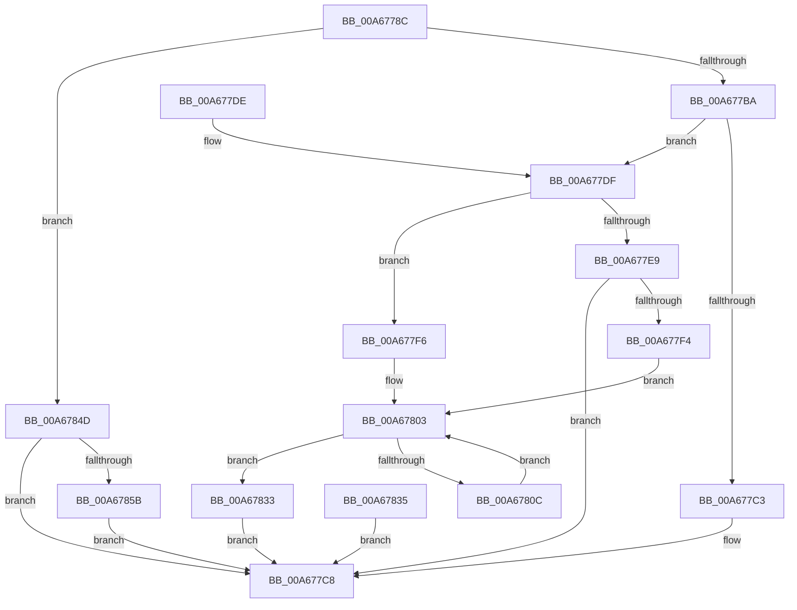

# EtwpUpdateStackTracing

- RVA: `0x00A6778C`–`0x00A6786C` (길이 `224` bytes)
- VA: `0x0000000140A6778C`
- 실행 섹션: `PAGE`
- PDB 이름 있음: `예`; PDB Function 태그: `아니요`
- unwind 정보 RVA: `0x000B3C9C`
- 디코드: `63`개 명령, `224/224` bytes 표시
- 미해석 바이트: `0` (있으면 어셈블리에 `.byte`로 보존)

> 이 문서는 커널 이미지의 기계어와 PDB 기호를 분석해 생성했습니다. 4번과 5번은 함수 원형과 자료형을 바이너리 사용 방식에서 추정한 C 해석이며 원본 소스 복구 결과는 아닙니다.

## 1. Dependencies

- 직접 호출 지점: **4**; 고유 호출 대상: **2**
- 직접 호출자로 확인된 함수: **2**
- RIP 상대 이미지 참조: **0**

### Outgoing calls
- `0x00A677E9` → [EtwpInitializeClassicStackTracing](EtwpInitializeClassicStackTracing_function_00A67874.md) (function, `0x00A67874`)
- `0x00A677FD` → [RtlClearAllBits](../../text/45/RtlClearAllBits_function_00450230.md) (function, `0x00450230`)
- `0x00A67843` → [RtlClearAllBits](../../text/45/RtlClearAllBits_function_00450230.md) (function, `0x00450230`)
- `0x00A67862` → [RtlClearAllBits](../../text/45/RtlClearAllBits_function_00450230.md) (function, `0x00450230`)

### Direct callers
- [EtwSetPerformanceTraceInformation](../A5/EtwSetPerformanceTraceInformation_function_00A53928.md) at `0x00A53C5B`
- [EtwpCheckForStackTracingExtension](EtwpCheckForStackTracingExtension_function_00A675F8.md) at `0x00A67639`

### Static image references
- 디코드된 RIP-relative 메모리 참조가 없습니다.

## 2. Other-region calls and transfers

- 다른 실행 섹션으로 향하는 call: **3**
  - `0x00A677FD` → [RtlClearAllBits](../../text/45/RtlClearAllBits_function_00450230.md) (`PAGE` → `.text`)
  - `0x00A67843` → [RtlClearAllBits](../../text/45/RtlClearAllBits_function_00450230.md) (`PAGE` → `.text`)
  - `0x00A67862` → [RtlClearAllBits](../../text/45/RtlClearAllBits_function_00450230.md) (`PAGE` → `.text`)
- 별도 외부 분기/꼬리 이동을 확인하지 못했습니다.

## 3. Assembly (complete function range)

```asm
00A6778C  48 89 5C 24 10                  mov qword ptr [rsp + 0x10], rbx
00A67791  48 89 74 24 18                  mov qword ptr [rsp + 0x18], rsi
00A67796  48 89 4C 24 08                  mov qword ptr [rsp + 8], rcx
00A6779B  57                              push rdi
00A6779C  41 56                           push r14
00A6779E  41 57                           push r15
00A677A0  48 83 EC 30                     sub rsp, 0x30
00A677A4  45 8B F0                        mov r14d, r8d
00A677A7  4C 8B FA                        mov r15, rdx
00A677AA  48 8B F9                        mov rdi, rcx
00A677AD  33 DB                           xor ebx, ebx
00A677AF  8B F3                           mov esi, ebx
00A677B1  45 85 C0                        test r8d, r8d
00A677B4  0F 84 93 00 00 00               je 0x140a6784d
00A677BA  41 81 F8 00 01 00 00            cmp r8d, 0x100
00A677C1  76 1C                           jbe 0x140a677df
00A677C3  BE 0D 00 00 C0                  mov esi, 0xc000000d
00A677C8  8B C6                           mov eax, esi
00A677CA  48 8B 5C 24 58                  mov rbx, qword ptr [rsp + 0x58]
00A677CF  48 8B 74 24 60                  mov rsi, qword ptr [rsp + 0x60]
00A677D4  48 83 C4 30                     add rsp, 0x30
00A677D8  41 5F                           pop r15
00A677DA  41 5E                           pop r14
00A677DC  5F                              pop rdi
00A677DD  C3                              ret
00A677DE  CC                              int3
00A677DF  8B 81 30 03 00 00               mov eax, dword ptr [rcx + 0x330]
00A677E5  84 C0                           test al, al
00A677E7  78 0D                           js 0x140a677f6
00A677E9  E8 86 00 00 00                  call 0x140a67874
00A677EE  8B F0                           mov esi, eax
00A677F0  85 C0                           test eax, eax
00A677F2  78 D4                           js 0x140a677c8
00A677F4  EB 0D                           jmp 0x140a67803
00A677F6  48 81 C1 10 04 00 00            add rcx, 0x410
00A677FD  E8 2E 8A 9E FF                  call 0x140450230
00A67802  90                              nop
00A67803  89 5C 24 20                     mov dword ptr [rsp + 0x20], ebx
00A67807  41 3B DE                        cmp ebx, r14d
00A6780A  73 27                           jae 0x140a67833
00A6780C  41 0F B7 14 9F                  movzx edx, word ptr [r15 + rbx*4]
00A67811  81 E2 FF 1F 00 00               and edx, 0x1fff
00A67817  8B CA                           mov ecx, edx
00A67819  48 C1 E9 03                     shr rcx, 3
00A6781D  48 03 8F 18 04 00 00            add rcx, qword ptr [rdi + 0x418]
00A67824  83 E2 07                        and edx, 7
00A67827  0F BE 01                        movsx eax, byte ptr [rcx]
00A6782A  0F AB D0                        bts eax, edx
00A6782D  88 01                           mov byte ptr [rcx], al
00A6782F  FF C3                           inc ebx
00A67831  EB D0                           jmp 0x140a67803
00A67833  EB 93                           jmp 0x140a677c8
00A67835  8B F0                           mov esi, eax
00A67837  48 8B 4C 24 50                  mov rcx, qword ptr [rsp + 0x50]
00A6783C  48 81 C1 10 04 00 00            add rcx, 0x410
00A67843  E8 E8 89 9E FF                  call 0x140450230
00A67848  E9 7B FF FF FF                  jmp 0x140a677c8
00A6784D  8B 81 30 03 00 00               mov eax, dword ptr [rcx + 0x330]
00A67853  84 C0                           test al, al
00A67855  0F 89 6D FF FF FF               jns 0x140a677c8
00A6785B  48 81 C1 10 04 00 00            add rcx, 0x410
00A67862  E8 C9 89 9E FF                  call 0x140450230
00A67867  E9 5C FF FF FF                  jmp 0x140a677c8
```

## 4. C-style interpretation (structured pseudocode)

```c
__int64 __fastcall EtwpUpdateStackTracing(__int64 a1, __int64 a2, int a3)
{
    __int64 result;
    __int64 v_rbx;
    __int64 v_rsp;
    unsigned __int64 v_stack_p10;
    unsigned __int64 v_stack_p18;
    unsigned int v_stack_p20;
    unsigned __int64 v_stack_p50;
    unsigned __int64 v_stack_p8;

    v_stack_p10 = v_rbx;
    v_stack_p18 = v_rsi;
    v_stack_p8 = a1;
    v_rsp = (v_rsp) - (48);
    v_rbx = 0;
    if (a3 == 0) goto loc_00A6784D;
    if (a3 <= 256) goto loc_00A677DF;
loc_00A677C8:
    v_rsp = (v_rsp) + (48);
    return (unsigned int)((unsigned int)((unsigned int)(0xC000000DULL)));
loc_00A677DF:
    if (sign_flag) goto loc_00A677F6;
    result = EtwpInitializeClassicStackTracing(a1, a2, a3, a4);
    if (sign_flag) goto loc_00A677C8;
    goto loc_00A67803;
loc_00A677F6:
    a1 = (a1) + (0x410ULL);
    result = RtlClearAllBits(a1, a2, a3, a4);
loc_00A67803:
    v_stack_p20 = (unsigned int)(v_stack_p10);
    if (((unsigned int)(v_stack_p10)) >= ((unsigned int)((unsigned int)(a3)))) goto loc_00A67833;
    a2 = (unsigned int)((*(unsigned __int16 *)(a2 + v_stack_p10 * 4)) & (0x1FFFULL));
    a1 = ((unsigned int)((unsigned int)(a2))) >> (3);
    a1 = (a1) + (*(unsigned __int64 *)(a1 + 1048));
    a2 = (unsigned int)((a2) & (7));
    *(unsigned __int8 *)(a1) = (unsigned __int8)((__int8)(*(unsigned __int8 *)(a1)));
    v_rbx = (unsigned int)((v_stack_p10) + 1);
    goto loc_00A67803;
loc_00A67833:
    goto loc_00A677C8;
loc_00A6784D:
    if (!sign_flag) goto loc_00A677C8;
    a1 = (a1) + (0x410ULL);
    result = RtlClearAllBits(a1, a2, a3, a4);
    goto loc_00A677C8;
}
```

## 5. (Beta) C Style

```c
int64_t EtwpUpdateStackTracing(void *Arg1, void *Arg2, int32_t Arg3)
{
    uint8_t *arg1 = (uint8_t *)Arg1;
    uint8_t *arg2 = (uint8_t *)Arg2;

    int64_t result;
    int64_t local_rbx;
    int64_t local_rsp;
    uint64_t v_stack_p10;
    uint64_t v_stack_p18;
    uint32_t v_stack_p20;
    uint64_t v_stack_p50;
    uint64_t v_stack_p8;

    v_stack_p10 = local_rbx;
    v_stack_p18 = local_rsi;
    v_stack_p8 = Arg1;
    local_rsp = (local_rsp) - (48);
    local_rbx = 0;
    if (Arg3 == 0) goto loc_00A6784D;
    if (Arg3 <= 256) goto loc_00A677DF;
loc_00A677C8:
    local_rsp = (local_rsp) + (48);
    return (uint32_t)((uint32_t)((uint32_t)(0xC000000DULL)));
loc_00A677DF:
    if (sign_flag) goto loc_00A677F6;
    result = EtwpInitializeClassicStackTracing(Arg1, Arg2, Arg3, a4);
    if (sign_flag) goto loc_00A677C8;
    goto loc_00A67803;
loc_00A677F6:
    Arg1 = (Arg1) + (0x410ULL);
    result = RtlClearAllBits(Arg1, Arg2, Arg3, a4);
loc_00A67803:
    v_stack_p20 = (uint32_t)(v_stack_p10);
    if (((uint32_t)(v_stack_p10)) >= ((uint32_t)((uint32_t)(Arg3)))) goto loc_00A67833;
    Arg2 = (uint32_t)((*(uint16_t *)(arg2 + v_stack_p10 * 4)) & (0x1FFFULL));
    Arg1 = ((uint32_t)((uint32_t)(Arg2))) >> (3);
    Arg1 = (Arg1) + (*(uint64_t *)(arg1 + 0x418));
    Arg2 = (uint32_t)((Arg2) & (7));
    *(uint8_t *)(arg1) = (uint8_t)((int8_t)(*(uint8_t *)(arg1)));
    local_rbx = (uint32_t)((v_stack_p10) + 1);
    goto loc_00A67803;
loc_00A67833:
    goto loc_00A677C8;
loc_00A6784D:
    if (!sign_flag) goto loc_00A677C8;
    Arg1 = (Arg1) + (0x410ULL);
    result = RtlClearAllBits(Arg1, Arg2, Arg3, a4);
    goto loc_00A677C8;
}
```

### 관측된 메모리 오프셋

구조체 형식이 확인되지 않은 접근은 인자 기준의 오프셋으로만 기록했습니다.

| 기준 인자 | 오프셋 표현 | 폭 (bit) | 접근 |
|---|---:|---:|---|
| `Arg1` | `+ 0x330` | `32` | `R` |
| `Arg1` | `+ 0x418` | `64` | `R` |
| `Arg2` | `+ 0x0 + rbx*4` | `16` | `R` |

## 6. Execution-region graph

[열기: 2D/3D 그래프와 함수 탐색 컨트롤 패널](../../../control-panel.html?section=page&rva=0x00A6778C&view=graph)

- 2D 그래프는 위에서 아래로 흐르고, 3D 그래프는 빈 공간을 드래그해 회전합니다. Shift+드래그는 이동, 휠은 확대·축소, 함수 노드 선택은 대상 보고서 이동입니다.

### Static fallback


