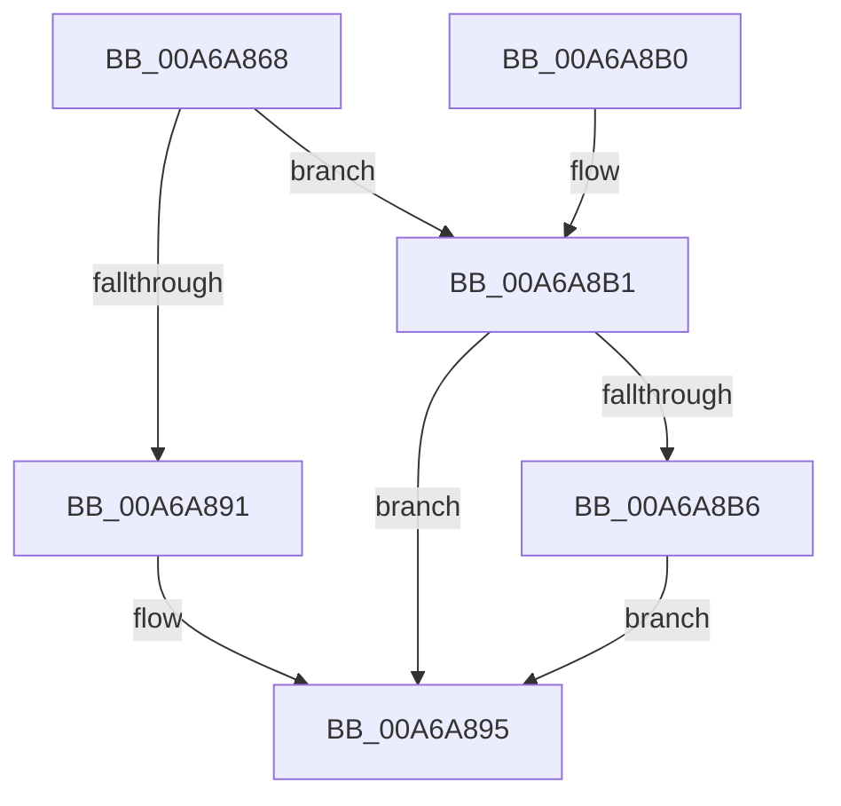

# ExEnableRaiseUMExceptionOnInvalidHandleClose

- RVA: `0x00A6A868`–`0x00A6A8BC` (길이 `84` bytes)
- VA: `0x0000000140A6A868`
- 실행 섹션: `PAGE`
- PDB 이름 있음: `예`; PDB Function 태그: `아니요`
- unwind 정보 RVA: `0x00070B38`
- 디코드: `25`개 명령, `84/84` bytes 표시
- 미해석 바이트: `0` (있으면 어셈블리에 `.byte`로 보존)

> 이 문서는 커널 이미지의 기계어와 PDB 기호를 분석해 생성했습니다. 4번과 5번은 함수 원형과 자료형을 바이너리 사용 방식에서 추정한 C 해석이며 원본 소스 복구 결과는 아닙니다.

## 1. Dependencies

- 직접 호출 지점: **2**; 고유 호출 대상: **2**
- 직접 호출자로 확인된 함수: **1**
- RIP 상대 이미지 참조: **0**

### Outgoing calls
- `0x00A6A888` → [ExpLockHandleTableExclusive](../../text/45/ExpLockHandleTableExclusive_function_00458B08.md) (function, `0x00458B08`)
- `0x00A6A89B` → [ExpUnlockHandleTableExclusive](../../text/46/ExpUnlockHandleTableExclusive_function_004608A8.md) (function, `0x004608A8`)

### Direct callers
- [NtSetInformationProcess](../AE/NtSetInformationProcess_function_00AE5370.md) at `0x00AE918C`

### Static image references
- 디코드된 RIP-relative 메모리 참조가 없습니다.

## 2. Other-region calls and transfers

- 다른 실행 섹션으로 향하는 call: **2**
  - `0x00A6A888` → [ExpLockHandleTableExclusive](../../text/45/ExpLockHandleTableExclusive_function_00458B08.md) (`PAGE` → `.text`)
  - `0x00A6A89B` → [ExpUnlockHandleTableExclusive](../../text/46/ExpUnlockHandleTableExclusive_function_004608A8.md) (`PAGE` → `.text`)
- 별도 외부 분기/꼬리 이동을 확인하지 못했습니다.

## 3. Assembly (complete function range)

```asm
00A6A868  48 89 5C 24 08                  mov qword ptr [rsp + 8], rbx
00A6A86D  48 89 74 24 10                  mov qword ptr [rsp + 0x10], rsi
00A6A872  57                              push rdi
00A6A873  48 83 EC 20                     sub rsp, 0x20
00A6A877  65 48 8B 34 25 88 01 00 00      mov rsi, qword ptr gs:[0x188]
00A6A880  8B FA                           mov edi, edx
00A6A882  48 8B D6                        mov rdx, rsi
00A6A885  48 8B D9                        mov rbx, rcx
00A6A888  E8 7B E2 9E FF                  call 0x140458b08
00A6A88D  85 FF                           test edi, edi
00A6A88F  75 20                           jne 0x140a6a8b1
00A6A891  80 63 2C EF                     and byte ptr [rbx + 0x2c], 0xef
00A6A895  48 8B D6                        mov rdx, rsi
00A6A898  48 8B CB                        mov rcx, rbx
00A6A89B  E8 08 60 9F FF                  call 0x1404608a8
00A6A8A0  48 8B 5C 24 30                  mov rbx, qword ptr [rsp + 0x30]
00A6A8A5  48 8B 74 24 38                  mov rsi, qword ptr [rsp + 0x38]
00A6A8AA  48 83 C4 20                     add rsp, 0x20
00A6A8AE  5F                              pop rdi
00A6A8AF  C3                              ret
00A6A8B0  CC                              int3
00A6A8B1  83 FF 01                        cmp edi, 1
00A6A8B4  75 DF                           jne 0x140a6a895
00A6A8B6  80 4B 2C 10                     or byte ptr [rbx + 0x2c], 0x10
00A6A8BA  EB D9                           jmp 0x140a6a895
```

## 4. C-style interpretation (structured pseudocode)

```c
__int64 __fastcall ExEnableRaiseUMExceptionOnInvalidHandleClose(__int64 a1, int a2)
{
    __int64 result;
    __int64 v_rsp;
    unsigned __int64 v_stack_p10;
    unsigned __int64 v_stack_p8;

    v_stack_p8 = v_rbx;
    v_stack_p10 = v_rsi;
    v_rsp = (v_rsp) - (32);
    result = ExpLockHandleTableExclusive(a1, *(unsigned __int64 *)(gs_base + (0 + 392)), a3, a4);
    if ((unsigned int)((unsigned int)(a2)) != 0) goto loc_00A6A8B1;
loc_00A6A895:
    result = ExpUnlockHandleTableExclusive(a1, *(unsigned __int64 *)(gs_base + (0 + 392)), a3, a4);
    v_rsp = (v_rsp) + (32);
    return result;
loc_00A6A8B1:
    if (((unsigned int)((unsigned int)(a2))) != 1) goto loc_00A6A895;
    goto loc_00A6A895;
}
```

## 5. (Beta) C Style

```c
int64_t ExEnableRaiseUMExceptionOnInvalidHandleClose(void *Arg1, int32_t Arg2)
{
    uint8_t *arg1 = (uint8_t *)Arg1;

    int64_t result;
    int64_t local_rsp;
    uint64_t v_stack_p10;
    uint64_t v_stack_p8;

    v_stack_p8 = local_rbx;
    v_stack_p10 = local_rsi;
    local_rsp = (local_rsp) - (32);
    result = ExpLockHandleTableExclusive(Arg1, *(uint64_t *)(gs_base + (0 + 0x188)), a3, a4);
    if ((uint32_t)((uint32_t)(Arg2)) != 0) goto loc_00A6A8B1;
loc_00A6A895:
    result = ExpUnlockHandleTableExclusive(Arg1, *(uint64_t *)(gs_base + (0 + 0x188)), a3, a4);
    local_rsp = (local_rsp) + (32);
    return result;
loc_00A6A8B1:
    if (((uint32_t)((uint32_t)(Arg2))) != 1) goto loc_00A6A895;
    goto loc_00A6A895;
}
```

### 관측된 메모리 오프셋

구조체 형식이 확인되지 않은 접근은 인자 기준의 오프셋으로만 기록했습니다.

| 기준 인자 | 오프셋 표현 | 폭 (bit) | 접근 |
|---|---:|---:|---|
| `Arg1` | `+ 0x2C` | `8` | `R/W` |

## 6. Execution-region graph

[열기: 2D/3D 그래프와 함수 탐색 컨트롤 패널](../../../control-panel.html?section=page&rva=0x00A6A868&view=graph)

- 2D 그래프는 위에서 아래로 흐르고, 3D 그래프는 빈 공간을 드래그해 회전합니다. Shift+드래그는 이동, 휠은 확대·축소, 함수 노드 선택은 대상 보고서 이동입니다.

### Static fallback


