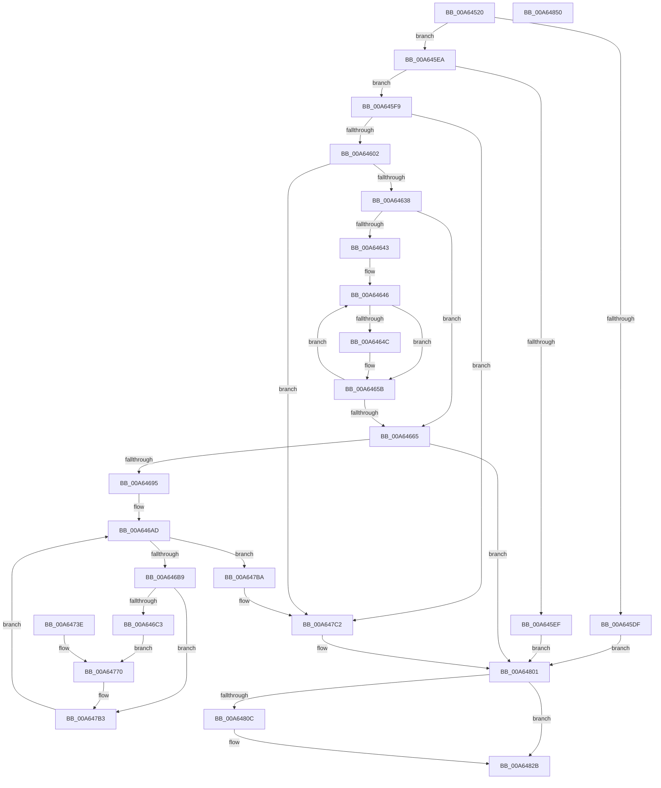

# ExRaiseHardError

- RVA: `0x00A64520`–`0x00A64851` (길이 `817` bytes)
- VA: `0x0000000140A64520`
- 실행 섹션: `PAGE`
- PDB 이름 있음: `예`; PDB Function 태그: `아니요`
- unwind 정보 RVA: `0x000B36E4`
- 디코드: `177`개 명령, `817/817` bytes 표시
- 미해석 바이트: `0` (있으면 어셈블리에 `.byte`로 보존)

> 이 문서는 커널 이미지의 기계어와 PDB 기호를 분석해 생성했습니다. 4번과 5번은 함수 원형과 자료형을 바이너리 사용 방식에서 추정한 C 해석이며 원본 소스 복구 결과는 아닙니다.

## 1. Dependencies

- 직접 호출 지점: **8**; 고유 호출 대상: **6**
- 직접 호출자로 확인된 함수: **9**
- RIP 상대 이미지 참조: **2**

### Outgoing calls
- `0x00A645D1` → [memset](../../text/6C/memset_function_006C6C40.md) (function, `0x006C6C40`)
- `0x00A64617` → [memcpy](../../text/6C/memcpy_function_006C6840.md) (function, `0x006C6840`)
- `0x00A6462A` → [memcpy](../../text/6C/memcpy_function_006C6840.md) (function, `0x006C6840`)
- `0x00A64686` → [ZwAllocateVirtualMemory](../../text/6A/ZwAllocateVirtualMemory_function_006AD3D0.md) (function, `0x006AD3D0`)
- `0x00A64737` → [memcpy](../../text/6C/memcpy_function_006C6840.md) (function, `0x006C6840`)
- `0x00A647F5` → [ExpRaiseHardError](ExpRaiseHardError_function_00A64AD4.md) (function, `0x00A64AD4`)
- `0x00A64826` → [ZwFreeVirtualMemory](../../text/6A/ZwFreeVirtualMemory_function_006AD490.md) (function, `0x006AD490`)
- `0x00A64838` → [_security_check_cookie](../../text/6A/_security_check_cookie_function_006AC640.md) (function, `0x006AC640`)

### Direct callers
- [IopHardErrorThread](../71/IopHardErrorThread_function_0071B690.md) at `0x0071B705`
- [ExpExpirationThread](../7C/ExpExpirationThread_function_007C5AF0.md) at `0x007C5B18`
- [CmpLoadHiveThread](../7D/CmpLoadHiveThread_function_007DB040.md) at `0x007DB985`
- [CmpMountPreloadedHives](../7D/CmpMountPreloadedHives_function_007DBE18.md) at `0x007DC54E`
- [CmpQuotaWarningWorker](../7E/CmpQuotaWarningWorker_function_007E2360.md) at `0x007E238F`
- [CmpDiskFullWarningWorker](../7E/CmpDiskFullWarningWorker_function_007E5A60.md) at `0x007E5A8F`
- [IopRaiseInformationalHardError](IopRaiseInformationalHardError_function_00A64190.md) at `0x00A6420A`
- [IopRaiseHardError](IopRaiseHardError_function_00A64260.md) at `0x00A643A8`
- [NtRaiseHardError](NtRaiseHardError_function_00A64860.md) at `0x00A64ABE`

### Static image references
- `0x00A64533` → RVA `0x00E0A740` (`.data`; read)
- `0x00A645D6` → RVA `0x00E685D1` (`.data`; read)

## 2. Other-region calls and transfers

- 다른 실행 섹션으로 향하는 call: **7**
  - `0x00A645D1` → [memset](../../text/6C/memset_function_006C6C40.md) (`PAGE` → `.text`)
  - `0x00A64617` → [memcpy](../../text/6C/memcpy_function_006C6840.md) (`PAGE` → `.text`)
  - `0x00A6462A` → [memcpy](../../text/6C/memcpy_function_006C6840.md) (`PAGE` → `.text`)
  - `0x00A64686` → [ZwAllocateVirtualMemory](../../text/6A/ZwAllocateVirtualMemory_function_006AD3D0.md) (`PAGE` → `.text`)
  - `0x00A64737` → [memcpy](../../text/6C/memcpy_function_006C6840.md) (`PAGE` → `.text`)
  - `0x00A64826` → [ZwFreeVirtualMemory](../../text/6A/ZwFreeVirtualMemory_function_006AD490.md) (`PAGE` → `.text`)
  - `0x00A64838` → [_security_check_cookie](../../text/6A/_security_check_cookie_function_006AC640.md) (`PAGE` → `.text`)
- 별도 외부 분기/꼬리 이동을 확인하지 못했습니다.

## 3. Assembly (complete function range)

```asm
00A64520  40 53                           push rbx
00A64522  56                              push rsi
00A64523  57                              push rdi
00A64524  41 54                           push r12
00A64526  41 55                           push r13
00A64528  41 56                           push r14
00A6452A  41 57                           push r15
00A6452C  48 81 EC 70 01 00 00            sub rsp, 0x170
00A64533  48 8B 05 06 62 3A 00            mov rax, qword ptr [rip + 0x3a6206]
00A6453A  48 33 C4                        xor rax, rsp
00A6453D  48 89 84 24 60 01 00 00         mov qword ptr [rsp + 0x160], rax
00A64545  4D 8B E1                        mov r12, r9
00A64548  45 8B E8                        mov r13d, r8d
00A6454B  8B F2                           mov esi, edx
00A6454D  89 4C 24 44                     mov dword ptr [rsp + 0x44], ecx
00A64551  89 4C 24 60                     mov dword ptr [rsp + 0x60], ecx
00A64555  89 74 24 68                     mov dword ptr [rsp + 0x68], esi
00A64559  44 89 44 24 70                  mov dword ptr [rsp + 0x70], r8d
00A6455E  4C 89 8C 24 90 00 00 00         mov qword ptr [rsp + 0x90], r9
00A64566  4C 8B BC 24 D8 01 00 00         mov r15, qword ptr [rsp + 0x1d8]
00A6456E  4C 89 BC 24 80 00 00 00         mov qword ptr [rsp + 0x80], r15
00A64576  48 83 64 24 50 00               and qword ptr [rsp + 0x50], 0
00A6457C  45 33 F6                        xor r14d, r14d
00A6457F  44 89 74 24 48                  mov dword ptr [rsp + 0x48], r14d
00A64584  4C 21 74 24 58                  and qword ptr [rsp + 0x58], r14
00A64589  0F 57 C0                        xorps xmm0, xmm0
00A6458C  33 C0                           xor eax, eax
00A6458E  0F 11 84 24 E0 00 00 00         movups xmmword ptr [rsp + 0xe0], xmm0
00A64596  0F 11 84 24 F0 00 00 00         movups xmmword ptr [rsp + 0xf0], xmm0
00A6459E  48 89 84 24 00 01 00 00         mov qword ptr [rsp + 0x100], rax
00A645A6  0F 57 C9                        xorps xmm1, xmm1
00A645A9  0F 11 8C 24 B8 00 00 00         movups xmmword ptr [rsp + 0xb8], xmm1
00A645B1  0F 11 8C 24 C8 00 00 00         movups xmmword ptr [rsp + 0xc8], xmm1
00A645B9  48 89 84 24 D8 00 00 00         mov qword ptr [rsp + 0xd8], rax
00A645C1  8D 78 50                        lea edi, [rax + 0x50]
00A645C4  44 8B C7                        mov r8d, edi
00A645C7  33 D2                           xor edx, edx
00A645C9  48 8D 8C 24 10 01 00 00         lea rcx, [rsp + 0x110]
00A645D1  E8 6A 26 C6 FF                  call 0x1406c6c40
00A645D6  44 38 35 F4 3F 40 00            cmp byte ptr [rip + 0x403ff4], r14b
00A645DD  74 0B                           je 0x140a645ea
00A645DF  33 DB                           xor ebx, ebx
00A645E1  44 8D 77 B1                     lea r14d, [rdi - 0x4f]
00A645E5  E9 17 02 00 00                  jmp 0x140a64801
00A645EA  83 FE 05                        cmp esi, 5
00A645ED  76 0A                           jbe 0x140a645f9
00A645EF  BB F0 00 00 C0                  mov ebx, 0xc00000f0
00A645F4  E9 08 02 00 00                  jmp 0x140a64801
00A645F9  4D 85 E4                        test r12, r12
00A645FC  0F 84 C0 01 00 00               je 0x140a647c2
00A64602  48 8B DE                        mov rbx, rsi
00A64605  48 C1 E3 03                     shl rbx, 3
00A64609  4C 8B C3                        mov r8, rbx
00A6460C  49 8B D4                        mov rdx, r12
00A6460F  48 8D 8C 24 E0 00 00 00         lea rcx, [rsp + 0xe0]
00A64617  E8 24 22 C6 FF                  call 0x1406c6840
00A6461C  4C 8B C3                        mov r8, rbx
00A6461F  49 8B D4                        mov rdx, r12
00A64622  48 8D 8C 24 B8 00 00 00         lea rcx, [rsp + 0xb8]
00A6462A  E8 11 22 C6 FF                  call 0x1406c6840
00A6462F  45 85 ED                        test r13d, r13d
00A64632  0F 84 8A 01 00 00               je 0x140a647c2
00A64638  48 89 7C 24 50                  mov qword ptr [rsp + 0x50], rdi
00A6463D  33 D2                           xor edx, edx
00A6463F  85 F6                           test esi, esi
00A64641  74 22                           je 0x140a64665
00A64643  4D 8B C4                        mov r8, r12
00A64646  41 0F A3 D5                     bt r13d, edx
00A6464A  73 0F                           jae 0x140a6465b
00A6464C  49 8B 00                        mov rax, qword ptr [r8]
00A6464F  0F B7 48 02                     movzx ecx, word ptr [rax + 2]
00A64653  48 03 F9                        add rdi, rcx
00A64656  48 89 7C 24 50                  mov qword ptr [rsp + 0x50], rdi
00A6465B  FF C2                           inc edx
00A6465D  49 83 C0 08                     add r8, 8
00A64661  3B D6                           cmp edx, esi
00A64663  72 E1                           jb 0x140a64646
00A64665  C7 44 24 28 04 00 00 00         mov dword ptr [rsp + 0x28], 4
00A6466D  C7 44 24 20 00 10 00 00         mov dword ptr [rsp + 0x20], 0x1000
00A64675  4C 8D 4C 24 50                  lea r9, [rsp + 0x50]
00A6467A  45 33 C0                        xor r8d, r8d
00A6467D  48 8D 54 24 58                  lea rdx, [rsp + 0x58]
00A64682  48 83 C9 FF                     or rcx, 0xffffffffffffffff
00A64686  E8 45 8D C4 FF                  call 0x1406ad3d0
00A6468B  8B D8                           mov ebx, eax
00A6468D  85 C0                           test eax, eax
00A6468F  0F 88 6C 01 00 00               js 0x140a64801
00A64695  4C 8B 7C 24 58                  mov r15, qword ptr [rsp + 0x58]
00A6469A  4C 89 BC 24 88 00 00 00         mov qword ptr [rsp + 0x88], r15
00A646A2  4D 8D 77 50                     lea r14, [r15 + 0x50]
00A646A6  4C 89 74 24 78                  mov qword ptr [rsp + 0x78], r14
00A646AB  33 DB                           xor ebx, ebx
00A646AD  89 5C 24 40                     mov dword ptr [rsp + 0x40], ebx
00A646B1  3B DE                           cmp ebx, esi
00A646B3  0F 83 01 01 00 00               jae 0x140a647ba
00A646B9  41 0F A3 DD                     bt r13d, ebx
00A646BD  0F 83 F0 00 00 00               jae 0x140a647b3
00A646C3  8B FB                           mov edi, ebx
00A646C5  48 8D 04 DD 00 00 00 00         lea rax, [rbx*8]
00A646CD  48 89 84 24 A8 00 00 00         mov qword ptr [rsp + 0xa8], rax
00A646D5  48 C1 E7 04                     shl rdi, 4
00A646D9  48 89 BC 24 98 00 00 00         mov qword ptr [rsp + 0x98], rdi
00A646E1  48 89 BC 24 A0 00 00 00         mov qword ptr [rsp + 0xa0], rdi
00A646E9  48 8D 8C 24 10 01 00 00         lea rcx, [rsp + 0x110]
00A646F1  48 8D 0C 39                     lea rcx, [rcx + rdi]
00A646F5  48 89 8C 24 B0 00 00 00         mov qword ptr [rsp + 0xb0], rcx
00A646FD  4A 8B 04 20                     mov rax, qword ptr [rax + r12]
00A64701  0F 10 00                        movups xmm0, xmmword ptr [rax]
00A64704  F3 0F 7F 01                     movdqu xmmword ptr [rcx], xmm0
00A64708  4E 89 74 3F 08                  mov qword ptr [rdi + r15 + 8], r14
00A6470D  0F B7 84 3C 12 01 00 00         movzx eax, word ptr [rsp + rdi + 0x112]
00A64715  66 42 89 44 3F 02               mov word ptr [rdi + r15 + 2], ax
00A6471B  0F B7 01                        movzx eax, word ptr [rcx]
00A6471E  66 42 89 04 3F                  mov word ptr [rdi + r15], ax
00A64723  44 0F B7 84 3C 12 01 00 00      movzx r8d, word ptr [rsp + rdi + 0x112]
00A6472C  48 8B 94 3C 18 01 00 00         mov rdx, qword ptr [rsp + rdi + 0x118]
00A64734  49 8B CE                        mov rcx, r14
00A64737  E8 04 21 C6 FF                  call 0x1406c6840
00A6473C  EB 32                           jmp 0x140a64770
00A6473E  8B 5C 24 40                     mov ebx, dword ptr [rsp + 0x40]
00A64742  4C 8B BC 24 88 00 00 00         mov r15, qword ptr [rsp + 0x88]
00A6474A  4C 8B 74 24 78                  mov r14, qword ptr [rsp + 0x78]
00A6474F  8B 44 24 60                     mov eax, dword ptr [rsp + 0x60]
00A64753  89 44 24 44                     mov dword ptr [rsp + 0x44], eax
00A64757  8B 74 24 68                     mov esi, dword ptr [rsp + 0x68]
00A6475B  44 8B 6C 24 70                  mov r13d, dword ptr [rsp + 0x70]
00A64760  4C 8B A4 24 90 00 00 00         mov r12, qword ptr [rsp + 0x90]
00A64768  48 8B BC 24 98 00 00 00         mov rdi, qword ptr [rsp + 0x98]
00A64770  4C 89 B4 3C 18 01 00 00         mov qword ptr [rsp + rdi + 0x118], r14
00A64778  0F B7 84 3C 12 01 00 00         movzx eax, word ptr [rsp + rdi + 0x112]
00A64780  4C 03 F0                        add r14, rax
00A64783  4C 89 74 24 78                  mov qword ptr [rsp + 0x78], r14
00A64788  48 8B 84 24 A0 00 00 00         mov rax, qword ptr [rsp + 0xa0]
00A64790  49 03 C7                        add rax, r15
00A64793  48 8B 8C 24 A8 00 00 00         mov rcx, qword ptr [rsp + 0xa8]
00A6479B  48 89 84 0C E0 00 00 00         mov qword ptr [rsp + rcx + 0xe0], rax
00A647A3  48 8B 84 24 B0 00 00 00         mov rax, qword ptr [rsp + 0xb0]
00A647AB  48 89 84 0C B8 00 00 00         mov qword ptr [rsp + rcx + 0xb8], rax
00A647B3  FF C3                           inc ebx
00A647B5  E9 F3 FE FF FF                  jmp 0x140a646ad
00A647BA  4C 8B BC 24 80 00 00 00         mov r15, qword ptr [rsp + 0x80]
00A647C2  48 8D 44 24 48                  lea rax, [rsp + 0x48]
00A647C7  48 89 44 24 30                  mov qword ptr [rsp + 0x30], rax
00A647CC  8B 84 24 D0 01 00 00            mov eax, dword ptr [rsp + 0x1d0]
00A647D3  89 44 24 28                     mov dword ptr [rsp + 0x28], eax
00A647D7  48 8D 84 24 B8 00 00 00         lea rax, [rsp + 0xb8]
00A647DF  48 89 44 24 20                  mov qword ptr [rsp + 0x20], rax
00A647E4  4C 8D 8C 24 E0 00 00 00         lea r9, [rsp + 0xe0]
00A647EC  45 8B C5                        mov r8d, r13d
00A647EF  8B D6                           mov edx, esi
00A647F1  8B 4C 24 44                     mov ecx, dword ptr [rsp + 0x44]
00A647F5  E8 DA 02 00 00                  call 0x140a64ad4
00A647FA  8B D8                           mov ebx, eax
00A647FC  44 8B 74 24 48                  mov r14d, dword ptr [rsp + 0x48]
00A64801  45 89 37                        mov dword ptr [r15], r14d
00A64804  48 83 7C 24 58 00               cmp qword ptr [rsp + 0x58], 0
00A6480A  74 1F                           je 0x140a6482b
00A6480C  48 83 64 24 50 00               and qword ptr [rsp + 0x50], 0
00A64812  41 B9 00 80 00 00               mov r9d, 0x8000
00A64818  4C 8D 44 24 50                  lea r8, [rsp + 0x50]
00A6481D  48 8D 54 24 58                  lea rdx, [rsp + 0x58]
00A64822  48 83 C9 FF                     or rcx, 0xffffffffffffffff
00A64826  E8 65 8C C4 FF                  call 0x1406ad490
00A6482B  8B C3                           mov eax, ebx
00A6482D  48 8B 8C 24 60 01 00 00         mov rcx, qword ptr [rsp + 0x160]
00A64835  48 33 CC                        xor rcx, rsp
00A64838  E8 03 7E C4 FF                  call 0x1406ac640
00A6483D  48 81 C4 70 01 00 00            add rsp, 0x170
00A64844  41 5F                           pop r15
00A64846  41 5E                           pop r14
00A64848  41 5D                           pop r13
00A6484A  41 5C                           pop r12
00A6484C  5F                              pop rdi
00A6484D  5E                              pop rsi
00A6484E  5B                              pop rbx
00A6484F  C3                              ret
00A64850  CC                              int3
```

## 4. C-style interpretation (structured pseudocode)

```c
__int64 __fastcall ExRaiseHardError(int a1, int a2, int a3, __int64 a4, unsigned int a5, __int64 a6)
{
    __int64 result;
    __int64 v_r14;
    __int64 v_rbx;
    __int64 v_rdi;
    __int64 v_rsp;
    unsigned __int64 v_stack_m100;
    unsigned __int64 v_stack_m108;
    unsigned __int64 v_stack_m110;
    unsigned __int64 v_stack_m118;
    unsigned __int64 v_stack_m120;
    unsigned __int64 v_stack_m128;
    unsigned __int64 v_stack_m130;
    unsigned int v_stack_m138;
    unsigned int v_stack_m140;
    unsigned int v_stack_m148;
    unsigned __int64 v_stack_m150;
    unsigned __int64 v_stack_m158;
    unsigned int v_stack_m160;
    unsigned int v_stack_m164;
    unsigned int v_stack_m168;
    unsigned __int64 v_stack_m178;
    unsigned int v_stack_m180;
    unsigned int v_stack_m188;
    unsigned __int64 v_stack_m48;
    unsigned __int64 v_stack_m98;
    unsigned __int64 v_stack_mA8;
    unsigned __int64 v_stack_mB8;
    unsigned __int64 v_stack_mC8;
    unsigned __int64 v_stack_mD0;
    unsigned __int64 v_stack_mE0;
    unsigned __int64 v_stack_mF0;
    unsigned __int64 v_stack_mF8;

    v_rsp = (v_rsp) - (368);
    result = (*(unsigned __int64 *)(v_rip + 3826182)) ^ (v_rsp);
    v_stack_m48 = result;
    v_stack_m164 = a1;
    v_stack_m148 = a1;
    v_stack_m140 = (unsigned int)((unsigned int)(a2));
    v_stack_m138 = a3;
    v_stack_m118 = a4;
    v_stack_m128 = a6;
    v_r14 = 0;
    v_stack_m160 = 0;
    result = 0;
    v_stack_mC8 = v_xmm0;
    v_stack_mB8 = v_xmm0;
    v_stack_mA8 = 0;
    v_stack_mF0 = v_xmm1;
    v_stack_mE0 = v_xmm1;
    v_stack_mD0 = 0;
    a2 = 0;
    result = memset(v_stack_m98, a2, (unsigned int)((unsigned int)(result + 80)), a4);
    if ((*(unsigned __int8 *)(v_rip + 4210676)) == 0) goto loc_00A645EA;
    v_rbx = 0;
    goto loc_00A64801;
loc_00A645EA:
    if (((unsigned int)((unsigned int)(a2))) <= 5) goto loc_00A645F9;
    goto loc_00A64801;
loc_00A645F9:
    if (a4 == 0) goto loc_00A647C2;
    v_rbx = ((unsigned int)(a2)) << (3);
    result = memcpy(v_stack_mC8, a4, v_rbx, a4);
    result = memcpy(v_stack_mF0, a4, v_rbx, a4);
    if ((unsigned int)((unsigned int)(a3)) == 0) goto loc_00A647C2;
    v_stack_m158 = result + 80;
    a2 = 0;
    if ((unsigned int)((unsigned int)(a2)) == 0) goto loc_00A64665;
loc_00A64646:
    v_rdi = result + 80;
    if (!(condition_is_above_or_equal)) {
        result = *(unsigned __int64 *)(a4);
        a1 = *(unsigned __int16 *)(result + 2);
        v_rdi = (result + 80) + (a1);
        v_stack_m158 = v_rdi;
    }
    a2 = (unsigned int)((a2) + 1);
    a3 = (a4) + (8);
    if (a2 < ((unsigned int)((unsigned int)(a2)))) goto loc_00A64646;
loc_00A64665:
    v_stack_m180 = 4;
    v_stack_m188 = 0x1000ULL;
    a3 = 0;
    a1 = (a1) | (-1);
    result = ZwAllocateVirtualMemory(a1, v_stack_m150, a3, v_stack_m158);
    if (sign_flag) goto loc_00A64801;
    v_stack_m120 = v_stack_m150;
    v_stack_m130 = v_stack_m150 + 80;
    v_rbx = 0;
loc_00A646AD:
    v_stack_m168 = 0;
    if (0 >= ((unsigned int)((unsigned int)(a2)))) goto loc_00A647BA;
    if (0 >= ((unsigned int)((unsigned int)(a2)))) goto loc_00A647B3;
    v_stack_m100 = v_rbx * 8;
    v_rdi = (0) << (4);
    v_stack_m110 = v_rdi;
    v_stack_m108 = v_rdi;
    v_stack_mF8 = v_stack_m98 + v_rdi * 1;
    *(unsigned __int64 *)(v_stack_m98 + v_rdi * 1) = v_xmm0;
    *(unsigned __int64 *)(v_rdi + v_stack_m150 * 1 + 8) = v_stack_m150 + 80;
    *(unsigned __int16 *)(v_rdi + v_stack_m150 * 1 + 2) = (unsigned __int16)(*(unsigned __int16 *)(v_rsp + v_rdi * 1 + 274));
    *(unsigned __int16 *)(v_rdi + v_stack_m150 * 1) = (unsigned __int16)(*(unsigned __int16 *)(v_stack_m98 + v_rdi * 1));
    result = memcpy(v_stack_m150 + 80, *(unsigned __int64 *)(v_rsp + v_rdi * 1 + 280), *(unsigned __int16 *)(v_rsp + v_rdi * 1 + 274), v_stack_m158);
    goto loc_00A64770;
loc_00A64770:
    *(unsigned __int64 *)(v_rsp + v_rdi * 1 + 280) = v_stack_m150 + 80;
    v_r14 = (v_stack_m150 + 80) + (*(unsigned __int16 *)(v_rsp + v_rdi * 1 + 274));
    v_stack_m130 = v_r14;
    result = (v_stack_m108) + (v_stack_m150);
    *(unsigned __int64 *)(v_rsp + v_stack_m100 * 1 + 224) = result;
    *(unsigned __int64 *)(v_rsp + v_stack_m100 * 1 + 184) = v_stack_mF8;
loc_00A647B3:
    v_rbx = (unsigned int)((v_rbx) + 1);
    goto loc_00A646AD;
loc_00A647BA:
loc_00A647C2:
    v_stack_m178 = v_stack_m160;
    v_stack_m180 = (unsigned int)((unsigned int)(a5));
    v_stack_m188 = v_stack_mF0;
    result = ExpRaiseHardError((unsigned int)(v_stack_m164), (unsigned int)((unsigned int)((unsigned int)(a2))), (unsigned int)((unsigned int)((unsigned int)(a3))), v_stack_mC8);
loc_00A64801:
    *(unsigned int *)(v_stack_m128) = (unsigned int)((unsigned int)(v_stack_m160));
    if (v_stack_m150 != 0) {
        a4 = 0x8000ULL;
        a3 = v_stack_m158;
        a2 = v_stack_m150;
        a1 = ((unsigned int)(v_stack_m164)) | (-1);
        result = ZwFreeVirtualMemory(a1, a2, a3, a4);
    }
    a1 = (v_stack_m48) ^ (v_rsp);
    result = _security_check_cookie(a1, a2, a3, a4);
    v_rsp = (v_rsp) + (368);
    return result;
}
```

## 5. (Beta) C Style

```c
int64_t ExRaiseHardError(int32_t Arg1, int32_t Arg2, int32_t Arg3, int64_t Arg4, uint32_t Arg5, int64_t Arg6)
{
    int64_t result;
    int64_t local_r14;
    int64_t local_rbx;
    int64_t local_rdi;
    int64_t local_rsp;
    uint64_t v_stack_m100;
    uint64_t v_stack_m108;
    uint64_t v_stack_m110;
    uint64_t v_stack_m118;
    uint64_t v_stack_m120;
    uint64_t v_stack_m128;
    uint64_t v_stack_m130;
    uint32_t v_stack_m138;
    uint32_t v_stack_m140;
    uint32_t v_stack_m148;
    uint64_t v_stack_m150;
    uint64_t v_stack_m158;
    uint32_t v_stack_m160;
    uint32_t v_stack_m164;
    uint32_t v_stack_m168;
    uint64_t v_stack_m178;
    uint32_t v_stack_m180;
    uint32_t v_stack_m188;
    uint64_t v_stack_m48;
    uint64_t v_stack_m98;
    uint64_t v_stack_mA8;
    uint64_t v_stack_mB8;
    uint64_t v_stack_mC8;
    uint64_t v_stack_mD0;
    uint64_t v_stack_mE0;
    uint64_t v_stack_mF0;
    uint64_t v_stack_mF8;

    local_rsp = (local_rsp) - (368);
    result = (*(uint64_t *)(v_rip + 0x3A6206)) ^ (local_rsp);
    v_stack_m48 = result;
    v_stack_m164 = Arg1;
    v_stack_m148 = Arg1;
    v_stack_m140 = (uint32_t)((uint32_t)(Arg2));
    v_stack_m138 = Arg3;
    v_stack_m118 = Arg4;
    v_stack_m128 = Arg6;
    local_r14 = 0;
    v_stack_m160 = 0;
    result = 0;
    v_stack_mC8 = v_xmm0;
    v_stack_mB8 = v_xmm0;
    v_stack_mA8 = 0;
    v_stack_mF0 = v_xmm1;
    v_stack_mE0 = v_xmm1;
    v_stack_mD0 = 0;
    Arg2 = 0;
    result = memset(v_stack_m98, Arg2, (uint32_t)((uint32_t)(result + 80)), Arg4);
    if ((*(uint8_t *)(v_rip + 0x403FF4)) == 0) goto loc_00A645EA;
    local_rbx = 0;
    goto loc_00A64801;
loc_00A645EA:
    if (((uint32_t)((uint32_t)(Arg2))) <= 5) goto loc_00A645F9;
    goto loc_00A64801;
loc_00A645F9:
    if (Arg4 == 0) goto loc_00A647C2;
    local_rbx = ((uint32_t)(Arg2)) << (3);
    result = memcpy(v_stack_mC8, Arg4, local_rbx, Arg4);
    result = memcpy(v_stack_mF0, Arg4, local_rbx, Arg4);
    if ((uint32_t)((uint32_t)(Arg3)) == 0) goto loc_00A647C2;
    v_stack_m158 = result + 80;
    Arg2 = 0;
    if ((uint32_t)((uint32_t)(Arg2)) == 0) goto loc_00A64665;
loc_00A64646:
    local_rdi = result + 80;
    if (!(condition_is_above_or_equal)) {
        result = *(uint64_t *)(Arg4);
        Arg1 = *(uint16_t *)(result + 0x2);
        local_rdi = (result + 80) + (Arg1);
        v_stack_m158 = local_rdi;
    }
    Arg2 = (uint32_t)((Arg2) + 1);
    Arg3 = (Arg4) + (8);
    if (Arg2 < ((uint32_t)((uint32_t)(Arg2)))) goto loc_00A64646;
loc_00A64665:
    v_stack_m180 = 4;
    v_stack_m188 = 0x1000ULL;
    Arg3 = 0;
    Arg1 = (Arg1) | (-1);
    result = ZwAllocateVirtualMemory(Arg1, v_stack_m150, Arg3, v_stack_m158);
    if (sign_flag) goto loc_00A64801;
    v_stack_m120 = v_stack_m150;
    v_stack_m130 = v_stack_m150 + 80;
    local_rbx = 0;
loc_00A646AD:
    v_stack_m168 = 0;
    if (0 >= ((uint32_t)((uint32_t)(Arg2)))) goto loc_00A647BA;
    if (0 >= ((uint32_t)((uint32_t)(Arg2)))) goto loc_00A647B3;
    v_stack_m100 = local_rbx * 8;
    local_rdi = (0) << (4);
    v_stack_m110 = local_rdi;
    v_stack_m108 = local_rdi;
    v_stack_mF8 = v_stack_m98 + local_rdi * 1;
    *(uint64_t *)(v_stack_m98 + local_rdi * 1) = v_xmm0;
    *(uint64_t *)(local_rdi + v_stack_m150 * 1 + 0x8) = v_stack_m150 + 80;
    *(uint16_t *)(local_rdi + v_stack_m150 * 1 + 0x2) = (uint16_t)(*(uint16_t *)(local_rsp + local_rdi * 1 + 0x112));
    *(uint16_t *)(local_rdi + v_stack_m150 * 1) = (uint16_t)(*(uint16_t *)(v_stack_m98 + local_rdi * 1));
    result = memcpy(v_stack_m150 + 80, *(uint64_t *)(local_rsp + local_rdi * 1 + 0x118), *(uint16_t *)(local_rsp + local_rdi * 1 + 0x112), v_stack_m158);
    goto loc_00A64770;
loc_00A64770:
    *(uint64_t *)(local_rsp + local_rdi * 1 + 0x118) = v_stack_m150 + 80;
    local_r14 = (v_stack_m150 + 80) + (*(uint16_t *)(local_rsp + local_rdi * 1 + 0x112));
    v_stack_m130 = local_r14;
    result = (v_stack_m108) + (v_stack_m150);
    *(uint64_t *)(local_rsp + v_stack_m100 * 1 + 0xE0) = result;
    *(uint64_t *)(local_rsp + v_stack_m100 * 1 + 0xB8) = v_stack_mF8;
loc_00A647B3:
    local_rbx = (uint32_t)((local_rbx) + 1);
    goto loc_00A646AD;
loc_00A647BA:
loc_00A647C2:
    v_stack_m178 = v_stack_m160;
    v_stack_m180 = (uint32_t)((uint32_t)(Arg5));
    v_stack_m188 = v_stack_mF0;
    result = ExpRaiseHardError((uint32_t)(v_stack_m164), (uint32_t)((uint32_t)((uint32_t)(Arg2))), (uint32_t)((uint32_t)((uint32_t)(Arg3))), v_stack_mC8);
loc_00A64801:
    *(uint32_t *)(v_stack_m128) = (uint32_t)((uint32_t)(v_stack_m160));
    if (v_stack_m150 != 0) {
        Arg4 = 0x8000ULL;
        Arg3 = v_stack_m158;
        Arg2 = v_stack_m150;
        Arg1 = ((uint32_t)(v_stack_m164)) | (-1);
        result = ZwFreeVirtualMemory(Arg1, Arg2, Arg3, Arg4);
    }
    Arg1 = (v_stack_m48) ^ (local_rsp);
    result = _security_check_cookie(Arg1, Arg2, Arg3, Arg4);
    local_rsp = (local_rsp) + (368);
    return result;
}
```

## 6. Execution-region graph

[열기: 2D/3D 그래프와 함수 탐색 컨트롤 패널](../../../control-panel.html?section=page&rva=0x00A64520&view=graph)

- 2D 그래프는 위에서 아래로 흐르고, 3D 그래프는 빈 공간을 드래그해 회전합니다. Shift+드래그는 이동, 휠은 확대·축소, 함수 노드 선택은 대상 보고서 이동입니다.

### Static fallback


