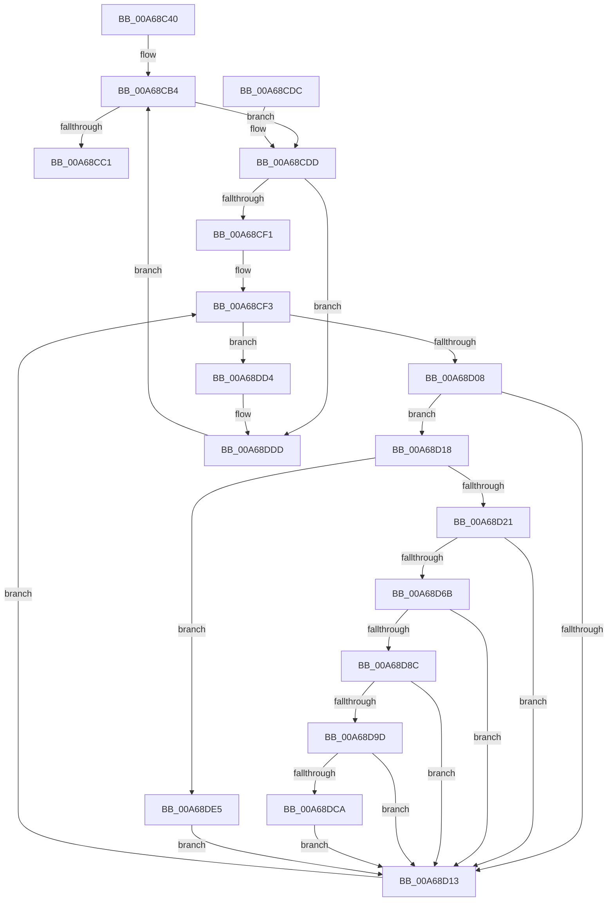

# ExSwapinWorkerThreads

- RVA: `0x00A68C40`–`0x00A68DF2` (길이 `434` bytes)
- VA: `0x0000000140A68C40`
- 실행 섹션: `PAGE`
- PDB 이름 있음: `예`; PDB Function 태그: `아니요`
- unwind 정보 RVA: `0x000B3FFC`
- 디코드: `112`개 명령, `434/434` bytes 표시
- 미해석 바이트: `0` (있으면 어셈블리에 `.byte`로 보존)

> 이 문서는 커널 이미지의 기계어와 PDB 기호를 분석해 생성했습니다. 4번과 5번은 함수 원형과 자료형을 바이너리 사용 방식에서 추정한 C 해석이며 원본 소스 복구 결과는 아닙니다.

## 1. Dependencies

- 직접 호출 지점: **16**; 고유 호출 대상: **15**
- 직접 호출자로 확인된 함수: **3**
- RIP 상대 이미지 참조: **3**

### Outgoing calls
- `0x00A68C61` → [memset](../../text/6C/memset_function_006C6C40.md) (function, `0x006C6C40`)
- `0x00A68C93` → [KeInitializeEvent](../../text/40/KeInitializeEvent_function_0040DD10.md) (function, `0x0040DD10`)
- `0x00A68C9F` → [ExAcquireFastMutex](../../text/20/ExAcquireFastMutex_function_0020E5A0.md) (function, `0x0020E5A0`)
- `0x00A68CB4` → [PsGetNextPartitionUnsafe](../../text/2F/PsGetNextPartitionUnsafe_function_002F0E38.md) (function, `0x002F0E38`)
- `0x00A68CC8` → [ExReleaseFastMutex](../../text/25/ExReleaseFastMutex_function_002519C0.md) (function, `0x002519C0`)
- `0x00A68CE4` → [PsReferencePartitionSystemProcess](PsReferencePartitionSystemProcess_function_00A68E00.md) (function, `0x00A68E00`)
- `0x00A68CF7` → [PsGetNextProcessThread](../8C/PsGetNextProcessThread_function_008C9CF0.md) (function, `0x008C9CF0`)
- `0x00A68D4C` → [KeInitializeApc](../../text/42/KeInitializeApc_function_00428510.md) (function, `0x00428510`)
- `0x00A68D62` → [KeInsertQueueApc](../../text/20/KeInsertQueueApc_function_00203F10.md) (function, `0x00203F10`)
- `0x00A68D80` → [KeWaitForSingleObject](../../text/20/KeWaitForSingleObject_function_0020E6B0.md) (function, `0x0020E6B0`)
- `0x00A68D90` → [KeRemoveQueueApc](../../text/3C/KeRemoveQueueApc_function_003C4820.md) (function, `0x003C4820`)
- `0x00A68DA4` → [PoPushPowerStateTransitionRecord](../../text/5D/PoPushPowerStateTransitionRecord_function_005D516C.md) (function, `0x005D516C`)
- `0x00A68DBD` → [KeWaitForSingleObject](../../text/20/KeWaitForSingleObject_function_0020E6B0.md) (function, `0x0020E6B0`)
- `0x00A68DCA` → [PoDelistPowerStateTransitionBlocker](../../pagelk/B7/PoDelistPowerStateTransitionBlocker_function_00B795D4.md) (function, `0x00B795D4`)
- `0x00A68DD8` → [ObfDereferenceObject](../../text/2F/ObfDereferenceObject_function_002F9350.md) (function, `0x002F9350`)
- `0x00A68DE8` → [KeSetKernelStackSwapEnable](../../text/45/KeSetKernelStackSwapEnable_function_00450760.md) (function, `0x00450760`)

### Direct callers
- [ExShutdownSystem](../../pagelk/B7/ExShutdownSystem_function_00B7290C.md) at `0x00B72A64`
- [PopUnlockAfterSleepWorker](../../pagelk/B7/PopUnlockAfterSleepWorker_function_00B782A0.md) at `0x00B78311`
- [PopTransitionSystemPowerStateEx](../../pagelk/B7/PopTransitionSystemPowerStateEx_function_00B7E8C0.md) at `0x00B7EA15`

### Static image references
- `0x00A68C98` → RVA `0x00EFA920` (`.data`; read)
- `0x00A68CA7` → RVA `0x00EFA958` (`.data`; write)
- `0x00A68D2D` → RVA `0x00B79740` (`ExpSetSwappingKernelApc`; read)

## 2. Other-region calls and transfers

- 다른 실행 섹션으로 향하는 call: **14**
  - `0x00A68C61` → [memset](../../text/6C/memset_function_006C6C40.md) (`PAGE` → `.text`)
  - `0x00A68C93` → [KeInitializeEvent](../../text/40/KeInitializeEvent_function_0040DD10.md) (`PAGE` → `.text`)
  - `0x00A68C9F` → [ExAcquireFastMutex](../../text/20/ExAcquireFastMutex_function_0020E5A0.md) (`PAGE` → `.text`)
  - `0x00A68CB4` → [PsGetNextPartitionUnsafe](../../text/2F/PsGetNextPartitionUnsafe_function_002F0E38.md) (`PAGE` → `.text`)
  - `0x00A68CC8` → [ExReleaseFastMutex](../../text/25/ExReleaseFastMutex_function_002519C0.md) (`PAGE` → `.text`)
  - `0x00A68D4C` → [KeInitializeApc](../../text/42/KeInitializeApc_function_00428510.md) (`PAGE` → `.text`)
  - `0x00A68D62` → [KeInsertQueueApc](../../text/20/KeInsertQueueApc_function_00203F10.md) (`PAGE` → `.text`)
  - `0x00A68D80` → [KeWaitForSingleObject](../../text/20/KeWaitForSingleObject_function_0020E6B0.md) (`PAGE` → `.text`)
  - `0x00A68D90` → [KeRemoveQueueApc](../../text/3C/KeRemoveQueueApc_function_003C4820.md) (`PAGE` → `.text`)
  - `0x00A68DA4` → [PoPushPowerStateTransitionRecord](../../text/5D/PoPushPowerStateTransitionRecord_function_005D516C.md) (`PAGE` → `.text`)
  - `0x00A68DBD` → [KeWaitForSingleObject](../../text/20/KeWaitForSingleObject_function_0020E6B0.md) (`PAGE` → `.text`)
  - `0x00A68DCA` → [PoDelistPowerStateTransitionBlocker](../../pagelk/B7/PoDelistPowerStateTransitionBlocker_function_00B795D4.md) (`PAGE` → `PAGELK`)
  - `0x00A68DD8` → [ObfDereferenceObject](../../text/2F/ObfDereferenceObject_function_002F9350.md) (`PAGE` → `.text`)
  - `0x00A68DE8` → [KeSetKernelStackSwapEnable](../../text/45/KeSetKernelStackSwapEnable_function_00450760.md) (`PAGE` → `.text`)
- 별도 외부 분기/꼬리 이동을 확인하지 못했습니다.

## 3. Assembly (complete function range)

```asm
00A68C40  88 4C 24 08                     mov byte ptr [rsp + 8], cl
00A68C44  55                              push rbp
00A68C45  53                              push rbx
00A68C46  57                              push rdi
00A68C47  41 56                           push r14
00A68C49  41 57                           push r15
00A68C4B  48 8D 6C 24 C9                  lea rbp, [rsp - 0x37]
00A68C50  48 81 EC C0 00 00 00            sub rsp, 0xc0
00A68C57  33 D2                           xor edx, edx
00A68C59  48 8D 4D D7                     lea rcx, [rbp - 0x29]
00A68C5D  44 8D 42 58                     lea r8d, [rdx + 0x58]
00A68C61  E8 DA DF C5 FF                  call 0x1406c6c40
00A68C66  48 83 65 6F 00                  and qword ptr [rbp + 0x6f], 0
00A68C6B  48 8D 4D B7                     lea rcx, [rbp - 0x49]
00A68C6F  33 C0                           xor eax, eax
00A68C71  48 C7 45 77 00 1F 0A FA         mov qword ptr [rbp + 0x77], 0xfffffffffa0a1f00
00A68C79  0F 57 C0                        xorps xmm0, xmm0
00A68C7C  48 89 45 C7                     mov qword ptr [rbp - 0x39], rax
00A68C80  0F 11 45 B7                     movups xmmword ptr [rbp - 0x49], xmm0
00A68C84  65 4C 8B 3C 25 88 01 00 00      mov r15, qword ptr gs:[0x188]
00A68C8D  45 33 C0                        xor r8d, r8d
00A68C90  8D 50 01                        lea edx, [rax + 1]
00A68C93  E8 78 50 9A FF                  call 0x14040dd10
00A68C98  48 8D 0D 81 1C 49 00            lea rcx, [rip + 0x491c81]
00A68C9F  E8 FC 58 7A FF                  call 0x14020e5a0
00A68CA4  8A 45 67                        mov al, byte ptr [rbp + 0x67]
00A68CA7  88 05 AB 1C 49 00               mov byte ptr [rip + 0x491cab], al
00A68CAD  F0 83 0C 24 00                  lock or dword ptr [rsp], 0
00A68CB2  33 C9                           xor ecx, ecx
00A68CB4  E8 7F 81 88 FF                  call 0x1402f0e38
00A68CB9  4C 8B F0                        mov r14, rax
00A68CBC  48 85 C0                        test rax, rax
00A68CBF  75 1C                           jne 0x140a68cdd
00A68CC1  48 8D 0D 58 1C 49 00            lea rcx, [rip + 0x491c58]
00A68CC8  E8 F3 8C 7E FF                  call 0x1402519c0
00A68CCD  48 81 C4 C0 00 00 00            add rsp, 0xc0
00A68CD4  41 5F                           pop r15
00A68CD6  41 5E                           pop r14
00A68CD8  5F                              pop rdi
00A68CD9  5B                              pop rbx
00A68CDA  5D                              pop rbp
00A68CDB  C3                              ret
00A68CDC  CC                              int3
00A68CDD  48 8D 55 6F                     lea rdx, [rbp + 0x6f]
00A68CE1  49 8B CE                        mov rcx, r14
00A68CE4  E8 17 01 00 00                  call 0x140a68e00
00A68CE9  85 C0                           test eax, eax
00A68CEB  0F 88 EC 00 00 00               js 0x140a68ddd
00A68CF1  33 D2                           xor edx, edx
00A68CF3  48 8B 4D 6F                     mov rcx, qword ptr [rbp + 0x6f]
00A68CF7  E8 F4 0F E6 FF                  call 0x1408c9cf0
00A68CFC  48 8B F8                        mov rdi, rax
00A68CFF  48 85 C0                        test rax, rax
00A68D02  0F 84 CC 00 00 00               je 0x140a68dd4
00A68D08  8B 88 A4 05 00 00               mov ecx, dword ptr [rax + 0x5a4]
00A68D0E  F6 C1 01                        test cl, 1
00A68D11  75 05                           jne 0x140a68d18
00A68D13  48 8B D7                        mov rdx, rdi
00A68D16  EB DB                           jmp 0x140a68cf3
00A68D18  49 3B FF                        cmp rdi, r15
00A68D1B  0F 84 C4 00 00 00               je 0x140a68de5
00A68D21  48 8D 45 67                     lea rax, [rbp + 0x67]
00A68D25  45 33 C0                        xor r8d, r8d
00A68D28  48 89 44 24 38                  mov qword ptr [rsp + 0x38], rax
00A68D2D  4C 8D 0D 0C 0A 11 00            lea r9, [rip + 0x110a0c]
00A68D34  C6 44 24 30 00                  mov byte ptr [rsp + 0x30], 0
00A68D39  48 8D 4D D7                     lea rcx, [rbp - 0x29]
00A68D3D  48 83 64 24 28 00               and qword ptr [rsp + 0x28], 0
00A68D43  48 8B D7                        mov rdx, rdi
00A68D46  48 83 64 24 20 00               and qword ptr [rsp + 0x20], 0
00A68D4C  E8 BF F7 9B FF                  call 0x140428510
00A68D51  41 B9 03 00 00 00               mov r9d, 3
00A68D57  48 8D 55 B7                     lea rdx, [rbp - 0x49]
00A68D5B  45 33 C0                        xor r8d, r8d
00A68D5E  48 8D 4D D7                     lea rcx, [rbp - 0x29]
00A68D62  E8 A9 B1 79 FF                  call 0x140203f10
00A68D67  84 C0                           test al, al
00A68D69  74 A8                           je 0x140a68d13
00A68D6B  48 8D 45 77                     lea rax, [rbp + 0x77]
00A68D6F  45 33 C9                        xor r9d, r9d
00A68D72  45 33 C0                        xor r8d, r8d
00A68D75  48 89 44 24 20                  mov qword ptr [rsp + 0x20], rax
00A68D7A  33 D2                           xor edx, edx
00A68D7C  48 8D 4D B7                     lea rcx, [rbp - 0x49]
00A68D80  E8 2B 59 7A FF                  call 0x14020e6b0
00A68D85  3D 02 01 00 00                  cmp eax, 0x102
00A68D8A  75 87                           jne 0x140a68d13
00A68D8C  48 8D 4D D7                     lea rcx, [rbp - 0x29]
00A68D90  E8 8B BA 95 FF                  call 0x1403c4820
00A68D95  84 C0                           test al, al
00A68D97  0F 85 76 FF FF FF               jne 0x140a68d13
00A68D9D  48 8B 4D 6F                     mov rcx, qword ptr [rbp + 0x6f]
00A68DA1  48 8B D7                        mov rdx, rdi
00A68DA4  E8 C3 C3 B6 FF                  call 0x1405d516c
00A68DA9  48 83 64 24 20 00               and qword ptr [rsp + 0x20], 0
00A68DAF  48 8D 4D B7                     lea rcx, [rbp - 0x49]
00A68DB3  45 33 C9                        xor r9d, r9d
00A68DB6  45 33 C0                        xor r8d, r8d
00A68DB9  33 D2                           xor edx, edx
00A68DBB  8B D8                           mov ebx, eax
00A68DBD  E8 EE 58 7A FF                  call 0x14020e6b0
00A68DC2  85 DB                           test ebx, ebx
00A68DC4  0F 88 49 FF FF FF               js 0x140a68d13
00A68DCA  E8 05 08 11 00                  call 0x140b795d4
00A68DCF  E9 3F FF FF FF                  jmp 0x140a68d13
00A68DD4  48 8B 4D 6F                     mov rcx, qword ptr [rbp + 0x6f]
00A68DD8  E8 73 05 89 FF                  call 0x1402f9350
00A68DDD  49 8B CE                        mov rcx, r14
00A68DE0  E9 CF FE FF FF                  jmp 0x140a68cb4
00A68DE5  8A 4D 67                        mov cl, byte ptr [rbp + 0x67]
00A68DE8  E8 73 79 9E FF                  call 0x140450760
00A68DED  E9 21 FF FF FF                  jmp 0x140a68d13
```

## 4. C-style interpretation (structured pseudocode)

```c
__int64 __fastcall ExSwapinWorkerThreads(unsigned __int8 a1, int a2)
{
    __int64 result;
    __int64 v_rsp;
    unsigned __int64 v_stack_m5F;
    unsigned __int64 v_stack_m88;
    unsigned __int64 v_stack_m98;
    unsigned __int64 v_stack_mA8;
    unsigned int v_stack_mE8;
    unsigned __int64 v_stack_p10;
    unsigned __int64 v_stack_p18;
    unsigned __int64 v_stack_p20;
    unsigned __int64 v_stack_p28;
    unsigned __int8 v_stack_p30;
    unsigned __int64 v_stack_p38;
    unsigned __int8 v_stack_p8;

    v_stack_p8 = a1;
    v_rsp = (v_rsp) - (192);
    a2 = 0;
    result = memset(v_stack_m88, a2, a2 + 88, a4);
    result = 0;
    v_stack_p18 = 0xFFFFFFFFFA0A1F00ULL;
    v_stack_m98 = 0;
    v_stack_mA8 = v_xmm0;
    a3 = 0;
    result = KeInitializeEvent(v_stack_mA8, result + 1, a3, a4);
    result = ExAcquireFastMutex(v_rip + 4791425, result + 1, a3, a4);
    *(unsigned __int8 *)(v_rip + 4791467) = (unsigned __int8)(v_stack_p8);
    a1 = 0;
loc_00A68CB4:
    result = PsGetNextPartitionUnsafe(a1, result + 1, a3, a4);
    if (result != 0) goto loc_00A68CDD;
    result = ExReleaseFastMutex(v_rip + 4791384, result + 1, a3, a4);
    v_rsp = (v_rsp) + (192);
    return result;
loc_00A68CDD:
    result = PsReferencePartitionSystemProcess(result, v_stack_p10, a3, a4);
    if (sign_flag) goto loc_00A68DDD;
    a2 = 0;
loc_00A68CF3:
    result = PsGetNextProcessThread(v_stack_p10, a2, a3, a4);
    if (result == 0) goto loc_00A68DD4;
    if ((((unsigned __int8)((unsigned int)(*(unsigned int *)(result + 1444)))) & (1)) != 0) goto loc_00A68D18;
loc_00A68D13:
    goto loc_00A68CF3;
loc_00A68D18:
    if (result == (*(unsigned __int64 *)(gs_base + (0 + 392)))) goto loc_00A68DE5;
    a3 = 0;
    v_stack_p38 = v_stack_p8;
    v_stack_p30 = 0;
    result = KeInitializeApc(v_stack_m88, result, a3, v_rip + 1116684);
    a3 = 0;
    result = KeInsertQueueApc(v_stack_m88, v_stack_mA8, a3, 3);
    if ((unsigned __int8)(result) == 0) goto loc_00A68D13;
    a4 = 0;
    a3 = 0;
    v_stack_p20 = v_stack_p18;
    a2 = 0;
    result = KeWaitForSingleObject(v_stack_mA8, a2, a3, a4);
    if (((unsigned int)(result)) != 258) goto loc_00A68D13;
    result = KeRemoveQueueApc(v_stack_m88, a2, a3, a4);
    if ((unsigned __int8)(result) != 0) goto loc_00A68D13;
    result = PoPushPowerStateTransitionRecord(v_stack_p10, result, a3, a4);
    a4 = 0;
    a3 = 0;
    a2 = 0;
    result = KeWaitForSingleObject(v_stack_mA8, a2, a3, a4);
    if (sign_flag) goto loc_00A68D13;
    result = PoDelistPowerStateTransitionBlocker(v_stack_mA8, a2, a3, a4);
    goto loc_00A68D13;
loc_00A68DD4:
    result = ObfDereferenceObject(v_stack_p10, a2, a3, a4);
loc_00A68DDD:
    goto loc_00A68CB4;
loc_00A68DE5:
    result = KeSetKernelStackSwapEnable(v_stack_p8, a2, a3, a4);
    goto loc_00A68D13;
}
```

## 5. (Beta) C Style

```c
int64_t ExSwapinWorkerThreads(uint8_t Arg1, int32_t Arg2)
{
    int64_t result;
    int64_t local_rsp;
    uint64_t v_stack_m5F;
    uint64_t v_stack_m88;
    uint64_t v_stack_m98;
    uint64_t v_stack_mA8;
    uint32_t v_stack_mE8;
    uint64_t v_stack_p10;
    uint64_t v_stack_p18;
    uint64_t v_stack_p20;
    uint64_t v_stack_p28;
    uint8_t v_stack_p30;
    uint64_t v_stack_p38;
    uint8_t v_stack_p8;

    v_stack_p8 = Arg1;
    local_rsp = (local_rsp) - (192);
    Arg2 = 0;
    result = memset(v_stack_m88, Arg2, Arg2 + 88, a4);
    result = 0;
    v_stack_p18 = 0xFFFFFFFFFA0A1F00ULL;
    v_stack_m98 = 0;
    v_stack_mA8 = v_xmm0;
    a3 = 0;
    result = KeInitializeEvent(v_stack_mA8, result + 1, a3, a4);
    result = ExAcquireFastMutex(v_rip + 4791425, result + 1, a3, a4);
    *(uint8_t *)(v_rip + 0x491CAB) = (uint8_t)(v_stack_p8);
    Arg1 = 0;
loc_00A68CB4:
    result = PsGetNextPartitionUnsafe(Arg1, result + 1, a3, a4);
    if (result != 0) goto loc_00A68CDD;
    result = ExReleaseFastMutex(v_rip + 4791384, result + 1, a3, a4);
    local_rsp = (local_rsp) + (192);
    return result;
loc_00A68CDD:
    result = PsReferencePartitionSystemProcess(result, v_stack_p10, a3, a4);
    if (sign_flag) goto loc_00A68DDD;
    Arg2 = 0;
loc_00A68CF3:
    result = PsGetNextProcessThread(v_stack_p10, Arg2, a3, a4);
    if (result == 0) goto loc_00A68DD4;
    if ((((uint8_t)((uint32_t)(*(uint32_t *)(result + 0x5A4)))) & (1)) != 0) goto loc_00A68D18;
loc_00A68D13:
    goto loc_00A68CF3;
loc_00A68D18:
    if (result == (*(uint64_t *)(gs_base + (0 + 0x188)))) goto loc_00A68DE5;
    a3 = 0;
    v_stack_p38 = v_stack_p8;
    v_stack_p30 = 0;
    result = KeInitializeApc(v_stack_m88, result, a3, v_rip + 1116684);
    a3 = 0;
    result = KeInsertQueueApc(v_stack_m88, v_stack_mA8, a3, 3);
    if ((uint8_t)(result) == 0) goto loc_00A68D13;
    a4 = 0;
    a3 = 0;
    v_stack_p20 = v_stack_p18;
    Arg2 = 0;
    result = KeWaitForSingleObject(v_stack_mA8, Arg2, a3, a4);
    if (((uint32_t)(result)) != 258) goto loc_00A68D13;
    result = KeRemoveQueueApc(v_stack_m88, Arg2, a3, a4);
    if ((uint8_t)(result) != 0) goto loc_00A68D13;
    result = PoPushPowerStateTransitionRecord(v_stack_p10, result, a3, a4);
    a4 = 0;
    a3 = 0;
    Arg2 = 0;
    result = KeWaitForSingleObject(v_stack_mA8, Arg2, a3, a4);
    if (sign_flag) goto loc_00A68D13;
    result = PoDelistPowerStateTransitionBlocker(v_stack_mA8, Arg2, a3, a4);
    goto loc_00A68D13;
loc_00A68DD4:
    result = ObfDereferenceObject(v_stack_p10, Arg2, a3, a4);
loc_00A68DDD:
    goto loc_00A68CB4;
loc_00A68DE5:
    result = KeSetKernelStackSwapEnable(v_stack_p8, Arg2, a3, a4);
    goto loc_00A68D13;
}
```

## 6. Execution-region graph

[열기: 2D/3D 그래프와 함수 탐색 컨트롤 패널](../../../control-panel.html?section=page&rva=0x00A68C40&view=graph)

- 2D 그래프는 위에서 아래로 흐르고, 3D 그래프는 빈 공간을 드래그해 회전합니다. Shift+드래그는 이동, 휠은 확대·축소, 함수 노드 선택은 대상 보고서 이동입니다.

### Static fallback


