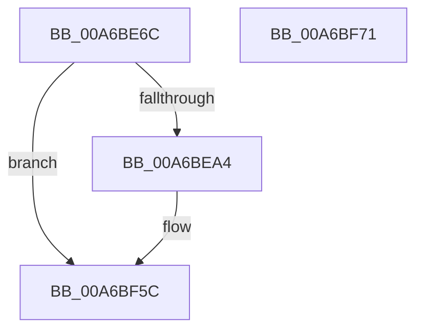

# ExpLogRefreshTimeZoneInformationQueryFail

- RVA: `0x00A6BE6C`–`0x00A6BF72` (길이 `262` bytes)
- VA: `0x0000000140A6BE6C`
- 실행 섹션: `PAGE`
- PDB 이름 있음: `예`; PDB Function 태그: `아니요`
- unwind 정보 RVA: `0x000B43CC`
- 디코드: `54`개 명령, `262/262` bytes 표시
- 미해석 바이트: `0` (있으면 어셈블리에 `.byte`로 보존)

> 이 문서는 커널 이미지의 기계어와 PDB 기호를 분석해 생성했습니다. 4번과 5번은 함수 원형과 자료형을 바이너리 사용 방식에서 추정한 C 해석이며 원본 소스 복구 결과는 아닙니다.

## 1. Dependencies

- 직접 호출 지점: **3**; 고유 호출 대상: **3**
- 직접 호출자로 확인된 함수: **1**
- RIP 상대 이미지 참조: **4**

### Outgoing calls
- `0x00A6BE8B` → [PsGetCurrentServerSiloGlobals](../../text/2F/PsGetCurrentServerSiloGlobals_function_002FE1F0.md) (function, `0x002FE1F0`)
- `0x00A6BF57` → [tlgWriteTransfer_EtwWriteTransfer](../../text/42/tlgWriteTransfer_EtwWriteTransfer_function_004260E0.md) (function, `0x004260E0`)
- `0x00A6BF63` → [_security_check_cookie](../../text/6A/_security_check_cookie_function_006AC640.md) (function, `0x006AC640`)

### Direct callers
- [ExpRefreshTimeZoneInformation](ExpRefreshTimeZoneInformation_function_00A6B46C.md) at `0x00A6B5F1`

### Static image references
- `0x00A6BE7A` → RVA `0x00E0A740` (`.data`; read)
- `0x00A6BE90` → RVA `0x00E09388` (`.data`; read)
- `0x00A6BEF3` → RVA `0x00E68570` (`.data`; read)
- `0x00A6BF13` → RVA `0x00055D69` (`.rdata`; read)

## 2. Other-region calls and transfers

- 다른 실행 섹션으로 향하는 call: **3**
  - `0x00A6BE8B` → [PsGetCurrentServerSiloGlobals](../../text/2F/PsGetCurrentServerSiloGlobals_function_002FE1F0.md) (`PAGE` → `.text`)
  - `0x00A6BF57` → [tlgWriteTransfer_EtwWriteTransfer](../../text/42/tlgWriteTransfer_EtwWriteTransfer_function_004260E0.md) (`PAGE` → `.text`)
  - `0x00A6BF63` → [_security_check_cookie](../../text/6A/_security_check_cookie_function_006AC640.md) (`PAGE` → `.text`)
- 별도 외부 분기/꼬리 이동을 확인하지 못했습니다.

## 3. Assembly (complete function range)

```asm
00A6BE6C  40 55                           push rbp
00A6BE6E  48 8D 6C 24 A9                  lea rbp, [rsp - 0x57]
00A6BE73  48 81 EC E0 00 00 00            sub rsp, 0xe0
00A6BE7A  48 8B 05 BF E8 39 00            mov rax, qword ptr [rip + 0x39e8bf]
00A6BE81  48 33 C4                        xor rax, rsp
00A6BE84  48 89 45 47                     mov qword ptr [rbp + 0x47], rax
00A6BE88  44 8B C9                        mov r9d, ecx
00A6BE8B  E8 60 23 89 FF                  call 0x1402fe1f0
00A6BE90  83 3D F1 D4 39 00 05            cmp dword ptr [rip + 0x39d4f1], 5
00A6BE97  4C 8B 80 C8 04 00 00            mov r8, qword ptr [rax + 0x4c8]
00A6BE9E  0F 86 B8 00 00 00               jbe 0x140a6bf5c
00A6BEA4  48 8D 45 AB                     lea rax, [rbp - 0x55]
00A6BEA8  44 89 4D AB                     mov dword ptr [rbp - 0x55], r9d
00A6BEAC  48 89 45 E7                     mov qword ptr [rbp - 0x19], rax
00A6BEB0  48 8D 0D D1 D4 39 00            lea rcx, [rip + 0x39d4d1]
00A6BEB7  41 8B 80 E8 03 00 00            mov eax, dword ptr [r8 + 0x3e8]
00A6BEBE  45 33 C9                        xor r9d, r9d
00A6BEC1  89 45 AF                        mov dword ptr [rbp - 0x51], eax
00A6BEC4  48 8D 45 AF                     lea rax, [rbp - 0x51]
00A6BEC8  48 89 45 F7                     mov qword ptr [rbp - 9], rax
00A6BECC  41 8B 80 B4 01 00 00            mov eax, dword ptr [r8 + 0x1b4]
00A6BED3  89 45 B3                        mov dword ptr [rbp - 0x4d], eax
00A6BED6  48 8D 45 B3                     lea rax, [rbp - 0x4d]
00A6BEDA  48 89 45 07                     mov qword ptr [rbp + 7], rax
00A6BEDE  41 8B 80 B0 01 00 00            mov eax, dword ptr [r8 + 0x1b0]
00A6BEE5  45 33 C0                        xor r8d, r8d
00A6BEE8  89 45 B7                        mov dword ptr [rbp - 0x49], eax
00A6BEEB  48 8D 45 B7                     lea rax, [rbp - 0x49]
00A6BEEF  48 89 45 17                     mov qword ptr [rbp + 0x17], rax
00A6BEF3  8A 05 77 C6 3F 00               mov al, byte ptr [rip + 0x3fc677]
00A6BEF9  88 45 A7                        mov byte ptr [rbp - 0x59], al
00A6BEFC  48 8D 45 A7                     lea rax, [rbp - 0x59]
00A6BF00  48 89 45 27                     mov qword ptr [rbp + 0x27], rax
00A6BF04  48 8D 45 A8                     lea rax, [rbp - 0x58]
00A6BF08  48 89 45 37                     mov qword ptr [rbp + 0x37], rax
00A6BF0C  48 8D 45 C7                     lea rax, [rbp - 0x39]
00A6BF10  88 55 A8                        mov byte ptr [rbp - 0x58], dl
00A6BF13  48 8D 15 4F 9E 5E FF            lea rdx, [rip - 0xa161b1]
00A6BF1A  48 89 44 24 28                  mov qword ptr [rsp + 0x28], rax
00A6BF1F  C7 44 24 20 08 00 00 00         mov dword ptr [rsp + 0x20], 8
00A6BF27  48 C7 45 EF 04 00 00 00         mov qword ptr [rbp - 0x11], 4
00A6BF2F  48 C7 45 FF 04 00 00 00         mov qword ptr [rbp - 1], 4
00A6BF37  48 C7 45 0F 04 00 00 00         mov qword ptr [rbp + 0xf], 4
00A6BF3F  48 C7 45 1F 04 00 00 00         mov qword ptr [rbp + 0x1f], 4
00A6BF47  48 C7 45 2F 01 00 00 00         mov qword ptr [rbp + 0x2f], 1
00A6BF4F  48 C7 45 3F 01 00 00 00         mov qword ptr [rbp + 0x3f], 1
00A6BF57  E8 84 A1 9B FF                  call 0x1404260e0
00A6BF5C  48 8B 4D 47                     mov rcx, qword ptr [rbp + 0x47]
00A6BF60  48 33 CC                        xor rcx, rsp
00A6BF63  E8 D8 06 C4 FF                  call 0x1406ac640
00A6BF68  48 81 C4 E0 00 00 00            add rsp, 0xe0
00A6BF6F  5D                              pop rbp
00A6BF70  C3                              ret
00A6BF71  CC                              int3
```

## 4. C-style interpretation (structured pseudocode)

```c
__int64 __fastcall ExpLogRefreshTimeZoneInformationQueryFail(int a1, unsigned __int8 a2)
{
    __int64 result;
    __int64 v_rsp;
    unsigned __int64 v_stack_m18;
    unsigned __int64 v_stack_m20;
    unsigned __int64 v_stack_m28;
    unsigned __int64 v_stack_m30;
    unsigned __int64 v_stack_m38;
    unsigned __int64 v_stack_m40;
    unsigned __int64 v_stack_m48;
    unsigned __int64 v_stack_m50;
    unsigned __int64 v_stack_m58;
    unsigned __int64 v_stack_m5F;
    unsigned __int64 v_stack_m60;
    unsigned __int64 v_stack_m68;
    unsigned __int64 v_stack_m70;
    unsigned __int64 v_stack_m78;
    unsigned __int64 v_stack_m98;
    unsigned int v_stack_mA8;
    unsigned int v_stack_mAC;
    unsigned int v_stack_mB0;
    unsigned __int64 v_stack_mB4;
    unsigned __int64 v_stack_mB7;
    unsigned __int8 v_stack_mB8;
    unsigned __int64 v_stack_mC0;
    unsigned int v_stack_mC8;

    v_rsp = (v_rsp) - (224);
    result = (*(unsigned __int64 *)(v_rip + 3795135)) ^ (v_rsp);
    v_stack_m18 = result;
    result = PsGetCurrentServerSiloGlobals(a1, a2, a3, (unsigned int)(a1));
    if ((*(unsigned int *)(v_rip + 3790065)) >= = 5) {
        result = v_stack_mB4;
        v_stack_mB4 = (unsigned int)((unsigned int)(a1));
        v_stack_m78 = result;
        a1 = v_rip + 3790033;
        result = *(unsigned int *)(*(unsigned __int64 *)(result + 1224) + 1000);
        a4 = 0;
        v_stack_mB0 = (unsigned int)(result);
        result = v_stack_mB0;
        v_stack_m68 = result;
        result = *(unsigned int *)(*(unsigned __int64 *)(result + 1224) + 436);
        v_stack_mAC = (unsigned int)(result);
        result = v_stack_mAC;
        v_stack_m58 = result;
        result = *(unsigned int *)(*(unsigned __int64 *)(result + 1224) + 432);
        a3 = 0;
        v_stack_mA8 = (unsigned int)(result);
        result = v_stack_mA8;
        v_stack_m48 = result;
        result = *(unsigned __int8 *)(v_rip + 4179575);
        v_stack_mB8 = (unsigned __int8)(result);
        result = v_stack_mB8;
        v_stack_m38 = result;
        result = v_stack_mB7;
        v_stack_m28 = result;
        result = v_stack_m98;
        v_stack_mB7 = a2;
        a2 = v_rip - 10576305;
        v_stack_mC0 = result;
        v_stack_mC8 = 8;
        v_stack_m70 = 4;
        v_stack_m60 = 4;
        v_stack_m50 = 4;
        v_stack_m40 = 4;
        v_stack_m30 = 1;
        v_stack_m20 = 1;
        result = tlgWriteTransfer_EtwWriteTransfer(a1, a2, a3, a4);
    }
    a1 = (v_stack_m18) ^ (v_rsp);
    result = _security_check_cookie(a1, a2, a3, a4);
    v_rsp = (v_rsp) + (224);
    return result;
}
```

## 5. (Beta) C Style

```c
int64_t ExpLogRefreshTimeZoneInformationQueryFail(int32_t Arg1, uint8_t Arg2)
{
    int64_t result;
    int64_t local_rsp;
    uint64_t v_stack_m18;
    uint64_t v_stack_m20;
    uint64_t v_stack_m28;
    uint64_t v_stack_m30;
    uint64_t v_stack_m38;
    uint64_t v_stack_m40;
    uint64_t v_stack_m48;
    uint64_t v_stack_m50;
    uint64_t v_stack_m58;
    uint64_t v_stack_m5F;
    uint64_t v_stack_m60;
    uint64_t v_stack_m68;
    uint64_t v_stack_m70;
    uint64_t v_stack_m78;
    uint64_t v_stack_m98;
    uint32_t v_stack_mA8;
    uint32_t v_stack_mAC;
    uint32_t v_stack_mB0;
    uint64_t v_stack_mB4;
    uint64_t v_stack_mB7;
    uint8_t v_stack_mB8;
    uint64_t v_stack_mC0;
    uint32_t v_stack_mC8;

    local_rsp = (local_rsp) - (224);
    result = (*(uint64_t *)(v_rip + 0x39E8BF)) ^ (local_rsp);
    v_stack_m18 = result;
    result = PsGetCurrentServerSiloGlobals(Arg1, Arg2, a3, (uint32_t)(Arg1));
    if ((*(uint32_t *)(v_rip + 0x39D4F1)) >= = 5) {
        result = v_stack_mB4;
        v_stack_mB4 = (uint32_t)((uint32_t)(Arg1));
        v_stack_m78 = result;
        Arg1 = v_rip + 3790033;
        result = *(uint32_t *)(*(uint64_t *)(result + 0x4C8) + 0x3E8);
        a4 = 0;
        v_stack_mB0 = (uint32_t)(result);
        result = v_stack_mB0;
        v_stack_m68 = result;
        result = *(uint32_t *)(*(uint64_t *)(result + 0x4C8) + 0x1B4);
        v_stack_mAC = (uint32_t)(result);
        result = v_stack_mAC;
        v_stack_m58 = result;
        result = *(uint32_t *)(*(uint64_t *)(result + 0x4C8) + 0x1B0);
        a3 = 0;
        v_stack_mA8 = (uint32_t)(result);
        result = v_stack_mA8;
        v_stack_m48 = result;
        result = *(uint8_t *)(v_rip + 0x3FC677);
        v_stack_mB8 = (uint8_t)(result);
        result = v_stack_mB8;
        v_stack_m38 = result;
        result = v_stack_mB7;
        v_stack_m28 = result;
        result = v_stack_m98;
        v_stack_mB7 = Arg2;
        Arg2 = v_rip - 10576305;
        v_stack_mC0 = result;
        v_stack_mC8 = 8;
        v_stack_m70 = 4;
        v_stack_m60 = 4;
        v_stack_m50 = 4;
        v_stack_m40 = 4;
        v_stack_m30 = 1;
        v_stack_m20 = 1;
        result = tlgWriteTransfer_EtwWriteTransfer(Arg1, Arg2, a3, a4);
    }
    Arg1 = (v_stack_m18) ^ (local_rsp);
    result = _security_check_cookie(Arg1, Arg2, a3, a4);
    local_rsp = (local_rsp) + (224);
    return result;
}
```

## 6. Execution-region graph

[열기: 2D/3D 그래프와 함수 탐색 컨트롤 패널](../../../control-panel.html?section=page&rva=0x00A6BE6C&view=graph)

- 2D 그래프는 위에서 아래로 흐르고, 3D 그래프는 빈 공간을 드래그해 회전합니다. Shift+드래그는 이동, 휠은 확대·축소, 함수 노드 선택은 대상 보고서 이동입니다.

### Static fallback


