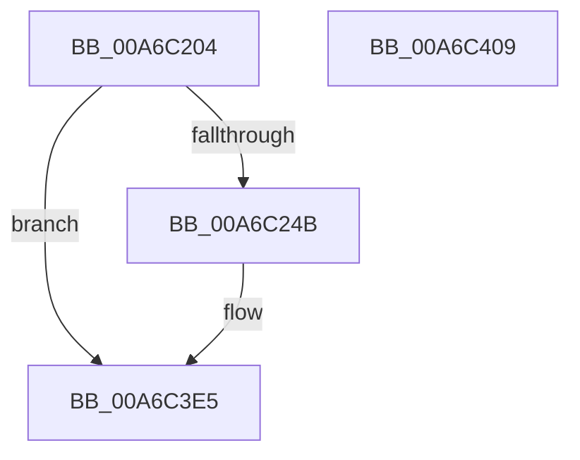

# ExpLogRefreshTimeZoneInformationSuccess

- RVA: `0x00A6C204`–`0x00A6C40A` (길이 `518` bytes)
- VA: `0x0000000140A6C204`
- 실행 섹션: `PAGE`
- PDB 이름 있음: `예`; PDB Function 태그: `아니요`
- unwind 정보 RVA: `0x000B4400`
- 디코드: `100`개 명령, `518/518` bytes 표시
- 미해석 바이트: `0` (있으면 어셈블리에 `.byte`로 보존)

> 이 문서는 커널 이미지의 기계어와 PDB 기호를 분석해 생성했습니다. 4번과 5번은 함수 원형과 자료형을 바이너리 사용 방식에서 추정한 C 해석이며 원본 소스 복구 결과는 아닙니다.

## 1. Dependencies

- 직접 호출 지점: **4**; 고유 호출 대상: **4**
- 직접 호출자로 확인된 함수: **1**
- RIP 상대 이미지 참조: **4**

### Outgoing calls
- `0x00A6C232` → [PsGetCurrentServerSiloGlobals](../../text/2F/PsGetCurrentServerSiloGlobals_function_002FE1F0.md) (function, `0x002FE1F0`)
- `0x00A6C329` → [tlgCreate1Sz_wchar_t](../../text/42/tlgCreate1Sz_wchar_t_function_00426198.md) (function, `0x00426198`)
- `0x00A6C3E0` → [tlgWriteTransfer_EtwWriteTransfer](../../text/42/tlgWriteTransfer_EtwWriteTransfer_function_004260E0.md) (function, `0x004260E0`)
- `0x00A6C3EF` → [_security_check_cookie](../../text/6A/_security_check_cookie_function_006AC640.md) (function, `0x006AC640`)

### Direct callers
- [ExpRefreshTimeZoneInformation](ExpRefreshTimeZoneInformation_function_00A6B46C.md) at `0x00A6BAEE`

### Static image references
- `0x00A6C21E` → RVA `0x00E0A740` (`.data`; read)
- `0x00A6C237` → RVA `0x00E09388` (`.data`; read)
- `0x00A6C284` → RVA `0x00E68570` (`.data`; read)
- `0x00A6C33E` → RVA `0x0005560C` (`.rdata`; read)

## 2. Other-region calls and transfers

- 다른 실행 섹션으로 향하는 call: **4**
  - `0x00A6C232` → [PsGetCurrentServerSiloGlobals](../../text/2F/PsGetCurrentServerSiloGlobals_function_002FE1F0.md) (`PAGE` → `.text`)
  - `0x00A6C329` → [tlgCreate1Sz_wchar_t](../../text/42/tlgCreate1Sz_wchar_t_function_00426198.md) (`PAGE` → `.text`)
  - `0x00A6C3E0` → [tlgWriteTransfer_EtwWriteTransfer](../../text/42/tlgWriteTransfer_EtwWriteTransfer_function_004260E0.md) (`PAGE` → `.text`)
  - `0x00A6C3EF` → [_security_check_cookie](../../text/6A/_security_check_cookie_function_006AC640.md) (`PAGE` → `.text`)
- 별도 외부 분기/꼬리 이동을 확인하지 못했습니다.

## 3. Assembly (complete function range)

```asm
00A6C204  48 89 5C 24 10                  mov qword ptr [rsp + 0x10], rbx
00A6C209  48 89 7C 24 18                  mov qword ptr [rsp + 0x18], rdi
00A6C20E  55                              push rbp
00A6C20F  48 8D AC 24 70 FF FF FF         lea rbp, [rsp - 0x90]
00A6C217  48 81 EC 90 01 00 00            sub rsp, 0x190
00A6C21E  48 8B 05 1B E5 39 00            mov rax, qword ptr [rip + 0x39e51b]
00A6C225  48 33 C4                        xor rax, rsp
00A6C228  48 89 85 80 00 00 00            mov qword ptr [rbp + 0x80], rax
00A6C22F  4C 8B D1                        mov r10, rcx
00A6C232  E8 B9 1F 89 FF                  call 0x1402fe1f0
00A6C237  83 3D 4A D1 39 00 05            cmp dword ptr [rip + 0x39d14a], 5
00A6C23E  48 8B 88 C8 04 00 00            mov rcx, qword ptr [rax + 0x4c8]
00A6C245  0F 86 9A 01 00 00               jbe 0x140a6c3e5
00A6C24B  8B 81 E8 03 00 00               mov eax, dword ptr [rcx + 0x3e8]
00A6C251  89 44 24 34                     mov dword ptr [rsp + 0x34], eax
00A6C255  48 8D 44 24 34                  lea rax, [rsp + 0x34]
00A6C25A  48 89 45 90                     mov qword ptr [rbp - 0x70], rax
00A6C25E  8B 81 B4 01 00 00               mov eax, dword ptr [rcx + 0x1b4]
00A6C264  89 44 24 38                     mov dword ptr [rsp + 0x38], eax
00A6C268  48 8D 44 24 38                  lea rax, [rsp + 0x38]
00A6C26D  48 89 45 A0                     mov qword ptr [rbp - 0x60], rax
00A6C271  8B 81 B0 01 00 00               mov eax, dword ptr [rcx + 0x1b0]
00A6C277  89 44 24 3C                     mov dword ptr [rsp + 0x3c], eax
00A6C27B  48 8D 44 24 3C                  lea rax, [rsp + 0x3c]
00A6C280  48 89 45 B0                     mov qword ptr [rbp - 0x50], rax
00A6C284  8A 05 E6 C2 3F 00               mov al, byte ptr [rip + 0x3fc2e6]
00A6C28A  88 44 24 30                     mov byte ptr [rsp + 0x30], al
00A6C28E  48 8D 44 24 30                  lea rax, [rsp + 0x30]
00A6C293  48 89 45 C0                     mov qword ptr [rbp - 0x40], rax
00A6C297  48 8D 44 24 31                  lea rax, [rsp + 0x31]
00A6C29C  48 89 45 D0                     mov qword ptr [rbp - 0x30], rax
00A6C2A0  49 8B 00                        mov rax, qword ptr [r8]
00A6C2A3  48 89 44 24 50                  mov qword ptr [rsp + 0x50], rax
00A6C2A8  48 8D 44 24 50                  lea rax, [rsp + 0x50]
00A6C2AD  48 89 45 E0                     mov qword ptr [rbp - 0x20], rax
00A6C2B1  49 8B 01                        mov rax, qword ptr [r9]
00A6C2B4  48 89 44 24 58                  mov qword ptr [rsp + 0x58], rax
00A6C2B9  48 8D 44 24 58                  lea rax, [rsp + 0x58]
00A6C2BE  48 89 45 F0                     mov qword ptr [rbp - 0x10], rax
00A6C2C2  48 8B 85 C0 00 00 00            mov rax, qword ptr [rbp + 0xc0]
00A6C2C9  88 54 24 31                     mov byte ptr [rsp + 0x31], dl
00A6C2CD  49 8D 92 AC 00 00 00            lea rdx, [r10 + 0xac]
00A6C2D4  48 C7 45 98 04 00 00 00         mov qword ptr [rbp - 0x68], 4
00A6C2DC  48 C7 45 A8 04 00 00 00         mov qword ptr [rbp - 0x58], 4
00A6C2E4  48 8B 08                        mov rcx, qword ptr [rax]
00A6C2E7  48 8D 44 24 60                  lea rax, [rsp + 0x60]
00A6C2EC  48 89 4C 24 60                  mov qword ptr [rsp + 0x60], rcx
00A6C2F1  48 8D 4D 10                     lea rcx, [rbp + 0x10]
00A6C2F5  48 C7 45 B8 04 00 00 00         mov qword ptr [rbp - 0x48], 4
00A6C2FD  48 C7 45 C8 01 00 00 00         mov qword ptr [rbp - 0x38], 1
00A6C305  48 C7 45 D8 01 00 00 00         mov qword ptr [rbp - 0x28], 1
00A6C30D  48 C7 45 E8 08 00 00 00         mov qword ptr [rbp - 0x18], 8
00A6C315  48 C7 45 F8 08 00 00 00         mov qword ptr [rbp - 8], 8
00A6C31D  48 89 45 00                     mov qword ptr [rbp], rax
00A6C321  48 C7 45 08 08 00 00 00         mov qword ptr [rbp + 8], 8
00A6C329  E8 6A 9E 9B FF                  call 0x140426198
00A6C32E  41 8A 8A AC 01 00 00            mov cl, byte ptr [r10 + 0x1ac]
00A6C335  48 8D 44 24 32                  lea rax, [rsp + 0x32]
00A6C33A  48 89 45 20                     mov qword ptr [rbp + 0x20], rax
00A6C33E  48 8D 15 C7 92 5E FF            lea rdx, [rip - 0xa16d39]
00A6C345  41 8B 02                        mov eax, dword ptr [r10]
00A6C348  45 33 C9                        xor r9d, r9d
00A6C34B  89 44 24 40                     mov dword ptr [rsp + 0x40], eax
00A6C34F  45 33 C0                        xor r8d, r8d
00A6C352  48 8D 44 24 40                  lea rax, [rsp + 0x40]
00A6C357  88 4C 24 32                     mov byte ptr [rsp + 0x32], cl
00A6C35B  48 89 45 30                     mov qword ptr [rbp + 0x30], rax
00A6C35F  48 8D 0D 22 D0 39 00            lea rcx, [rip + 0x39d022]
00A6C366  41 8B 42 54                     mov eax, dword ptr [r10 + 0x54]
00A6C36A  89 44 24 44                     mov dword ptr [rsp + 0x44], eax
00A6C36E  48 8D 44 24 44                  lea rax, [rsp + 0x44]
00A6C373  48 89 45 40                     mov qword ptr [rbp + 0x40], rax
00A6C377  41 8B 82 A8 00 00 00            mov eax, dword ptr [r10 + 0xa8]
00A6C37E  89 44 24 48                     mov dword ptr [rsp + 0x48], eax
00A6C382  48 8D 44 24 48                  lea rax, [rsp + 0x48]
00A6C387  48 89 45 50                     mov qword ptr [rbp + 0x50], rax
00A6C38B  49 8D 42 44                     lea rax, [r10 + 0x44]
00A6C38F  48 89 45 60                     mov qword ptr [rbp + 0x60], rax
00A6C393  49 8D 82 98 00 00 00            lea rax, [r10 + 0x98]
00A6C39A  48 89 45 70                     mov qword ptr [rbp + 0x70], rax
00A6C39E  48 8D 44 24 70                  lea rax, [rsp + 0x70]
00A6C3A3  48 89 44 24 28                  mov qword ptr [rsp + 0x28], rax
00A6C3A8  C7 44 24 20 11 00 00 00         mov dword ptr [rsp + 0x20], 0x11
00A6C3B0  48 C7 45 28 01 00 00 00         mov qword ptr [rbp + 0x28], 1
00A6C3B8  48 C7 45 38 04 00 00 00         mov qword ptr [rbp + 0x38], 4
00A6C3C0  48 C7 45 48 04 00 00 00         mov qword ptr [rbp + 0x48], 4
00A6C3C8  48 C7 45 58 04 00 00 00         mov qword ptr [rbp + 0x58], 4
00A6C3D0  48 C7 45 68 10 00 00 00         mov qword ptr [rbp + 0x68], 0x10
00A6C3D8  48 C7 45 78 10 00 00 00         mov qword ptr [rbp + 0x78], 0x10
00A6C3E0  E8 FB 9C 9B FF                  call 0x1404260e0
00A6C3E5  48 8B 8D 80 00 00 00            mov rcx, qword ptr [rbp + 0x80]
00A6C3EC  48 33 CC                        xor rcx, rsp
00A6C3EF  E8 4C 02 C4 FF                  call 0x1406ac640
00A6C3F4  4C 8D 9C 24 90 01 00 00         lea r11, [rsp + 0x190]
00A6C3FC  49 8B 5B 18                     mov rbx, qword ptr [r11 + 0x18]
00A6C400  49 8B 7B 20                     mov rdi, qword ptr [r11 + 0x20]
00A6C404  49 8B E3                        mov rsp, r11
00A6C407  5D                              pop rbp
00A6C408  C3                              ret
00A6C409  CC                              int3
```

## 4. C-style interpretation (structured pseudocode)

```c
__int64 __fastcall ExpLogRefreshTimeZoneInformationSuccess(__int64 a1, unsigned __int8 a2, __int64 a3, __int64 a4, __int64 a5)
{
    __int64 result;
    __int64 v_rsp;
    unsigned __int64 v_stack_m100;
    unsigned __int64 v_stack_m108;
    unsigned __int64 v_stack_m128;
    unsigned __int64 v_stack_m138;
    unsigned __int64 v_stack_m140;
    unsigned __int64 v_stack_m148;
    unsigned int v_stack_m150;
    unsigned int v_stack_m154;
    unsigned int v_stack_m158;
    unsigned int v_stack_m15C;
    unsigned int v_stack_m160;
    unsigned int v_stack_m164;
    unsigned __int64 v_stack_m166;
    unsigned __int64 v_stack_m167;
    unsigned __int8 v_stack_m168;
    unsigned __int64 v_stack_m170;
    unsigned int v_stack_m178;
    unsigned __int64 v_stack_m18;
    unsigned __int64 v_stack_m20;
    unsigned __int64 v_stack_m28;
    unsigned __int64 v_stack_m30;
    unsigned __int64 v_stack_m38;
    unsigned __int64 v_stack_m40;
    unsigned __int64 v_stack_m48;
    unsigned __int64 v_stack_m50;
    unsigned __int64 v_stack_m58;
    unsigned __int64 v_stack_m60;
    unsigned __int64 v_stack_m68;
    unsigned __int64 v_stack_m70;
    unsigned __int64 v_stack_m78;
    unsigned __int64 v_stack_m8;
    unsigned __int64 v_stack_m88;
    unsigned __int64 v_stack_m90;
    unsigned __int64 v_stack_m98;
    unsigned __int64 v_stack_mA0;
    unsigned __int64 v_stack_mA8;
    unsigned __int64 v_stack_mB0;
    unsigned __int64 v_stack_mB8;
    unsigned __int64 v_stack_mC0;
    unsigned __int64 v_stack_mC8;
    unsigned __int64 v_stack_mD0;
    unsigned __int64 v_stack_mD8;
    unsigned __int64 v_stack_mE0;
    unsigned __int64 v_stack_mE8;
    unsigned __int64 v_stack_mF0;
    unsigned __int64 v_stack_mF8;
    unsigned __int64 v_stack_p10;
    unsigned __int64 v_stack_p18;

    v_stack_p10 = v_rbx;
    v_stack_p18 = v_rdi;
    v_rsp = (v_rsp) - (400);
    result = (*(unsigned __int64 *)(v_rip + 3794203)) ^ (v_rsp);
    v_stack_m18 = result;
    result = PsGetCurrentServerSiloGlobals(a1, a2, a3, a4);
    if ((*(unsigned int *)(v_rip + 3789130)) >= = 5) {
        result = *(unsigned int *)(*(unsigned __int64 *)(result + 1224) + 1000);
        v_stack_m164 = (unsigned int)(result);
        result = v_stack_m164;
        v_stack_m108 = result;
        result = *(unsigned int *)(*(unsigned __int64 *)(result + 1224) + 436);
        v_stack_m160 = (unsigned int)(result);
        result = v_stack_m160;
        v_stack_mF8 = result;
        result = *(unsigned int *)(*(unsigned __int64 *)(result + 1224) + 432);
        v_stack_m15C = (unsigned int)(result);
        result = v_stack_m15C;
        v_stack_mE8 = result;
        result = *(unsigned __int8 *)(v_rip + 4178662);
        v_stack_m168 = (unsigned __int8)(result);
        result = v_stack_m168;
        v_stack_mD8 = result;
        result = v_stack_m167;
        v_stack_mC8 = result;
        result = *(unsigned __int64 *)(a3);
        v_stack_m148 = result;
        result = v_stack_m148;
        v_stack_mB8 = result;
        result = *(unsigned __int64 *)(a4);
        v_stack_m140 = result;
        result = v_stack_m140;
        v_stack_mA8 = result;
        result = a5;
        v_stack_m167 = a2;
        a2 = a1 + 172;
        v_stack_m100 = 4;
        v_stack_mF0 = 4;
        a1 = *(unsigned __int64 *)(result);
        result = v_stack_m138;
        v_stack_m138 = a1;
        a1 = v_stack_m88;
        v_stack_mE0 = 4;
        v_stack_mD0 = 1;
        v_stack_mC0 = 1;
        v_stack_mB0 = 8;
        v_stack_mA0 = 8;
        v_stack_m98 = result;
        v_stack_m90 = 8;
        result = tlgCreate1Sz_wchar_t(a1, a2, a3, a4);
        a1 = *(unsigned __int8 *)(a1 + 428);
        result = v_stack_m166;
        v_stack_m78 = result;
        a2 = v_rip - 10579257;
        result = *(unsigned int *)(a1);
        a4 = 0;
        v_stack_m158 = (unsigned int)(result);
        a3 = 0;
        result = v_stack_m158;
        v_stack_m166 = (unsigned __int8)(a1);
        v_stack_m68 = result;
        a1 = v_rip + 3788834;
        result = *(unsigned int *)(a1 + 84);
        v_stack_m154 = (unsigned int)(result);
        result = v_stack_m154;
        v_stack_m58 = result;
        result = *(unsigned int *)(a1 + 168);
        v_stack_m150 = (unsigned int)(result);
        result = v_stack_m150;
        v_stack_m48 = result;
        result = a1 + 68;
        v_stack_m38 = result;
        result = a1 + 152;
        v_stack_m28 = result;
        result = v_stack_m128;
        v_stack_m170 = result;
        v_stack_m178 = 17;
        v_stack_m70 = 1;
        v_stack_m60 = 4;
        v_stack_m50 = 4;
        v_stack_m40 = 4;
        v_stack_m30 = 16;
        v_stack_m20 = 16;
        result = tlgWriteTransfer_EtwWriteTransfer(a1, a2, a3, a4);
    }
    a1 = (v_stack_m18) ^ (v_rsp);
    result = _security_check_cookie(a1, a2, a3, a4);
    return result;
}
```

## 5. (Beta) C Style

```c
int64_t ExpLogRefreshTimeZoneInformationSuccess(int64_t Arg1, uint8_t Arg2, int64_t Arg3, int64_t Arg4, void *Arg5)
{
    uint8_t *arg5 = (uint8_t *)Arg5;

    int64_t result;
    int64_t local_rsp;
    uint64_t v_stack_m100;
    uint64_t v_stack_m108;
    uint64_t v_stack_m128;
    uint64_t v_stack_m138;
    uint64_t v_stack_m140;
    uint64_t v_stack_m148;
    uint32_t v_stack_m150;
    uint32_t v_stack_m154;
    uint32_t v_stack_m158;
    uint32_t v_stack_m15C;
    uint32_t v_stack_m160;
    uint32_t v_stack_m164;
    uint64_t v_stack_m166;
    uint64_t v_stack_m167;
    uint8_t v_stack_m168;
    uint64_t v_stack_m170;
    uint32_t v_stack_m178;
    uint64_t v_stack_m18;
    uint64_t v_stack_m20;
    uint64_t v_stack_m28;
    uint64_t v_stack_m30;
    uint64_t v_stack_m38;
    uint64_t v_stack_m40;
    uint64_t v_stack_m48;
    uint64_t v_stack_m50;
    uint64_t v_stack_m58;
    uint64_t v_stack_m60;
    uint64_t v_stack_m68;
    uint64_t v_stack_m70;
    uint64_t v_stack_m78;
    uint64_t v_stack_m8;
    uint64_t v_stack_m88;
    uint64_t v_stack_m90;
    uint64_t v_stack_m98;
    uint64_t v_stack_mA0;
    uint64_t v_stack_mA8;
    uint64_t v_stack_mB0;
    uint64_t v_stack_mB8;
    uint64_t v_stack_mC0;
    uint64_t v_stack_mC8;
    uint64_t v_stack_mD0;
    uint64_t v_stack_mD8;
    uint64_t v_stack_mE0;
    uint64_t v_stack_mE8;
    uint64_t v_stack_mF0;
    uint64_t v_stack_mF8;
    uint64_t v_stack_p10;
    uint64_t v_stack_p18;

    v_stack_p10 = local_rbx;
    v_stack_p18 = local_rdi;
    local_rsp = (local_rsp) - (400);
    result = (*(uint64_t *)(v_rip + 0x39E51B)) ^ (local_rsp);
    v_stack_m18 = result;
    result = PsGetCurrentServerSiloGlobals(Arg1, Arg2, Arg3, Arg4);
    if ((*(uint32_t *)(v_rip + 0x39D14A)) >= = 5) {
        result = *(uint32_t *)(*(uint64_t *)(result + 0x4C8) + 0x3E8);
        v_stack_m164 = (uint32_t)(result);
        result = v_stack_m164;
        v_stack_m108 = result;
        result = *(uint32_t *)(*(uint64_t *)(result + 0x4C8) + 0x1B4);
        v_stack_m160 = (uint32_t)(result);
        result = v_stack_m160;
        v_stack_mF8 = result;
        result = *(uint32_t *)(*(uint64_t *)(result + 0x4C8) + 0x1B0);
        v_stack_m15C = (uint32_t)(result);
        result = v_stack_m15C;
        v_stack_mE8 = result;
        result = *(uint8_t *)(v_rip + 0x3FC2E6);
        v_stack_m168 = (uint8_t)(result);
        result = v_stack_m168;
        v_stack_mD8 = result;
        result = v_stack_m167;
        v_stack_mC8 = result;
        result = *(uint64_t *)(Arg3);
        v_stack_m148 = result;
        result = v_stack_m148;
        v_stack_mB8 = result;
        result = *(uint64_t *)(Arg4);
        v_stack_m140 = result;
        result = v_stack_m140;
        v_stack_mA8 = result;
        result = Arg5;
        v_stack_m167 = Arg2;
        Arg2 = Arg1 + 172;
        v_stack_m100 = 4;
        v_stack_mF0 = 4;
        Arg1 = *(uint64_t *)(result);
        result = v_stack_m138;
        v_stack_m138 = Arg1;
        Arg1 = v_stack_m88;
        v_stack_mE0 = 4;
        v_stack_mD0 = 1;
        v_stack_mC0 = 1;
        v_stack_mB0 = 8;
        v_stack_mA0 = 8;
        v_stack_m98 = result;
        v_stack_m90 = 8;
        result = tlgCreate1Sz_wchar_t(Arg1, Arg2, Arg3, Arg4);
        Arg1 = *(uint8_t *)(Arg1 + 0x1AC);
        result = v_stack_m166;
        v_stack_m78 = result;
        Arg2 = v_rip - 10579257;
        result = *(uint32_t *)(Arg1);
        Arg4 = 0;
        v_stack_m158 = (uint32_t)(result);
        Arg3 = 0;
        result = v_stack_m158;
        v_stack_m166 = (uint8_t)(Arg1);
        v_stack_m68 = result;
        Arg1 = v_rip + 3788834;
        result = *(uint32_t *)(Arg1 + 0x54);
        v_stack_m154 = (uint32_t)(result);
        result = v_stack_m154;
        v_stack_m58 = result;
        result = *(uint32_t *)(Arg1 + 0xA8);
        v_stack_m150 = (uint32_t)(result);
        result = v_stack_m150;
        v_stack_m48 = result;
        result = Arg1 + 68;
        v_stack_m38 = result;
        result = Arg1 + 152;
        v_stack_m28 = result;
        result = v_stack_m128;
        v_stack_m170 = result;
        v_stack_m178 = 17;
        v_stack_m70 = 1;
        v_stack_m60 = 4;
        v_stack_m50 = 4;
        v_stack_m40 = 4;
        v_stack_m30 = 16;
        v_stack_m20 = 16;
        result = tlgWriteTransfer_EtwWriteTransfer(Arg1, Arg2, Arg3, Arg4);
    }
    Arg1 = (v_stack_m18) ^ (local_rsp);
    result = _security_check_cookie(Arg1, Arg2, Arg3, Arg4);
    return result;
}
```

### 관측된 메모리 오프셋

구조체 형식이 확인되지 않은 접근은 인자 기준의 오프셋으로만 기록했습니다.

| 기준 인자 | 오프셋 표현 | 폭 (bit) | 접근 |
|---|---:|---:|---|
| `Arg5` | `+ 0x0` | `64` | `R` |

## 6. Execution-region graph

[열기: 2D/3D 그래프와 함수 탐색 컨트롤 패널](../../../control-panel.html?section=page&rva=0x00A6C204&view=graph)

- 2D 그래프는 위에서 아래로 흐르고, 3D 그래프는 빈 공간을 드래그해 회전합니다. Shift+드래그는 이동, 휠은 확대·축소, 함수 노드 선택은 대상 보고서 이동입니다.

### Static fallback


