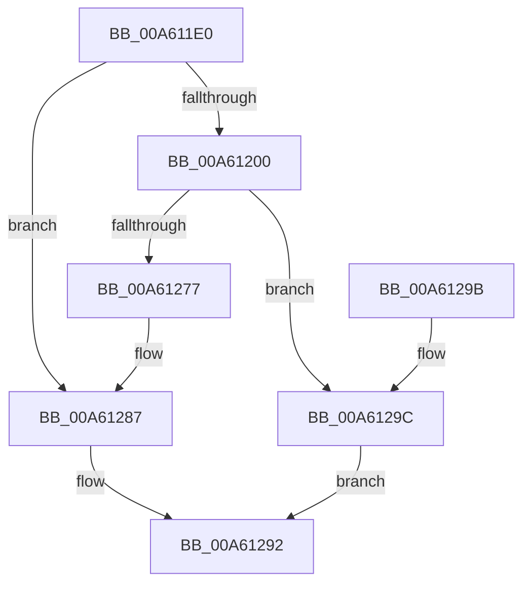

# ExpPcwDisabledStatus

- RVA: `0x00A611E0`–`0x00A612A0` (길이 `192` bytes)
- VA: `0x0000000140A611E0`
- 실행 섹션: `PAGE`
- PDB 이름 있음: `예`; PDB Function 태그: `아니요`
- unwind 정보 RVA: `0x000B3144`
- 디코드: `50`개 명령, `192/192` bytes 표시
- 미해석 바이트: `0` (있으면 어셈블리에 `.byte`로 보존)

> 이 문서는 커널 이미지의 기계어와 PDB 기호를 분석해 생성했습니다. 4번과 5번은 함수 원형과 자료형을 바이너리 사용 방식에서 추정한 C 해석이며 원본 소스 복구 결과는 아닙니다.

## 1. Dependencies

- 직접 호출 지점: **1**; 고유 호출 대상: **1**
- 직접 호출자로 확인된 함수: **9**
- RIP 상대 이미지 참조: **4**

### Outgoing calls
- `0x00A61264` → [RtlpQueryRegistryValues](../8C/RtlpQueryRegistryValues_function_008C9050.md) (function, `0x008C9050`)

### Direct callers
- [ExProcessCounterSetCallback](../91/ExProcessCounterSetCallback_function_0091CDF0.md) at `0x0091D2F3`
- [ExProcessorCounterSetCallback](../9E/ExProcessorCounterSetCallback_function_009E4880.md) at `0x009E5270`
- [ExProcessorCounterSetCallback](../9E/ExProcessorCounterSetCallback_function_009E4880.md) at `0x009E527C`
- [ExProcessorCounterSetCallback](../9E/ExProcessorCounterSetCallback_function_009E4880.md) at `0x009E5288`
- [ExProcessorCounterSetCallback](../9E/ExProcessorCounterSetCallback_function_009E4880.md) at `0x009E5291`
- [EtwpEventTracingCounterSetCallback](../A0/EtwpEventTracingCounterSetCallback_function_00A0E0C0.md) at `0x00A0E1BD`
- [PcwAddInstance](../A0/PcwAddInstance_function_00A0E530.md) at `0x00A0E5A6`
- [KiSynchCounterSetCallback](../A5/KiSynchCounterSetCallback_function_00A5F5B0.md) at `0x00A5F6DC`
- [PcwCreateInstance](PcwCreateInstance_function_00A610F0.md) at `0x00A6116A`
- [PcwRegister](PcwRegister_function_00A61180.md) at `0x00A611CF`
- [FsRtlAddDiskIOCounterInstance](FsRtlAddDiskIOCounterInstance_function_00A615C0.md) at `0x00A616B3`
- [KiSynchNumaCounterSetCallback](../A7/KiSynchNumaCounterSetCallback_function_00A77BE0.md) at `0x00A78181`
- [KiSynchNumaCounterSetCallback](../A7/KiSynchNumaCounterSetCallback_function_00A77BE0.md) at `0x00A7818A`

### Static image references
- `0x00A611F2` → RVA `0x00FD818C` (`PAGEDATA`; read)
- `0x00A61204` → RVA `0x00AFDF50` (` ?? ::NNGAKEGL::`string'`; read)
- `0x00A61218` → RVA `0x00B08B30` (` ?? ::NNGAKEGL::`string'`; read)
- `0x00A61281` → RVA `0x00FD818C` (`PAGEDATA`; write)

## 2. Other-region calls and transfers

- 다른 실행 섹션으로 향하는 call: **0**
- 별도 외부 분기/꼬리 이동을 확인하지 못했습니다.

## 3. Assembly (complete function range)

```asm
00A611E0  40 55                           push rbp
00A611E2  48 8D 6C 24 A9                  lea rbp, [rsp - 0x57]
00A611E7  48 81 EC A0 00 00 00            sub rsp, 0xa0
00A611EE  83 65 67 00                     and dword ptr [rbp + 0x67], 0
00A611F2  8B 05 94 6F 57 00               mov eax, dword ptr [rip + 0x576f94]
00A611F8  85 C0                           test eax, eax
00A611FA  0F 85 87 00 00 00               jne 0x140a61287
00A61200  83 4D 6F FF                     or dword ptr [rbp + 0x6f], 0xffffffff
00A61204  48 8D 05 45 CD 09 00            lea rax, [rip + 0x9cd45]
00A6120B  48 83 65 E7 00                  and qword ptr [rbp - 0x19], 0
00A61210  4C 8D 45 E7                     lea r8, [rbp - 0x19]
00A61214  48 89 45 F7                     mov qword ptr [rbp - 9], rax
00A61218  48 8D 15 11 79 0A 00            lea rdx, [rip + 0xa7911]
00A6121F  0F 57 C0                        xorps xmm0, xmm0
00A61222  C7 45 EF 20 01 00 00            mov dword ptr [rbp - 0x11], 0x120
00A61229  48 8D 45 67                     lea rax, [rbp + 0x67]
00A6122D  C7 45 07 04 00 00 04            mov dword ptr [rbp + 7], 0x4000004
00A61234  48 89 45 FF                     mov qword ptr [rbp - 1], rax
00A61238  45 33 C9                        xor r9d, r9d
00A6123B  48 8D 45 6F                     lea rax, [rbp + 0x6f]
00A6123F  C7 45 17 04 00 00 00            mov dword ptr [rbp + 0x17], 4
00A61246  48 89 45 0F                     mov qword ptr [rbp + 0xf], rax
00A6124A  33 C0                           xor eax, eax
00A6124C  0F 11 45 1F                     movups xmmword ptr [rbp + 0x1f], xmm0
00A61250  48 89 45 4F                     mov qword ptr [rbp + 0x4f], rax
00A61254  0F 11 45 2F                     movups xmmword ptr [rbp + 0x2f], xmm0
00A61258  8D 48 01                        lea ecx, [rax + 1]
00A6125B  C6 44 24 28 01                  mov byte ptr [rsp + 0x28], 1
00A61260  0F 11 45 3F                     movups xmmword ptr [rbp + 0x3f], xmm0
00A61264  E8 E7 7D E6 FF                  call 0x1408c9050
00A61269  33 C9                           xor ecx, ecx
00A6126B  3D 34 00 00 C0                  cmp eax, 0xc0000034
00A61270  0F 45 C8                        cmovne ecx, eax
00A61273  85 C9                           test ecx, ecx
00A61275  78 25                           js 0x140a6129c
00A61277  8B 45 67                        mov eax, dword ptr [rbp + 0x67]
00A6127A  F7 D8                           neg eax
00A6127C  1B C0                           sbb eax, eax
00A6127E  83 C0 02                        add eax, 2
00A61281  89 05 05 6F 57 00               mov dword ptr [rip + 0x576f05], eax
00A61287  FF C8                           dec eax
00A61289  F7 D8                           neg eax
00A6128B  1B C0                           sbb eax, eax
00A6128D  25 02 00 00 C0                  and eax, 0xc0000002
00A61292  48 81 C4 A0 00 00 00            add rsp, 0xa0
00A61299  5D                              pop rbp
00A6129A  C3                              ret
00A6129B  CC                              int3
00A6129C  8B C1                           mov eax, ecx
00A6129E  EB F2                           jmp 0x140a61292
```

## 4. C-style interpretation (structured pseudocode)

```c
__int64 __fastcall ExpPcwDisabledStatus(__int64 a1, __int64 a2, __int64 a3, int a4)
{
    __int64 result;
    __int64 v_rsp;
    unsigned __int64 v_stack_m10;
    unsigned __int64 v_stack_m20;
    unsigned __int64 v_stack_m30;
    unsigned __int64 v_stack_m40;
    unsigned int v_stack_m48;
    unsigned __int64 v_stack_m50;
    unsigned int v_stack_m58;
    unsigned __int64 v_stack_m5F;
    unsigned __int64 v_stack_m60;
    unsigned __int64 v_stack_m68;
    unsigned int v_stack_m70;
    unsigned __int64 v_stack_m78;
    unsigned __int8 v_stack_m80;
    unsigned int v_stack_p10;
    unsigned int v_stack_p8;

    v_rsp = (v_rsp) - (160);
    if ((unsigned int)((unsigned int)(*(unsigned int *)(v_rip + 5730196))) != 0) goto loc_00A61287;
    v_stack_m68 = v_rip + 642373;
    v_stack_m70 = 288;
    v_stack_m58 = 0x4000004ULL;
    v_stack_m60 = v_stack_p8;
    a4 = 0;
    v_stack_m48 = 4;
    v_stack_m50 = v_stack_p10;
    result = 0;
    v_stack_m40 = v_xmm0;
    v_stack_m10 = 0;
    v_stack_m30 = v_xmm0;
    v_stack_m80 = 1;
    v_stack_m20 = v_xmm0;
    result = RtlpQueryRegistryValues(result + 1, v_rip + 686353, v_stack_m78, a4);
    a1 = 0;
    if (((unsigned int)(result)) != 0xC0000034ULL) { a1 = (unsigned int)(result); }
    if (sign_flag) goto loc_00A6129C;
    result = (unsigned int)(-((unsigned int)(v_stack_p8)));
    result = (unsigned int)((result) + (2));
    *(unsigned int *)(v_rip + 5730053) = (unsigned int)(result);
loc_00A61287:
    result = (unsigned int)((result) - 1);
    result = (unsigned int)(-(result));
    result = (unsigned int)((result) & (0xC0000002ULL));
loc_00A61292:
    v_rsp = (v_rsp) + (160);
    return result;
loc_00A6129C:
    goto loc_00A61292;
}
```

## 5. (Beta) C Style

```c
int64_t ExpPcwDisabledStatus(int64_t Arg1, int64_t Arg2, int64_t Arg3, int32_t Arg4)
{
    int64_t result;
    int64_t local_rsp;
    uint64_t v_stack_m10;
    uint64_t v_stack_m20;
    uint64_t v_stack_m30;
    uint64_t v_stack_m40;
    uint32_t v_stack_m48;
    uint64_t v_stack_m50;
    uint32_t v_stack_m58;
    uint64_t v_stack_m5F;
    uint64_t v_stack_m60;
    uint64_t v_stack_m68;
    uint32_t v_stack_m70;
    uint64_t v_stack_m78;
    uint8_t v_stack_m80;
    uint32_t v_stack_p10;
    uint32_t v_stack_p8;

    local_rsp = (local_rsp) - (160);
    if ((uint32_t)((uint32_t)(*(uint32_t *)(v_rip + 0x576F94))) != 0) goto loc_00A61287;
    v_stack_m68 = v_rip + 642373;
    v_stack_m70 = 288;
    v_stack_m58 = 0x4000004ULL;
    v_stack_m60 = v_stack_p8;
    Arg4 = 0;
    v_stack_m48 = 4;
    v_stack_m50 = v_stack_p10;
    result = 0;
    v_stack_m40 = v_xmm0;
    v_stack_m10 = 0;
    v_stack_m30 = v_xmm0;
    v_stack_m80 = 1;
    v_stack_m20 = v_xmm0;
    result = RtlpQueryRegistryValues(result + 1, v_rip + 686353, v_stack_m78, Arg4);
    Arg1 = 0;
    if (((uint32_t)(result)) != 0xC0000034ULL) { Arg1 = (uint32_t)(result); }
    if (sign_flag) goto loc_00A6129C;
    result = (uint32_t)(-((uint32_t)(v_stack_p8)));
    result = (uint32_t)((result) + (2));
    *(uint32_t *)(v_rip + 0x576F05) = (uint32_t)(result);
loc_00A61287:
    result = (uint32_t)((result) - 1);
    result = (uint32_t)(-(result));
    result = (uint32_t)((result) & (0xC0000002ULL));
loc_00A61292:
    local_rsp = (local_rsp) + (160);
    return result;
loc_00A6129C:
    goto loc_00A61292;
}
```

## 6. Execution-region graph

[열기: 2D/3D 그래프와 함수 탐색 컨트롤 패널](../../../control-panel.html?section=page&rva=0x00A611E0&view=graph)

- 2D 그래프는 위에서 아래로 흐르고, 3D 그래프는 빈 공간을 드래그해 회전합니다. Shift+드래그는 이동, 휠은 확대·축소, 함수 노드 선택은 대상 보고서 이동입니다.

### Static fallback


