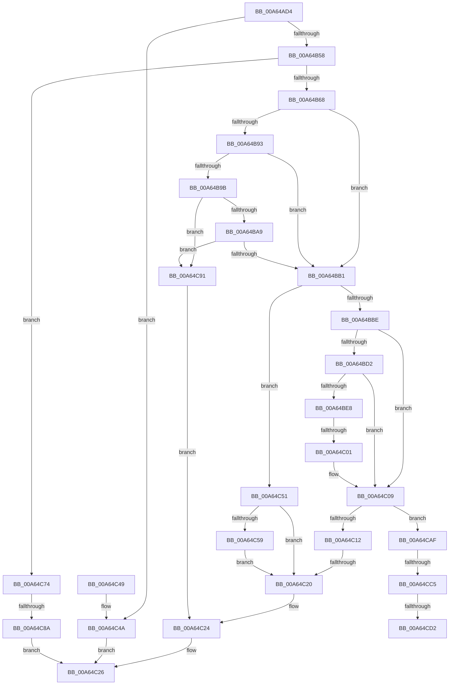

# ExpRaiseHardError

- RVA: `0x00A64AD4`–`0x00A64CDE` (길이 `522` bytes)
- VA: `0x0000000140A64AD4`
- 실행 섹션: `PAGE`
- PDB 이름 있음: `예`; PDB Function 태그: `예`
- unwind 정보 RVA: `0x000B3764`
- 디코드: `129`개 명령, `522/522` bytes 표시
- 미해석 바이트: `0` (있으면 어셈블리에 `.byte`로 보존)

> 이 문서는 커널 이미지의 기계어와 PDB 기호를 분석해 생성했습니다. 4번과 5번은 함수 원형과 자료형을 바이너리 사용 방식에서 추정한 C 해석이며 원본 소스 복구 결과는 아닙니다.

## 1. Dependencies

- 직접 호출 지점: **6**; 고유 호출 대상: **5**
- 직접 호출자로 확인된 함수: **2**
- RIP 상대 이미지 참조: **2**

### Outgoing calls
- `0x00A64B34` → [PsGetCurrentServerSiloGlobals](../../text/2F/PsGetCurrentServerSiloGlobals_function_002FE1F0.md) (function, `0x002FE1F0`)
- `0x00A64BEB` → [PsCaptureExceptionPort](../90/PsCaptureExceptionPort_function_00904CB0.md) (function, `0x00904CB0`)
- `0x00A64C31` → [_security_check_cookie](../../text/6A/_security_check_cookie_function_006AC640.md) (function, `0x006AC640`)
- `0x00A64C6D` → [ExpSystemErrorHandler](../../text/4F/ExpSystemErrorHandler_function_004FEDF0.md) (function, `0x004FEDF0`)
- `0x00A64C7D` → [SeSinglePrivilegeCheck](../87/SeSinglePrivilegeCheck_function_00871E20.md) (function, `0x00871E20`)
- `0x00A64CA5` → [ExpSystemErrorHandler](../../text/4F/ExpSystemErrorHandler_function_004FEDF0.md) (function, `0x004FEDF0`)

### Direct callers
- [ExRaiseHardError](ExRaiseHardError_function_00A64520.md) at `0x00A647F5`
- [NtRaiseHardError](NtRaiseHardError_function_00A64860.md) at `0x00A64A53`

### Static image references
- `0x00A64AE7` → RVA `0x00E0A740` (`.data`; read)
- `0x00A64C76` → RVA `0x00FD9B30` (`PAGEDATA`; read)

## 2. Other-region calls and transfers

- 다른 실행 섹션으로 향하는 call: **4**
  - `0x00A64B34` → [PsGetCurrentServerSiloGlobals](../../text/2F/PsGetCurrentServerSiloGlobals_function_002FE1F0.md) (`PAGE` → `.text`)
  - `0x00A64C31` → [_security_check_cookie](../../text/6A/_security_check_cookie_function_006AC640.md) (`PAGE` → `.text`)
  - `0x00A64C6D` → [ExpSystemErrorHandler](../../text/4F/ExpSystemErrorHandler_function_004FEDF0.md) (`PAGE` → `.text`)
  - `0x00A64CA5` → [ExpSystemErrorHandler](../../text/4F/ExpSystemErrorHandler_function_004FEDF0.md) (`PAGE` → `.text`)
- call이 아닌 외부 분기/꼬리 이동: **6**
  - `0x00A64BFB` → [sub_00B3E4E0 + 0x21](../B3/Unknown_function_00B3E4E0.md) (`tail-transfer`)
  - `0x00A64C1A` → [sub_00B3E4E0 + 0xAC](../B3/Unknown_function_00B3E4E0.md) (`tail-transfer`)
  - `0x00A64C84` → [sub_00B3E4E0](../B3/Unknown_function_00B3E4E0.md) (`tail-transfer`)
  - `0x00A64CBF` → [sub_00B3E4E0 + 0x32](../B3/Unknown_function_00B3E4E0.md) (`tail-transfer`)
  - `0x00A64CCC` → [sub_00B3E4E0 + 0x32](../B3/Unknown_function_00B3E4E0.md) (`tail-transfer`)
  - `0x00A64CD9` → [sub_00B3E4E0 + 0x34](../B3/Unknown_function_00B3E4E0.md) (`tail-transfer`)

## 3. Assembly (complete function range)

```asm
00A64AD4  40 53                           push rbx
00A64AD6  56                              push rsi
00A64AD7  57                              push rdi
00A64AD8  41 54                           push r12
00A64ADA  41 55                           push r13
00A64ADC  41 56                           push r14
00A64ADE  41 57                           push r15
00A64AE0  48 81 EC 40 03 00 00            sub rsp, 0x340
00A64AE7  48 8B 05 52 5C 3A 00            mov rax, qword ptr [rip + 0x3a5c52]
00A64AEE  48 33 C4                        xor rax, rsp
00A64AF1  48 89 84 24 30 03 00 00         mov qword ptr [rsp + 0x330], rax
00A64AF9  49 8B C1                        mov rax, r9
00A64AFC  48 89 44 24 60                  mov qword ptr [rsp + 0x60], rax
00A64B01  45 8B E8                        mov r13d, r8d
00A64B04  44 8B E2                        mov r12d, edx
00A64B07  8B F1                           mov esi, ecx
00A64B09  89 4C 24 38                     mov dword ptr [rsp + 0x38], ecx
00A64B0D  89 54 24 50                     mov dword ptr [rsp + 0x50], edx
00A64B11  89 54 24 5C                     mov dword ptr [rsp + 0x5c], edx
00A64B15  44 89 44 24 58                  mov dword ptr [rsp + 0x58], r8d
00A64B1A  48 89 44 24 68                  mov qword ptr [rsp + 0x68], rax
00A64B1F  48 8B BC 24 A0 03 00 00         mov rdi, qword ptr [rsp + 0x3a0]
00A64B27  4C 8B BC 24 B0 03 00 00         mov r15, qword ptr [rsp + 0x3b0]
00A64B2F  4C 89 7C 24 70                  mov qword ptr [rsp + 0x70], r15
00A64B34  E8 B7 96 89 FF                  call 0x1402fe1f0
00A64B39  4C 8B F0                        mov r14, rax
00A64B3C  65 48 8B 0C 25 88 01 00 00      mov rcx, qword ptr gs:[0x188]
00A64B45  8A 99 32 02 00 00               mov bl, byte ptr [rcx + 0x232]
00A64B4B  41 83 27 00                     and dword ptr [r15], 0
00A64B4F  83 FA 4D                        cmp edx, 0x4d
00A64B52  0F 87 F2 00 00 00               ja 0x140a64c4a
00A64B58  32 D2                           xor dl, dl
00A64B5A  83 BC 24 A8 03 00 00 06         cmp dword ptr [rsp + 0x3a8], 6
00A64B62  0F 84 0C 01 00 00               je 0x140a64c74
00A64B68  65 48 8B 0C 25 88 01 00 00      mov rcx, qword ptr gs:[0x188]
00A64B71  65 48 8B 04 25 88 01 00 00      mov rax, qword ptr gs:[0x188]
00A64B7A  4C 8B 90 B8 00 00 00            mov r10, qword ptr [rax + 0xb8]
00A64B81  44 8B 99 A0 05 00 00            mov r11d, dword ptr [rcx + 0x5a0]
00A64B88  41 83 E3 10                     and r11d, 0x10
00A64B8C  B9 00 00 00 C0                  mov ecx, 0xc0000000
00A64B91  75 1E                           jne 0x140a64bb1
00A64B93  8B C6                           mov eax, esi
00A64B95  23 C1                           and eax, ecx
00A64B97  3B C1                           cmp eax, ecx
00A64B99  75 16                           jne 0x140a64bb1
00A64B9B  41 83 BE 60 03 00 00 00         cmp dword ptr [r14 + 0x360], 0
00A64BA3  0F 84 E8 00 00 00               je 0x140a64c91
00A64BA9  84 D2                           test dl, dl
00A64BAB  0F 85 E0 00 00 00               jne 0x140a64c91
00A64BB1  4D 3B 96 50 03 00 00            cmp r10, qword ptr [r14 + 0x350]
00A64BB8  0F 84 93 00 00 00               je 0x140a64c51
00A64BBE  33 DB                           xor ebx, ebx
00A64BC0  48 89 5C 24 48                  mov qword ptr [rsp + 0x48], rbx
00A64BC5  40 32 FF                        xor dil, dil
00A64BC8  40 88 7C 24 30                  mov byte ptr [rsp + 0x30], dil
00A64BCD  45 85 DB                        test r11d, r11d
00A64BD0  75 37                           jne 0x140a64c09
00A64BD2  41 F6 82 88 03 00 00 01         test byte ptr [r10 + 0x388], 1
00A64BDA  0F 94 C2                        sete dl
00A64BDD  0F BA E6 1C                     bt esi, 0x1c
00A64BE1  0F 93 C0                        setae al
00A64BE4  84 D0                           test al, dl
00A64BE6  75 21                           jne 0x140a64c09
00A64BE8  49 8B CA                        mov rcx, r10
00A64BEB  E8 C0 00 EA FF                  call 0x140904cb0
00A64BF0  48 8B D8                        mov rbx, rax
00A64BF3  48 89 44 24 48                  mov qword ptr [rsp + 0x48], rax
00A64BF8  48 85 C0                        test rax, rax
00A64BFB  0F 84 00 99 0D 00               je 0x140b3e501
00A64C01  40 B7 01                        mov dil, 1
00A64C04  40 88 7C 24 30                  mov byte ptr [rsp + 0x30], dil
00A64C09  48 85 DB                        test rbx, rbx
00A64C0C  0F 85 9D 00 00 00               jne 0x140a64caf
00A64C12  4C 8B 74 24 60                  mov r14, qword ptr [rsp + 0x60]
00A64C17  48 85 DB                        test rbx, rbx
00A64C1A  0F 85 6C 99 0D 00               jne 0x140b3e58c
00A64C20  41 83 27 00                     and dword ptr [r15], 0
00A64C24  33 C0                           xor eax, eax
00A64C26  48 8B 8C 24 30 03 00 00         mov rcx, qword ptr [rsp + 0x330]
00A64C2E  48 33 CC                        xor rcx, rsp
00A64C31  E8 0A 7A C4 FF                  call 0x1406ac640
00A64C36  48 81 C4 40 03 00 00            add rsp, 0x340
00A64C3D  41 5F                           pop r15
00A64C3F  41 5E                           pop r14
00A64C41  41 5D                           pop r13
00A64C43  41 5C                           pop r12
00A64C45  5F                              pop rdi
00A64C46  5E                              pop rsi
00A64C47  5B                              pop rbx
00A64C48  C3                              ret
00A64C49  CC                              int3
00A64C4A  B8 0D 00 00 C0                  mov eax, 0xc000000d
00A64C4F  EB D5                           jmp 0x140a64c26
00A64C51  8B C6                           mov eax, esi
00A64C53  23 C1                           and eax, ecx
00A64C55  3B C1                           cmp eax, ecx
00A64C57  75 C7                           jne 0x140a64c20
00A64C59  84 DB                           test bl, bl
00A64C5B  0F 95 C0                        setne al
00A64C5E  88 44 24 20                     mov byte ptr [rsp + 0x20], al
00A64C62  4C 8B CF                        mov r9, rdi
00A64C65  45 8B C5                        mov r8d, r13d
00A64C68  41 8B D4                        mov edx, r12d
00A64C6B  8B CE                           mov ecx, esi
00A64C6D  E8 7E A1 A9 FF                  call 0x1404fedf0
00A64C72  EB AC                           jmp 0x140a64c20
00A64C74  8A D3                           mov dl, bl
00A64C76  48 8B 0D B3 4E 57 00            mov rcx, qword ptr [rip + 0x574eb3]
00A64C7D  E8 9E D1 E0 FF                  call 0x140871e20
00A64C82  84 C0                           test al, al
00A64C84  0F 85 56 98 0D 00               jne 0x140b3e4e0
00A64C8A  B8 61 00 00 C0                  mov eax, 0xc0000061
00A64C8F  EB 95                           jmp 0x140a64c26
00A64C91  84 DB                           test bl, bl
00A64C93  0F 95 C0                        setne al
00A64C96  88 44 24 20                     mov byte ptr [rsp + 0x20], al
00A64C9A  4C 8B CF                        mov r9, rdi
00A64C9D  45 8B C5                        mov r8d, r13d
00A64CA0  41 8B D4                        mov edx, r12d
00A64CA3  8B CE                           mov ecx, esi
00A64CA5  E8 46 A1 A9 FF                  call 0x1404fedf0
00A64CAA  E9 75 FF FF FF                  jmp 0x140a64c24
00A64CAF  65 48 8B 0C 25 88 01 00 00      mov rcx, qword ptr gs:[0x188]
00A64CB8  F7 41 74 00 04 00 00            test dword ptr [rcx + 0x74], 0x400
00A64CBF  0F 85 4D 98 0D 00               jne 0x140b3e512
00A64CC5  80 B9 4A 02 00 00 01            cmp byte ptr [rcx + 0x24a], 1
00A64CCC  0F 84 40 98 0D 00               je 0x140b3e512
00A64CD2  48 8B 81 F0 00 00 00            mov rax, qword ptr [rcx + 0xf0]
00A64CD9  E9 36 98 0D 00                  jmp 0x140b3e514
```

## 4. C-style interpretation (structured pseudocode)

```c
__int64 __fastcall ExpRaiseHardError(int a1, int a2, int a3, __int64 a4, __int64 a5, unsigned int a6, __int64 a7)
{
    __int64 result;
    __int64 v_r11;
    __int64 v_rbx;
    __int64 v_rdi;
    __int64 v_rsp;
    unsigned __int64 v_stack_m308;
    unsigned __int64 v_stack_m310;
    unsigned __int64 v_stack_m318;
    unsigned int v_stack_m31C;
    unsigned int v_stack_m320;
    unsigned int v_stack_m328;
    unsigned __int64 v_stack_m330;
    unsigned int v_stack_m340;
    unsigned __int8 v_stack_m348;
    unsigned __int64 v_stack_m48;
    unsigned __int8 v_stack_p20;

    v_rsp = (v_rsp) - (832);
    result = (*(unsigned __int64 *)(v_rip + 3824722)) ^ (v_rsp);
    v_stack_m48 = result;
    v_stack_m318 = a4;
    v_stack_m340 = a1;
    v_stack_m328 = a2;
    v_stack_m31C = a2;
    v_stack_m320 = a3;
    v_stack_m310 = a4;
    v_stack_m308 = a7;
    result = PsGetCurrentServerSiloGlobals(a1, a2, a3, a4);
    if (a2 > 77) goto loc_00A64C4A;
    a2 = 0;
    if (a6 == 6) goto loc_00A64C74;
    v_r11 = (unsigned int)(((unsigned int)(*(unsigned int *)(*(unsigned __int64 *)(gs_base + (0 + 392)) + 1440))) & (16));
    if (condition_is_not_equal) goto loc_00A64BB1;
    result = (unsigned int)(((unsigned int)((unsigned int)((unsigned int)(a1)))) & ((unsigned int)((unsigned int)(0xC0000000ULL))));
    if (((unsigned int)(result)) != ((unsigned int)((unsigned int)(0xC0000000ULL)))) goto loc_00A64BB1;
    if ((*(unsigned int *)(result + 864)) == 0) goto loc_00A64C91;
    if (0 != 0) goto loc_00A64C91;
loc_00A64BB1:
    if ((*(unsigned __int64 *)(*(unsigned __int64 *)(gs_base + (0 + 392)) + 184)) == (*(unsigned __int64 *)(result + 848))) goto loc_00A64C51;
    v_rbx = 0;
    v_stack_m330 = 0;
    v_rdi = 0;
    v_stack_m348 = 0;
    if ((unsigned int)(v_r11) != 0) goto loc_00A64C09;
    a2 = (((*(unsigned __int8 *)(*(unsigned __int64 *)(*(unsigned __int64 *)(gs_base + (0 + 392)) + 184) + 904)) & (1)) == 0) ? 1 : 0;
    result = (condition_is_above_or_equal) ? 1 : 0;
    if ((((unsigned __int8)(result)) & ((unsigned __int8)(a2))) != 0) goto loc_00A64C09;
    result = PsCaptureExceptionPort(*(unsigned __int64 *)(*(unsigned __int64 *)(gs_base + (0 + 392)) + 184), a2, a3, a4);
    v_stack_m330 = result;
    v_stack_m348 = 1;
loc_00A64C09:
    if (result != 0) goto loc_00A64CAF;
loc_00A64C20:
loc_00A64C24:
    result = 0;
loc_00A64C26:
    a1 = (v_stack_m48) ^ (v_rsp);
    result = _security_check_cookie(a1, a2, a3, a4);
    v_rsp = (v_rsp) + (832);
    return result;
loc_00A64C4A:
    goto loc_00A64C26;
loc_00A64C51:
    result = (unsigned int)(((unsigned int)((unsigned int)((unsigned int)(a1)))) & (a1));
    if (((unsigned int)(result)) != a1) goto loc_00A64C20;
    result = ((unsigned __int8)(result) != 0) ? 1 : 0;
    v_stack_p20 = (unsigned __int8)(result);
    result = ExpSystemErrorHandler((unsigned int)((unsigned int)((unsigned int)(a1))), (unsigned int)((unsigned int)((unsigned int)(a2))), (unsigned int)((unsigned int)((unsigned int)(a3))), 1);
    goto loc_00A64C20;
loc_00A64C74:
    result = SeSinglePrivilegeCheck(*(unsigned __int64 *)(v_rip + 5721779), (unsigned __int8)(result), (unsigned int)((unsigned int)((unsigned int)(a3))), 1);
    goto loc_00A64C26;
loc_00A64C91:
    result = ((unsigned __int8)(result) != 0) ? 1 : 0;
    v_stack_p20 = (unsigned __int8)(result);
    result = ExpSystemErrorHandler((unsigned int)((unsigned int)((unsigned int)(a1))), (unsigned int)((unsigned int)((unsigned int)(a2))), (unsigned int)((unsigned int)((unsigned int)(a3))), 1);
    goto loc_00A64C24;
loc_00A64CAF:
}
```

## 5. (Beta) C Style

```c
int64_t ExpRaiseHardError(int32_t Arg1, int32_t Arg2, int32_t Arg3, int64_t Arg4, int64_t Arg5, uint32_t Arg6, void *Arg7)
{
    uint8_t *arg7 = (uint8_t *)Arg7;

    int64_t result;
    int64_t local_r11;
    int64_t local_rbx;
    int64_t local_rdi;
    int64_t local_rsp;
    uint64_t v_stack_m308;
    uint64_t v_stack_m310;
    uint64_t v_stack_m318;
    uint32_t v_stack_m31C;
    uint32_t v_stack_m320;
    uint32_t v_stack_m328;
    uint64_t v_stack_m330;
    uint32_t v_stack_m340;
    uint8_t v_stack_m348;
    uint64_t v_stack_m48;
    uint8_t v_stack_p20;

    local_rsp = (local_rsp) - (832);
    result = (*(uint64_t *)(v_rip + 0x3A5C52)) ^ (local_rsp);
    v_stack_m48 = result;
    v_stack_m318 = Arg4;
    v_stack_m340 = Arg1;
    v_stack_m328 = Arg2;
    v_stack_m31C = Arg2;
    v_stack_m320 = Arg3;
    v_stack_m310 = Arg4;
    v_stack_m308 = Arg7;
    result = PsGetCurrentServerSiloGlobals(Arg1, Arg2, Arg3, Arg4);
    if (Arg2 > 77) goto loc_00A64C4A;
    Arg2 = 0;
    if (Arg6 == 6) goto loc_00A64C74;
    local_r11 = (uint32_t)(((uint32_t)(*(uint32_t *)(*(uint64_t *)(gs_base + (0 + 0x188)) + 0x5A0))) & (16));
    if (condition_is_not_equal) goto loc_00A64BB1;
    result = (uint32_t)(((uint32_t)((uint32_t)((uint32_t)(Arg1)))) & ((uint32_t)((uint32_t)(0xC0000000ULL))));
    if (((uint32_t)(result)) != ((uint32_t)((uint32_t)(0xC0000000ULL)))) goto loc_00A64BB1;
    if ((*(uint32_t *)(result + 0x360)) == 0) goto loc_00A64C91;
    if (0 != 0) goto loc_00A64C91;
loc_00A64BB1:
    if ((*(uint64_t *)(*(uint64_t *)(gs_base + (0 + 0x188)) + 0xB8)) == (*(uint64_t *)(result + 0x350))) goto loc_00A64C51;
    local_rbx = 0;
    v_stack_m330 = 0;
    local_rdi = 0;
    v_stack_m348 = 0;
    if ((uint32_t)(local_r11) != 0) goto loc_00A64C09;
    Arg2 = (((*(uint8_t *)(*(uint64_t *)(*(uint64_t *)(gs_base + (0 + 0x188)) + 0xB8) + 0x388)) & (1)) == 0) ? 1 : 0;
    result = (condition_is_above_or_equal) ? 1 : 0;
    if ((((uint8_t)(result)) & ((uint8_t)(Arg2))) != 0) goto loc_00A64C09;
    result = PsCaptureExceptionPort(*(uint64_t *)(*(uint64_t *)(gs_base + (0 + 0x188)) + 0xB8), Arg2, Arg3, Arg4);
    v_stack_m330 = result;
    v_stack_m348 = 1;
loc_00A64C09:
    if (result != 0) goto loc_00A64CAF;
loc_00A64C20:
loc_00A64C24:
    result = 0;
loc_00A64C26:
    Arg1 = (v_stack_m48) ^ (local_rsp);
    result = _security_check_cookie(Arg1, Arg2, Arg3, Arg4);
    local_rsp = (local_rsp) + (832);
    return result;
loc_00A64C4A:
    goto loc_00A64C26;
loc_00A64C51:
    result = (uint32_t)(((uint32_t)((uint32_t)((uint32_t)(Arg1)))) & (Arg1));
    if (((uint32_t)(result)) != Arg1) goto loc_00A64C20;
    result = ((uint8_t)(result) != 0) ? 1 : 0;
    v_stack_p20 = (uint8_t)(result);
    result = ExpSystemErrorHandler((uint32_t)((uint32_t)((uint32_t)(Arg1))), (uint32_t)((uint32_t)((uint32_t)(Arg2))), (uint32_t)((uint32_t)((uint32_t)(Arg3))), 1);
    goto loc_00A64C20;
loc_00A64C74:
    result = SeSinglePrivilegeCheck(*(uint64_t *)(v_rip + 0x574EB3), (uint8_t)(result), (uint32_t)((uint32_t)((uint32_t)(Arg3))), 1);
    goto loc_00A64C26;
loc_00A64C91:
    result = ((uint8_t)(result) != 0) ? 1 : 0;
    v_stack_p20 = (uint8_t)(result);
    result = ExpSystemErrorHandler((uint32_t)((uint32_t)((uint32_t)(Arg1))), (uint32_t)((uint32_t)((uint32_t)(Arg2))), (uint32_t)((uint32_t)((uint32_t)(Arg3))), 1);
    goto loc_00A64C24;
loc_00A64CAF:
}
```

### 관측된 메모리 오프셋

구조체 형식이 확인되지 않은 접근은 인자 기준의 오프셋으로만 기록했습니다.

| 기준 인자 | 오프셋 표현 | 폭 (bit) | 접근 |
|---|---:|---:|---|
| `Arg7` | `+ 0x0` | `32` | `R/W` |

## 6. Execution-region graph

[열기: 2D/3D 그래프와 함수 탐색 컨트롤 패널](../../../control-panel.html?section=page&rva=0x00A64AD4&view=graph)

- 2D 그래프는 위에서 아래로 흐르고, 3D 그래프는 빈 공간을 드래그해 회전합니다. Shift+드래그는 이동, 휠은 확대·축소, 함수 노드 선택은 대상 보고서 이동입니다.

### Static fallback


