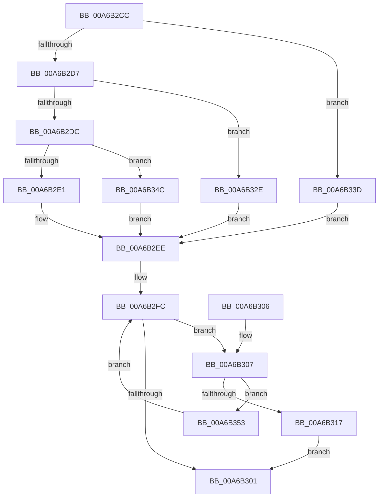

# ExpSetWorkerFactoryDeferredCreateTimer

- RVA: `0x00A6B2CC`–`0x00A6B358` (길이 `140` bytes)
- VA: `0x0000000140A6B2CC`
- 실행 섹션: `PAGE`
- PDB 이름 있음: `예`; PDB Function 태그: `아니요`
- unwind 정보 RVA: `0x000B42FC`
- 디코드: `37`개 명령, `140/140` bytes 표시
- 미해석 바이트: `0` (있으면 어셈블리에 `.byte`로 보존)

> 이 문서는 커널 이미지의 기계어와 PDB 기호를 분석해 생성했습니다. 4번과 5번은 함수 원형과 자료형을 바이너리 사용 방식에서 추정한 C 해석이며 원본 소스 복구 결과는 아닙니다.

## 1. Dependencies

- 직접 호출 지점: **1**; 고유 호출 대상: **1**
- 직접 호출자로 확인된 함수: **1**
- RIP 상대 이미지 참조: **5**

### Outgoing calls
- `0x00A6B327` → [KeSetCoalescableTimer](../../text/22/KeSetCoalescableTimer_function_0022FFD0.md) (function, `0x0022FFD0`)

### Direct callers
- [sub_0034466C](../../text/34/Unknown_function_0034466C.md) at `0x003446E6`

### Static image references
- `0x00A6B2E1` → RVA `0x00EFA260` (`.data`; read)
- `0x00A6B2EE` → RVA `0x00EFA180` (`.data`; read)
- `0x00A6B31D` → RVA `0x00EFA220` (`.data`; read)
- `0x00A6B32E` → RVA `0x00EFA268` (`.data`; read)
- `0x00A6B33D` → RVA `0x00EFA178` (`.data`; read)

## 2. Other-region calls and transfers

- 다른 실행 섹션으로 향하는 call: **1**
  - `0x00A6B327` → [KeSetCoalescableTimer](../../text/22/KeSetCoalescableTimer_function_0022FFD0.md) (`PAGE` → `.text`)
- 별도 외부 분기/꼬리 이동을 확인하지 못했습니다.

## 3. Assembly (complete function range)

```asm
00A6B2CC  48 83 EC 38                     sub rsp, 0x38
00A6B2D0  8B D1                           mov edx, ecx
00A6B2D2  83 EA 01                        sub edx, 1
00A6B2D5  74 66                           je 0x140a6b33d
00A6B2D7  83 EA 01                        sub edx, 1
00A6B2DA  74 52                           je 0x140a6b32e
00A6B2DC  83 FA 01                        cmp edx, 1
00A6B2DF  75 6B                           jne 0x140a6b34c
00A6B2E1  48 8B 15 78 EF 48 00            mov rdx, qword ptr [rip + 0x48ef78]
00A6B2E8  41 B9 1E 00 00 00               mov r9d, 0x1e
00A6B2EE  0F 0D 0D 8B EE 48 00            prefetchw byte ptr [rip + 0x48ee8b]
00A6B2F5  44 8B 05 84 EE 48 00            mov r8d, dword ptr [rip + 0x48ee84]
00A6B2FC  41 3B C8                        cmp ecx, r8d
00A6B2FF  7F 06                           jg 0x140a6b307
00A6B301  48 83 C4 38                     add rsp, 0x38
00A6B305  C3                              ret
00A6B306  CC                              int3
00A6B307  41 8B C0                        mov eax, r8d
00A6B30A  F0 0F B1 0D 6E EE 48 00         lock cmpxchg dword ptr [rip + 0x48ee6e], ecx
00A6B312  44 3B C0                        cmp r8d, eax
00A6B315  75 3C                           jne 0x140a6b353
00A6B317  48 83 64 24 20 00               and qword ptr [rsp + 0x20], 0
00A6B31D  48 8D 0D FC EE 48 00            lea rcx, [rip + 0x48eefc]
00A6B324  45 33 C0                        xor r8d, r8d
00A6B327  E8 A4 4C 7C FF                  call 0x14022ffd0
00A6B32C  EB D3                           jmp 0x140a6b301
00A6B32E  48 8B 15 33 EF 48 00            mov rdx, qword ptr [rip + 0x48ef33]
00A6B335  41 B9 78 00 00 00               mov r9d, 0x78
00A6B33B  EB B1                           jmp 0x140a6b2ee
00A6B33D  48 8B 15 34 EE 48 00            mov rdx, qword ptr [rip + 0x48ee34]
00A6B344  41 B9 F4 01 00 00               mov r9d, 0x1f4
00A6B34A  EB A2                           jmp 0x140a6b2ee
00A6B34C  33 D2                           xor edx, edx
00A6B34E  45 33 C9                        xor r9d, r9d
00A6B351  EB 9B                           jmp 0x140a6b2ee
00A6B353  44 8B C0                        mov r8d, eax
00A6B356  EB A4                           jmp 0x140a6b2fc
```

## 4. C-style interpretation (structured pseudocode)

```c
__int64 __fastcall ExpSetWorkerFactoryDeferredCreateTimer(int a1)
{
    __int64 result;
    __int64 v_rsp;
    unsigned __int64 v_stack_p20;

    v_rsp = (v_rsp) - (56);
    a2 = (unsigned int)(((unsigned int)(a1)) - (1));
    if (condition_is_equal) goto loc_00A6B33D;
    a2 = (unsigned int)((a2) - (1));
    if (condition_is_equal) goto loc_00A6B32E;
    if (((unsigned int)(a2)) != 1) goto loc_00A6B34C;
loc_00A6B2EE:
loc_00A6B2FC:
    if (a1 > ((unsigned int)((unsigned int)(*(unsigned int *)(v_rip + 4779652))))) goto loc_00A6B307;
loc_00A6B301:
    v_rsp = (v_rsp) + (56);
    return result;
loc_00A6B307:
    if (((unsigned int)((unsigned int)(*(unsigned int *)(v_rip + 4779652)))) != ((unsigned int)((unsigned int)((unsigned int)((unsigned int)(*(unsigned int *)(v_rip + 4779652))))))) goto loc_00A6B353;
    a3 = 0;
    result = KeSetCoalescableTimer(v_rip + 4779772, *(unsigned __int64 *)(v_rip + 4779896), a3, 30);
    goto loc_00A6B301;
loc_00A6B32E:
    goto loc_00A6B2EE;
loc_00A6B33D:
    goto loc_00A6B2EE;
loc_00A6B34C:
    a2 = 0;
    a4 = 0;
    goto loc_00A6B2EE;
loc_00A6B353:
    goto loc_00A6B2FC;
}
```

## 5. (Beta) C Style

```c
int64_t ExpSetWorkerFactoryDeferredCreateTimer(int32_t Arg1)
{
    int64_t result;
    int64_t local_rsp;
    uint64_t v_stack_p20;

    local_rsp = (local_rsp) - (56);
    a2 = (uint32_t)(((uint32_t)(Arg1)) - (1));
    if (condition_is_equal) goto loc_00A6B33D;
    a2 = (uint32_t)((a2) - (1));
    if (condition_is_equal) goto loc_00A6B32E;
    if (((uint32_t)(a2)) != 1) goto loc_00A6B34C;
loc_00A6B2EE:
loc_00A6B2FC:
    if (Arg1 > ((uint32_t)((uint32_t)(*(uint32_t *)(v_rip + 0x48EE84))))) goto loc_00A6B307;
loc_00A6B301:
    local_rsp = (local_rsp) + (56);
    return result;
loc_00A6B307:
    if (((uint32_t)((uint32_t)(*(uint32_t *)(v_rip + 0x48EE84)))) != ((uint32_t)((uint32_t)((uint32_t)((uint32_t)(*(uint32_t *)(v_rip + 0x48EE84))))))) goto loc_00A6B353;
    a3 = 0;
    result = KeSetCoalescableTimer(v_rip + 4779772, *(uint64_t *)(v_rip + 0x48EF78), a3, 30);
    goto loc_00A6B301;
loc_00A6B32E:
    goto loc_00A6B2EE;
loc_00A6B33D:
    goto loc_00A6B2EE;
loc_00A6B34C:
    a2 = 0;
    a4 = 0;
    goto loc_00A6B2EE;
loc_00A6B353:
    goto loc_00A6B2FC;
}
```

## 6. Execution-region graph

[열기: 2D/3D 그래프와 함수 탐색 컨트롤 패널](../../../control-panel.html?section=page&rva=0x00A6B2CC&view=graph)

- 2D 그래프는 위에서 아래로 흐르고, 3D 그래프는 빈 공간을 드래그해 회전합니다. Shift+드래그는 이동, 휠은 확대·축소, 함수 노드 선택은 대상 보고서 이동입니다.

### Static fallback


