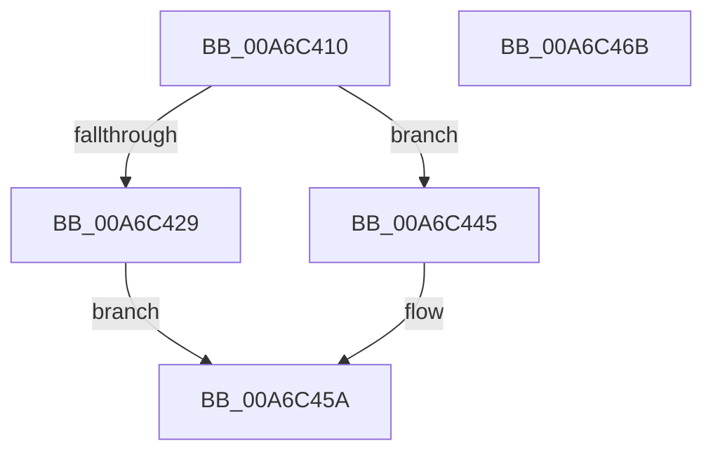

# ExpWriteTimeZoneBiasStartEnd

- RVA: `0x00A6C410`–`0x00A6C46C` (길이 `92` bytes)
- VA: `0x0000000140A6C410`
- 실행 섹션: `PAGE`
- PDB 이름 있음: `예`; PDB Function 태그: `예`
- unwind 정보 RVA: `0x0005CAAC`
- 디코드: `23`개 명령, `92/92` bytes 표시
- 미해석 바이트: `0` (있으면 어셈블리에 `.byte`로 보존)

> 이 문서는 커널 이미지의 기계어와 PDB 기호를 분석해 생성했습니다. 4번과 5번은 함수 원형과 자료형을 바이너리 사용 방식에서 추정한 C 해석이며 원본 소스 복구 결과는 아닙니다.

## 1. Dependencies

- 직접 호출 지점: **2**; 고유 호출 대상: **2**
- 직접 호출자로 확인된 함수: **1**
- RIP 상대 이미지 참조: **1**

### Outgoing calls
- `0x00A6C420` → [PsIsCurrentThreadInServerSilo](../../text/43/PsIsCurrentThreadInServerSilo_function_004362E0.md) (function, `0x004362E0`)
- `0x00A6C429` → [PsGetCurrentServerSiloGlobals](../../text/2F/PsGetCurrentServerSiloGlobals_function_002FE1F0.md) (function, `0x002FE1F0`)

### Direct callers
- [ExpRefreshTimeZoneInformation](ExpRefreshTimeZoneInformation_function_00A6B46C.md) at `0x00A6BA89`

### Static image references
- `0x00A6C445` → RVA `0x00FC5008` (`ALMOSTRO`; read)

## 2. Other-region calls and transfers

- 다른 실행 섹션으로 향하는 call: **2**
  - `0x00A6C420` → [PsIsCurrentThreadInServerSilo](../../text/43/PsIsCurrentThreadInServerSilo_function_004362E0.md) (`PAGE` → `.text`)
  - `0x00A6C429` → [PsGetCurrentServerSiloGlobals](../../text/2F/PsGetCurrentServerSiloGlobals_function_002FE1F0.md) (`PAGE` → `.text`)
- 별도 외부 분기/꼬리 이동을 확인하지 못했습니다.

## 3. Assembly (complete function range)

```asm
00A6C410  48 89 5C 24 08                  mov qword ptr [rsp + 8], rbx
00A6C415  57                              push rdi
00A6C416  48 83 EC 20                     sub rsp, 0x20
00A6C41A  48 8B DA                        mov rbx, rdx
00A6C41D  48 8B F9                        mov rdi, rcx
00A6C420  E8 BB 9E 9C FF                  call 0x1404362e0
00A6C425  84 C0                           test al, al
00A6C427  74 1C                           je 0x140a6c445
00A6C429  E8 C2 1D 89 FF                  call 0x1402fe1f0
00A6C42E  4C 8B 80 08 05 00 00            mov r8, qword ptr [rax + 0x508]
00A6C435  4D 8D 88 60 02 00 00            lea r9, [r8 + 0x260]
00A6C43C  49 81 C0 68 02 00 00            add r8, 0x268
00A6C443  EB 15                           jmp 0x140a6c45a
00A6C445  48 8B 05 BC 8B 55 00            mov rax, qword ptr [rip + 0x558bbc]
00A6C44C  4C 8D 88 C8 03 00 00            lea r9, [rax + 0x3c8]
00A6C453  4C 8D 80 D0 03 00 00            lea r8, [rax + 0x3d0]
00A6C45A  49 89 39                        mov qword ptr [r9], rdi
00A6C45D  49 89 18                        mov qword ptr [r8], rbx
00A6C460  48 8B 5C 24 30                  mov rbx, qword ptr [rsp + 0x30]
00A6C465  48 83 C4 20                     add rsp, 0x20
00A6C469  5F                              pop rdi
00A6C46A  C3                              ret
00A6C46B  CC                              int3
```

## 4. C-style interpretation (structured pseudocode)

```c
__int64 __fastcall ExpWriteTimeZoneBiasStartEnd(__int64 a1, __int64 a2)
{
    __int64 result;
    __int64 v_rsp;
    unsigned __int64 v_stack_p8;

    v_stack_p8 = v_rbx;
    v_rsp = (v_rsp) - (32);
    result = PsIsCurrentThreadInServerSilo(a1, a2, a3, a4);
    if ((unsigned __int8)(result) == 0) goto loc_00A6C445;
    result = PsGetCurrentServerSiloGlobals(a1, a2, a3, a4);
    a3 = (*(unsigned __int64 *)(result + 1288)) + (616);
    goto loc_00A6C45A;
loc_00A6C445:
loc_00A6C45A:
    *(unsigned __int64 *)(*(unsigned __int64 *)(v_rip + 5606332) + 968) = a1;
    *(unsigned __int64 *)(*(unsigned __int64 *)(v_rip + 5606332) + 976) = a2;
    v_rsp = (v_rsp) + (32);
    return *(unsigned __int64 *)(v_rip + 5606332);
}
```

## 5. (Beta) C Style

```c
int64_t ExpWriteTimeZoneBiasStartEnd(int64_t Arg1, int64_t Arg2)
{
    int64_t result;
    int64_t local_rsp;
    uint64_t v_stack_p8;

    v_stack_p8 = local_rbx;
    local_rsp = (local_rsp) - (32);
    result = PsIsCurrentThreadInServerSilo(Arg1, Arg2, a3, a4);
    if ((uint8_t)(result) == 0) goto loc_00A6C445;
    result = PsGetCurrentServerSiloGlobals(Arg1, Arg2, a3, a4);
    a3 = (*(uint64_t *)(result + 0x508)) + (616);
    goto loc_00A6C45A;
loc_00A6C445:
loc_00A6C45A:
    *(uint64_t *)(*(uint64_t *)(v_rip + 0x558BBC) + 0x3C8) = Arg1;
    *(uint64_t *)(*(uint64_t *)(v_rip + 0x558BBC) + 0x3D0) = Arg2;
    local_rsp = (local_rsp) + (32);
    return *(uint64_t *)(v_rip + 0x558BBC);
}
```

## 6. Execution-region graph

[열기: 2D/3D 그래프와 함수 탐색 컨트롤 패널](../../../control-panel.html?section=page&rva=0x00A6C410&view=graph)

- 2D 그래프는 위에서 아래로 흐르고, 3D 그래프는 빈 공간을 드래그해 회전합니다. Shift+드래그는 이동, 휠은 확대·축소, 함수 노드 선택은 대상 보고서 이동입니다.

### Static fallback


