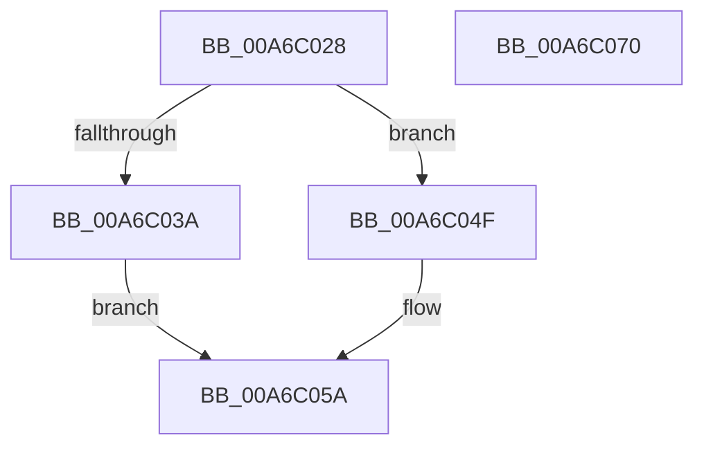

# ExpWriteTimeZoneBias

- RVA: `0x00A6C028`–`0x00A6C071` (길이 `73` bytes)
- VA: `0x0000000140A6C028`
- 실행 섹션: `PAGE`
- PDB 이름 있음: `예`; PDB Function 태그: `아니요`
- unwind 정보 RVA: `0x0005CF00`
- 디코드: `22`개 명령, `73/73` bytes 표시
- 미해석 바이트: `0` (있으면 어셈블리에 `.byte`로 보존)

> 이 문서는 커널 이미지의 기계어와 PDB 기호를 분석해 생성했습니다. 4번과 5번은 함수 원형과 자료형을 바이너리 사용 방식에서 추정한 C 해석이며 원본 소스 복구 결과는 아닙니다.

## 1. Dependencies

- 직접 호출 지점: **2**; 고유 호출 대상: **2**
- 직접 호출자로 확인된 함수: **3**
- RIP 상대 이미지 참조: **1**

### Outgoing calls
- `0x00A6C031` → [PsIsCurrentThreadInServerSilo](../../text/43/PsIsCurrentThreadInServerSilo_function_004362E0.md) (function, `0x004362E0`)
- `0x00A6C03A` → [PsGetCurrentServerSiloGlobals](../../text/2F/PsGetCurrentServerSiloGlobals_function_002FE1F0.md) (function, `0x002FE1F0`)

### Direct callers
- [ExInitializeUtcTimeZoneBias](../7C/ExInitializeUtcTimeZoneBias_function_007C5818.md) at `0x007C59B5`
- [ExpRefreshTimeZoneInformation](ExpRefreshTimeZoneInformation_function_00A6B46C.md) at `0x00A6BA67`
- [Phase1InitializationDiscard](../../init/C1/Phase1InitializationDiscard_function_00C1C728.md) at `0x00C1CDC0`

### Static image references
- `0x00A6C04F` → RVA `0x00FC5008` (`ALMOSTRO`; read)

## 2. Other-region calls and transfers

- 다른 실행 섹션으로 향하는 call: **2**
  - `0x00A6C031` → [PsIsCurrentThreadInServerSilo](../../text/43/PsIsCurrentThreadInServerSilo_function_004362E0.md) (`PAGE` → `.text`)
  - `0x00A6C03A` → [PsGetCurrentServerSiloGlobals](../../text/2F/PsGetCurrentServerSiloGlobals_function_002FE1F0.md) (`PAGE` → `.text`)
- 별도 외부 분기/꼬리 이동을 확인하지 못했습니다.

## 3. Assembly (complete function range)

```asm
00A6C028  40 53                           push rbx
00A6C02A  48 83 EC 20                     sub rsp, 0x20
00A6C02E  48 8B D9                        mov rbx, rcx
00A6C031  E8 AA A2 9C FF                  call 0x1404362e0
00A6C036  84 C0                           test al, al
00A6C038  74 15                           je 0x140a6c04f
00A6C03A  E8 B1 21 89 FF                  call 0x1402fe1f0
00A6C03F  48 8B 90 08 05 00 00            mov rdx, qword ptr [rax + 0x508]
00A6C046  48 81 C2 50 02 00 00            add rdx, 0x250
00A6C04D  EB 0B                           jmp 0x140a6c05a
00A6C04F  48 8B 15 B2 8F 55 00            mov rdx, qword ptr [rip + 0x558fb2]
00A6C056  48 83 C2 20                     add rdx, 0x20
00A6C05A  8B 43 04                        mov eax, dword ptr [rbx + 4]
00A6C05D  89 42 08                        mov dword ptr [rdx + 8], eax
00A6C060  8B 03                           mov eax, dword ptr [rbx]
00A6C062  89 02                           mov dword ptr [rdx], eax
00A6C064  8B 43 04                        mov eax, dword ptr [rbx + 4]
00A6C067  89 42 04                        mov dword ptr [rdx + 4], eax
00A6C06A  48 83 C4 20                     add rsp, 0x20
00A6C06E  5B                              pop rbx
00A6C06F  C3                              ret
00A6C070  CC                              int3
```

## 4. C-style interpretation (structured pseudocode)

```c
__int64 __fastcall ExpWriteTimeZoneBias(__int64 a1)
{
    __int64 result;
    __int64 v_rsp;

    v_rsp = (v_rsp) - (32);
    result = PsIsCurrentThreadInServerSilo(a1, a2, a3, a4);
    if ((unsigned __int8)(result) == 0) goto loc_00A6C04F;
    result = PsGetCurrentServerSiloGlobals(a1, a2, a3, a4);
    a2 = (*(unsigned __int64 *)(result + 1288)) + (592);
    goto loc_00A6C05A;
loc_00A6C04F:
    a2 = (*(unsigned __int64 *)(v_rip + 5607346)) + (32);
loc_00A6C05A:
    *(unsigned int *)(a2 + 8) = (unsigned int)((unsigned int)(*(unsigned int *)(a1 + 4)));
    *(unsigned int *)(a2) = (unsigned int)((unsigned int)(*(unsigned int *)(a1)));
    *(unsigned int *)(a2 + 4) = (unsigned int)((unsigned int)(*(unsigned int *)(a1 + 4)));
    v_rsp = (v_rsp) + (32);
    return (unsigned int)(*(unsigned int *)(a1 + 4));
}
```

## 5. (Beta) C Style

```c
int64_t ExpWriteTimeZoneBias(void *Arg1)
{
    uint8_t *arg1 = (uint8_t *)Arg1;

    int64_t result;
    int64_t local_rsp;

    local_rsp = (local_rsp) - (32);
    result = PsIsCurrentThreadInServerSilo(Arg1, a2, a3, a4);
    if ((uint8_t)(result) == 0) goto loc_00A6C04F;
    result = PsGetCurrentServerSiloGlobals(Arg1, a2, a3, a4);
    a2 = (*(uint64_t *)(result + 0x508)) + (592);
    goto loc_00A6C05A;
loc_00A6C04F:
    a2 = (*(uint64_t *)(v_rip + 0x558FB2)) + (32);
loc_00A6C05A:
    *(uint32_t *)(a2 + 0x8) = (uint32_t)((uint32_t)(*(uint32_t *)(arg1 + 0x4)));
    *(uint32_t *)(a2) = (uint32_t)((uint32_t)(*(uint32_t *)(arg1)));
    *(uint32_t *)(a2 + 0x4) = (uint32_t)((uint32_t)(*(uint32_t *)(arg1 + 0x4)));
    local_rsp = (local_rsp) + (32);
    return (uint32_t)(*(uint32_t *)(arg1 + 0x4));
}
```

### 관측된 메모리 오프셋

구조체 형식이 확인되지 않은 접근은 인자 기준의 오프셋으로만 기록했습니다.

| 기준 인자 | 오프셋 표현 | 폭 (bit) | 접근 |
|---|---:|---:|---|
| `Arg1` | `+ 0x0` | `32` | `R` |
| `Arg1` | `+ 0x4` | `32` | `R` |

## 6. Execution-region graph

[열기: 2D/3D 그래프와 함수 탐색 컨트롤 패널](../../../control-panel.html?section=page&rva=0x00A6C028&view=graph)

- 2D 그래프는 위에서 아래로 흐르고, 3D 그래프는 빈 공간을 드래그해 회전합니다. Shift+드래그는 이동, 휠은 확대·축소, 함수 노드 선택은 대상 보고서 이동입니다.

### Static fallback


