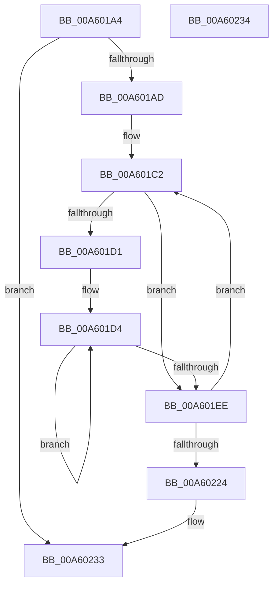

# FlushEventEntryList

- RVA: `0x00A601A4`–`0x00A60235` (길이 `145` bytes)
- VA: `0x0000000140A601A4`
- 실행 섹션: `PAGE`
- PDB 이름 있음: `예`; PDB Function 태그: `예`
- unwind 정보 RVA: `0x000AC034`
- 디코드: `43`개 명령, `145/145` bytes 표시
- 미해석 바이트: `0` (있으면 어셈블리에 `.byte`로 보존)

> 이 문서는 커널 이미지의 기계어와 PDB 기호를 분석해 생성했습니다. 4번과 5번은 함수 원형과 자료형을 바이너리 사용 방식에서 추정한 C 해석이며 원본 소스 복구 결과는 아닙니다.

## 1. Dependencies

- 직접 호출 지점: **2**; 고유 호출 대상: **2**
- 직접 호출자로 확인된 함수: **1**
- RIP 상대 이미지 참조: **0**

### Outgoing calls
- `0x00A6020B` → [EtwWriteTransfer](../../text/41/EtwWriteTransfer_function_0041C830.md) (function, `0x0041C830`)
- `0x00A60217` → [DestroyEventEntry](../../text/4B/DestroyEventEntry_function_004B2838.md) (function, `0x004B2838`)

### Direct callers
- [FlushLookUpTableBucket](../../text/49/FlushLookUpTableBucket_function_00497690.md) at `0x0049777A`

### Static image references
- 디코드된 RIP-relative 메모리 참조가 없습니다.

## 2. Other-region calls and transfers

- 다른 실행 섹션으로 향하는 call: **2**
  - `0x00A6020B` → [EtwWriteTransfer](../../text/41/EtwWriteTransfer_function_0041C830.md) (`PAGE` → `.text`)
  - `0x00A60217` → [DestroyEventEntry](../../text/4B/DestroyEventEntry_function_004B2838.md) (`PAGE` → `.text`)
- 별도 외부 분기/꼬리 이동을 확인하지 못했습니다.

## 3. Assembly (complete function range)

```asm
00A601A4  48 85 D2                        test rdx, rdx
00A601A7  0F 84 86 00 00 00               je 0x140a60233
00A601AD  48 89 5C 24 08                  mov qword ptr [rsp + 8], rbx
00A601B2  48 89 74 24 10                  mov qword ptr [rsp + 0x10], rsi
00A601B7  57                              push rdi
00A601B8  48 83 EC 30                     sub rsp, 0x30
00A601BC  48 8B FA                        mov rdi, rdx
00A601BF  48 8B F1                        mov rsi, rcx
00A601C2  0F B6 47 2D                     movzx eax, byte ptr [rdi + 0x2d]
00A601C6  BA 02 00 00 00                  mov edx, 2
00A601CB  03 C2                           add eax, edx
00A601CD  3B C2                           cmp eax, edx
00A601CF  76 1D                           jbe 0x140a601ee
00A601D1  8D 4A 1E                        lea ecx, [rdx + 0x1e]
00A601D4  48 8B 47 10                     mov rax, qword ptr [rdi + 0x10]
00A601D8  48 8D 49 10                     lea rcx, [rcx + 0x10]
00A601DC  FF C2                           inc edx
00A601DE  C6 44 08 FD 00                  mov byte ptr [rax + rcx - 3], 0
00A601E3  0F B6 47 2D                     movzx eax, byte ptr [rdi + 0x2d]
00A601E7  83 C0 02                        add eax, 2
00A601EA  3B D0                           cmp edx, eax
00A601EC  7C E6                           jl 0x140a601d4
00A601EE  0F B6 57 2C                     movzx edx, byte ptr [rdi + 0x2c]
00A601F2  45 33 C9                        xor r9d, r9d
00A601F5  48 8B 47 10                     mov rax, qword ptr [rdi + 0x10]
00A601F9  45 33 C0                        xor r8d, r8d
00A601FC  48 89 44 24 28                  mov qword ptr [rsp + 0x28], rax
00A60201  48 8B CE                        mov rcx, rsi
00A60204  89 54 24 20                     mov dword ptr [rsp + 0x20], edx
00A60208  48 8B D7                        mov rdx, rdi
00A6020B  E8 20 C6 9B FF                  call 0x14041c830
00A60210  48 8B 5F 18                     mov rbx, qword ptr [rdi + 0x18]
00A60214  48 8B CF                        mov rcx, rdi
00A60217  E8 1C 26 A5 FF                  call 0x1404b2838
00A6021C  48 8B FB                        mov rdi, rbx
00A6021F  48 85 DB                        test rbx, rbx
00A60222  75 9E                           jne 0x140a601c2
00A60224  48 8B 5C 24 40                  mov rbx, qword ptr [rsp + 0x40]
00A60229  48 8B 74 24 48                  mov rsi, qword ptr [rsp + 0x48]
00A6022E  48 83 C4 30                     add rsp, 0x30
00A60232  5F                              pop rdi
00A60233  C3                              ret
00A60234  CC                              int3
```

## 4. C-style interpretation (structured pseudocode)

```c
__int64 __fastcall FlushEventEntryList(__int64 a1, __int64 a2, int a3, int a4)
{
    __int64 result;
    __int64 v_rsp;
    unsigned __int64 v_stack_m10;
    unsigned int v_stack_m18;
    unsigned __int64 v_stack_p10;
    unsigned __int64 v_stack_p8;

    if (a2 == 0) goto loc_00A60233;
    v_stack_p8 = v_rbx;
    v_stack_p10 = v_rsi;
    v_rsp = (v_rsp) - (48);
loc_00A601C2:
    result = (unsigned int)((*(unsigned __int8 *)(a2 + 45)) + (2));
    if (((unsigned int)(result)) <= 2) goto loc_00A601EE;
loc_00A601D4:
    a2 = (unsigned int)((2) + 1);
    *(unsigned __int8 *)(*(unsigned __int64 *)(a2 + 16) + 2 + 30 + 16 * 1 - 3) = 0;
    result = (unsigned int)((*(unsigned __int8 *)(a2 + 45)) + (2));
    if (((unsigned int)(a2)) < ((unsigned int)(result))) goto loc_00A601D4;
loc_00A601EE:
    a4 = 0;
    a3 = 0;
    v_stack_m10 = *(unsigned __int64 *)(a2 + 16);
    v_stack_m18 = (unsigned int)(*(unsigned __int8 *)(a2 + 44));
    result = EtwWriteTransfer(a1, a2, a3, a4);
    result = DestroyEventEntry(a2, a2, a3, a4);
    if (*(unsigned __int64 *)(a2 + 24) != 0) goto loc_00A601C2;
    v_rsp = (v_rsp) + (48);
loc_00A60233:
    return result;
}
```

## 5. (Beta) C Style

```c
int64_t FlushEventEntryList(int64_t Arg1, int64_t Arg2, int32_t Arg3, int32_t Arg4)
{
    int64_t result;
    int64_t local_rsp;
    uint64_t v_stack_m10;
    uint32_t v_stack_m18;
    uint64_t v_stack_p10;
    uint64_t v_stack_p8;

    if (Arg2 == 0) goto loc_00A60233;
    v_stack_p8 = local_rbx;
    v_stack_p10 = local_rsi;
    local_rsp = (local_rsp) - (48);
loc_00A601C2:
    result = (uint32_t)((*(uint8_t *)(Arg2 + 0x2D)) + (2));
    if (((uint32_t)(result)) <= 2) goto loc_00A601EE;
loc_00A601D4:
    Arg2 = (uint32_t)((2) + 1);
    *(uint8_t *)(*(uint64_t *)(Arg2 + 0x10) + 0x2 + 0x1E + 0x10 * 1 - 0x3) = 0;
    result = (uint32_t)((*(uint8_t *)(Arg2 + 0x2D)) + (2));
    if (((uint32_t)(Arg2)) < ((uint32_t)(result))) goto loc_00A601D4;
loc_00A601EE:
    Arg4 = 0;
    Arg3 = 0;
    v_stack_m10 = *(uint64_t *)(Arg2 + 0x10);
    v_stack_m18 = (uint32_t)(*(uint8_t *)(Arg2 + 0x2C));
    result = EtwWriteTransfer(Arg1, Arg2, Arg3, Arg4);
    result = DestroyEventEntry(Arg2, Arg2, Arg3, Arg4);
    if (*(uint64_t *)(Arg2 + 0x18) != 0) goto loc_00A601C2;
    local_rsp = (local_rsp) + (48);
loc_00A60233:
    return result;
}
```

## 6. Execution-region graph

[열기: 2D/3D 그래프와 함수 탐색 컨트롤 패널](../../../control-panel.html?section=page&rva=0x00A601A4&view=graph)

- 2D 그래프는 위에서 아래로 흐르고, 3D 그래프는 빈 공간을 드래그해 회전합니다. Shift+드래그는 이동, 휠은 확대·축소, 함수 노드 선택은 대상 보고서 이동입니다.

### Static fallback


