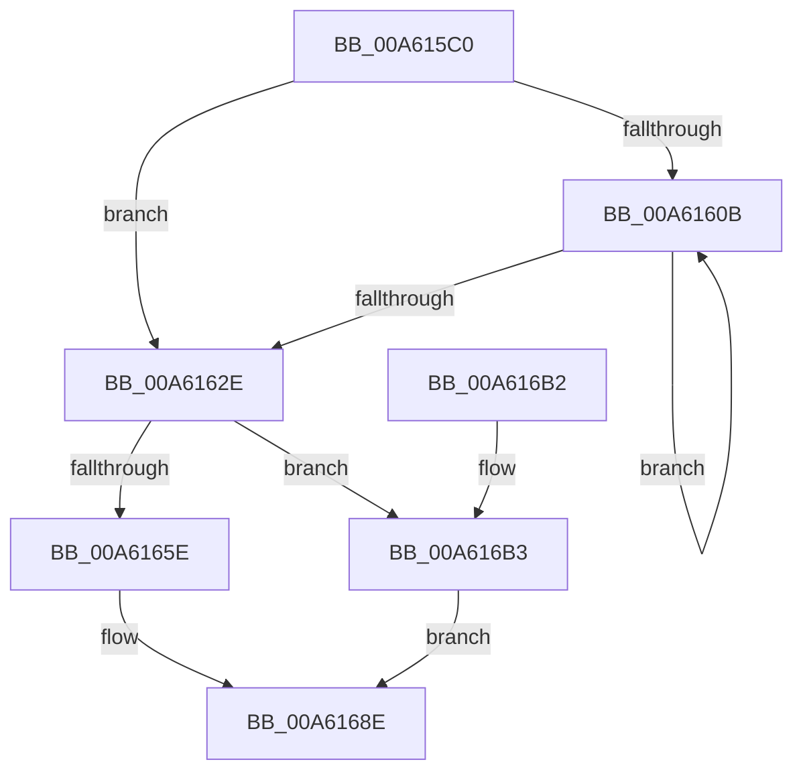

# FsRtlAddDiskIOCounterInstance

- RVA: `0x00A615C0`–`0x00A616BC` (길이 `252` bytes)
- VA: `0x0000000140A615C0`
- 실행 섹션: `PAGE`
- PDB 이름 있음: `예`; PDB Function 태그: `아니요`
- unwind 정보 RVA: `0x000B3218`
- 디코드: `65`개 명령, `252/252` bytes 표시
- 미해석 바이트: `0` (있으면 어셈블리에 `.byte`로 보존)

> 이 문서는 커널 이미지의 기계어와 PDB 기호를 분석해 생성했습니다. 4번과 5번은 함수 원형과 자료형을 바이너리 사용 방식에서 추정한 C 해석이며 원본 소스 복구 결과는 아닙니다.

## 1. Dependencies

- 직접 호출 지점: **8**; 고유 호출 대상: **8**
- 직접 호출자로 확인된 함수: **1**
- RIP 상대 이미지 참조: **3**

### Outgoing calls
- `0x00A615F4` → [KeQueryActiveProcessorCountEx](../../text/24/KeQueryActiveProcessorCountEx_function_00249EF0.md) (function, `0x00249EF0`)
- `0x00A6160D` → [KeGetPrcb](../../text/2D/KeGetPrcb_function_002D85D0.md) (function, `0x002D85D0`)
- `0x00A61639` → [RtlInitUnicodeString](../../text/42/RtlInitUnicodeString_function_0042A780.md) (function, `0x0042A780`)
- `0x00A61654` → [ExGetExtensionTable](../../text/42/ExGetExtensionTable_function_00428814.md) (function, `0x00428814`)
- `0x00A6167B` → [guard_dispatch_icall](../../text/6B/guard_dispatch_icall_function_006BAAD0.md) (function, `0x006BAAD0`)
- `0x00A61689` → [ExReleaseExtensionTable](../../text/45/ExReleaseExtensionTable_function_00456DC0.md) (function, `0x00456DC0`)
- `0x00A61697` → [_security_check_cookie](../../text/6A/_security_check_cookie_function_006AC640.md) (function, `0x006AC640`)
- `0x00A616B3` → [ExpPcwDisabledStatus](ExpPcwDisabledStatus_function_00A611E0.md) (function, `0x00A611E0`)

### Direct callers
- [FsRtlDiskIOCounterSetCallback](FsRtlDiskIOCounterSetCallback_function_00A61540.md) at `0x00A6155F`

### Static image references
- `0x00A615D7` → RVA `0x00E0A740` (`.data`; read)
- `0x00A6162E` → RVA `0x00AFC130` (` ?? ::NNGAKEGL::`string'`; read)
- `0x00A6163E` → RVA `0x00FD8080` (`PAGEDATA`; read)

## 2. Other-region calls and transfers

- 다른 실행 섹션으로 향하는 call: **7**
  - `0x00A615F4` → [KeQueryActiveProcessorCountEx](../../text/24/KeQueryActiveProcessorCountEx_function_00249EF0.md) (`PAGE` → `.text`)
  - `0x00A6160D` → [KeGetPrcb](../../text/2D/KeGetPrcb_function_002D85D0.md) (`PAGE` → `.text`)
  - `0x00A61639` → [RtlInitUnicodeString](../../text/42/RtlInitUnicodeString_function_0042A780.md) (`PAGE` → `.text`)
  - `0x00A61654` → [ExGetExtensionTable](../../text/42/ExGetExtensionTable_function_00428814.md) (`PAGE` → `.text`)
  - `0x00A6167B` → [guard_dispatch_icall](../../text/6B/guard_dispatch_icall_function_006BAAD0.md) (`PAGE` → `.text`)
  - `0x00A61689` → [ExReleaseExtensionTable](../../text/45/ExReleaseExtensionTable_function_00456DC0.md) (`PAGE` → `.text`)
  - `0x00A61697` → [_security_check_cookie](../../text/6A/_security_check_cookie_function_006AC640.md) (`PAGE` → `.text`)
- 별도 외부 분기/꼬리 이동을 확인하지 못했습니다.

## 3. Assembly (complete function range)

```asm
00A615C0  48 89 5C 24 10                  mov qword ptr [rsp + 0x10], rbx
00A615C5  48 89 74 24 18                  mov qword ptr [rsp + 0x18], rsi
00A615CA  48 89 7C 24 20                  mov qword ptr [rsp + 0x20], rdi
00A615CF  55                              push rbp
00A615D0  48 8B EC                        mov rbp, rsp
00A615D3  48 83 EC 70                     sub rsp, 0x70
00A615D7  48 8B 05 62 91 3A 00            mov rax, qword ptr [rip + 0x3a9162]
00A615DE  48 33 C4                        xor rax, rsp
00A615E1  48 89 45 F0                     mov qword ptr [rbp - 0x10], rax
00A615E5  48 8B F1                        mov rsi, rcx
00A615E8  0F 57 C0                        xorps xmm0, xmm0
00A615EB  B9 FF FF 00 00                  mov ecx, 0xffff
00A615F0  0F 11 45 D0                     movups xmmword ptr [rbp - 0x30], xmm0
00A615F4  E8 F7 88 7E FF                  call 0x140249ef0
00A615F9  48 83 65 E0 00                  and qword ptr [rbp - 0x20], 0
00A615FE  33 DB                           xor ebx, ebx
00A61600  48 83 65 E8 00                  and qword ptr [rbp - 0x18], 0
00A61605  8B F8                           mov edi, eax
00A61607  85 C0                           test eax, eax
00A61609  74 23                           je 0x140a6162e
00A6160B  8B CB                           mov ecx, ebx
00A6160D  E8 BE 6F 87 FF                  call 0x1402d85d0
00A61612  FF C3                           inc ebx
00A61614  48 8B 88 80 8F 00 00            mov rcx, qword ptr [rax + 0x8f80]
00A6161B  48 01 4D E0                     add qword ptr [rbp - 0x20], rcx
00A6161F  48 8B 80 88 8F 00 00            mov rax, qword ptr [rax + 0x8f88]
00A61626  48 01 45 E8                     add qword ptr [rbp - 0x18], rax
00A6162A  3B DF                           cmp ebx, edi
00A6162C  72 DD                           jb 0x140a6160b
00A6162E  48 8D 15 FB AA 09 00            lea rdx, [rip + 0x9aafb]
00A61635  48 8D 4D D0                     lea rcx, [rbp - 0x30]
00A61639  E8 42 91 9C FF                  call 0x14042a780
00A6163E  48 8B 0D 3B 6A 57 00            mov rcx, qword ptr [rip + 0x576a3b]
00A61645  48 8D 45 E0                     lea rax, [rbp - 0x20]
00A61649  48 89 45 C0                     mov qword ptr [rbp - 0x40], rax
00A6164D  C7 45 C8 10 00 00 00            mov dword ptr [rbp - 0x38], 0x10
00A61654  E8 BB 71 9C FF                  call 0x140428814
00A61659  48 85 C0                        test rax, rax
00A6165C  74 55                           je 0x140a616b3
00A6165E  48 8B 40 20                     mov rax, qword ptr [rax + 0x20]
00A61662  48 8D 4D C0                     lea rcx, [rbp - 0x40]
00A61666  48 89 4C 24 20                  mov qword ptr [rsp + 0x20], rcx
00A6166B  48 8D 55 D0                     lea rdx, [rbp - 0x30]
00A6166F  48 8B CE                        mov rcx, rsi
00A61672  41 B9 01 00 00 00               mov r9d, 1
00A61678  45 33 C0                        xor r8d, r8d
00A6167B  E8 50 94 C5 FF                  call 0x1406baad0
00A61680  48 8B 0D F9 69 57 00            mov rcx, qword ptr [rip + 0x5769f9]
00A61687  8B D8                           mov ebx, eax
00A61689  E8 32 57 9F FF                  call 0x140456dc0
00A6168E  8B C3                           mov eax, ebx
00A61690  48 8B 4D F0                     mov rcx, qword ptr [rbp - 0x10]
00A61694  48 33 CC                        xor rcx, rsp
00A61697  E8 A4 AF C4 FF                  call 0x1406ac640
00A6169C  4C 8D 5C 24 70                  lea r11, [rsp + 0x70]
00A616A1  49 8B 5B 18                     mov rbx, qword ptr [r11 + 0x18]
00A616A5  49 8B 73 20                     mov rsi, qword ptr [r11 + 0x20]
00A616A9  49 8B 7B 28                     mov rdi, qword ptr [r11 + 0x28]
00A616AD  49 8B E3                        mov rsp, r11
00A616B0  5D                              pop rbp
00A616B1  C3                              ret
00A616B2  CC                              int3
00A616B3  E8 28 FB FF FF                  call 0x140a611e0
00A616B8  8B D8                           mov ebx, eax
00A616BA  EB D2                           jmp 0x140a6168e
```

## 4. C-style interpretation (structured pseudocode)

```c
__int64 __fastcall FsRtlAddDiskIOCounterInstance(__int64 a1, __int64 a2, int a3)
{
    __int64 result;
    __int64 v_rbx;
    __int64 v_rsp;
    unsigned __int64 v_stack_m18;
    unsigned __int64 v_stack_m20;
    unsigned __int64 v_stack_m28;
    unsigned __int64 v_stack_m38;
    unsigned int v_stack_m40;
    unsigned __int64 v_stack_m48;
    unsigned __int64 v_stack_m58;
    unsigned __int64 v_stack_m8;
    unsigned __int64 v_stack_p10;
    unsigned __int64 v_stack_p18;
    unsigned __int64 v_stack_p20;

    v_stack_p10 = v_rbx;
    v_stack_p18 = v_rsi;
    v_stack_p20 = v_rdi;
    v_rsp = (v_rsp) - (112);
    result = (*(unsigned __int64 *)(v_rip + 3838306)) ^ (v_rsp);
    v_stack_m18 = result;
    v_stack_m38 = v_xmm0;
    result = KeQueryActiveProcessorCountEx((unsigned int)(0xFFFFULL), a2, a3, a4);
    v_rbx = 0;
    if ((unsigned int)(result) == 0) goto loc_00A6162E;
loc_00A6160B:
    result = KeGetPrcb(0, a2, a3, a4);
    v_rbx = (unsigned int)((v_rbx) + 1);
    if (((unsigned int)(v_rbx)) < ((unsigned int)((unsigned int)((unsigned int)(result))))) goto loc_00A6160B;
loc_00A6162E:
    result = RtlInitUnicodeString(v_stack_m38, v_rip + 633595, a3, a4);
    v_stack_m48 = v_stack_m28;
    v_stack_m40 = 16;
    result = ExGetExtensionTable(*(unsigned __int64 *)(v_rip + 5728827), v_rip + 633595, a3, a4);
    if (result == 0) goto loc_00A616B3;
    v_stack_m58 = v_stack_m48;
    a3 = 0;
    result = guard_dispatch_icall(a1, v_stack_m38, a3, 1);
    result = ExReleaseExtensionTable(*(unsigned __int64 *)(v_rip + 5728761), v_stack_m38, a3, 1);
loc_00A6168E:
    a1 = (v_stack_m18) ^ (v_rsp);
    result = _security_check_cookie(a1, v_stack_m38, a3, 1);
    return result;
loc_00A616B3:
    result = ExpPcwDisabledStatus(a1, v_stack_m38, a3, 1);
    goto loc_00A6168E;
}
```

## 5. (Beta) C Style

```c
int64_t FsRtlAddDiskIOCounterInstance(int64_t Arg1, int64_t Arg2, int32_t Arg3)
{
    int64_t result;
    int64_t local_rbx;
    int64_t local_rsp;
    uint64_t v_stack_m18;
    uint64_t v_stack_m20;
    uint64_t v_stack_m28;
    uint64_t v_stack_m38;
    uint32_t v_stack_m40;
    uint64_t v_stack_m48;
    uint64_t v_stack_m58;
    uint64_t v_stack_m8;
    uint64_t v_stack_p10;
    uint64_t v_stack_p18;
    uint64_t v_stack_p20;

    v_stack_p10 = local_rbx;
    v_stack_p18 = local_rsi;
    v_stack_p20 = local_rdi;
    local_rsp = (local_rsp) - (112);
    result = (*(uint64_t *)(v_rip + 0x3A9162)) ^ (local_rsp);
    v_stack_m18 = result;
    v_stack_m38 = v_xmm0;
    result = KeQueryActiveProcessorCountEx((uint32_t)(0xFFFFULL), Arg2, Arg3, a4);
    local_rbx = 0;
    if ((uint32_t)(result) == 0) goto loc_00A6162E;
loc_00A6160B:
    result = KeGetPrcb(0, Arg2, Arg3, a4);
    local_rbx = (uint32_t)((local_rbx) + 1);
    if (((uint32_t)(local_rbx)) < ((uint32_t)((uint32_t)((uint32_t)(result))))) goto loc_00A6160B;
loc_00A6162E:
    result = RtlInitUnicodeString(v_stack_m38, v_rip + 633595, Arg3, a4);
    v_stack_m48 = v_stack_m28;
    v_stack_m40 = 16;
    result = ExGetExtensionTable(*(uint64_t *)(v_rip + 0x576A3B), v_rip + 633595, Arg3, a4);
    if (result == 0) goto loc_00A616B3;
    v_stack_m58 = v_stack_m48;
    Arg3 = 0;
    result = guard_dispatch_icall(Arg1, v_stack_m38, Arg3, 1);
    result = ExReleaseExtensionTable(*(uint64_t *)(v_rip + 0x5769F9), v_stack_m38, Arg3, 1);
loc_00A6168E:
    Arg1 = (v_stack_m18) ^ (local_rsp);
    result = _security_check_cookie(Arg1, v_stack_m38, Arg3, 1);
    return result;
loc_00A616B3:
    result = ExpPcwDisabledStatus(Arg1, v_stack_m38, Arg3, 1);
    goto loc_00A6168E;
}
```

## 6. Execution-region graph

[열기: 2D/3D 그래프와 함수 탐색 컨트롤 패널](../../../control-panel.html?section=page&rva=0x00A615C0&view=graph)

- 2D 그래프는 위에서 아래로 흐르고, 3D 그래프는 빈 공간을 드래그해 회전합니다. Shift+드래그는 이동, 휠은 확대·축소, 함수 노드 선택은 대상 보고서 이동입니다.

### Static fallback


