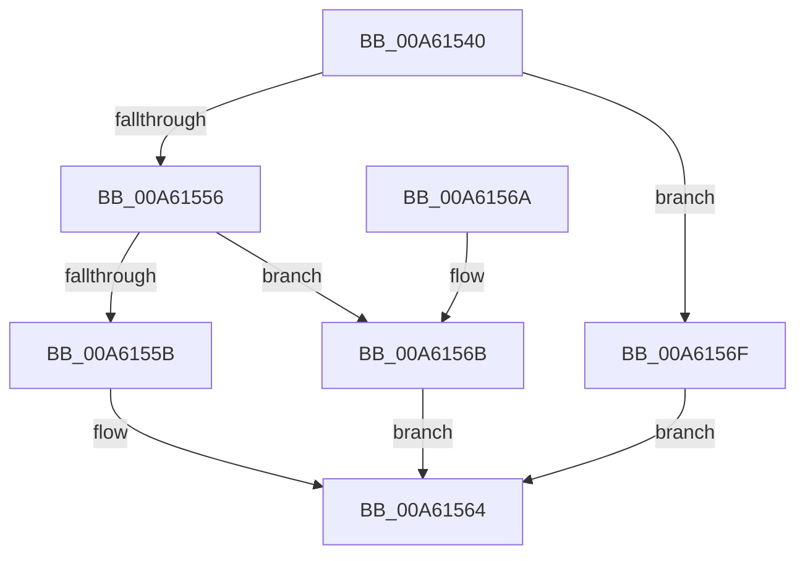

# FsRtlDiskIOCounterSetCallback

- RVA: `0x00A61540`–`0x00A615B7` (길이 `119` bytes)
- VA: `0x0000000140A61540`
- 실행 섹션: `PAGE`
- PDB 이름 있음: `예`; PDB Function 태그: `아니요`
- unwind 정보 RVA: `0x000B320C`
- 디코드: `34`개 명령, `119/119` bytes 표시
- 미해석 바이트: `0` (있으면 어셈블리에 `.byte`로 보존)

> 이 문서는 커널 이미지의 기계어와 PDB 기호를 분석해 생성했습니다. 4번과 5번은 함수 원형과 자료형을 바이너리 사용 방식에서 추정한 C 해석이며 원본 소스 복구 결과는 아닙니다.

## 1. Dependencies

- 직접 호출 지점: **3**; 고유 호출 대상: **3**
- 직접 호출자로 확인된 함수: **0**
- RIP 상대 이미지 참조: **1**

### Outgoing calls
- `0x00A6155F` → [FsRtlAddDiskIOCounterInstance](FsRtlAddDiskIOCounterInstance_function_00A615C0.md) (function, `0x00A615C0`)
- `0x00A6157B` → [RtlInitUnicodeString](../../text/42/RtlInitUnicodeString_function_0042A780.md) (function, `0x0042A780`)
- `0x00A615A9` → [PcwAddInstance](../A0/PcwAddInstance_function_00A0E530.md) (function, `0x00A0E530`)

### Direct callers
- 이 함수 시작 RVA로 연결되는 직접 call은 확인되지 않았습니다. 간접 호출은 완전히 역산할 수 없습니다.

### Static image references
- `0x00A6156F` → RVA `0x00AFC130` (` ?? ::NNGAKEGL::`string'`; read)

## 2. Other-region calls and transfers

- 다른 실행 섹션으로 향하는 call: **1**
  - `0x00A6157B` → [RtlInitUnicodeString](../../text/42/RtlInitUnicodeString_function_0042A780.md) (`PAGE` → `.text`)
- 별도 외부 분기/꼬리 이동을 확인하지 못했습니다.

## 3. Assembly (complete function range)

```asm
00A61540  40 53                           push rbx
00A61542  48 83 EC 50                     sub rsp, 0x50
00A61546  0F 57 C0                        xorps xmm0, xmm0
00A61549  48 8B DA                        mov rbx, rdx
00A6154C  0F 11 44 24 40                  movups xmmword ptr [rsp + 0x40], xmm0
00A61551  83 E9 02                        sub ecx, 2
00A61554  74 19                           je 0x140a6156f
00A61556  83 F9 01                        cmp ecx, 1
00A61559  75 10                           jne 0x140a6156b
00A6155B  48 8B 4A 18                     mov rcx, qword ptr [rdx + 0x18]
00A6155F  E8 5C 00 00 00                  call 0x140a615c0
00A61564  48 83 C4 50                     add rsp, 0x50
00A61568  5B                              pop rbx
00A61569  C3                              ret
00A6156A  CC                              int3
00A6156B  33 C0                           xor eax, eax
00A6156D  EB F5                           jmp 0x140a61564
00A6156F  48 8D 15 BA AB 09 00            lea rdx, [rip + 0x9abba]
00A61576  48 8D 4C 24 40                  lea rcx, [rsp + 0x40]
00A6157B  E8 00 92 9C FF                  call 0x14042a780
00A61580  48 8B 4B 18                     mov rcx, qword ptr [rbx + 0x18]
00A61584  48 8D 44 24 30                  lea rax, [rsp + 0x30]
00A61589  33 DB                           xor ebx, ebx
00A6158B  C7 44 24 38 10 00 00 00         mov dword ptr [rsp + 0x38], 0x10
00A61593  45 33 C0                        xor r8d, r8d
00A61596  48 89 5C 24 30                  mov qword ptr [rsp + 0x30], rbx
00A6159B  48 8D 54 24 40                  lea rdx, [rsp + 0x40]
00A615A0  48 89 44 24 20                  mov qword ptr [rsp + 0x20], rax
00A615A5  44 8D 4B 01                     lea r9d, [rbx + 1]
00A615A9  E8 82 CF FA FF                  call 0x140a0e530
00A615AE  85 C0                           test eax, eax
00A615B0  0F 48 D8                        cmovs ebx, eax
00A615B3  8B C3                           mov eax, ebx
00A615B5  EB AD                           jmp 0x140a61564
```

## 4. C-style interpretation (structured pseudocode)

```c
__int64 __fastcall FsRtlDiskIOCounterSetCallback(int a1, __int64 a2, int a3)
{
    __int64 result;
    __int64 v_rbx;
    __int64 v_rsp;
    unsigned __int64 v_stack_m18;
    unsigned __int64 v_stack_p20;
    unsigned __int64 v_stack_p30;
    unsigned int v_stack_p38;
    unsigned __int64 v_stack_p40;

    v_rsp = (v_rsp) - (80);
    v_stack_m18 = v_xmm0;
    a1 = (unsigned int)((a1) - (2));
    if (condition_is_equal) goto loc_00A6156F;
    if (a1 != 1) goto loc_00A6156B;
    result = FsRtlAddDiskIOCounterInstance(*(unsigned __int64 *)(a2 + 24), a2, a3, a4);
loc_00A61564:
    v_rsp = (v_rsp) + (80);
    return result;
loc_00A6156B:
    result = 0;
    goto loc_00A61564;
loc_00A6156F:
    result = RtlInitUnicodeString(v_stack_p40, v_rip + 633786, a3, a4);
    v_rbx = 0;
    v_stack_p38 = 16;
    a3 = 0;
    v_stack_p30 = 0;
    v_stack_p20 = v_stack_p30;
    result = PcwAddInstance(*(unsigned __int64 *)(a2 + 24), v_stack_p40, a3, v_rbx + 1);
    if (sign_flag) { v_rbx = (unsigned int)(result); }
    goto loc_00A61564;
}
```

## 5. (Beta) C Style

```c
int64_t FsRtlDiskIOCounterSetCallback(int32_t Arg1, void *Arg2, int32_t Arg3)
{
    uint8_t *arg2 = (uint8_t *)Arg2;

    int64_t result;
    int64_t local_rbx;
    int64_t local_rsp;
    uint64_t v_stack_m18;
    uint64_t v_stack_p20;
    uint64_t v_stack_p30;
    uint32_t v_stack_p38;
    uint64_t v_stack_p40;

    local_rsp = (local_rsp) - (80);
    v_stack_m18 = v_xmm0;
    Arg1 = (uint32_t)((Arg1) - (2));
    if (condition_is_equal) goto loc_00A6156F;
    if (Arg1 != 1) goto loc_00A6156B;
    result = FsRtlAddDiskIOCounterInstance(*(uint64_t *)(arg2 + 0x18), Arg2, Arg3, a4);
loc_00A61564:
    local_rsp = (local_rsp) + (80);
    return result;
loc_00A6156B:
    result = 0;
    goto loc_00A61564;
loc_00A6156F:
    result = RtlInitUnicodeString(v_stack_p40, v_rip + 633786, Arg3, a4);
    local_rbx = 0;
    v_stack_p38 = 16;
    Arg3 = 0;
    v_stack_p30 = 0;
    v_stack_p20 = v_stack_p30;
    result = PcwAddInstance(*(uint64_t *)(arg2 + 0x18), v_stack_p40, Arg3, local_rbx + 1);
    if (sign_flag) { local_rbx = (uint32_t)(result); }
    goto loc_00A61564;
}
```

### 관측된 메모리 오프셋

구조체 형식이 확인되지 않은 접근은 인자 기준의 오프셋으로만 기록했습니다.

| 기준 인자 | 오프셋 표현 | 폭 (bit) | 접근 |
|---|---:|---:|---|
| `Arg2` | `+ 0x18` | `64` | `R` |

## 6. Execution-region graph

[열기: 2D/3D 그래프와 함수 탐색 컨트롤 패널](../../../control-panel.html?section=page&rva=0x00A61540&view=graph)

- 2D 그래프는 위에서 아래로 흐르고, 3D 그래프는 빈 공간을 드래그해 회전합니다. Shift+드래그는 이동, 휠은 확대·축소, 함수 노드 선택은 대상 보고서 이동입니다.

### Static fallback


