# FsRtlGetSectorSizeInformation

- RVA: `0x00A62EB0`–`0x00A634B0` (길이 `1,536` bytes)
- VA: `0x0000000140A62EB0`
- 실행 섹션: `PAGE`
- PDB 이름 있음: `예`; PDB Function 태그: `아니요`
- unwind 정보 RVA: `0x000B34CC`
- 디코드: `392`개 명령, `1,536/1,536` bytes 표시
- 미해석 바이트: `0` (있으면 어셈블리에 `.byte`로 보존)

> 이 문서는 커널 이미지의 기계어와 PDB 기호를 분석해 생성했습니다. 4번과 5번은 함수 원형과 자료형을 바이너리 사용 방식에서 추정한 C 해석이며 원본 소스 복구 결과는 아닙니다.

## 1. Dependencies

- 직접 호출 지점: **24**; 고유 호출 대상: **7**
- 직접 호출자로 확인된 함수: **1**
- RIP 상대 이미지 참조: **1**

### Outgoing calls
- `0x00A62F0E` → [memset](../../text/6C/memset_function_006C6C40.md) (function, `0x006C6C40`)
- `0x00A62F4B` → [FsRtlIssueDeviceIoControl](FsRtlIssueDeviceIoControl_function_00A634C0.md) (function, `0x00A634C0`)
- `0x00A62FAE` → [KeInitializeEvent](../../text/40/KeInitializeEvent_function_0040DD10.md) (function, `0x0040DD10`)
- `0x00A62FF0` → [IoBuildDeviceIoControlRequest](../../text/20/IoBuildDeviceIoControlRequest_function_00204FD0.md) (function, `0x00204FD0`)
- `0x00A6300E` → [IofCallDriver](../../text/29/IofCallDriver_function_0029B4B0.md) (function, `0x0029B4B0`)
- `0x00A630EC` → [KeInitializeEvent](../../text/40/KeInitializeEvent_function_0040DD10.md) (function, `0x0040DD10`)
- `0x00A63129` → [IoBuildDeviceIoControlRequest](../../text/20/IoBuildDeviceIoControlRequest_function_00204FD0.md) (function, `0x00204FD0`)
- `0x00A63144` → [IofCallDriver](../../text/29/IofCallDriver_function_0029B4B0.md) (function, `0x0029B4B0`)
- `0x00A631A9` → [KeInitializeEvent](../../text/40/KeInitializeEvent_function_0040DD10.md) (function, `0x0040DD10`)
- `0x00A631E1` → [IoBuildDeviceIoControlRequest](../../text/20/IoBuildDeviceIoControlRequest_function_00204FD0.md) (function, `0x00204FD0`)
- `0x00A631FC` → [IofCallDriver](../../text/29/IofCallDriver_function_0029B4B0.md) (function, `0x0029B4B0`)
- `0x00A6325B` → [KeInitializeEvent](../../text/40/KeInitializeEvent_function_0040DD10.md) (function, `0x0040DD10`)
- `0x00A63296` → [IoBuildDeviceIoControlRequest](../../text/20/IoBuildDeviceIoControlRequest_function_00204FD0.md) (function, `0x00204FD0`)
- `0x00A632B1` → [IofCallDriver](../../text/29/IofCallDriver_function_0029B4B0.md) (function, `0x0029B4B0`)
- `0x00A632D5` → [_security_check_cookie](../../text/6A/_security_check_cookie_function_006AC640.md) (function, `0x006AC640`)
- `0x00A63316` → [memset](../../text/6C/memset_function_006C6C40.md) (function, `0x006C6C40`)
- `0x00A63339` → [KeInitializeEvent](../../text/40/KeInitializeEvent_function_0040DD10.md) (function, `0x0040DD10`)
- `0x00A63376` → [IoBuildDeviceIoControlRequest](../../text/20/IoBuildDeviceIoControlRequest_function_00204FD0.md) (function, `0x00204FD0`)
- `0x00A63395` → [IofCallDriver](../../text/29/IofCallDriver_function_0029B4B0.md) (function, `0x0029B4B0`)
- `0x00A633E6` → [KeWaitForSingleObject](../../text/20/KeWaitForSingleObject_function_0020E6B0.md) (function, `0x0020E6B0`)
- `0x00A63406` → [KeWaitForSingleObject](../../text/20/KeWaitForSingleObject_function_0020E6B0.md) (function, `0x0020E6B0`)
- `0x00A63423` → [KeWaitForSingleObject](../../text/20/KeWaitForSingleObject_function_0020E6B0.md) (function, `0x0020E6B0`)
- `0x00A63443` → [KeWaitForSingleObject](../../text/20/KeWaitForSingleObject_function_0020E6B0.md) (function, `0x0020E6B0`)
- `0x00A63476` → [KeWaitForSingleObject](../../text/20/KeWaitForSingleObject_function_0020E6B0.md) (function, `0x0020E6B0`)

### Direct callers
- [sub_00B2D53C](../B2/Unknown_function_00B2D53C.md) at `0x00B2D54A`

### Static image references
- `0x00A62ECB` → RVA `0x00E0A740` (`.data`; read)

## 2. Other-region calls and transfers

- 다른 실행 섹션으로 향하는 call: **23**
  - `0x00A62F0E` → [memset](../../text/6C/memset_function_006C6C40.md) (`PAGE` → `.text`)
  - `0x00A62FAE` → [KeInitializeEvent](../../text/40/KeInitializeEvent_function_0040DD10.md) (`PAGE` → `.text`)
  - `0x00A62FF0` → [IoBuildDeviceIoControlRequest](../../text/20/IoBuildDeviceIoControlRequest_function_00204FD0.md) (`PAGE` → `.text`)
  - `0x00A6300E` → [IofCallDriver](../../text/29/IofCallDriver_function_0029B4B0.md) (`PAGE` → `.text`)
  - `0x00A630EC` → [KeInitializeEvent](../../text/40/KeInitializeEvent_function_0040DD10.md) (`PAGE` → `.text`)
  - `0x00A63129` → [IoBuildDeviceIoControlRequest](../../text/20/IoBuildDeviceIoControlRequest_function_00204FD0.md) (`PAGE` → `.text`)
  - `0x00A63144` → [IofCallDriver](../../text/29/IofCallDriver_function_0029B4B0.md) (`PAGE` → `.text`)
  - `0x00A631A9` → [KeInitializeEvent](../../text/40/KeInitializeEvent_function_0040DD10.md) (`PAGE` → `.text`)
  - `0x00A631E1` → [IoBuildDeviceIoControlRequest](../../text/20/IoBuildDeviceIoControlRequest_function_00204FD0.md) (`PAGE` → `.text`)
  - `0x00A631FC` → [IofCallDriver](../../text/29/IofCallDriver_function_0029B4B0.md) (`PAGE` → `.text`)
  - `0x00A6325B` → [KeInitializeEvent](../../text/40/KeInitializeEvent_function_0040DD10.md) (`PAGE` → `.text`)
  - `0x00A63296` → [IoBuildDeviceIoControlRequest](../../text/20/IoBuildDeviceIoControlRequest_function_00204FD0.md) (`PAGE` → `.text`)
  - `0x00A632B1` → [IofCallDriver](../../text/29/IofCallDriver_function_0029B4B0.md) (`PAGE` → `.text`)
  - `0x00A632D5` → [_security_check_cookie](../../text/6A/_security_check_cookie_function_006AC640.md) (`PAGE` → `.text`)
  - `0x00A63316` → [memset](../../text/6C/memset_function_006C6C40.md) (`PAGE` → `.text`)
  - `0x00A63339` → [KeInitializeEvent](../../text/40/KeInitializeEvent_function_0040DD10.md) (`PAGE` → `.text`)
  - `0x00A63376` → [IoBuildDeviceIoControlRequest](../../text/20/IoBuildDeviceIoControlRequest_function_00204FD0.md) (`PAGE` → `.text`)
  - `0x00A63395` → [IofCallDriver](../../text/29/IofCallDriver_function_0029B4B0.md) (`PAGE` → `.text`)
  - `0x00A633E6` → [KeWaitForSingleObject](../../text/20/KeWaitForSingleObject_function_0020E6B0.md) (`PAGE` → `.text`)
  - `0x00A63406` → [KeWaitForSingleObject](../../text/20/KeWaitForSingleObject_function_0020E6B0.md) (`PAGE` → `.text`)
  - `0x00A63423` → [KeWaitForSingleObject](../../text/20/KeWaitForSingleObject_function_0020E6B0.md) (`PAGE` → `.text`)
  - `0x00A63443` → [KeWaitForSingleObject](../../text/20/KeWaitForSingleObject_function_0020E6B0.md) (`PAGE` → `.text`)
  - `0x00A63476` → [KeWaitForSingleObject](../../text/20/KeWaitForSingleObject_function_0020E6B0.md) (`PAGE` → `.text`)
- 별도 외부 분기/꼬리 이동을 확인하지 못했습니다.

## 3. Assembly (complete function range)

```asm
00A62EB0  48 89 5C 24 18                  mov qword ptr [rsp + 0x18], rbx
00A62EB5  55                              push rbp
00A62EB6  56                              push rsi
00A62EB7  57                              push rdi
00A62EB8  41 54                           push r12
00A62EBA  41 57                           push r15
00A62EBC  48 8D AC 24 70 FF FF FF         lea rbp, [rsp - 0x90]
00A62EC4  48 81 EC 90 01 00 00            sub rsp, 0x190
00A62ECB  48 8B 05 6E 78 3A 00            mov rax, qword ptr [rip + 0x3a786e]
00A62ED2  48 33 C4                        xor rax, rsp
00A62ED5  48 89 85 88 00 00 00            mov qword ptr [rbp + 0x88], rax
00A62EDC  0F 57 C0                        xorps xmm0, xmm0
00A62EDF  33 C0                           xor eax, eax
00A62EE1  48 8B DA                        mov rbx, rdx
00A62EE4  48 89 45 70                     mov qword ptr [rbp + 0x70], rax
00A62EE8  48 8B F9                        mov rdi, rcx
00A62EEB  89 45 84                        mov dword ptr [rbp - 0x7c], eax
00A62EEE  45 33 FF                        xor r15d, r15d
00A62EF1  48 8D 4D 80                     lea rcx, [rbp - 0x80]
00A62EF5  33 D2                           xor edx, edx
00A62EF7  44 89 7D 18                     mov dword ptr [rbp + 0x18], r15d
00A62EFB  41 B8 8C 00 00 00               mov r8d, 0x8c
00A62F01  44 89 7D 38                     mov dword ptr [rbp + 0x38], r15d
00A62F05  0F 11 45 60                     movups xmmword ptr [rbp + 0x60], xmm0
00A62F09  F3 0F 7F 45 28                  movdqu xmmword ptr [rbp + 0x28], xmm0
00A62F0E  E8 2D 3D C6 FF                  call 0x1406c6c40
00A62F13  33 C0                           xor eax, eax
00A62F15  4C 89 7C 24 38                  mov qword ptr [rsp + 0x38], r15
00A62F1A  0F 57 C0                        xorps xmm0, xmm0
00A62F1D  C7 44 24 30 18 00 00 00         mov dword ptr [rsp + 0x30], 0x18
00A62F25  0F 11 03                        movups xmmword ptr [rbx], xmm0
00A62F28  48 89 43 10                     mov qword ptr [rbx + 0x10], rax
00A62F2C  45 33 C9                        xor r9d, r9d
00A62F2F  89 43 18                        mov dword ptr [rbx + 0x18], eax
00A62F32  41 B0 02                        mov r8b, 2
00A62F35  48 8D 45 60                     lea rax, [rbp + 0x60]
00A62F39  BA 00 00 07 00                  mov edx, 0x70000
00A62F3E  48 89 44 24 28                  mov qword ptr [rsp + 0x28], rax
00A62F43  48 8B CF                        mov rcx, rdi
00A62F46  44 89 7C 24 20                  mov dword ptr [rsp + 0x20], r15d
00A62F4B  E8 70 05 00 00                  call 0x140a634c0
00A62F50  85 C0                           test eax, eax
00A62F52  0F 88 73 03 00 00               js 0x140a632cb
00A62F58  8B 4D 74                        mov ecx, dword ptr [rbp + 0x74]
00A62F5B  85 C9                           test ecx, ecx
00A62F5D  0F 84 43 05 00 00               je 0x140a634a6
00A62F63  8D 41 FF                        lea eax, [rcx - 1]
00A62F66  85 C1                           test ecx, eax
00A62F68  0F 85 38 05 00 00               jne 0x140a634a6
00A62F6E  0F 57 C0                        xorps xmm0, xmm0
00A62F71  4C 89 7D 14                     mov qword ptr [rbp + 0x14], r15
00A62F75  33 C0                           xor eax, eax
00A62F77  C7 45 10 06 00 00 00            mov dword ptr [rbp + 0x10], 6
00A62F7E  45 33 C0                        xor r8d, r8d
00A62F81  48 89 44 24 70                  mov qword ptr [rsp + 0x70], rax
00A62F86  33 D2                           xor edx, edx
00A62F88  44 89 7D 38                     mov dword ptr [rbp + 0x38], r15d
00A62F8C  48 8D 4C 24 60                  lea rcx, [rsp + 0x60]
00A62F91  C7 45 20 02 00 00 00            mov dword ptr [rbp + 0x20], 2
00A62F98  F3 0F 7F 45 28                  movdqu xmmword ptr [rbp + 0x28], xmm0
00A62F9D  C7 45 24 01 00 00 00            mov dword ptr [rbp + 0x24], 1
00A62FA4  0F 11 44 24 60                  movups xmmword ptr [rsp + 0x60], xmm0
00A62FA9  0F 11 44 24 50                  movups xmmword ptr [rsp + 0x50], xmm0
00A62FAE  E8 5D AD 9A FF                  call 0x14040dd10
00A62FB3  48 8D 44 24 50                  lea rax, [rsp + 0x50]
00A62FB8  48 8B D7                        mov rdx, rdi
00A62FBB  48 89 44 24 40                  mov qword ptr [rsp + 0x40], rax
00A62FC0  45 8D 67 0C                     lea r12d, [r15 + 0xc]
00A62FC4  48 8D 44 24 60                  lea rax, [rsp + 0x60]
00A62FC9  45 8B CC                        mov r9d, r12d
00A62FCC  48 89 44 24 38                  mov qword ptr [rsp + 0x38], rax
00A62FD1  4C 8D 45 10                     lea r8, [rbp + 0x10]
00A62FD5  44 88 7C 24 30                  mov byte ptr [rsp + 0x30], r15b
00A62FDA  48 8D 45 20                     lea rax, [rbp + 0x20]
00A62FDE  C7 44 24 28 1C 00 00 00         mov dword ptr [rsp + 0x28], 0x1c
00A62FE6  B9 00 14 2D 00                  mov ecx, 0x2d1400
00A62FEB  48 89 44 24 20                  mov qword ptr [rsp + 0x20], rax
00A62FF0  E8 DB 1F 7A FF                  call 0x140204fd0
00A62FF5  83 CE FF                        or esi, 0xffffffff
00A62FF8  48 85 C0                        test rax, rax
00A62FFB  74 7F                           je 0x140a6307c
00A62FFD  48 8B 88 B8 00 00 00            mov rcx, qword ptr [rax + 0xb8]
00A63004  48 8B D0                        mov rdx, rax
00A63007  80 49 BA 02                     or byte ptr [rcx - 0x46], 2
00A6300B  48 8B CF                        mov rcx, rdi
00A6300E  E8 9D 84 83 FF                  call 0x14029b4b0
00A63013  3D 03 01 00 00                  cmp eax, 0x103
00A63018  0F 84 B6 03 00 00               je 0x140a633d4
00A6301E  85 C0                           test eax, eax
00A63020  78 5A                           js 0x140a6307c
00A63022  48 83 7C 24 58 1C               cmp qword ptr [rsp + 0x58], 0x1c
00A63028  72 52                           jb 0x140a6307c
00A6302A  83 7D 20 1C                     cmp dword ptr [rbp + 0x20], 0x1c
00A6302E  72 4C                           jb 0x140a6307c
00A63030  8B 45 24                        mov eax, dword ptr [rbp + 0x24]
00A63033  48 3B 44 24 58                  cmp rax, qword ptr [rsp + 0x58]
00A63038  72 42                           jb 0x140a6307c
00A6303A  44 8B 55 30                     mov r10d, dword ptr [rbp + 0x30]
00A6303E  45 85 D2                        test r10d, r10d
00A63041  74 39                           je 0x140a6307c
00A63043  44 8B 4D 74                     mov r9d, dword ptr [rbp + 0x74]
00A63047  45 3B D1                        cmp r10d, r9d
00A6304A  75 34                           jne 0x140a63080
00A6304C  8B 4D 34                        mov ecx, dword ptr [rbp + 0x34]
00A6304F  41 3B CA                        cmp ecx, r10d
00A63052  72 2C                           jb 0x140a63080
00A63054  85 C9                           test ecx, ecx
00A63056  74 28                           je 0x140a63080
00A63058  8D 41 FF                        lea eax, [rcx - 1]
00A6305B  85 C1                           test ecx, eax
00A6305D  75 21                           jne 0x140a63080
00A6305F  33 D2                           xor edx, edx
00A63061  8B C1                           mov eax, ecx
00A63063  41 F7 F2                        div r10d
00A63066  85 D2                           test edx, edx
00A63068  75 16                           jne 0x140a63080
00A6306A  44 8B 45 38                     mov r8d, dword ptr [rbp + 0x38]
00A6306E  33 D2                           xor edx, edx
00A63070  41 8B C0                        mov eax, r8d
00A63073  41 F7 F2                        div r10d
00A63076  85 D2                           test edx, edx
00A63078  75 06                           jne 0x140a63080
00A6307A  EB 1C                           jmp 0x140a63098
00A6307C  44 8B 4D 74                     mov r9d, dword ptr [rbp + 0x74]
00A63080  41 8B C9                        mov ecx, r9d
00A63083  4C 89 7D 20                     mov qword ptr [rbp + 0x20], r15
00A63087  89 4D 34                        mov dword ptr [rbp + 0x34], ecx
00A6308A  44 8B C6                        mov r8d, esi
00A6308D  4C 89 7D 28                     mov qword ptr [rbp + 0x28], r15
00A63091  44 89 4D 30                     mov dword ptr [rbp + 0x30], r9d
00A63095  89 75 38                        mov dword ptr [rbp + 0x38], esi
00A63098  44 89 0B                        mov dword ptr [rbx], r9d
00A6309B  89 4B 04                        mov dword ptr [rbx + 4], ecx
00A6309E  89 4B 08                        mov dword ptr [rbx + 8], ecx
00A630A1  C7 43 10 03 00 00 00            mov dword ptr [rbx + 0x10], 3
00A630A8  44 89 43 14                     mov dword ptr [rbx + 0x14], r8d
00A630AC  89 73 18                        mov dword ptr [rbx + 0x18], esi
00A630AF  44 89 4B 0C                     mov dword ptr [rbx + 0xc], r9d
00A630B3  44 3B C6                        cmp r8d, esi
00A630B6  0F 85 36 02 00 00               jne 0x140a632f2
00A630BC  33 C0                           xor eax, eax
00A630BE  4C 89 7D 14                     mov qword ptr [rbp + 0x14], r15
00A630C2  0F 57 C0                        xorps xmm0, xmm0
00A630C5  48 89 45 40                     mov qword ptr [rbp + 0x40], rax
00A630C9  45 33 C0                        xor r8d, r8d
00A630CC  89 45 48                        mov dword ptr [rbp + 0x48], eax
00A630CF  33 D2                           xor edx, edx
00A630D1  48 89 44 24 70                  mov qword ptr [rsp + 0x70], rax
00A630D6  48 8D 4C 24 60                  lea rcx, [rsp + 0x60]
00A630DB  C7 45 10 07 00 00 00            mov dword ptr [rbp + 0x10], 7
00A630E2  0F 11 44 24 60                  movups xmmword ptr [rsp + 0x60], xmm0
00A630E7  0F 11 44 24 50                  movups xmmword ptr [rsp + 0x50], xmm0
00A630EC  E8 1F AC 9A FF                  call 0x14040dd10
00A630F1  48 8D 44 24 50                  lea rax, [rsp + 0x50]
00A630F6  BE 00 14 2D 00                  mov esi, 0x2d1400
00A630FB  48 89 44 24 40                  mov qword ptr [rsp + 0x40], rax
00A63100  4C 8D 45 10                     lea r8, [rbp + 0x10]
00A63104  48 8D 44 24 60                  lea rax, [rsp + 0x60]
00A63109  45 8B CC                        mov r9d, r12d
00A6310C  48 89 44 24 38                  mov qword ptr [rsp + 0x38], rax
00A63111  48 8B D7                        mov rdx, rdi
00A63114  44 88 7C 24 30                  mov byte ptr [rsp + 0x30], r15b
00A63119  48 8D 45 40                     lea rax, [rbp + 0x40]
00A6311D  44 89 64 24 28                  mov dword ptr [rsp + 0x28], r12d
00A63122  8B CE                           mov ecx, esi
00A63124  48 89 44 24 20                  mov qword ptr [rsp + 0x20], rax
00A63129  E8 A2 1E 7A FF                  call 0x140204fd0
00A6312E  48 85 C0                        test rax, rax
00A63131  74 46                           je 0x140a63179
00A63133  48 8B 88 B8 00 00 00            mov rcx, qword ptr [rax + 0xb8]
00A6313A  48 8B D0                        mov rdx, rax
00A6313D  80 49 BA 02                     or byte ptr [rcx - 0x46], 2
00A63141  48 8B CF                        mov rcx, rdi
00A63144  E8 67 83 83 FF                  call 0x14029b4b0
00A63149  3D 03 01 00 00                  cmp eax, 0x103
00A6314E  0F 84 BD 02 00 00               je 0x140a63411
00A63154  85 C0                           test eax, eax
00A63156  78 21                           js 0x140a63179
00A63158  44 39 65 40                     cmp dword ptr [rbp + 0x40], r12d
00A6315C  72 1B                           jb 0x140a63179
00A6315E  4C 39 64 24 58                  cmp qword ptr [rsp + 0x58], r12
00A63163  72 14                           jb 0x140a63179
00A63165  8B 45 44                        mov eax, dword ptr [rbp + 0x44]
00A63168  48 3B 44 24 58                  cmp rax, qword ptr [rsp + 0x58]
00A6316D  72 0A                           jb 0x140a63179
00A6316F  44 38 7D 48                     cmp byte ptr [rbp + 0x48], r15b
00A63173  75 04                           jne 0x140a63179
00A63175  83 4B 10 04                     or dword ptr [rbx + 0x10], 4
00A63179  33 C0                           xor eax, eax
00A6317B  4C 89 7D 14                     mov qword ptr [rbp + 0x14], r15
00A6317F  0F 57 C0                        xorps xmm0, xmm0
00A63182  48 89 45 50                     mov qword ptr [rbp + 0x50], rax
00A63186  45 33 C0                        xor r8d, r8d
00A63189  89 45 58                        mov dword ptr [rbp + 0x58], eax
00A6318C  33 D2                           xor edx, edx
00A6318E  48 89 44 24 70                  mov qword ptr [rsp + 0x70], rax
00A63193  48 8D 4C 24 60                  lea rcx, [rsp + 0x60]
00A63198  C7 45 10 08 00 00 00            mov dword ptr [rbp + 0x10], 8
00A6319F  0F 11 44 24 60                  movups xmmword ptr [rsp + 0x60], xmm0
00A631A4  0F 11 44 24 50                  movups xmmword ptr [rsp + 0x50], xmm0
00A631A9  E8 62 AB 9A FF                  call 0x14040dd10
00A631AE  48 8D 44 24 50                  lea rax, [rsp + 0x50]
00A631B3  45 8B CC                        mov r9d, r12d
00A631B6  48 89 44 24 40                  mov qword ptr [rsp + 0x40], rax
00A631BB  4C 8D 45 10                     lea r8, [rbp + 0x10]
00A631BF  48 8D 44 24 60                  lea rax, [rsp + 0x60]
00A631C4  48 8B D7                        mov rdx, rdi
00A631C7  48 89 44 24 38                  mov qword ptr [rsp + 0x38], rax
00A631CC  8B CE                           mov ecx, esi
00A631CE  44 88 7C 24 30                  mov byte ptr [rsp + 0x30], r15b
00A631D3  48 8D 45 50                     lea rax, [rbp + 0x50]
00A631D7  44 89 64 24 28                  mov dword ptr [rsp + 0x28], r12d
00A631DC  48 89 44 24 20                  mov qword ptr [rsp + 0x20], rax
00A631E1  E8 EA 1D 7A FF                  call 0x140204fd0
00A631E6  48 85 C0                        test rax, rax
00A631E9  74 40                           je 0x140a6322b
00A631EB  48 8B 88 B8 00 00 00            mov rcx, qword ptr [rax + 0xb8]
00A631F2  48 8B D0                        mov rdx, rax
00A631F5  80 49 BA 02                     or byte ptr [rcx - 0x46], 2
00A631F9  48 8B CF                        mov rcx, rdi
00A631FC  E8 AF 82 83 FF                  call 0x14029b4b0
00A63201  3D 03 01 00 00                  cmp eax, 0x103
00A63206  0F 84 25 02 00 00               je 0x140a63431
00A6320C  85 C0                           test eax, eax
00A6320E  78 1B                           js 0x140a6322b
00A63210  4C 39 64 24 58                  cmp qword ptr [rsp + 0x58], r12
00A63215  72 14                           jb 0x140a6322b
00A63217  44 39 65 50                     cmp dword ptr [rbp + 0x50], r12d
00A6321B  72 0E                           jb 0x140a6322b
00A6321D  8B 45 54                        mov eax, dword ptr [rbp + 0x54]
00A63220  48 3B 44 24 58                  cmp rax, qword ptr [rsp + 0x58]
00A63225  0F 83 26 02 00 00               jae 0x140a63451
00A6322B  0F 57 C0                        xorps xmm0, xmm0
00A6322E  4C 89 7D 14                     mov qword ptr [rbp + 0x14], r15
00A63232  0F 57 C9                        xorps xmm1, xmm1
00A63235  C7 45 10 37 00 00 00            mov dword ptr [rbp + 0x10], 0x37
00A6323C  33 C0                           xor eax, eax
00A6323E  48 8D 4C 24 60                  lea rcx, [rsp + 0x60]
00A63243  45 33 C0                        xor r8d, r8d
00A63246  48 89 44 24 70                  mov qword ptr [rsp + 0x70], rax
00A6324B  33 D2                           xor edx, edx
00A6324D  0F 11 45 78                     movups xmmword ptr [rbp + 0x78], xmm0
00A63251  0F 11 4C 24 60                  movups xmmword ptr [rsp + 0x60], xmm1
00A63256  0F 11 44 24 50                  movups xmmword ptr [rsp + 0x50], xmm0
00A6325B  E8 B0 AA 9A FF                  call 0x14040dd10
00A63260  48 8D 44 24 50                  lea rax, [rsp + 0x50]
00A63265  45 8B CC                        mov r9d, r12d
00A63268  48 89 44 24 40                  mov qword ptr [rsp + 0x40], rax
00A6326D  4C 8D 45 10                     lea r8, [rbp + 0x10]
00A63271  48 8D 44 24 60                  lea rax, [rsp + 0x60]
00A63276  48 8B D7                        mov rdx, rdi
00A63279  48 89 44 24 38                  mov qword ptr [rsp + 0x38], rax
00A6327E  8B CE                           mov ecx, esi
00A63280  44 88 7C 24 30                  mov byte ptr [rsp + 0x30], r15b
00A63285  48 8D 45 78                     lea rax, [rbp + 0x78]
00A63289  C7 44 24 28 10 00 00 00         mov dword ptr [rsp + 0x28], 0x10
00A63291  48 89 44 24 20                  mov qword ptr [rsp + 0x20], rax
00A63296  E8 35 1D 7A FF                  call 0x140204fd0
00A6329B  48 85 C0                        test rax, rax
00A6329E  74 29                           je 0x140a632c9
00A632A0  48 8B 90 B8 00 00 00            mov rdx, qword ptr [rax + 0xb8]
00A632A7  48 8B CF                        mov rcx, rdi
00A632AA  80 4A BA 02                     or byte ptr [rdx - 0x46], 2
00A632AE  48 8B D0                        mov rdx, rax
00A632B1  E8 FA 81 83 FF                  call 0x14029b4b0
00A632B6  3D 03 01 00 00                  cmp eax, 0x103
00A632BB  0F 84 A3 01 00 00               je 0x140a63464
00A632C1  85 C0                           test eax, eax
00A632C3  0F 89 BB 01 00 00               jns 0x140a63484
00A632C9  33 C0                           xor eax, eax
00A632CB  48 8B 8D 88 00 00 00            mov rcx, qword ptr [rbp + 0x88]
00A632D2  48 33 CC                        xor rcx, rsp
00A632D5  E8 66 93 C4 FF                  call 0x1406ac640
00A632DA  48 8B 9C 24 D0 01 00 00         mov rbx, qword ptr [rsp + 0x1d0]
00A632E2  48 81 C4 90 01 00 00            add rsp, 0x190
00A632E9  41 5F                           pop r15
00A632EB  41 5C                           pop r12
00A632ED  5F                              pop rdi
00A632EE  5E                              pop rsi
00A632EF  5D                              pop rbp
00A632F0  C3                              ret
00A632F1  CC                              int3
00A632F2  33 D2                           xor edx, edx
00A632F4  44 89 43 14                     mov dword ptr [rbx + 0x14], r8d
00A632F8  41 8B C0                        mov eax, r8d
00A632FB  F7 F1                           div ecx
00A632FD  8B F2                           mov esi, edx
00A632FF  85 D2                           test edx, edx
00A63301  74 07                           je 0x140a6330a
00A63303  C7 43 10 02 00 00 00            mov dword ptr [rbx + 0x10], 2
00A6330A  33 D2                           xor edx, edx
00A6330C  48 8D 4D 80                     lea rcx, [rbp - 0x80]
00A63310  41 B8 90 00 00 00               mov r8d, 0x90
00A63316  E8 25 39 C6 FF                  call 0x1406c6c40
00A6331B  0F 57 C0                        xorps xmm0, xmm0
00A6331E  48 8D 4C 24 60                  lea rcx, [rsp + 0x60]
00A63323  33 C0                           xor eax, eax
00A63325  45 33 C0                        xor r8d, r8d
00A63328  33 D2                           xor edx, edx
00A6332A  48 89 44 24 70                  mov qword ptr [rsp + 0x70], rax
00A6332F  0F 11 44 24 60                  movups xmmword ptr [rsp + 0x60], xmm0
00A63334  0F 11 44 24 50                  movups xmmword ptr [rsp + 0x50], xmm0
00A63339  E8 D2 A9 9A FF                  call 0x14040dd10
00A6333E  48 8D 44 24 50                  lea rax, [rsp + 0x50]
00A63343  45 33 C9                        xor r9d, r9d
00A63346  48 89 44 24 40                  mov qword ptr [rsp + 0x40], rax
00A6334B  45 33 C0                        xor r8d, r8d
00A6334E  48 8D 44 24 60                  lea rax, [rsp + 0x60]
00A63353  48 8B D7                        mov rdx, rdi
00A63356  48 89 44 24 38                  mov qword ptr [rsp + 0x38], rax
00A6335B  B9 48 00 07 00                  mov ecx, 0x70048
00A63360  44 88 7C 24 30                  mov byte ptr [rsp + 0x30], r15b
00A63365  48 8D 45 80                     lea rax, [rbp - 0x80]
00A63369  C7 44 24 28 90 00 00 00         mov dword ptr [rsp + 0x28], 0x90
00A63371  48 89 44 24 20                  mov qword ptr [rsp + 0x20], rax
00A63376  E8 55 1C 7A FF                  call 0x140204fd0
00A6337B  48 85 C0                        test rax, rax
00A6337E  0F 84 38 FD FF FF               je 0x140a630bc
00A63384  48 8B 88 B8 00 00 00            mov rcx, qword ptr [rax + 0xb8]
00A6338B  48 8B D0                        mov rdx, rax
00A6338E  80 49 BA 02                     or byte ptr [rcx - 0x46], 2
00A63392  48 8B CF                        mov rcx, rdi
00A63395  E8 16 81 83 FF                  call 0x14029b4b0
00A6339A  3D 03 01 00 00                  cmp eax, 0x103
00A6339F  74 53                           je 0x140a633f4
00A633A1  85 C0                           test eax, eax
00A633A3  0F 88 13 FD FF FF               js 0x140a630bc
00A633A9  44 8B 45 34                     mov r8d, dword ptr [rbp + 0x34]
00A633AD  48 8B 45 88                     mov rax, qword ptr [rbp - 0x78]
00A633B1  48 99                           cqo
00A633B3  49 F7 F8                        idiv r8
00A633B6  41 8B C0                        mov eax, r8d
00A633B9  2B C2                           sub eax, edx
00A633BB  89 53 18                        mov dword ptr [rbx + 0x18], edx
00A633BE  33 D2                           xor edx, edx
00A633C0  41 F7 F0                        div r8d
00A633C3  3B D6                           cmp edx, esi
00A633C5  0F 84 F1 FC FF FF               je 0x140a630bc
00A633CB  83 63 10 FD                     and dword ptr [rbx + 0x10], 0xfffffffd
00A633CF  E9 E8 FC FF FF                  jmp 0x140a630bc
00A633D4  45 33 C9                        xor r9d, r9d
00A633D7  4C 89 7C 24 20                  mov qword ptr [rsp + 0x20], r15
00A633DC  45 33 C0                        xor r8d, r8d
00A633DF  48 8D 4C 24 60                  lea rcx, [rsp + 0x60]
00A633E4  33 D2                           xor edx, edx
00A633E6  E8 C5 B2 7A FF                  call 0x14020e6b0
00A633EB  8B 44 24 50                     mov eax, dword ptr [rsp + 0x50]
00A633EF  E9 2A FC FF FF                  jmp 0x140a6301e
00A633F4  45 33 C9                        xor r9d, r9d
00A633F7  4C 89 7C 24 20                  mov qword ptr [rsp + 0x20], r15
00A633FC  45 33 C0                        xor r8d, r8d
00A633FF  48 8D 4C 24 60                  lea rcx, [rsp + 0x60]
00A63404  33 D2                           xor edx, edx
00A63406  E8 A5 B2 7A FF                  call 0x14020e6b0
00A6340B  8B 44 24 50                     mov eax, dword ptr [rsp + 0x50]
00A6340F  EB 90                           jmp 0x140a633a1
00A63411  45 33 C9                        xor r9d, r9d
00A63414  4C 89 7C 24 20                  mov qword ptr [rsp + 0x20], r15
00A63419  45 33 C0                        xor r8d, r8d
00A6341C  48 8D 4C 24 60                  lea rcx, [rsp + 0x60]
00A63421  33 D2                           xor edx, edx
00A63423  E8 88 B2 7A FF                  call 0x14020e6b0
00A63428  8B 44 24 50                     mov eax, dword ptr [rsp + 0x50]
00A6342C  E9 23 FD FF FF                  jmp 0x140a63154
00A63431  45 33 C9                        xor r9d, r9d
00A63434  4C 89 7C 24 20                  mov qword ptr [rsp + 0x20], r15
00A63439  45 33 C0                        xor r8d, r8d
00A6343C  48 8D 4C 24 60                  lea rcx, [rsp + 0x60]
00A63441  33 D2                           xor edx, edx
00A63443  E8 68 B2 7A FF                  call 0x14020e6b0
00A63448  8B 44 24 50                     mov eax, dword ptr [rsp + 0x50]
00A6344C  E9 BB FD FF FF                  jmp 0x140a6320c
00A63451  44 38 7D 58                     cmp byte ptr [rbp + 0x58], r15b
00A63455  0F 84 D0 FD FF FF               je 0x140a6322b
00A6345B  83 4B 10 08                     or dword ptr [rbx + 0x10], 8
00A6345F  E9 C7 FD FF FF                  jmp 0x140a6322b
00A63464  45 33 C9                        xor r9d, r9d
00A63467  4C 89 7C 24 20                  mov qword ptr [rsp + 0x20], r15
00A6346C  45 33 C0                        xor r8d, r8d
00A6346F  48 8D 4C 24 60                  lea rcx, [rsp + 0x60]
00A63474  33 D2                           xor edx, edx
00A63476  E8 35 B2 7A FF                  call 0x14020e6b0
00A6347B  8B 44 24 50                     mov eax, dword ptr [rsp + 0x50]
00A6347F  E9 3D FE FF FF                  jmp 0x140a632c1
00A63484  48 83 7C 24 58 10               cmp qword ptr [rsp + 0x58], 0x10
00A6348A  0F 85 39 FE FF FF               jne 0x140a632c9
00A63490  F6 85 80 00 00 00 01            test byte ptr [rbp + 0x80], 1
00A63497  0F 84 2C FE FF FF               je 0x140a632c9
00A6349D  83 4B 10 10                     or dword ptr [rbx + 0x10], 0x10
00A634A1  E9 23 FE FF FF                  jmp 0x140a632c9
00A634A6  B8 CB 00 00 C0                  mov eax, 0xc00000cb
00A634AB  E9 1B FE FF FF                  jmp 0x140a632cb
```

## 4. C-style interpretation (structured pseudocode)

```c
__int64 __fastcall FsRtlGetSectorSizeInformation(__int64 a1, __int64 a2, __int64 a3, int a4)
{
    __int64 result;
    __int64 v_r15;
    __int64 v_rsi;
    __int64 v_rsp;
    unsigned __int64 v_stack_m130;
    unsigned int v_stack_m134;
    unsigned __int64 v_stack_m138;
    unsigned __int64 v_stack_m148;
    unsigned __int64 v_stack_m158;
    unsigned __int64 v_stack_m160;
    unsigned __int64 v_stack_m168;
    unsigned __int64 v_stack_m178;
    unsigned __int64 v_stack_m180;
    unsigned int v_stack_m188;
    unsigned __int64 v_stack_m190;
    unsigned int v_stack_m198;
    unsigned __int64 v_stack_m30;
    unsigned __int8 v_stack_m38;
    unsigned __int64 v_stack_m40;
    unsigned int v_stack_m44;
    unsigned __int64 v_stack_m48;
    unsigned __int64 v_stack_m58;
    unsigned int v_stack_m60;
    unsigned int v_stack_m64;
    unsigned __int64 v_stack_m68;
    unsigned int v_stack_m70;
    unsigned int v_stack_m74;
    unsigned __int64 v_stack_m78;
    unsigned int v_stack_m80;
    unsigned int v_stack_m84;
    unsigned int v_stack_m88;
    unsigned __int64 v_stack_m90;
    unsigned int v_stack_m94;
    unsigned int v_stack_m98;
    unsigned int v_stack_mA0;
    unsigned __int64 v_stack_mA4;
    unsigned int v_stack_mA8;
    unsigned __int64 v_stack_mB8;
    unsigned __int64 v_stack_p18;
    unsigned __int64 v_stack_p20;
    unsigned int v_stack_p28;
    unsigned __int8 v_stack_p30;
    unsigned __int64 v_stack_p38;
    unsigned __int64 v_stack_p40;
    unsigned __int64 v_stack_p50;
    unsigned __int64 v_stack_p58;
    unsigned __int64 v_stack_p60;
    unsigned __int64 v_stack_p70;

    v_stack_p18 = v_rbx;
    v_rsp = (v_rsp) - (400);
    result = (*(unsigned __int64 *)(v_rip + 3831918)) ^ (v_rsp);
    v_stack_m30 = result;
    result = 0;
    v_stack_m48 = 0;
    v_stack_m134 = 0;
    v_r15 = 0;
    a2 = 0;
    v_stack_mA0 = 0;
    v_stack_m80 = 0;
    v_stack_m58 = v_xmm0;
    v_stack_m90 = v_xmm0;
    result = memset(v_stack_m138, a2, 140, a4);
    result = 0;
    v_stack_m180 = 0;
    v_stack_m188 = 24;
    *(unsigned __int64 *)(a2) = v_xmm0;
    *(unsigned __int64 *)(a2 + 16) = 0;
    a4 = 0;
    *(unsigned int *)(a2 + 24) = 0;
    v_stack_m190 = v_stack_m58;
    v_stack_m198 = 0;
    result = FsRtlIssueDeviceIoControl(a1, (unsigned int)(0x70000ULL), 2, a4);
    if (sign_flag) goto loc_00A632CB;
    if ((unsigned int)((unsigned int)(v_stack_m44)) == 0) goto loc_00A634A6;
    if ((((unsigned int)((unsigned int)(v_stack_m44))) & ((unsigned int)((unsigned int)(v_stack_m44) - 1))) != 0) goto loc_00A634A6;
    v_stack_mA4 = 0;
    result = 0;
    v_stack_mA8 = 6;
    a3 = 0;
    v_stack_m148 = 0;
    a2 = 0;
    v_stack_m80 = 0;
    v_stack_m98 = 2;
    v_stack_m90 = v_xmm0;
    v_stack_m94 = 1;
    v_stack_m158 = v_xmm0;
    v_stack_m168 = v_xmm0;
    result = KeInitializeEvent(v_stack_m158, a2, a3, a4);
    v_stack_m178 = v_stack_m168;
    v_stack_m180 = v_stack_m158;
    v_stack_m188 = 0;
    v_stack_m190 = 28;
    v_stack_m198 = v_stack_m98;
    result = IoBuildDeviceIoControlRequest((unsigned int)(0x2D1400ULL), a1, v_stack_mA8, (unsigned int)((unsigned int)(v_r15 + 12)));
    v_rsi = (unsigned int)((v_rsi) | (0xFFFFFFFFULL));
    if (result == 0) goto loc_00A6307C;
    result = IofCallDriver(a1, result, v_stack_mA8, (unsigned int)((unsigned int)(v_r15 + 12)));
    if (((unsigned int)(result)) == 259) goto loc_00A633D4;
loc_00A6301E:
    if (sign_flag) goto loc_00A6307C;
    if (v_stack_m160 < 28) goto loc_00A6307C;
    if (v_stack_m98 < 28) goto loc_00A6307C;
    if (((unsigned int)(v_stack_m94)) < v_stack_m160) goto loc_00A6307C;
    if ((unsigned int)((unsigned int)(v_stack_m88)) == 0) goto loc_00A6307C;
    if (((unsigned int)((unsigned int)(v_stack_m88))) != ((unsigned int)((unsigned int)(v_stack_m44)))) goto loc_00A63080;
    if (((unsigned int)((unsigned int)(v_stack_m84))) < ((unsigned int)((unsigned int)(v_stack_m88)))) goto loc_00A63080;
    if ((unsigned int)((unsigned int)(v_stack_m84)) == 0) goto loc_00A63080;
    if ((((unsigned int)((unsigned int)(v_stack_m84))) & ((unsigned int)((unsigned int)(v_stack_m84) - 1))) != 0) goto loc_00A63080;
    a2 = 0;
    if (0 != 0) goto loc_00A63080;
    a2 = 0;
    if (0 != 0) goto loc_00A63080;
    goto loc_00A63098;
loc_00A6307C:
loc_00A63080:
    v_stack_m98 = 0;
    v_stack_m84 = (unsigned int)((unsigned int)((unsigned int)((unsigned int)(v_stack_m44))));
    v_stack_m90 = 0;
    v_stack_m88 = (unsigned int)((unsigned int)(v_stack_m44));
    v_stack_m80 = (unsigned int)(v_rsi);
loc_00A63098:
    *(unsigned int *)(a2) = (unsigned int)((unsigned int)(v_stack_m44));
    *(unsigned int *)(a2 + 4) = (unsigned int)((unsigned int)((unsigned int)((unsigned int)(v_stack_m44))));
    *(unsigned int *)(a2 + 8) = (unsigned int)((unsigned int)((unsigned int)((unsigned int)(v_stack_m44))));
    *(unsigned int *)(a2 + 16) = 3;
    *(unsigned int *)(a2 + 20) = (unsigned int)((unsigned int)((unsigned int)(v_rsi)));
    *(unsigned int *)(a2 + 24) = (unsigned int)(v_rsi);
    *(unsigned int *)(a2 + 12) = (unsigned int)((unsigned int)(v_stack_m44));
    if (((unsigned int)((unsigned int)((unsigned int)(v_rsi)))) != ((unsigned int)(v_rsi))) goto loc_00A632F2;
loc_00A630BC:
    result = 0;
    v_stack_mA4 = 0;
    v_stack_m78 = 0;
    a3 = 0;
    v_stack_m70 = 0;
    a2 = 0;
    v_stack_m148 = 0;
    v_stack_mA8 = 7;
    v_stack_m158 = v_xmm0;
    v_stack_m168 = v_xmm0;
    result = KeInitializeEvent(v_stack_m158, a2, a3, (unsigned int)(v_stack_m44));
    v_stack_m178 = v_stack_m168;
    v_stack_m180 = v_stack_m158;
    v_stack_m188 = 0;
    v_stack_m190 = (unsigned int)(v_r15 + 12);
    v_stack_m198 = v_stack_m78;
    result = IoBuildDeviceIoControlRequest((unsigned int)((unsigned int)((unsigned int)(0x2D1400ULL))), a1, v_stack_mA8, (unsigned int)((unsigned int)(v_r15 + 12)));
    if (result == 0) goto loc_00A63179;
    result = IofCallDriver(a1, result, v_stack_mA8, (unsigned int)((unsigned int)(v_r15 + 12)));
    if (((unsigned int)(result)) == 259) goto loc_00A63411;
loc_00A63154:
    if (sign_flag) goto loc_00A63179;
    if (v_stack_m78 < ((unsigned int)(v_r15 + 12))) goto loc_00A63179;
    if (v_stack_m160 < (v_r15 + 12)) goto loc_00A63179;
    if (((unsigned int)(v_stack_m74)) < v_stack_m160) goto loc_00A63179;
    if (v_stack_m70 == 0) {
    }
    result = 0;
    v_stack_mA4 = 0;
    v_stack_m68 = 0;
    a3 = 0;
    v_stack_m60 = 0;
    a2 = 0;
    v_stack_m148 = 0;
    v_stack_mA8 = 8;
    v_stack_m158 = v_xmm0;
    v_stack_m168 = v_xmm0;
    result = KeInitializeEvent(v_stack_m158, a2, a3, (unsigned int)((unsigned int)(v_r15 + 12)));
    v_stack_m178 = v_stack_m168;
    v_stack_m180 = v_stack_m158;
    v_stack_m188 = 0;
    v_stack_m190 = (unsigned int)(v_r15 + 12);
    v_stack_m198 = v_stack_m68;
    result = IoBuildDeviceIoControlRequest((unsigned int)((unsigned int)((unsigned int)(0x2D1400ULL))), a1, v_stack_mA8, (unsigned int)((unsigned int)(v_r15 + 12)));
    if (result == 0) goto loc_00A6322B;
    result = IofCallDriver(a1, result, v_stack_mA8, (unsigned int)((unsigned int)(v_r15 + 12)));
    if (((unsigned int)(result)) == 259) goto loc_00A63431;
loc_00A6320C:
    if (sign_flag) goto loc_00A6322B;
    if (v_stack_m160 < (v_r15 + 12)) goto loc_00A6322B;
    if (v_stack_m68 < ((unsigned int)(v_r15 + 12))) goto loc_00A6322B;
    if (((unsigned int)(v_stack_m64)) >= v_stack_m160) goto loc_00A63451;
loc_00A6322B:
    v_stack_mA4 = 0;
    v_stack_mA8 = 55;
    result = 0;
    a3 = 0;
    v_stack_m148 = 0;
    a2 = 0;
    v_stack_m40 = v_xmm0;
    v_stack_m158 = v_xmm1;
    v_stack_m168 = v_xmm0;
    result = KeInitializeEvent(v_stack_m158, a2, a3, (unsigned int)((unsigned int)(v_r15 + 12)));
    v_stack_m178 = v_stack_m168;
    v_stack_m180 = v_stack_m158;
    v_stack_m188 = 0;
    v_stack_m190 = 16;
    v_stack_m198 = v_stack_m40;
    result = IoBuildDeviceIoControlRequest((unsigned int)((unsigned int)((unsigned int)(0x2D1400ULL))), a1, v_stack_mA8, (unsigned int)((unsigned int)(v_r15 + 12)));
    if (result == 0) goto loc_00A632C9;
    result = IofCallDriver(a1, result, v_stack_mA8, (unsigned int)((unsigned int)(v_r15 + 12)));
    if (((unsigned int)(result)) == 259) goto loc_00A63464;
loc_00A632C1:
    if (!sign_flag) goto loc_00A63484;
loc_00A632C9:
    result = 0;
loc_00A632CB:
    a1 = (v_stack_m30) ^ (v_rsp);
    result = _security_check_cookie(a1, result, v_stack_mA8, (unsigned int)((unsigned int)(v_r15 + 12)));
    v_rsp = (v_rsp) + (400);
    return result;
loc_00A632F2:
    a2 = 0;
    *(unsigned int *)(v_stack_p18 + 20) = (unsigned int)(v_stack_mA8);
    if (0 != 0) {
        *(unsigned int *)(v_stack_p18 + 16) = 2;
    }
    a2 = 0;
    result = memset(v_stack_m138, a2, 144, (unsigned int)((unsigned int)(v_r15 + 12)));
    result = 0;
    a3 = 0;
    a2 = 0;
    v_stack_p70 = 0;
    v_stack_p60 = v_xmm0;
    v_stack_p50 = v_xmm0;
    result = KeInitializeEvent(v_stack_p60, a2, a3, (unsigned int)((unsigned int)(v_r15 + 12)));
    a4 = 0;
    v_stack_p40 = v_stack_p50;
    a3 = 0;
    v_stack_p38 = v_stack_p60;
    v_stack_p30 = 0;
    v_stack_p28 = 144;
    v_stack_p20 = v_stack_m138;
    result = IoBuildDeviceIoControlRequest((unsigned int)(0x70048ULL), a1, a3, a4);
    if (result == 0) goto loc_00A630BC;
    result = IofCallDriver(a1, result, a3, a4);
    if (((unsigned int)(result)) == 259) goto loc_00A633F4;
loc_00A633A1:
    if (sign_flag) goto loc_00A630BC;
    result = (unsigned int)(((unsigned int)((unsigned int)((unsigned int)(v_stack_m84)))) - ((unsigned int)(result)));
    *(unsigned int *)(v_stack_p18 + 24) = (unsigned int)(result);
    a2 = 0;
    if (0 == 0) goto loc_00A630BC;
    goto loc_00A630BC;
loc_00A633D4:
    a4 = 0;
    v_stack_p20 = 0;
    a3 = 0;
    a2 = 0;
    result = KeWaitForSingleObject(v_stack_p60, a2, a3, a4);
    goto loc_00A6301E;
loc_00A633F4:
    a4 = 0;
    v_stack_p20 = 0;
    a3 = 0;
    a2 = 0;
    result = KeWaitForSingleObject(v_stack_p60, a2, a3, a4);
    goto loc_00A633A1;
loc_00A63411:
    a4 = 0;
    v_stack_p20 = 0;
    a3 = 0;
    a2 = 0;
    result = KeWaitForSingleObject(v_stack_p60, a2, a3, a4);
    goto loc_00A63154;
loc_00A63431:
    a4 = 0;
    v_stack_p20 = 0;
    a3 = 0;
    a2 = 0;
    result = KeWaitForSingleObject(v_stack_p60, a2, a3, a4);
    goto loc_00A6320C;
loc_00A63451:
    if (v_stack_m60 == 0) goto loc_00A6322B;
    goto loc_00A6322B;
loc_00A63464:
    a4 = 0;
    v_stack_p20 = 0;
    a3 = 0;
    a2 = 0;
    result = KeWaitForSingleObject(v_stack_p60, a2, a3, a4);
    goto loc_00A632C1;
loc_00A63484:
    if (v_stack_p58 != 16) goto loc_00A632C9;
    if (((v_stack_m38) & (1)) == 0) goto loc_00A632C9;
    goto loc_00A632C9;
loc_00A634A6:
    goto loc_00A632CB;
}
```

## 5. (Beta) C Style

```c
int64_t FsRtlGetSectorSizeInformation(int64_t Arg1, void *Arg2, int64_t Arg3, int32_t Arg4)
{
    uint8_t *arg2 = (uint8_t *)Arg2;

    int64_t result;
    int64_t local_r15;
    int64_t local_rsi;
    int64_t local_rsp;
    uint64_t v_stack_m130;
    uint32_t v_stack_m134;
    uint64_t v_stack_m138;
    uint64_t v_stack_m148;
    uint64_t v_stack_m158;
    uint64_t v_stack_m160;
    uint64_t v_stack_m168;
    uint64_t v_stack_m178;
    uint64_t v_stack_m180;
    uint32_t v_stack_m188;
    uint64_t v_stack_m190;
    uint32_t v_stack_m198;
    uint64_t v_stack_m30;
    uint8_t v_stack_m38;
    uint64_t v_stack_m40;
    uint32_t v_stack_m44;
    uint64_t v_stack_m48;
    uint64_t v_stack_m58;
    uint32_t v_stack_m60;
    uint32_t v_stack_m64;
    uint64_t v_stack_m68;
    uint32_t v_stack_m70;
    uint32_t v_stack_m74;
    uint64_t v_stack_m78;
    uint32_t v_stack_m80;
    uint32_t v_stack_m84;
    uint32_t v_stack_m88;
    uint64_t v_stack_m90;
    uint32_t v_stack_m94;
    uint32_t v_stack_m98;
    uint32_t v_stack_mA0;
    uint64_t v_stack_mA4;
    uint32_t v_stack_mA8;
    uint64_t v_stack_mB8;
    uint64_t v_stack_p18;
    uint64_t v_stack_p20;
    uint32_t v_stack_p28;
    uint8_t v_stack_p30;
    uint64_t v_stack_p38;
    uint64_t v_stack_p40;
    uint64_t v_stack_p50;
    uint64_t v_stack_p58;
    uint64_t v_stack_p60;
    uint64_t v_stack_p70;

    v_stack_p18 = local_rbx;
    local_rsp = (local_rsp) - (400);
    result = (*(uint64_t *)(v_rip + 0x3A786E)) ^ (local_rsp);
    v_stack_m30 = result;
    result = 0;
    v_stack_m48 = 0;
    v_stack_m134 = 0;
    local_r15 = 0;
    Arg2 = 0;
    v_stack_mA0 = 0;
    v_stack_m80 = 0;
    v_stack_m58 = v_xmm0;
    v_stack_m90 = v_xmm0;
    result = memset(v_stack_m138, Arg2, 140, Arg4);
    result = 0;
    v_stack_m180 = 0;
    v_stack_m188 = 24;
    *(uint64_t *)(arg2) = v_xmm0;
    *(uint64_t *)(arg2 + 0x10) = 0;
    Arg4 = 0;
    *(uint32_t *)(arg2 + 0x18) = 0;
    v_stack_m190 = v_stack_m58;
    v_stack_m198 = 0;
    result = FsRtlIssueDeviceIoControl(Arg1, (uint32_t)(0x70000ULL), 2, Arg4);
    if (sign_flag) goto loc_00A632CB;
    if ((uint32_t)((uint32_t)(v_stack_m44)) == 0) goto loc_00A634A6;
    if ((((uint32_t)((uint32_t)(v_stack_m44))) & ((uint32_t)((uint32_t)(v_stack_m44) - 1))) != 0) goto loc_00A634A6;
    v_stack_mA4 = 0;
    result = 0;
    v_stack_mA8 = 6;
    Arg3 = 0;
    v_stack_m148 = 0;
    Arg2 = 0;
    v_stack_m80 = 0;
    v_stack_m98 = 2;
    v_stack_m90 = v_xmm0;
    v_stack_m94 = 1;
    v_stack_m158 = v_xmm0;
    v_stack_m168 = v_xmm0;
    result = KeInitializeEvent(v_stack_m158, Arg2, Arg3, Arg4);
    v_stack_m178 = v_stack_m168;
    v_stack_m180 = v_stack_m158;
    v_stack_m188 = 0;
    v_stack_m190 = 28;
    v_stack_m198 = v_stack_m98;
    result = IoBuildDeviceIoControlRequest((uint32_t)(0x2D1400ULL), Arg1, v_stack_mA8, (uint32_t)((uint32_t)(local_r15 + 12)));
    local_rsi = (uint32_t)((local_rsi) | (0xFFFFFFFFULL));
    if (result == 0) goto loc_00A6307C;
    result = IofCallDriver(Arg1, result, v_stack_mA8, (uint32_t)((uint32_t)(local_r15 + 12)));
    if (((uint32_t)(result)) == 259) goto loc_00A633D4;
loc_00A6301E:
    if (sign_flag) goto loc_00A6307C;
    if (v_stack_m160 < 28) goto loc_00A6307C;
    if (v_stack_m98 < 28) goto loc_00A6307C;
    if (((uint32_t)(v_stack_m94)) < v_stack_m160) goto loc_00A6307C;
    if ((uint32_t)((uint32_t)(v_stack_m88)) == 0) goto loc_00A6307C;
    if (((uint32_t)((uint32_t)(v_stack_m88))) != ((uint32_t)((uint32_t)(v_stack_m44)))) goto loc_00A63080;
    if (((uint32_t)((uint32_t)(v_stack_m84))) < ((uint32_t)((uint32_t)(v_stack_m88)))) goto loc_00A63080;
    if ((uint32_t)((uint32_t)(v_stack_m84)) == 0) goto loc_00A63080;
    if ((((uint32_t)((uint32_t)(v_stack_m84))) & ((uint32_t)((uint32_t)(v_stack_m84) - 1))) != 0) goto loc_00A63080;
    Arg2 = 0;
    if (0 != 0) goto loc_00A63080;
    Arg2 = 0;
    if (0 != 0) goto loc_00A63080;
    goto loc_00A63098;
loc_00A6307C:
loc_00A63080:
    v_stack_m98 = 0;
    v_stack_m84 = (uint32_t)((uint32_t)((uint32_t)((uint32_t)(v_stack_m44))));
    v_stack_m90 = 0;
    v_stack_m88 = (uint32_t)((uint32_t)(v_stack_m44));
    v_stack_m80 = (uint32_t)(local_rsi);
loc_00A63098:
    *(uint32_t *)(arg2) = (uint32_t)((uint32_t)(v_stack_m44));
    *(uint32_t *)(arg2 + 0x4) = (uint32_t)((uint32_t)((uint32_t)((uint32_t)(v_stack_m44))));
    *(uint32_t *)(arg2 + 0x8) = (uint32_t)((uint32_t)((uint32_t)((uint32_t)(v_stack_m44))));
    *(uint32_t *)(arg2 + 0x10) = 3;
    *(uint32_t *)(arg2 + 0x14) = (uint32_t)((uint32_t)((uint32_t)(local_rsi)));
    *(uint32_t *)(arg2 + 0x18) = (uint32_t)(local_rsi);
    *(uint32_t *)(arg2 + 0xC) = (uint32_t)((uint32_t)(v_stack_m44));
    if (((uint32_t)((uint32_t)((uint32_t)(local_rsi)))) != ((uint32_t)(local_rsi))) goto loc_00A632F2;
loc_00A630BC:
    result = 0;
    v_stack_mA4 = 0;
    v_stack_m78 = 0;
    Arg3 = 0;
    v_stack_m70 = 0;
    Arg2 = 0;
    v_stack_m148 = 0;
    v_stack_mA8 = 7;
    v_stack_m158 = v_xmm0;
    v_stack_m168 = v_xmm0;
    result = KeInitializeEvent(v_stack_m158, Arg2, Arg3, (uint32_t)(v_stack_m44));
    v_stack_m178 = v_stack_m168;
    v_stack_m180 = v_stack_m158;
    v_stack_m188 = 0;
    v_stack_m190 = (uint32_t)(local_r15 + 12);
    v_stack_m198 = v_stack_m78;
    result = IoBuildDeviceIoControlRequest((uint32_t)((uint32_t)((uint32_t)(0x2D1400ULL))), Arg1, v_stack_mA8, (uint32_t)((uint32_t)(local_r15 + 12)));
    if (result == 0) goto loc_00A63179;
    result = IofCallDriver(Arg1, result, v_stack_mA8, (uint32_t)((uint32_t)(local_r15 + 12)));
    if (((uint32_t)(result)) == 259) goto loc_00A63411;
loc_00A63154:
    if (sign_flag) goto loc_00A63179;
    if (v_stack_m78 < ((uint32_t)(local_r15 + 12))) goto loc_00A63179;
    if (v_stack_m160 < (local_r15 + 12)) goto loc_00A63179;
    if (((uint32_t)(v_stack_m74)) < v_stack_m160) goto loc_00A63179;
    if (v_stack_m70 == 0) {
    }
    result = 0;
    v_stack_mA4 = 0;
    v_stack_m68 = 0;
    Arg3 = 0;
    v_stack_m60 = 0;
    Arg2 = 0;
    v_stack_m148 = 0;
    v_stack_mA8 = 8;
    v_stack_m158 = v_xmm0;
    v_stack_m168 = v_xmm0;
    result = KeInitializeEvent(v_stack_m158, Arg2, Arg3, (uint32_t)((uint32_t)(local_r15 + 12)));
    v_stack_m178 = v_stack_m168;
    v_stack_m180 = v_stack_m158;
    v_stack_m188 = 0;
    v_stack_m190 = (uint32_t)(local_r15 + 12);
    v_stack_m198 = v_stack_m68;
    result = IoBuildDeviceIoControlRequest((uint32_t)((uint32_t)((uint32_t)(0x2D1400ULL))), Arg1, v_stack_mA8, (uint32_t)((uint32_t)(local_r15 + 12)));
    if (result == 0) goto loc_00A6322B;
    result = IofCallDriver(Arg1, result, v_stack_mA8, (uint32_t)((uint32_t)(local_r15 + 12)));
    if (((uint32_t)(result)) == 259) goto loc_00A63431;
loc_00A6320C:
    if (sign_flag) goto loc_00A6322B;
    if (v_stack_m160 < (local_r15 + 12)) goto loc_00A6322B;
    if (v_stack_m68 < ((uint32_t)(local_r15 + 12))) goto loc_00A6322B;
    if (((uint32_t)(v_stack_m64)) >= v_stack_m160) goto loc_00A63451;
loc_00A6322B:
    v_stack_mA4 = 0;
    v_stack_mA8 = 55;
    result = 0;
    Arg3 = 0;
    v_stack_m148 = 0;
    Arg2 = 0;
    v_stack_m40 = v_xmm0;
    v_stack_m158 = v_xmm1;
    v_stack_m168 = v_xmm0;
    result = KeInitializeEvent(v_stack_m158, Arg2, Arg3, (uint32_t)((uint32_t)(local_r15 + 12)));
    v_stack_m178 = v_stack_m168;
    v_stack_m180 = v_stack_m158;
    v_stack_m188 = 0;
    v_stack_m190 = 16;
    v_stack_m198 = v_stack_m40;
    result = IoBuildDeviceIoControlRequest((uint32_t)((uint32_t)((uint32_t)(0x2D1400ULL))), Arg1, v_stack_mA8, (uint32_t)((uint32_t)(local_r15 + 12)));
    if (result == 0) goto loc_00A632C9;
    result = IofCallDriver(Arg1, result, v_stack_mA8, (uint32_t)((uint32_t)(local_r15 + 12)));
    if (((uint32_t)(result)) == 259) goto loc_00A63464;
loc_00A632C1:
    if (!sign_flag) goto loc_00A63484;
loc_00A632C9:
    result = 0;
loc_00A632CB:
    Arg1 = (v_stack_m30) ^ (local_rsp);
    result = _security_check_cookie(Arg1, result, v_stack_mA8, (uint32_t)((uint32_t)(local_r15 + 12)));
    local_rsp = (local_rsp) + (400);
    return result;
loc_00A632F2:
    Arg2 = 0;
    *(uint32_t *)(v_stack_p18 + 0x14) = (uint32_t)(v_stack_mA8);
    if (0 != 0) {
        *(uint32_t *)(v_stack_p18 + 0x10) = 2;
    }
    Arg2 = 0;
    result = memset(v_stack_m138, Arg2, 144, (uint32_t)((uint32_t)(local_r15 + 12)));
    result = 0;
    Arg3 = 0;
    Arg2 = 0;
    v_stack_p70 = 0;
    v_stack_p60 = v_xmm0;
    v_stack_p50 = v_xmm0;
    result = KeInitializeEvent(v_stack_p60, Arg2, Arg3, (uint32_t)((uint32_t)(local_r15 + 12)));
    Arg4 = 0;
    v_stack_p40 = v_stack_p50;
    Arg3 = 0;
    v_stack_p38 = v_stack_p60;
    v_stack_p30 = 0;
    v_stack_p28 = 144;
    v_stack_p20 = v_stack_m138;
    result = IoBuildDeviceIoControlRequest((uint32_t)(0x70048ULL), Arg1, Arg3, Arg4);
    if (result == 0) goto loc_00A630BC;
    result = IofCallDriver(Arg1, result, Arg3, Arg4);
    if (((uint32_t)(result)) == 259) goto loc_00A633F4;
loc_00A633A1:
    if (sign_flag) goto loc_00A630BC;
    result = (uint32_t)(((uint32_t)((uint32_t)((uint32_t)(v_stack_m84)))) - ((uint32_t)(result)));
    *(uint32_t *)(v_stack_p18 + 0x18) = (uint32_t)(result);
    Arg2 = 0;
    if (0 == 0) goto loc_00A630BC;
    goto loc_00A630BC;
loc_00A633D4:
    Arg4 = 0;
    v_stack_p20 = 0;
    Arg3 = 0;
    Arg2 = 0;
    result = KeWaitForSingleObject(v_stack_p60, Arg2, Arg3, Arg4);
    goto loc_00A6301E;
loc_00A633F4:
    Arg4 = 0;
    v_stack_p20 = 0;
    Arg3 = 0;
    Arg2 = 0;
    result = KeWaitForSingleObject(v_stack_p60, Arg2, Arg3, Arg4);
    goto loc_00A633A1;
loc_00A63411:
    Arg4 = 0;
    v_stack_p20 = 0;
    Arg3 = 0;
    Arg2 = 0;
    result = KeWaitForSingleObject(v_stack_p60, Arg2, Arg3, Arg4);
    goto loc_00A63154;
loc_00A63431:
    Arg4 = 0;
    v_stack_p20 = 0;
    Arg3 = 0;
    Arg2 = 0;
    result = KeWaitForSingleObject(v_stack_p60, Arg2, Arg3, Arg4);
    goto loc_00A6320C;
loc_00A63451:
    if (v_stack_m60 == 0) goto loc_00A6322B;
    goto loc_00A6322B;
loc_00A63464:
    Arg4 = 0;
    v_stack_p20 = 0;
    Arg3 = 0;
    Arg2 = 0;
    result = KeWaitForSingleObject(v_stack_p60, Arg2, Arg3, Arg4);
    goto loc_00A632C1;
loc_00A63484:
    if (v_stack_p58 != 16) goto loc_00A632C9;
    if (((v_stack_m38) & (1)) == 0) goto loc_00A632C9;
    goto loc_00A632C9;
loc_00A634A6:
    goto loc_00A632CB;
}
```

### 관측된 메모리 오프셋

구조체 형식이 확인되지 않은 접근은 인자 기준의 오프셋으로만 기록했습니다.

| 기준 인자 | 오프셋 표현 | 폭 (bit) | 접근 |
|---|---:|---:|---|
| `Arg2` | `+ 0x0` | `32` | `W` |
| `Arg2` | `+ 0x0` | `128` | `R` |
| `Arg2` | `+ 0x4` | `32` | `W` |
| `Arg2` | `+ 0x8` | `32` | `W` |
| `Arg2` | `+ 0xC` | `32` | `W` |
| `Arg2` | `+ 0x10` | `32` | `R/W` |
| `Arg2` | `+ 0x10` | `32` | `W` |
| `Arg2` | `+ 0x10` | `64` | `W` |
| `Arg2` | `+ 0x14` | `32` | `W` |
| `Arg2` | `+ 0x18` | `32` | `W` |

## 6. Execution-region graph

[열기: 2D/3D 그래프와 함수 탐색 컨트롤 패널](../../../control-panel.html?section=page&rva=0x00A62EB0&view=graph)

- 2D 그래프는 위에서 아래로 흐르고, 3D 그래프는 빈 공간을 드래그해 회전합니다. Shift+드래그는 이동, 휠은 확대·축소, 함수 노드 선택은 대상 보고서 이동입니다.

### Static fallback

```mermaid
flowchart TD
  bb_00A62EB0[BB_00A62EB0]
  bb_00A62F58[BB_00A62F58]
  bb_00A62F63[BB_00A62F63]
  bb_00A62F6E[BB_00A62F6E]
  bb_00A62FFD[BB_00A62FFD]
  bb_00A6301E[BB_00A6301E]
  bb_00A63022[BB_00A63022]
  bb_00A6302A[BB_00A6302A]
  bb_00A63030[BB_00A63030]
  bb_00A6303A[BB_00A6303A]
  bb_00A63043[BB_00A63043]
  bb_00A6304C[BB_00A6304C]
  bb_00A63054[BB_00A63054]
  bb_00A63058[BB_00A63058]
  bb_00A6305F[BB_00A6305F]
  bb_00A6306A[BB_00A6306A]
  bb_00A6307A[BB_00A6307A]
  bb_00A6307C[BB_00A6307C]
  bb_00A63080[BB_00A63080]
  bb_00A63098[BB_00A63098]
  bb_00A630BC[BB_00A630BC]
  bb_00A63133[BB_00A63133]
  bb_00A63154[BB_00A63154]
  bb_00A63158[BB_00A63158]
  bb_00A6315E[BB_00A6315E]
  bb_00A63165[BB_00A63165]
  bb_00A6316F[BB_00A6316F]
  bb_00A63175[BB_00A63175]
  bb_00A63179[BB_00A63179]
  bb_00A631EB[BB_00A631EB]
  bb_00A6320C[BB_00A6320C]
  bb_00A63210[BB_00A63210]
  bb_00A63217[BB_00A63217]
  bb_00A6321D[BB_00A6321D]
  bb_00A6322B[BB_00A6322B]
  bb_00A632A0[BB_00A632A0]
  bb_00A632C1[BB_00A632C1]
  bb_00A632C9[BB_00A632C9]
  bb_00A632CB[BB_00A632CB]
  bb_00A632F1[BB_00A632F1]
  bb_00A632F2[BB_00A632F2]
  bb_00A63303[BB_00A63303]
  bb_00A6330A[BB_00A6330A]
  bb_00A63384[BB_00A63384]
  bb_00A633A1[BB_00A633A1]
  bb_00A633A9[BB_00A633A9]
  bb_00A633CB[BB_00A633CB]
  bb_00A633D4[BB_00A633D4]
  bb_00A633F4[BB_00A633F4]
  bb_00A63411[BB_00A63411]
  bb_00A63431[BB_00A63431]
  bb_00A63451[BB_00A63451]
  bb_00A6345B[BB_00A6345B]
  bb_00A63464[BB_00A63464]
  bb_00A63484[BB_00A63484]
  bb_00A63490[BB_00A63490]
  bb_00A6349D[BB_00A6349D]
  bb_00A634A6[BB_00A634A6]
  bb_00A62EB0 -->|branch| bb_00A632CB
  bb_00A62EB0 -->|fallthrough| bb_00A62F58
  bb_00A62F58 -->|branch| bb_00A634A6
  bb_00A62F58 -->|fallthrough| bb_00A62F63
  bb_00A62F63 -->|branch| bb_00A634A6
  bb_00A62F63 -->|fallthrough| bb_00A62F6E
  bb_00A62F6E -->|branch| bb_00A6307C
  bb_00A62F6E -->|fallthrough| bb_00A62FFD
  bb_00A62FFD -->|branch| bb_00A633D4
  bb_00A62FFD -->|fallthrough| bb_00A6301E
  bb_00A6301E -->|branch| bb_00A6307C
  bb_00A6301E -->|fallthrough| bb_00A63022
  bb_00A63022 -->|branch| bb_00A6307C
  bb_00A63022 -->|fallthrough| bb_00A6302A
  bb_00A6302A -->|branch| bb_00A6307C
  bb_00A6302A -->|fallthrough| bb_00A63030
  bb_00A63030 -->|branch| bb_00A6307C
  bb_00A63030 -->|fallthrough| bb_00A6303A
  bb_00A6303A -->|branch| bb_00A6307C
  bb_00A6303A -->|fallthrough| bb_00A63043
  bb_00A63043 -->|branch| bb_00A63080
  bb_00A63043 -->|fallthrough| bb_00A6304C
  bb_00A6304C -->|branch| bb_00A63080
  bb_00A6304C -->|fallthrough| bb_00A63054
  bb_00A63054 -->|branch| bb_00A63080
  bb_00A63054 -->|fallthrough| bb_00A63058
  bb_00A63058 -->|branch| bb_00A63080
  bb_00A63058 -->|fallthrough| bb_00A6305F
  bb_00A6305F -->|branch| bb_00A63080
  bb_00A6305F -->|fallthrough| bb_00A6306A
  bb_00A6306A -->|branch| bb_00A63080
  bb_00A6306A -->|fallthrough| bb_00A6307A
  bb_00A6307A -->|branch| bb_00A63098
  bb_00A6307C -->|flow| bb_00A63080
  bb_00A63080 -->|flow| bb_00A63098
  bb_00A63098 -->|branch| bb_00A632F2
  bb_00A63098 -->|fallthrough| bb_00A630BC
  bb_00A630BC -->|branch| bb_00A63179
  bb_00A630BC -->|fallthrough| bb_00A63133
  bb_00A63133 -->|branch| bb_00A63411
  bb_00A63133 -->|fallthrough| bb_00A63154
  bb_00A63154 -->|branch| bb_00A63179
  bb_00A63154 -->|fallthrough| bb_00A63158
  bb_00A63158 -->|branch| bb_00A63179
  bb_00A63158 -->|fallthrough| bb_00A6315E
  bb_00A6315E -->|branch| bb_00A63179
  bb_00A6315E -->|fallthrough| bb_00A63165
  bb_00A63165 -->|branch| bb_00A63179
  bb_00A63165 -->|fallthrough| bb_00A6316F
  bb_00A6316F -->|branch| bb_00A63179
  bb_00A6316F -->|fallthrough| bb_00A63175
  bb_00A63175 -->|flow| bb_00A63179
  bb_00A63179 -->|branch| bb_00A6322B
  bb_00A63179 -->|fallthrough| bb_00A631EB
  bb_00A631EB -->|branch| bb_00A63431
  bb_00A631EB -->|fallthrough| bb_00A6320C
  bb_00A6320C -->|branch| bb_00A6322B
  bb_00A6320C -->|fallthrough| bb_00A63210
  bb_00A63210 -->|branch| bb_00A6322B
  bb_00A63210 -->|fallthrough| bb_00A63217
  bb_00A63217 -->|branch| bb_00A6322B
  bb_00A63217 -->|fallthrough| bb_00A6321D
  bb_00A6321D -->|branch| bb_00A63451
  bb_00A6321D -->|fallthrough| bb_00A6322B
  bb_00A6322B -->|branch| bb_00A632C9
  bb_00A6322B -->|fallthrough| bb_00A632A0
  bb_00A632A0 -->|branch| bb_00A63464
  bb_00A632A0 -->|fallthrough| bb_00A632C1
  bb_00A632C1 -->|branch| bb_00A63484
  bb_00A632C1 -->|fallthrough| bb_00A632C9
  bb_00A632C9 -->|flow| bb_00A632CB
  bb_00A632F1 -->|flow| bb_00A632F2
  bb_00A632F2 -->|branch| bb_00A6330A
  bb_00A632F2 -->|fallthrough| bb_00A63303
  bb_00A63303 -->|flow| bb_00A6330A
  bb_00A6330A -->|branch| bb_00A630BC
  bb_00A6330A -->|fallthrough| bb_00A63384
  bb_00A63384 -->|branch| bb_00A633F4
  bb_00A63384 -->|fallthrough| bb_00A633A1
  bb_00A633A1 -->|branch| bb_00A630BC
  bb_00A633A1 -->|fallthrough| bb_00A633A9
  bb_00A633A9 -->|branch| bb_00A630BC
  bb_00A633A9 -->|fallthrough| bb_00A633CB
  bb_00A633CB -->|branch| bb_00A630BC
  bb_00A633D4 -->|branch| bb_00A6301E
  bb_00A633F4 -->|branch| bb_00A633A1
  bb_00A63411 -->|branch| bb_00A63154
  bb_00A63431 -->|branch| bb_00A6320C
  bb_00A63451 -->|branch| bb_00A6322B
  bb_00A63451 -->|fallthrough| bb_00A6345B
  bb_00A6345B -->|branch| bb_00A6322B
  bb_00A63464 -->|branch| bb_00A632C1
  bb_00A63484 -->|branch| bb_00A632C9
  bb_00A63484 -->|fallthrough| bb_00A63490
  bb_00A63490 -->|branch| bb_00A632C9
  bb_00A63490 -->|fallthrough| bb_00A6349D
  bb_00A6349D -->|branch| bb_00A632C9
  bb_00A634A6 -->|branch| bb_00A632CB
```


