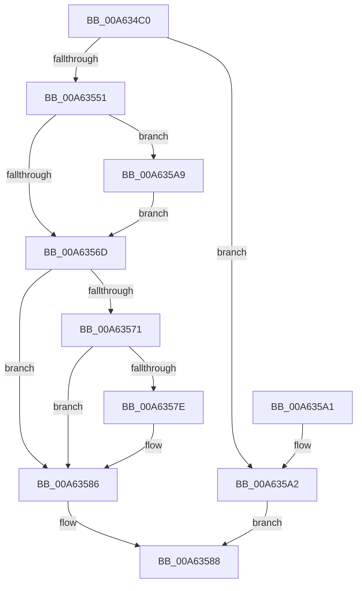

# FsRtlIssueDeviceIoControl

- RVA: `0x00A634C0`–`0x00A635C7` (길이 `263` bytes)
- VA: `0x0000000140A634C0`
- 실행 섹션: `PAGE`
- PDB 이름 있음: `예`; PDB Function 태그: `아니요`
- unwind 정보 RVA: `0x0007043C`
- 디코드: `69`개 명령, `263/263` bytes 표시
- 미해석 바이트: `0` (있으면 어셈블리에 `.byte`로 보존)

> 이 문서는 커널 이미지의 기계어와 PDB 기호를 분석해 생성했습니다. 4번과 5번은 함수 원형과 자료형을 바이너리 사용 방식에서 추정한 C 해석이며 원본 소스 복구 결과는 아닙니다.

## 1. Dependencies

- 직접 호출 지점: **4**; 고유 호출 대상: **4**
- 직접 호출자로 확인된 함수: **2**
- RIP 상대 이미지 참조: **0**

### Outgoing calls
- `0x00A634FE` → [KeInitializeEvent](../../text/40/KeInitializeEvent_function_0040DD10.md) (function, `0x0040DD10`)
- `0x00A63544` → [IoBuildDeviceIoControlRequest](../../text/20/IoBuildDeviceIoControlRequest_function_00204FD0.md) (function, `0x00204FD0`)
- `0x00A6355F` → [IofCallDriver](../../text/29/IofCallDriver_function_0029B4B0.md) (function, `0x0029B4B0`)
- `0x00A635BC` → [KeWaitForSingleObject](../../text/20/KeWaitForSingleObject_function_0020E6B0.md) (function, `0x0020E6B0`)

### Direct callers
- [FsRtlVolumeDeviceToCorrelationId](FsRtlVolumeDeviceToCorrelationId_function_00A62E20.md) at `0x00A62E6E`
- [FsRtlGetSectorSizeInformation](FsRtlGetSectorSizeInformation_function_00A62EB0.md) at `0x00A62F4B`

### Static image references
- 디코드된 RIP-relative 메모리 참조가 없습니다.

## 2. Other-region calls and transfers

- 다른 실행 섹션으로 향하는 call: **4**
  - `0x00A634FE` → [KeInitializeEvent](../../text/40/KeInitializeEvent_function_0040DD10.md) (`PAGE` → `.text`)
  - `0x00A63544` → [IoBuildDeviceIoControlRequest](../../text/20/IoBuildDeviceIoControlRequest_function_00204FD0.md) (`PAGE` → `.text`)
  - `0x00A6355F` → [IofCallDriver](../../text/29/IofCallDriver_function_0029B4B0.md) (`PAGE` → `.text`)
  - `0x00A635BC` → [KeWaitForSingleObject](../../text/20/KeWaitForSingleObject_function_0020E6B0.md) (`PAGE` → `.text`)
- 별도 외부 분기/꼬리 이동을 확인하지 못했습니다.

## 3. Assembly (complete function range)

```asm
00A634C0  4C 8B DC                        mov r11, rsp
00A634C3  49 89 5B 08                     mov qword ptr [r11 + 8], rbx
00A634C7  49 89 6B 10                     mov qword ptr [r11 + 0x10], rbp
00A634CB  49 89 73 18                     mov qword ptr [r11 + 0x18], rsi
00A634CF  57                              push rdi
00A634D0  48 81 EC 80 00 00 00            sub rsp, 0x80
00A634D7  0F 57 C0                        xorps xmm0, xmm0
00A634DA  41 8A E8                        mov bpl, r8b
00A634DD  8B FA                           mov edi, edx
00A634DF  48 8B F1                        mov rsi, rcx
00A634E2  33 C0                           xor eax, eax
00A634E4  49 8D 4B D8                     lea rcx, [r11 - 0x28]
00A634E8  0F 11 44 24 60                  movups xmmword ptr [rsp + 0x60], xmm0
00A634ED  45 33 C0                        xor r8d, r8d
00A634F0  49 89 43 E8                     mov qword ptr [r11 - 0x18], rax
00A634F4  33 D2                           xor edx, edx
00A634F6  49 8B D9                        mov rbx, r9
00A634F9  0F 11 44 24 50                  movups xmmword ptr [rsp + 0x50], xmm0
00A634FE  E8 0D A8 9A FF                  call 0x14040dd10
00A63503  44 8B 8C 24 B0 00 00 00         mov r9d, dword ptr [rsp + 0xb0]
00A6350B  48 8D 44 24 50                  lea rax, [rsp + 0x50]
00A63510  48 89 44 24 40                  mov qword ptr [rsp + 0x40], rax
00A63515  4C 8B C3                        mov r8, rbx
00A63518  48 8D 44 24 60                  lea rax, [rsp + 0x60]
00A6351D  48 8B D6                        mov rdx, rsi
00A63520  48 89 44 24 38                  mov qword ptr [rsp + 0x38], rax
00A63525  8B CF                           mov ecx, edi
00A63527  8B 84 24 C0 00 00 00            mov eax, dword ptr [rsp + 0xc0]
00A6352E  C6 44 24 30 00                  mov byte ptr [rsp + 0x30], 0
00A63533  89 44 24 28                     mov dword ptr [rsp + 0x28], eax
00A63537  48 8B 84 24 B8 00 00 00         mov rax, qword ptr [rsp + 0xb8]
00A6353F  48 89 44 24 20                  mov qword ptr [rsp + 0x20], rax
00A63544  E8 87 1A 7A FF                  call 0x140204fd0
00A63549  48 8B D0                        mov rdx, rax
00A6354C  48 85 C0                        test rax, rax
00A6354F  74 51                           je 0x140a635a2
00A63551  48 8B 80 B8 00 00 00            mov rax, qword ptr [rax + 0xb8]
00A63558  48 8B CE                        mov rcx, rsi
00A6355B  40 08 68 BA                     or byte ptr [rax - 0x46], bpl
00A6355F  E8 4C 7F 83 FF                  call 0x14029b4b0
00A63564  8B C8                           mov ecx, eax
00A63566  3D 03 01 00 00                  cmp eax, 0x103
00A6356B  74 3C                           je 0x140a635a9
00A6356D  85 C9                           test ecx, ecx
00A6356F  78 15                           js 0x140a63586
00A63571  48 8B 94 24 C8 00 00 00         mov rdx, qword ptr [rsp + 0xc8]
00A63579  48 85 D2                        test rdx, rdx
00A6357C  74 08                           je 0x140a63586
00A6357E  48 8B 44 24 58                  mov rax, qword ptr [rsp + 0x58]
00A63583  48 89 02                        mov qword ptr [rdx], rax
00A63586  8B C1                           mov eax, ecx
00A63588  4C 8D 9C 24 80 00 00 00         lea r11, [rsp + 0x80]
00A63590  49 8B 5B 10                     mov rbx, qword ptr [r11 + 0x10]
00A63594  49 8B 6B 18                     mov rbp, qword ptr [r11 + 0x18]
00A63598  49 8B 73 20                     mov rsi, qword ptr [r11 + 0x20]
00A6359C  49 8B E3                        mov rsp, r11
00A6359F  5F                              pop rdi
00A635A0  C3                              ret
00A635A1  CC                              int3
00A635A2  B8 9A 00 00 C0                  mov eax, 0xc000009a
00A635A7  EB DF                           jmp 0x140a63588
00A635A9  48 83 64 24 20 00               and qword ptr [rsp + 0x20], 0
00A635AF  48 8D 4C 24 60                  lea rcx, [rsp + 0x60]
00A635B4  45 33 C9                        xor r9d, r9d
00A635B7  45 33 C0                        xor r8d, r8d
00A635BA  33 D2                           xor edx, edx
00A635BC  E8 EF B0 7A FF                  call 0x14020e6b0
00A635C1  8B 4C 24 50                     mov ecx, dword ptr [rsp + 0x50]
00A635C5  EB A6                           jmp 0x140a6356d
```

## 4. C-style interpretation (structured pseudocode)

```c
__int64 __fastcall FsRtlIssueDeviceIoControl(__int64 a1, int a2, int a3, __int64 a4, unsigned int a5, __int64 a6, unsigned int a7, __int64 a8)
{
    __int64 result;
    __int64 v_rsp;
    unsigned __int64 v_stack_m20;
    unsigned __int64 v_stack_m28;
    unsigned __int64 v_stack_m30;
    unsigned __int64 v_stack_m38;
    unsigned __int64 v_stack_m48;
    unsigned __int64 v_stack_m50;
    unsigned __int8 v_stack_m58;
    unsigned int v_stack_m60;
    unsigned __int64 v_stack_m68;
    unsigned __int64 v_stack_m8;

    *(unsigned __int64 *)(v_rsp + 8) = v_rbx;
    *(unsigned __int64 *)(v_rsp + 16) = v_rbp;
    *(unsigned __int64 *)(v_rsp + 24) = v_rsi;
    v_rsp = (v_rsp) - (128);
    result = 0;
    v_stack_m28 = v_xmm0;
    a3 = 0;
    *(unsigned __int64 *)(v_rsp - 24) = 0;
    a2 = 0;
    v_stack_m38 = v_xmm0;
    result = KeInitializeEvent(v_rsp - 40, a2, a3, a4);
    v_stack_m48 = v_stack_m38;
    v_stack_m50 = v_stack_m28;
    v_stack_m58 = 0;
    v_stack_m60 = (unsigned int)((unsigned int)(a7));
    v_stack_m68 = a6;
    result = IoBuildDeviceIoControlRequest((unsigned int)((unsigned int)((unsigned int)(a2))), a1, a4, (unsigned int)(a5));
    if (result == 0) goto loc_00A635A2;
    result = IofCallDriver(a1, result, a4, (unsigned int)(a5));
    if (((unsigned int)(result)) == 259) goto loc_00A635A9;
loc_00A6356D:
    if (sign_flag) goto loc_00A63586;
    if (a8 != 0) {
        result = v_stack_m30;
        *(unsigned __int64 *)(a8) = result;
    }
loc_00A63588:
    return (unsigned int)((unsigned int)((unsigned int)((unsigned int)(result))));
loc_00A635A2:
    goto loc_00A63588;
loc_00A635A9:
    a4 = 0;
    a3 = 0;
    a2 = 0;
    result = KeWaitForSingleObject(v_stack_m20, a2, a3, a4);
    goto loc_00A6356D;
}
```

## 5. (Beta) C Style

```c
int64_t FsRtlIssueDeviceIoControl(int64_t Arg1, int32_t Arg2, int32_t Arg3, int64_t Arg4, uint32_t Arg5, int64_t Arg6, uint32_t Arg7, int64_t Arg8)
{
    int64_t result;
    int64_t local_rsp;
    uint64_t v_stack_m20;
    uint64_t v_stack_m28;
    uint64_t v_stack_m30;
    uint64_t v_stack_m38;
    uint64_t v_stack_m48;
    uint64_t v_stack_m50;
    uint8_t v_stack_m58;
    uint32_t v_stack_m60;
    uint64_t v_stack_m68;
    uint64_t v_stack_m8;

    *(uint64_t *)(local_rsp + 0x8) = local_rbx;
    *(uint64_t *)(local_rsp + 0x10) = local_rbp;
    *(uint64_t *)(local_rsp + 0x18) = local_rsi;
    local_rsp = (local_rsp) - (128);
    result = 0;
    v_stack_m28 = v_xmm0;
    Arg3 = 0;
    *(uint64_t *)(local_rsp - 0x18) = 0;
    Arg2 = 0;
    v_stack_m38 = v_xmm0;
    result = KeInitializeEvent(local_rsp - 40, Arg2, Arg3, Arg4);
    v_stack_m48 = v_stack_m38;
    v_stack_m50 = v_stack_m28;
    v_stack_m58 = 0;
    v_stack_m60 = (uint32_t)((uint32_t)(Arg7));
    v_stack_m68 = Arg6;
    result = IoBuildDeviceIoControlRequest((uint32_t)((uint32_t)((uint32_t)(Arg2))), Arg1, Arg4, (uint32_t)(Arg5));
    if (result == 0) goto loc_00A635A2;
    result = IofCallDriver(Arg1, result, Arg4, (uint32_t)(Arg5));
    if (((uint32_t)(result)) == 259) goto loc_00A635A9;
loc_00A6356D:
    if (sign_flag) goto loc_00A63586;
    if (Arg8 != 0) {
        result = v_stack_m30;
        *(uint64_t *)(Arg8) = result;
    }
loc_00A63588:
    return (uint32_t)((uint32_t)((uint32_t)((uint32_t)(result))));
loc_00A635A2:
    goto loc_00A63588;
loc_00A635A9:
    Arg4 = 0;
    Arg3 = 0;
    Arg2 = 0;
    result = KeWaitForSingleObject(v_stack_m20, Arg2, Arg3, Arg4);
    goto loc_00A6356D;
}
```

## 6. Execution-region graph

[열기: 2D/3D 그래프와 함수 탐색 컨트롤 패널](../../../control-panel.html?section=page&rva=0x00A634C0&view=graph)

- 2D 그래프는 위에서 아래로 흐르고, 3D 그래프는 빈 공간을 드래그해 회전합니다. Shift+드래그는 이동, 휠은 확대·축소, 함수 노드 선택은 대상 보고서 이동입니다.

### Static fallback


