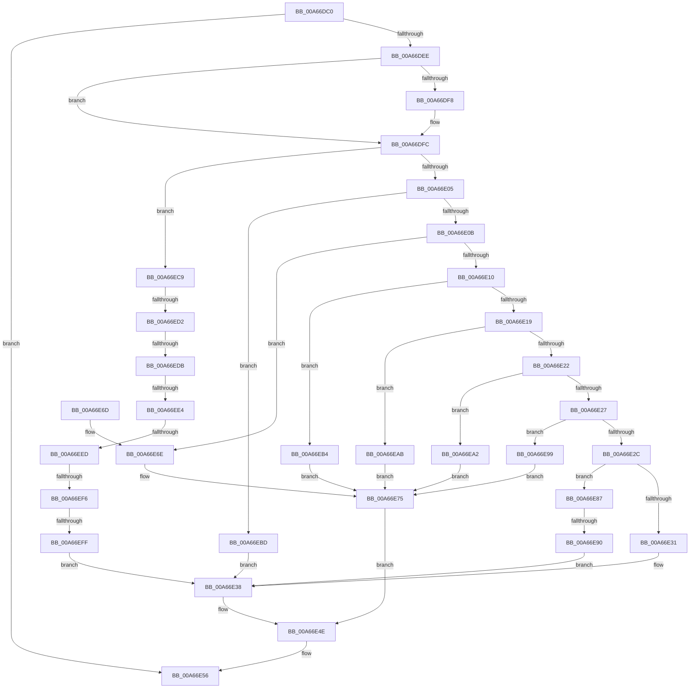

# FsRtlNotifyVolumeEventEx

- RVA: `0x00A66DC0`–`0x00A66F0B` (길이 `331` bytes)
- VA: `0x0000000140A66DC0`
- 실행 섹션: `PAGE`
- PDB 이름 있음: `예`; PDB Function 태그: `예`
- unwind 정보 RVA: `0x000B3B54`
- 디코드: `85`개 명령, `331/331` bytes 표시
- 미해석 바이트: `0` (있으면 어셈블리에 `.byte`로 보존)

> 이 문서는 커널 이미지의 기계어와 PDB 기호를 분석해 생성했습니다. 4번과 5번은 함수 원형과 자료형을 바이너리 사용 방식에서 추정한 C 해석이며 원본 소스 복구 결과는 아닙니다.

## 1. Dependencies

- 직접 호출 지점: **4**; 고유 호출 대상: **4**
- 직접 호출자로 확인된 함수: **1**
- RIP 상대 이미지 참조: **9**

### Outgoing calls
- `0x00A66DE3` → [PnpGetRelatedTargetDevice](../../text/27/PnpGetRelatedTargetDevice_function_00271F54.md) (function, `0x00271F54`)
- `0x00A66E49` → [IoReportTargetDeviceChangeAsynchronous](../../text/47/IoReportTargetDeviceChangeAsynchronous_function_00475DA0.md) (function, `0x00475DA0`)
- `0x00A66E51` → [ObfDereferenceObject](../../text/2F/ObfDereferenceObject_function_002F9350.md) (function, `0x002F9350`)
- `0x00A66E80` → [IoReportTargetDeviceChange](IoReportTargetDeviceChange_function_00A66F20.md) (function, `0x00A66F20`)

### Direct callers
- [FsRtlNotifyVolumeEvent](../71/FsRtlNotifyVolumeEvent_function_00716EE0.md) at `0x00716F1F`

### Static image references
- `0x00A66E31` → RVA `0x000135D8` (`.rdata`; read)
- `0x00A66E6E` → RVA `0x0001A8A8` (`.rdata`; read)
- `0x00A66E90` → RVA `0x00026BD0` (`.rdata`; read)
- `0x00A66E99` → RVA `0x00026BE0` (`.rdata`; read)
- `0x00A66EA2` → RVA `0x00026BC0` (`.rdata`; read)
- `0x00A66EAB` → RVA `0x00026BF0` (`.rdata`; read)
- `0x00A66EB4` → RVA `0x00026C00` (`.rdata`; read)
- `0x00A66EBD` → RVA `0x00026C40` (`.rdata`; read)
- `0x00A66EFF` → RVA `0x00026C30` (`.rdata`; read)

## 2. Other-region calls and transfers

- 다른 실행 섹션으로 향하는 call: **3**
  - `0x00A66DE3` → [PnpGetRelatedTargetDevice](../../text/27/PnpGetRelatedTargetDevice_function_00271F54.md) (`PAGE` → `.text`)
  - `0x00A66E49` → [IoReportTargetDeviceChangeAsynchronous](../../text/47/IoReportTargetDeviceChangeAsynchronous_function_00475DA0.md) (`PAGE` → `.text`)
  - `0x00A66E51` → [ObfDereferenceObject](../../text/2F/ObfDereferenceObject_function_002F9350.md) (`PAGE` → `.text`)
- call이 아닌 외부 분기/꼬리 이동: **7**
  - `0x00A66E8A` → [sub_00B3E99E](../B3/Unknown_function_00B3E99E.md) (`tail-transfer`)
  - `0x00A66ECC` → [sub_00B3E99E + 0x42](../B3/Unknown_function_00B3E99E.md) (`tail-transfer`)
  - `0x00A66ED5` → [sub_00B3E99E + 0x36](../B3/Unknown_function_00B3E99E.md) (`tail-transfer`)
  - `0x00A66EDE` → [sub_00B3E99E + 0x2A](../B3/Unknown_function_00B3E99E.md) (`tail-transfer`)
  - `0x00A66EE7` → [sub_00B3E99E + 0x1E](../B3/Unknown_function_00B3E99E.md) (`tail-transfer`)
  - `0x00A66EF0` → [sub_00B3E99E + 0x12](../B3/Unknown_function_00B3E99E.md) (`tail-transfer`)
  - `0x00A66EF9` → [sub_00B3E99E](../B3/Unknown_function_00B3E99E.md) (`tail-transfer`)

## 3. Assembly (complete function range)

```asm
00A66DC0  48 8B C4                        mov rax, rsp
00A66DC3  48 89 58 08                     mov qword ptr [rax + 8], rbx
00A66DC7  48 89 68 10                     mov qword ptr [rax + 0x10], rbp
00A66DCB  48 89 70 18                     mov qword ptr [rax + 0x18], rsi
00A66DCF  57                              push rdi
00A66DD0  48 83 EC 20                     sub rsp, 0x20
00A66DD4  8B DA                           mov ebx, edx
00A66DD6  33 F6                           xor esi, esi
00A66DD8  48 8D 50 20                     lea rdx, [rax + 0x20]
00A66DDC  48 89 70 20                     mov qword ptr [rax + 0x20], rsi
00A66DE0  49 8B F8                        mov rdi, r8
00A66DE3  E8 6C B1 80 FF                  call 0x140271f54
00A66DE8  8B E8                           mov ebp, eax
00A66DEA  85 C0                           test eax, eax
00A66DEC  78 68                           js 0x140a66e56
00A66DEE  48 8B 4C 24 48                  mov rcx, qword ptr [rsp + 0x48]
00A66DF3  48 85 C9                        test rcx, rcx
00A66DF6  74 04                           je 0x140a66dfc
00A66DF8  48 8B 71 20                     mov rsi, qword ptr [rcx + 0x20]
00A66DFC  83 FB 08                        cmp ebx, 8
00A66DFF  0F 87 C4 00 00 00               ja 0x140a66ec9
00A66E05  0F 84 B2 00 00 00               je 0x140a66ebd
00A66E0B  83 EB 01                        sub ebx, 1
00A66E0E  74 5E                           je 0x140a66e6e
00A66E10  83 EB 01                        sub ebx, 1
00A66E13  0F 84 9B 00 00 00               je 0x140a66eb4
00A66E19  83 EB 01                        sub ebx, 1
00A66E1C  0F 84 89 00 00 00               je 0x140a66eab
00A66E22  83 EB 01                        sub ebx, 1
00A66E25  74 7B                           je 0x140a66ea2
00A66E27  83 EB 01                        sub ebx, 1
00A66E2A  74 6D                           je 0x140a66e99
00A66E2C  83 EB 01                        sub ebx, 1
00A66E2F  75 56                           jne 0x140a66e87
00A66E31  0F 10 05 A0 C7 5A FF            movups xmm0, xmmword ptr [rip - 0xa53860]
00A66E38  45 33 C9                        xor r9d, r9d
00A66E3B  45 33 C0                        xor r8d, r8d
00A66E3E  48 8B D7                        mov rdx, rdi
00A66E41  48 8B CE                        mov rcx, rsi
00A66E44  F3 0F 7F 47 04                  movdqu xmmword ptr [rdi + 4], xmm0
00A66E49  E8 52 EF A0 FF                  call 0x140475da0
00A66E4E  48 8B CE                        mov rcx, rsi
00A66E51  E8 FA 24 89 FF                  call 0x1402f9350
00A66E56  8B C5                           mov eax, ebp
00A66E58  48 8B 5C 24 30                  mov rbx, qword ptr [rsp + 0x30]
00A66E5D  48 8B 6C 24 38                  mov rbp, qword ptr [rsp + 0x38]
00A66E62  48 8B 74 24 40                  mov rsi, qword ptr [rsp + 0x40]
00A66E67  48 83 C4 20                     add rsp, 0x20
00A66E6B  5F                              pop rdi
00A66E6C  C3                              ret
00A66E6D  CC                              int3
00A66E6E  0F 10 05 33 3A 5B FF            movups xmm0, xmmword ptr [rip - 0xa4c5cd]
00A66E75  48 8B D7                        mov rdx, rdi
00A66E78  48 8B CE                        mov rcx, rsi
00A66E7B  F3 0F 7F 47 04                  movdqu xmmword ptr [rdi + 4], xmm0
00A66E80  E8 9B 00 00 00                  call 0x140a66f20
00A66E85  EB C7                           jmp 0x140a66e4e
00A66E87  83 FB 01                        cmp ebx, 1
00A66E8A  0F 85 0E 7B 0D 00               jne 0x140b3e99e
00A66E90  0F 10 05 39 FD 5B FF            movups xmm0, xmmword ptr [rip - 0xa402c7]
00A66E97  EB 9F                           jmp 0x140a66e38
00A66E99  0F 10 05 40 FD 5B FF            movups xmm0, xmmword ptr [rip - 0xa402c0]
00A66EA0  EB D3                           jmp 0x140a66e75
00A66EA2  0F 10 05 17 FD 5B FF            movups xmm0, xmmword ptr [rip - 0xa402e9]
00A66EA9  EB CA                           jmp 0x140a66e75
00A66EAB  0F 10 05 3E FD 5B FF            movups xmm0, xmmword ptr [rip - 0xa402c2]
00A66EB2  EB C1                           jmp 0x140a66e75
00A66EB4  0F 10 05 45 FD 5B FF            movups xmm0, xmmword ptr [rip - 0xa402bb]
00A66EBB  EB B8                           jmp 0x140a66e75
00A66EBD  0F 10 05 7C FD 5B FF            movups xmm0, xmmword ptr [rip - 0xa40284]
00A66EC4  E9 6F FF FF FF                  jmp 0x140a66e38
00A66EC9  83 EB 09                        sub ebx, 9
00A66ECC  0F 84 0E 7B 0D 00               je 0x140b3e9e0
00A66ED2  83 EB 01                        sub ebx, 1
00A66ED5  0F 84 F9 7A 0D 00               je 0x140b3e9d4
00A66EDB  83 EB 01                        sub ebx, 1
00A66EDE  0F 84 E4 7A 0D 00               je 0x140b3e9c8
00A66EE4  83 EB 01                        sub ebx, 1
00A66EE7  0F 84 CF 7A 0D 00               je 0x140b3e9bc
00A66EED  83 EB 01                        sub ebx, 1
00A66EF0  0F 84 BA 7A 0D 00               je 0x140b3e9b0
00A66EF6  83 FB 01                        cmp ebx, 1
00A66EF9  0F 85 9F 7A 0D 00               jne 0x140b3e99e
00A66EFF  0F 10 05 2A FD 5B FF            movups xmm0, xmmword ptr [rip - 0xa402d6]
00A66F06  E9 2D FF FF FF                  jmp 0x140a66e38
```

## 4. C-style interpretation (structured pseudocode)

```c
__int64 __fastcall FsRtlNotifyVolumeEventEx(__int64 a1, int a2, __int64 a3, int a4)
{
    __int64 result;
    __int64 v_rbx;
    __int64 v_rsi;
    __int64 v_rsp;
    unsigned __int64 v_stack_p10;
    unsigned __int64 v_stack_p18;
    unsigned __int64 v_stack_p20;
    unsigned __int64 v_stack_p8;

    *(unsigned __int64 *)(v_rsp + 8) = v_rbx;
    *(unsigned __int64 *)(v_rsp + 16) = v_rbp;
    *(unsigned __int64 *)(v_rsp + 24) = v_rsi;
    v_rsp = (v_rsp) - (32);
    v_rsi = 0;
    *(unsigned __int64 *)(v_rsp + 32) = 0;
    result = PnpGetRelatedTargetDevice(a1, v_rsp + 32, a3, a4);
    if (sign_flag) goto loc_00A66E56;
    if (v_stack_p20 != 0) {
        v_rsi = *(unsigned __int64 *)(v_stack_p20 + 32);
    }
    if (((unsigned int)((unsigned int)(a2))) > 8) goto loc_00A66EC9;
    if (((unsigned int)((unsigned int)(a2))) == 8) goto loc_00A66EBD;
    v_rbx = (unsigned int)(((unsigned int)(a2)) - (1));
    if (condition_is_equal) goto loc_00A66E6E;
    v_rbx = (unsigned int)((v_rbx) - (1));
    if (condition_is_equal) goto loc_00A66EB4;
    v_rbx = (unsigned int)((v_rbx) - (1));
    if (condition_is_equal) goto loc_00A66EAB;
    v_rbx = (unsigned int)((v_rbx) - (1));
    if (condition_is_equal) goto loc_00A66EA2;
    v_rbx = (unsigned int)((v_rbx) - (1));
    if (condition_is_equal) goto loc_00A66E99;
    v_rbx = (unsigned int)((v_rbx) - (1));
    if (condition_is_not_equal) goto loc_00A66E87;
loc_00A66E38:
    a4 = 0;
    a3 = 0;
    *(unsigned __int64 *)(a3 + 4) = v_xmm0;
    result = IoReportTargetDeviceChangeAsynchronous(v_rsi, 0, a3, a4);
loc_00A66E4E:
    result = ObfDereferenceObject(v_rsi, 0, a3, a4);
loc_00A66E56:
    v_rsp = (v_rsp) + (32);
    return (unsigned int)((unsigned int)((unsigned int)((unsigned int)(result))));
loc_00A66E6E:
loc_00A66E75:
    *(unsigned __int64 *)(a3 + 4) = v_xmm0;
    result = IoReportTargetDeviceChange(v_stack_p18, 0, a3, a4);
    goto loc_00A66E4E;
loc_00A66E87:
    goto loc_00A66E38;
loc_00A66E99:
    goto loc_00A66E75;
loc_00A66EA2:
    goto loc_00A66E75;
loc_00A66EAB:
    goto loc_00A66E75;
loc_00A66EB4:
    goto loc_00A66E75;
loc_00A66EBD:
    goto loc_00A66E38;
loc_00A66EC9:
    v_rbx = (unsigned int)((v_stack_p8) - (9));
    v_rbx = (unsigned int)((v_rbx) - (1));
    v_rbx = (unsigned int)((v_rbx) - (1));
    v_rbx = (unsigned int)((v_rbx) - (1));
    v_rbx = (unsigned int)((v_rbx) - (1));
    goto loc_00A66E38;
}
```

## 5. (Beta) C Style

```c
int64_t FsRtlNotifyVolumeEventEx(int64_t Arg1, int32_t Arg2, void *Arg3, int32_t Arg4)
{
    uint8_t *arg3 = (uint8_t *)Arg3;

    int64_t result;
    int64_t local_rbx;
    int64_t local_rsi;
    int64_t local_rsp;
    uint64_t v_stack_p10;
    uint64_t v_stack_p18;
    uint64_t v_stack_p20;
    uint64_t v_stack_p8;

    *(uint64_t *)(local_rsp + 0x8) = local_rbx;
    *(uint64_t *)(local_rsp + 0x10) = local_rbp;
    *(uint64_t *)(local_rsp + 0x18) = local_rsi;
    local_rsp = (local_rsp) - (32);
    local_rsi = 0;
    *(uint64_t *)(local_rsp + 0x20) = 0;
    result = PnpGetRelatedTargetDevice(Arg1, local_rsp + 32, Arg3, Arg4);
    if (sign_flag) goto loc_00A66E56;
    if (v_stack_p20 != 0) {
        local_rsi = *(uint64_t *)(v_stack_p20 + 0x20);
    }
    if (((uint32_t)((uint32_t)(Arg2))) > 8) goto loc_00A66EC9;
    if (((uint32_t)((uint32_t)(Arg2))) == 8) goto loc_00A66EBD;
    local_rbx = (uint32_t)(((uint32_t)(Arg2)) - (1));
    if (condition_is_equal) goto loc_00A66E6E;
    local_rbx = (uint32_t)((local_rbx) - (1));
    if (condition_is_equal) goto loc_00A66EB4;
    local_rbx = (uint32_t)((local_rbx) - (1));
    if (condition_is_equal) goto loc_00A66EAB;
    local_rbx = (uint32_t)((local_rbx) - (1));
    if (condition_is_equal) goto loc_00A66EA2;
    local_rbx = (uint32_t)((local_rbx) - (1));
    if (condition_is_equal) goto loc_00A66E99;
    local_rbx = (uint32_t)((local_rbx) - (1));
    if (condition_is_not_equal) goto loc_00A66E87;
loc_00A66E38:
    Arg4 = 0;
    Arg3 = 0;
    *(uint64_t *)(arg3 + 0x4) = v_xmm0;
    result = IoReportTargetDeviceChangeAsynchronous(local_rsi, 0, Arg3, Arg4);
loc_00A66E4E:
    result = ObfDereferenceObject(local_rsi, 0, Arg3, Arg4);
loc_00A66E56:
    local_rsp = (local_rsp) + (32);
    return (uint32_t)((uint32_t)((uint32_t)((uint32_t)(result))));
loc_00A66E6E:
loc_00A66E75:
    *(uint64_t *)(arg3 + 0x4) = v_xmm0;
    result = IoReportTargetDeviceChange(v_stack_p18, 0, Arg3, Arg4);
    goto loc_00A66E4E;
loc_00A66E87:
    goto loc_00A66E38;
loc_00A66E99:
    goto loc_00A66E75;
loc_00A66EA2:
    goto loc_00A66E75;
loc_00A66EAB:
    goto loc_00A66E75;
loc_00A66EB4:
    goto loc_00A66E75;
loc_00A66EBD:
    goto loc_00A66E38;
loc_00A66EC9:
    local_rbx = (uint32_t)((v_stack_p8) - (9));
    local_rbx = (uint32_t)((local_rbx) - (1));
    local_rbx = (uint32_t)((local_rbx) - (1));
    local_rbx = (uint32_t)((local_rbx) - (1));
    local_rbx = (uint32_t)((local_rbx) - (1));
    goto loc_00A66E38;
}
```

### 관측된 메모리 오프셋

구조체 형식이 확인되지 않은 접근은 인자 기준의 오프셋으로만 기록했습니다.

| 기준 인자 | 오프셋 표현 | 폭 (bit) | 접근 |
|---|---:|---:|---|
| `Arg3` | `+ 0x4` | `128` | `W` |

## 6. Execution-region graph

[열기: 2D/3D 그래프와 함수 탐색 컨트롤 패널](../../../control-panel.html?section=page&rva=0x00A66DC0&view=graph)

- 2D 그래프는 위에서 아래로 흐르고, 3D 그래프는 빈 공간을 드래그해 회전합니다. Shift+드래그는 이동, 휠은 확대·축소, 함수 노드 선택은 대상 보고서 이동입니다.

### Static fallback


