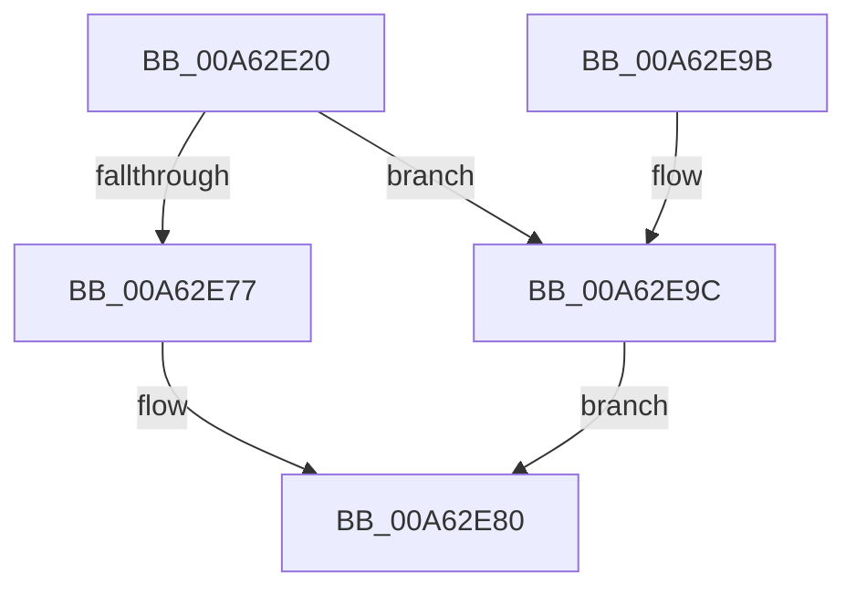

# FsRtlVolumeDeviceToCorrelationId

- RVA: `0x00A62E20`–`0x00A62EA9` (길이 `137` bytes)
- VA: `0x0000000140A62E20`
- 실행 섹션: `PAGE`
- PDB 이름 있음: `예`; PDB Function 태그: `아니요`
- unwind 정보 RVA: `0x000B34B4`
- 디코드: `36`개 명령, `137/137` bytes 표시
- 미해석 바이트: `0` (있으면 어셈블리에 `.byte`로 보존)

> 이 문서는 커널 이미지의 기계어와 PDB 기호를 분석해 생성했습니다. 4번과 5번은 함수 원형과 자료형을 바이너리 사용 방식에서 추정한 C 해석이며 원본 소스 복구 결과는 아닙니다.

## 1. Dependencies

- 직접 호출 지점: **3**; 고유 호출 대상: **3**
- 직접 호출자로 확인된 함수: **0**
- RIP 상대 이미지 참조: **1**

### Outgoing calls
- `0x00A62E6E` → [FsRtlIssueDeviceIoControl](FsRtlIssueDeviceIoControl_function_00A634C0.md) (function, `0x00A634C0`)
- `0x00A62E88` → [_security_check_cookie](../../text/6A/_security_check_cookie_function_006AC640.md) (function, `0x006AC640`)
- `0x00A62EA2` → [IoVolumeDeviceToGuid](../95/IoVolumeDeviceToGuid_function_00952A90.md) (function, `0x00952A90`)

### Direct callers
- 이 함수 시작 RVA로 연결되는 직접 call은 확인되지 않았습니다. 간접 호출은 완전히 역산할 수 없습니다.

### Static image references
- `0x00A62E2C` → RVA `0x00E0A740` (`.data`; read)

## 2. Other-region calls and transfers

- 다른 실행 섹션으로 향하는 call: **1**
  - `0x00A62E88` → [_security_check_cookie](../../text/6A/_security_check_cookie_function_006AC640.md) (`PAGE` → `.text`)
- 별도 외부 분기/꼬리 이동을 확인하지 못했습니다.

## 3. Assembly (complete function range)

```asm
00A62E20  4C 8B DC                        mov r11, rsp
00A62E23  49 89 5B 18                     mov qword ptr [r11 + 0x18], rbx
00A62E27  57                              push rdi
00A62E28  48 83 EC 60                     sub rsp, 0x60
00A62E2C  48 8B 05 0D 79 3A 00            mov rax, qword ptr [rip + 0x3a790d]
00A62E33  48 33 C4                        xor rax, rsp
00A62E36  48 89 44 24 50                  mov qword ptr [rsp + 0x50], rax
00A62E3B  49 83 63 D0 00                  and qword ptr [r11 - 0x30], 0
00A62E40  49 8D 43 D8                     lea rax, [r11 - 0x28]
00A62E44  C7 44 24 30 10 00 00 00         mov dword ptr [rsp + 0x30], 0x10
00A62E4C  48 8B DA                        mov rbx, rdx
00A62E4F  0F 57 C0                        xorps xmm0, xmm0
00A62E52  49 89 43 C0                     mov qword ptr [r11 - 0x40], rax
00A62E56  83 64 24 20 00                  and dword ptr [rsp + 0x20], 0
00A62E5B  45 33 C9                        xor r9d, r9d
00A62E5E  45 33 C0                        xor r8d, r8d
00A62E61  BA 18 00 4D 00                  mov edx, 0x4d0018
00A62E66  48 8B F9                        mov rdi, rcx
00A62E69  0F 11 44 24 40                  movups xmmword ptr [rsp + 0x40], xmm0
00A62E6E  E8 4D 06 00 00                  call 0x140a634c0
00A62E73  85 C0                           test eax, eax
00A62E75  78 25                           js 0x140a62e9c
00A62E77  0F 10 44 24 40                  movups xmm0, xmmword ptr [rsp + 0x40]
00A62E7C  F3 0F 7F 03                     movdqu xmmword ptr [rbx], xmm0
00A62E80  48 8B 4C 24 50                  mov rcx, qword ptr [rsp + 0x50]
00A62E85  48 33 CC                        xor rcx, rsp
00A62E88  E8 B3 97 C4 FF                  call 0x1406ac640
00A62E8D  48 8B 9C 24 80 00 00 00         mov rbx, qword ptr [rsp + 0x80]
00A62E95  48 83 C4 60                     add rsp, 0x60
00A62E99  5F                              pop rdi
00A62E9A  C3                              ret
00A62E9B  CC                              int3
00A62E9C  48 8B D3                        mov rdx, rbx
00A62E9F  48 8B CF                        mov rcx, rdi
00A62EA2  E8 E9 FB EE FF                  call 0x140952a90
00A62EA7  EB D7                           jmp 0x140a62e80
```

## 4. C-style interpretation (structured pseudocode)

```c
__int64 __fastcall FsRtlVolumeDeviceToCorrelationId(__int64 a1, __int64 a2, int a3, int a4)
{
    __int64 result;
    __int64 v_rsp;
    unsigned __int64 v_stack_m18;
    unsigned __int64 v_stack_m28;
    unsigned int v_stack_m38;
    unsigned int v_stack_m48;
    unsigned __int64 v_stack_p18;

    *(unsigned __int64 *)(v_rsp + 24) = v_rbx;
    v_rsp = (v_rsp) - (96);
    result = (*(unsigned __int64 *)(v_rip + 3832077)) ^ (v_rsp);
    v_stack_m18 = result;
    v_stack_m38 = 16;
    *(unsigned __int64 *)(v_rsp - 64) = v_rsp - 40;
    a4 = 0;
    a3 = 0;
    v_stack_m28 = v_xmm0;
    result = FsRtlIssueDeviceIoControl(a1, (unsigned int)(0x4D0018ULL), a3, a4);
    if (sign_flag) goto loc_00A62E9C;
    *(unsigned __int64 *)(a2) = v_xmm0;
loc_00A62E80:
    a1 = (v_stack_m18) ^ (v_rsp);
    result = _security_check_cookie(a1, (unsigned int)(0x4D0018ULL), a3, a4);
    v_rsp = (v_rsp) + (96);
    return result;
loc_00A62E9C:
    result = IoVolumeDeviceToGuid(a1, v_stack_p18, a3, a4);
    goto loc_00A62E80;
}
```

## 5. (Beta) C Style

```c
int64_t FsRtlVolumeDeviceToCorrelationId(int64_t Arg1, void *Arg2, int32_t Arg3, int32_t Arg4)
{
    uint8_t *arg2 = (uint8_t *)Arg2;

    int64_t result;
    int64_t local_rsp;
    uint64_t v_stack_m18;
    uint64_t v_stack_m28;
    uint32_t v_stack_m38;
    uint32_t v_stack_m48;
    uint64_t v_stack_p18;

    *(uint64_t *)(local_rsp + 0x18) = local_rbx;
    local_rsp = (local_rsp) - (96);
    result = (*(uint64_t *)(v_rip + 0x3A790D)) ^ (local_rsp);
    v_stack_m18 = result;
    v_stack_m38 = 16;
    *(uint64_t *)(local_rsp - 0x40) = local_rsp - 40;
    Arg4 = 0;
    Arg3 = 0;
    v_stack_m28 = v_xmm0;
    result = FsRtlIssueDeviceIoControl(Arg1, (uint32_t)(0x4D0018ULL), Arg3, Arg4);
    if (sign_flag) goto loc_00A62E9C;
    *(uint64_t *)(arg2) = v_xmm0;
loc_00A62E80:
    Arg1 = (v_stack_m18) ^ (local_rsp);
    result = _security_check_cookie(Arg1, (uint32_t)(0x4D0018ULL), Arg3, Arg4);
    local_rsp = (local_rsp) + (96);
    return result;
loc_00A62E9C:
    result = IoVolumeDeviceToGuid(Arg1, v_stack_p18, Arg3, Arg4);
    goto loc_00A62E80;
}
```

### 관측된 메모리 오프셋

구조체 형식이 확인되지 않은 접근은 인자 기준의 오프셋으로만 기록했습니다.

| 기준 인자 | 오프셋 표현 | 폭 (bit) | 접근 |
|---|---:|---:|---|
| `Arg2` | `+ 0x0` | `128` | `W` |

## 6. Execution-region graph

[열기: 2D/3D 그래프와 함수 탐색 컨트롤 패널](../../../control-panel.html?section=page&rva=0x00A62E20&view=graph)

- 2D 그래프는 위에서 아래로 흐르고, 3D 그래프는 빈 공간을 드래그해 회전합니다. Shift+드래그는 이동, 휠은 확대·축소, 함수 노드 선택은 대상 보고서 이동입니다.

### Static fallback


