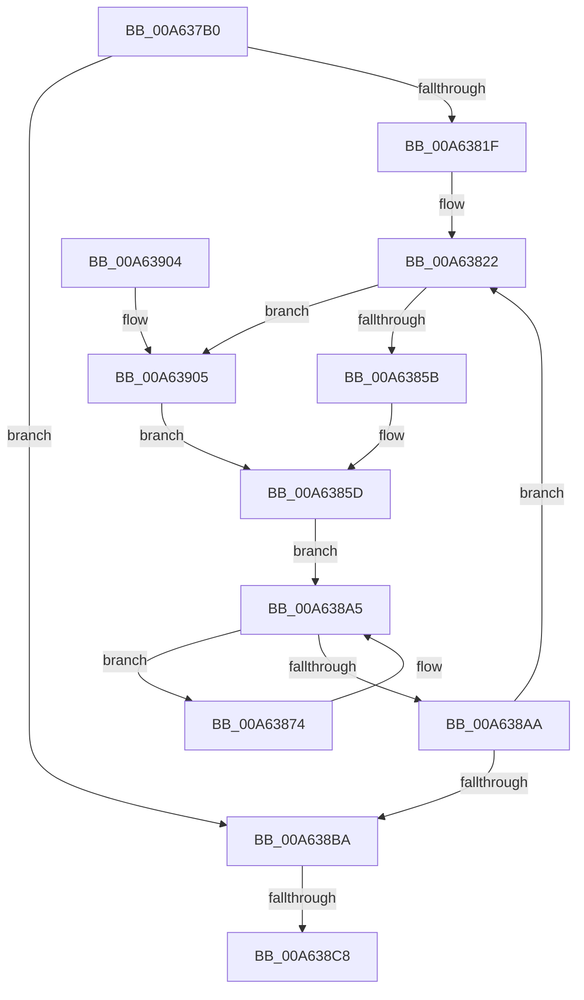

# HalpCmcWorkerRoutine

- RVA: `0x00A637B0`–`0x00A6390E` (길이 `350` bytes)
- VA: `0x0000000140A637B0`
- 실행 섹션: `PAGE`
- PDB 이름 있음: `예`; PDB Function 태그: `예`
- unwind 정보 RVA: `0x000B3518`
- 디코드: `90`개 명령, `350/350` bytes 표시
- 미해석 바이트: `0` (있으면 어셈블리에 `.byte`로 보존)

> 이 문서는 커널 이미지의 기계어와 PDB 기호를 분석해 생성했습니다. 4번과 5번은 함수 원형과 자료형을 바이너리 사용 방식에서 추정한 C 해석이며 원본 소스 복구 결과는 아닙니다.

## 1. Dependencies

- 직접 호출 지점: **5**; 고유 호출 대상: **5**
- 직접 호출자로 확인된 함수: **0**
- RIP 상대 이미지 참조: **5**

### Outgoing calls
- `0x00A6380C` → [KeQueryActiveProcessorCountEx](../../text/24/KeQueryActiveProcessorCountEx_function_00249EF0.md) (function, `0x00249EF0`)
- `0x00A6385D` → [KeSetSystemGroupAffinityThread](../../text/39/KeSetSystemGroupAffinityThread_function_00399140.md) (function, `0x00399140`)
- `0x00A6388B` → [HalpCmcPollProcessor](../../text/48/HalpCmcPollProcessor_function_0048772C.md) (function, `0x0048772C`)
- `0x00A638CC` → [KeRevertToUserGroupAffinityThread](../../text/39/KeRevertToUserGroupAffinityThread_function_00398EC0.md) (function, `0x00398EC0`)
- `0x00A638DE` → [_security_check_cookie](../../text/6A/_security_check_cookie_function_006AC640.md) (function, `0x006AC640`)

### Direct callers
- 이 함수 시작 RVA로 연결되는 직접 call은 확인되지 않았습니다. 간접 호출은 완전히 역산할 수 없습니다.

### Static image references
- `0x00A637D2` → RVA `0x00E0A740` (`.data`; read)
- `0x00A63822` → RVA `0x00F231B0` (`.data`; read)
- `0x00A6387E` → RVA `0x00E0F6B8` (`.data`; read)
- `0x00A63884` → RVA `0x00E0F6C0` (`.data`; read)
- `0x00A638BA` → RVA `0x00E0F6A0` (`.data`; read)

## 2. Other-region calls and transfers

- 다른 실행 섹션으로 향하는 call: **5**
  - `0x00A6380C` → [KeQueryActiveProcessorCountEx](../../text/24/KeQueryActiveProcessorCountEx_function_00249EF0.md) (`PAGE` → `.text`)
  - `0x00A6385D` → [KeSetSystemGroupAffinityThread](../../text/39/KeSetSystemGroupAffinityThread_function_00399140.md) (`PAGE` → `.text`)
  - `0x00A6388B` → [HalpCmcPollProcessor](../../text/48/HalpCmcPollProcessor_function_0048772C.md) (`PAGE` → `.text`)
  - `0x00A638CC` → [KeRevertToUserGroupAffinityThread](../../text/39/KeRevertToUserGroupAffinityThread_function_00398EC0.md) (`PAGE` → `.text`)
  - `0x00A638DE` → [_security_check_cookie](../../text/6A/_security_check_cookie_function_006AC640.md) (`PAGE` → `.text`)
- call이 아닌 외부 분기/꼬리 이동: **1**
  - `0x00A638C2` → [sub_00B3E38E](../B3/Unknown_function_00B3E38E.md) (`tail-transfer`)

## 3. Assembly (complete function range)

```asm
00A637B0  48 89 5C 24 10                  mov qword ptr [rsp + 0x10], rbx
00A637B5  48 89 74 24 18                  mov qword ptr [rsp + 0x18], rsi
00A637BA  48 89 7C 24 20                  mov qword ptr [rsp + 0x20], rdi
00A637BF  55                              push rbp
00A637C0  41 54                           push r12
00A637C2  41 55                           push r13
00A637C4  41 56                           push r14
00A637C6  41 57                           push r15
00A637C8  48 8B EC                        mov rbp, rsp
00A637CB  48 81 EC 80 00 00 00            sub rsp, 0x80
00A637D2  48 8B 05 67 6F 3A 00            mov rax, qword ptr [rip + 0x3a6f67]
00A637D9  48 33 C4                        xor rax, rsp
00A637DC  48 89 45 F0                     mov qword ptr [rbp - 0x10], rax
00A637E0  FF 81 B8 00 00 00               inc dword ptr [rcx + 0xb8]
00A637E6  0F 57 C0                        xorps xmm0, xmm0
00A637E9  48 8B F9                        mov rdi, rcx
00A637EC  0F 57 C9                        xorps xmm1, xmm1
00A637EF  33 DB                           xor ebx, ebx
00A637F1  B9 FF FF 00 00                  mov ecx, 0xffff
00A637F6  0F 11 45 A0                     movups xmmword ptr [rbp - 0x60], xmm0
00A637FA  8B F3                           mov esi, ebx
00A637FC  0F 11 4D E0                     movups xmmword ptr [rbp - 0x20], xmm1
00A63800  0F 11 45 B0                     movups xmmword ptr [rbp - 0x50], xmm0
00A63804  0F 11 45 C0                     movups xmmword ptr [rbp - 0x40], xmm0
00A63808  0F 11 45 D0                     movups xmmword ptr [rbp - 0x30], xmm0
00A6380C  E8 DF 66 7E FF                  call 0x140249ef0
00A63811  44 8B E8                        mov r13d, eax
00A63814  44 8B FB                        mov r15d, ebx
00A63817  85 C0                           test eax, eax
00A63819  0F 84 9B 00 00 00               je 0x140a638ba
00A6381F  44 8B E3                        mov r12d, ebx
00A63822  48 8B 0D 87 F9 4B 00            mov rcx, qword ptr [rip + 0x4bf987]
00A63829  33 C0                           xor eax, eax
00A6382B  89 45 AA                        mov dword ptr [rbp - 0x56], eax
00A6382E  66 89 45 AE                     mov word ptr [rbp - 0x52], ax
00A63832  B8 01 00 00 00                  mov eax, 1
00A63837  41 8B 0C 0C                     mov ecx, dword ptr [r12 + rcx]
00A6383B  8B D1                           mov edx, ecx
00A6383D  83 E1 3F                        and ecx, 0x3f
00A63840  C1 EA 06                        shr edx, 6
00A63843  48 D3 E0                        shl rax, cl
00A63846  48 8D 4D A0                     lea rcx, [rbp - 0x60]
00A6384A  66 89 55 A8                     mov word ptr [rbp - 0x58], dx
00A6384E  48 89 45 A0                     mov qword ptr [rbp - 0x60], rax
00A63852  45 85 FF                        test r15d, r15d
00A63855  0F 84 AA 00 00 00               je 0x140a63905
00A6385B  33 D2                           xor edx, edx
00A6385D  E8 DE 58 93 FF                  call 0x140399140
00A63862  65 48 8B 04 25 18 00 00 00      mov rax, qword ptr gs:[0x18]
00A6386B  4C 8B B0 D8 00 00 00            mov r14, qword ptr [rax + 0xd8]
00A63872  EB 31                           jmp 0x140a638a5
00A63874  4D 8B 86 AC 00 00 00            mov r8, qword ptr [r14 + 0xac]
00A6387B  4D 8B CE                        mov r9, r14
00A6387E  8A 15 34 BE 3A 00               mov dl, byte ptr [rip + 0x3abe34]
00A63884  48 8B 0D 35 BE 3A 00            mov rcx, qword ptr [rip + 0x3abe35]
00A6388B  E8 9C 3E A2 FF                  call 0x14048772c
00A63890  41 8B 86 A4 00 00 00            mov eax, dword ptr [r14 + 0xa4]
00A63897  3B C6                           cmp eax, esi
00A63899  4D 8B B6 B8 00 00 00            mov r14, qword ptr [r14 + 0xb8]
00A638A0  0F 46 C6                        cmovbe eax, esi
00A638A3  8B F0                           mov esi, eax
00A638A5  4D 85 F6                        test r14, r14
00A638A8  75 CA                           jne 0x140a63874
00A638AA  41 FF C7                        inc r15d
00A638AD  49 83 C4 04                     add r12, 4
00A638B1  45 3B FD                        cmp r15d, r13d
00A638B4  0F 82 68 FF FF FF               jb 0x140a63822
00A638BA  8B 05 E0 BD 3A 00               mov eax, dword ptr [rip + 0x3abde0]
00A638C0  85 C0                           test eax, eax
00A638C2  0F 85 C6 AA 0D 00               jne 0x140b3e38e
00A638C8  48 8D 4D E0                     lea rcx, [rbp - 0x20]
00A638CC  E8 EF 55 93 FF                  call 0x140398ec0
00A638D1  87 9F A8 00 00 00               xchg dword ptr [rdi + 0xa8], ebx
00A638D7  48 8B 4D F0                     mov rcx, qword ptr [rbp - 0x10]
00A638DB  48 33 CC                        xor rcx, rsp
00A638DE  E8 5D 8D C4 FF                  call 0x1406ac640
00A638E3  4C 8D 9C 24 80 00 00 00         lea r11, [rsp + 0x80]
00A638EB  49 8B 5B 38                     mov rbx, qword ptr [r11 + 0x38]
00A638EF  49 8B 73 40                     mov rsi, qword ptr [r11 + 0x40]
00A638F3  49 8B 7B 48                     mov rdi, qword ptr [r11 + 0x48]
00A638F7  49 8B E3                        mov rsp, r11
00A638FA  41 5F                           pop r15
00A638FC  41 5E                           pop r14
00A638FE  41 5D                           pop r13
00A63900  41 5C                           pop r12
00A63902  5D                              pop rbp
00A63903  C3                              ret
00A63904  CC                              int3
00A63905  48 8D 55 E0                     lea rdx, [rbp - 0x20]
00A63909  E9 4F FF FF FF                  jmp 0x140a6385d
```

## 4. C-style interpretation (structured pseudocode)

```c
__int64 __fastcall HalpCmcWorkerRoutine(__int64 a1)
{
    __int64 result;
    __int64 v_r12;
    __int64 v_r15;
    __int64 v_rbx;
    __int64 v_rsp;
    unsigned __int64 v_stack_m28;
    unsigned __int64 v_stack_m38;
    unsigned __int64 v_stack_m48;
    unsigned __int64 v_stack_m58;
    unsigned __int64 v_stack_m68;
    unsigned __int64 v_stack_m78;
    unsigned __int16 v_stack_m7A;
    unsigned int v_stack_m7E;
    unsigned __int16 v_stack_m80;
    unsigned __int64 v_stack_m88;
    unsigned __int64 v_stack_p10;
    unsigned __int64 v_stack_p18;
    unsigned __int64 v_stack_p20;

    v_stack_p10 = v_rbx;
    v_stack_p18 = v_rsi;
    v_stack_p20 = v_rdi;
    v_rsp = (v_rsp) - (128);
    result = (*(unsigned __int64 *)(v_rip + 3829607)) ^ (v_rsp);
    v_stack_m38 = result;
    v_rbx = 0;
    v_stack_m88 = v_xmm0;
    v_stack_m48 = v_xmm1;
    v_stack_m78 = v_xmm0;
    v_stack_m68 = v_xmm0;
    v_stack_m58 = v_xmm0;
    result = KeQueryActiveProcessorCountEx((unsigned int)(0xFFFFULL), a2, a3, a4);
    if ((unsigned int)(result) == 0) goto loc_00A638BA;
loc_00A63822:
    result = 0;
    v_stack_m7E = 0;
    v_stack_m7A = 0;
    a1 = (unsigned int)(((unsigned int)(*(unsigned int *)(0 + *(unsigned __int64 *)(v_rip + 4979079) * 1))) & (63));
    a2 = (unsigned int)(((unsigned int)((unsigned int)((unsigned int)(*(unsigned int *)(0 + *(unsigned __int64 *)(v_rip + 4979079) * 1))))) >> (6));
    result = (1) << ((unsigned __int8)(a1));
    v_stack_m80 = (unsigned __int16)(a2);
    v_stack_m88 = result;
    if (0 == 0) goto loc_00A63905;
    a2 = 0;
loc_00A6385D:
    result = KeSetSystemGroupAffinityThread(v_stack_m88, a2, a3, a4);
    goto loc_00A638A5;
loc_00A63874:
    result = HalpCmcPollProcessor(*(unsigned __int64 *)(v_rip + 3849781), *(unsigned __int8 *)(v_rip + 3849780), *(unsigned __int64 *)(*(unsigned __int64 *)(*(unsigned __int64 *)(gs_base + (0 + 24)) + 216) + 172), *(unsigned __int64 *)(*(unsigned __int64 *)(gs_base + (0 + 24)) + 216));
    result = (unsigned int)(*(unsigned int *)(*(unsigned __int64 *)(*(unsigned __int64 *)(gs_base + (0 + 24)) + 216) + 164));
    if (((unsigned int)((unsigned int)(*(unsigned int *)(*(unsigned __int64 *)(*(unsigned __int64 *)(gs_base + (0 + 24)) + 216) + 164)))) <= 0) { result = 0; }
loc_00A638A5:
    if (*(unsigned __int64 *)(*(unsigned __int64 *)(*(unsigned __int64 *)(gs_base + (0 + 24)) + 216) + 184) != 0) goto loc_00A63874;
    v_r15 = (unsigned int)((0) + 1);
    v_r12 = (0) + (4);
    if (((unsigned int)(v_r15)) < ((unsigned int)((unsigned int)((unsigned int)(result))))) goto loc_00A63822;
loc_00A638BA:
    result = KeRevertToUserGroupAffinityThread(v_stack_m48, *(unsigned __int8 *)(v_rip + 3849780), *(unsigned __int64 *)(*(unsigned __int64 *)(*(unsigned __int64 *)(gs_base + (0 + 24)) + 216) + 172), *(unsigned __int64 *)(*(unsigned __int64 *)(gs_base + (0 + 24)) + 216));
    a1 = (v_stack_m38) ^ (v_rsp);
    result = _security_check_cookie(a1, *(unsigned __int8 *)(v_rip + 3849780), *(unsigned __int64 *)(*(unsigned __int64 *)(*(unsigned __int64 *)(gs_base + (0 + 24)) + 216) + 172), *(unsigned __int64 *)(*(unsigned __int64 *)(gs_base + (0 + 24)) + 216));
    return result;
loc_00A63905:
    goto loc_00A6385D;
}
```

## 5. (Beta) C Style

```c
int64_t HalpCmcWorkerRoutine(void *Arg1)
{
    uint8_t *arg1 = (uint8_t *)Arg1;

    int64_t result;
    int64_t local_r12;
    int64_t local_r15;
    int64_t local_rbx;
    int64_t local_rsp;
    uint64_t v_stack_m28;
    uint64_t v_stack_m38;
    uint64_t v_stack_m48;
    uint64_t v_stack_m58;
    uint64_t v_stack_m68;
    uint64_t v_stack_m78;
    uint16_t v_stack_m7A;
    uint32_t v_stack_m7E;
    uint16_t v_stack_m80;
    uint64_t v_stack_m88;
    uint64_t v_stack_p10;
    uint64_t v_stack_p18;
    uint64_t v_stack_p20;

    v_stack_p10 = local_rbx;
    v_stack_p18 = local_rsi;
    v_stack_p20 = local_rdi;
    local_rsp = (local_rsp) - (128);
    result = (*(uint64_t *)(v_rip + 0x3A6F67)) ^ (local_rsp);
    v_stack_m38 = result;
    local_rbx = 0;
    v_stack_m88 = v_xmm0;
    v_stack_m48 = v_xmm1;
    v_stack_m78 = v_xmm0;
    v_stack_m68 = v_xmm0;
    v_stack_m58 = v_xmm0;
    result = KeQueryActiveProcessorCountEx((uint32_t)(0xFFFFULL), a2, a3, a4);
    if ((uint32_t)(result) == 0) goto loc_00A638BA;
loc_00A63822:
    result = 0;
    v_stack_m7E = 0;
    v_stack_m7A = 0;
    Arg1 = (uint32_t)(((uint32_t)(*(uint32_t *)(0 + *(uint64_t *)(v_rip + 0x4BF987) * 1))) & (63));
    a2 = (uint32_t)(((uint32_t)((uint32_t)((uint32_t)(*(uint32_t *)(0 + *(uint64_t *)(v_rip + 0x4BF987) * 1))))) >> (6));
    result = (1) << ((uint8_t)(Arg1));
    v_stack_m80 = (uint16_t)(a2);
    v_stack_m88 = result;
    if (0 == 0) goto loc_00A63905;
    a2 = 0;
loc_00A6385D:
    result = KeSetSystemGroupAffinityThread(v_stack_m88, a2, a3, a4);
    goto loc_00A638A5;
loc_00A63874:
    result = HalpCmcPollProcessor(*(uint64_t *)(v_rip + 0x3ABE35), *(uint8_t *)(v_rip + 0x3ABE34), *(uint64_t *)(*(uint64_t *)(*(uint64_t *)(gs_base + (0 + 0x18)) + 0xD8) + 0xAC), *(uint64_t *)(*(uint64_t *)(gs_base + (0 + 0x18)) + 0xD8));
    result = (uint32_t)(*(uint32_t *)(*(uint64_t *)(*(uint64_t *)(gs_base + (0 + 0x18)) + 0xD8) + 0xA4));
    if (((uint32_t)((uint32_t)(*(uint32_t *)(*(uint64_t *)(*(uint64_t *)(gs_base + (0 + 0x18)) + 0xD8) + 0xA4)))) <= 0) { result = 0; }
loc_00A638A5:
    if (*(uint64_t *)(*(uint64_t *)(*(uint64_t *)(gs_base + (0 + 0x18)) + 0xD8) + 0xB8) != 0) goto loc_00A63874;
    local_r15 = (uint32_t)((0) + 1);
    local_r12 = (0) + (4);
    if (((uint32_t)(local_r15)) < ((uint32_t)((uint32_t)((uint32_t)(result))))) goto loc_00A63822;
loc_00A638BA:
    result = KeRevertToUserGroupAffinityThread(v_stack_m48, *(uint8_t *)(v_rip + 0x3ABE34), *(uint64_t *)(*(uint64_t *)(*(uint64_t *)(gs_base + (0 + 0x18)) + 0xD8) + 0xAC), *(uint64_t *)(*(uint64_t *)(gs_base + (0 + 0x18)) + 0xD8));
    Arg1 = (v_stack_m38) ^ (local_rsp);
    result = _security_check_cookie(Arg1, *(uint8_t *)(v_rip + 0x3ABE34), *(uint64_t *)(*(uint64_t *)(*(uint64_t *)(gs_base + (0 + 0x18)) + 0xD8) + 0xAC), *(uint64_t *)(*(uint64_t *)(gs_base + (0 + 0x18)) + 0xD8));
    return result;
loc_00A63905:
    goto loc_00A6385D;
}
```

### 관측된 메모리 오프셋

구조체 형식이 확인되지 않은 접근은 인자 기준의 오프셋으로만 기록했습니다.

| 기준 인자 | 오프셋 표현 | 폭 (bit) | 접근 |
|---|---:|---:|---|
| `Arg1` | `+ 0xA8` | `32` | `R/W` |
| `Arg1` | `+ 0xB8` | `32` | `R/W` |

## 6. Execution-region graph

[열기: 2D/3D 그래프와 함수 탐색 컨트롤 패널](../../../control-panel.html?section=page&rva=0x00A637B0&view=graph)

- 2D 그래프는 위에서 아래로 흐르고, 3D 그래프는 빈 공간을 드래그해 회전합니다. Shift+드래그는 이동, 휠은 확대·축소, 함수 노드 선택은 대상 보고서 이동입니다.

### Static fallback


