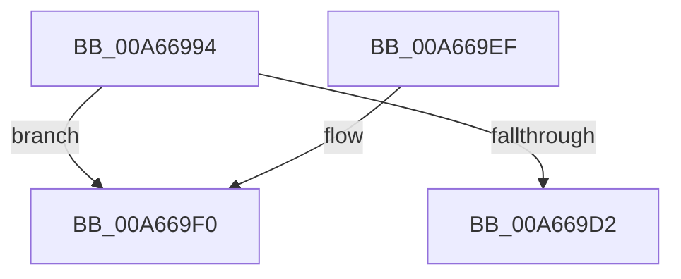

# HvFreeHivePartial

- RVA: `0x00A66994`–`0x00A669FC` (길이 `104` bytes)
- VA: `0x0000000140A66994`
- 실행 섹션: `PAGE`
- PDB 이름 있음: `예`; PDB Function 태그: `예`
- unwind 정보 RVA: `0x000B3A34`
- 디코드: `32`개 명령, `104/104` bytes 표시
- 미해석 바이트: `0` (있으면 어셈블리에 `.byte`로 보존)

> 이 문서는 커널 이미지의 기계어와 PDB 기호를 분석해 생성했습니다. 4번과 5번은 함수 원형과 자료형을 바이너리 사용 방식에서 추정한 C 해석이며 원본 소스 복구 결과는 아닙니다.

## 1. Dependencies

- 직접 호출 지점: **0**; 고유 호출 대상: **0**
- 직접 호출자로 확인된 함수: **2**
- RIP 상대 이미지 참조: **0**

### Outgoing calls
- 직접 디코드된 call 명령이 없습니다.

### Direct callers
- [HvpTruncateBins](../9B/HvpTruncateBins_function_009B64F0.md) at `0x009B657E`
- [HvpPerformLogFileRecovery](../9B/HvpPerformLogFileRecovery_function_009B7994.md) at `0x009B7DDB`

### Static image references
- 디코드된 RIP-relative 메모리 참조가 없습니다.

## 2. Other-region calls and transfers

- 다른 실행 섹션으로 향하는 call: **0**
- call이 아닌 외부 분기/꼬리 이동: **1**
  - `0x00A669F7` → [sub_00B3E78C](../B3/Unknown_function_00B3E78C.md) (`tail-transfer`)

## 3. Assembly (complete function range)

```asm
00A66994  48 89 5C 24 08                  mov qword ptr [rsp + 8], rbx
00A66999  48 89 6C 24 18                  mov qword ptr [rsp + 0x18], rbp
00A6699E  48 89 74 24 20                  mov qword ptr [rsp + 0x20], rsi
00A669A3  57                              push rdi
00A669A4  41 54                           push r12
00A669A6  41 55                           push r13
00A669A8  41 56                           push r14
00A669AA  41 57                           push r15
00A669AC  48 83 EC 30                     sub rsp, 0x30
00A669B0  4D 63 E0                        movsxd r12, r8d
00A669B3  44 8B F2                        mov r14d, edx
00A669B6  4D 69 FC 78 02 00 00            imul r15, r12, 0x278
00A669BD  48 8B E9                        mov rbp, rcx
00A669C0  8B F2                           mov esi, edx
00A669C2  41 8B 84 0F 18 01 00 00         mov eax, dword ptr [r15 + rcx + 0x118]
00A669CA  89 44 24 68                     mov dword ptr [rsp + 0x68], eax
00A669CE  3B D0                           cmp edx, eax
00A669D0  75 1E                           jne 0x140a669f0
00A669D2  48 8B 5C 24 60                  mov rbx, qword ptr [rsp + 0x60]
00A669D7  48 8B 6C 24 70                  mov rbp, qword ptr [rsp + 0x70]
00A669DC  48 8B 74 24 78                  mov rsi, qword ptr [rsp + 0x78]
00A669E1  48 83 C4 30                     add rsp, 0x30
00A669E5  41 5F                           pop r15
00A669E7  41 5E                           pop r14
00A669E9  41 5D                           pop r13
00A669EB  41 5C                           pop r12
00A669ED  5F                              pop rdi
00A669EE  C3                              ret
00A669EF  CC                              int3
00A669F0  45 8B EC                        mov r13d, r12d
00A669F3  41 C1 E5 1F                     shl r13d, 0x1f
00A669F7  E9 90 7D 0D 00                  jmp 0x140b3e78c
```

## 4. C-style interpretation (structured pseudocode)

```c
__int64 __fastcall HvFreeHivePartial(__int64 a1, int a2, int a3)
{
    __int64 v_r13;
    __int64 v_r15;
    __int64 v_rsp;
    unsigned int v_stack_p10;
    unsigned __int64 v_stack_p18;
    unsigned __int64 v_stack_p20;
    unsigned __int64 v_stack_p8;

    v_stack_p8 = v_rbx;
    v_stack_p18 = v_rbp;
    v_stack_p20 = v_rsi;
    v_rsp = (v_rsp) - (48);
    v_r15 = (v_r15) * ((int)(a3));
    v_stack_p10 = (unsigned int)((unsigned int)(*(unsigned int *)(v_r15 + a1 * 1 + 280)));
    if (a2 != ((unsigned int)((unsigned int)(*(unsigned int *)(v_r15 + a1 * 1 + 280))))) goto loc_00A669F0;
    v_rsp = (v_rsp) + (48);
    return (unsigned int)(*(unsigned int *)(v_r15 + a1 * 1 + 280));
loc_00A669F0:
    v_r13 = (unsigned int)(((unsigned int)((unsigned int)((int)(a3)))) << (31));
}
```

## 5. (Beta) C Style

```c
int64_t HvFreeHivePartial(int64_t Arg1, int32_t Arg2, int32_t Arg3)
{
    int64_t local_r13;
    int64_t local_r15;
    int64_t local_rsp;
    uint32_t v_stack_p10;
    uint64_t v_stack_p18;
    uint64_t v_stack_p20;
    uint64_t v_stack_p8;

    v_stack_p8 = local_rbx;
    v_stack_p18 = local_rbp;
    v_stack_p20 = local_rsi;
    local_rsp = (local_rsp) - (48);
    local_r15 = (local_r15) * ((int32_t)(Arg3));
    v_stack_p10 = (uint32_t)((uint32_t)(*(uint32_t *)(local_r15 + Arg1 * 1 + 0x118)));
    if (Arg2 != ((uint32_t)((uint32_t)(*(uint32_t *)(local_r15 + Arg1 * 1 + 0x118))))) goto loc_00A669F0;
    local_rsp = (local_rsp) + (48);
    return (uint32_t)(*(uint32_t *)(local_r15 + Arg1 * 1 + 0x118));
loc_00A669F0:
    local_r13 = (uint32_t)(((uint32_t)((uint32_t)((int32_t)(Arg3)))) << (31));
}
```

## 6. Execution-region graph

[열기: 2D/3D 그래프와 함수 탐색 컨트롤 패널](../../../control-panel.html?section=page&rva=0x00A66994&view=graph)

- 2D 그래프는 위에서 아래로 흐르고, 3D 그래프는 빈 공간을 드래그해 회전합니다. Shift+드래그는 이동, 휠은 확대·축소, 함수 노드 선택은 대상 보고서 이동입니다.

### Static fallback


