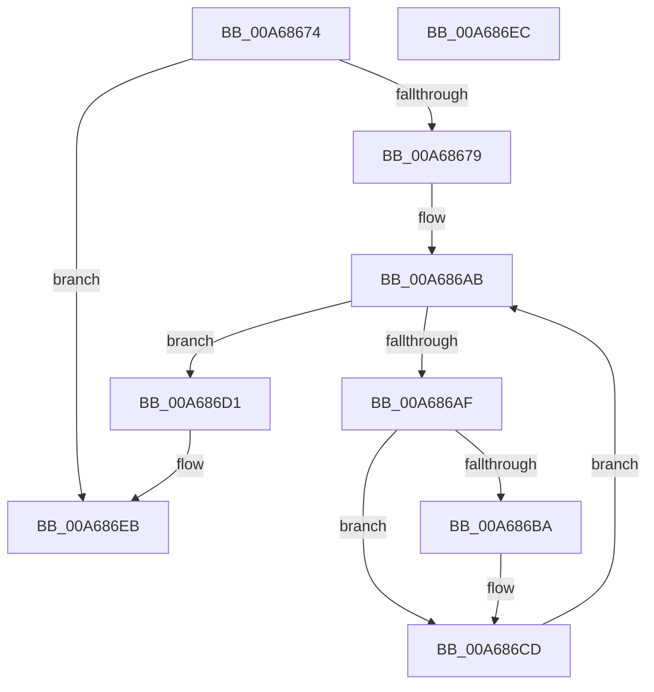

# HvpFreeMap

- RVA: `0x00A68674`–`0x00A686ED` (길이 `121` bytes)
- VA: `0x0000000140A68674`
- 실행 섹션: `PAGE`
- PDB 이름 있음: `예`; PDB Function 태그: `아니요`
- unwind 정보 RVA: `0x000B3EFC`
- 디코드: `35`개 명령, `121/121` bytes 표시
- 미해석 바이트: `0` (있으면 어셈블리에 `.byte`로 보존)

> 이 문서는 커널 이미지의 기계어와 PDB 기호를 분석해 생성했습니다. 4번과 5번은 함수 원형과 자료형을 바이너리 사용 방식에서 추정한 C 해석이며 원본 소스 복구 결과는 아닙니다.

## 1. Dependencies

- 직접 호출 지점: **1**; 고유 호출 대상: **1**
- 직접 호출자로 확인된 함수: **5**
- RIP 상대 이미지 참조: **0**

### Outgoing calls
- `0x00A686C3` → [guard_dispatch_icall](../../text/6B/guard_dispatch_icall_function_006BAAD0.md) (function, `0x006BAAD0`)

### Direct callers
- [HvpShrinkMap](../7F/HvpShrinkMap_function_007F3D78.md) at `0x007F3E28`
- [HvHiveCleanup](../84/HvHiveCleanup_function_0084D918.md) at `0x0084DA2E`
- [HvpInitMap](../9B/HvpInitMap_function_009B8A68.md) at `0x009B8CEA`
- [sub_00B3D876](../B3/Unknown_function_00B3D876.md) at `0x00B3D913`
- [sub_00B3E78C](../B3/Unknown_function_00B3E78C.md) at `0x00B3E87D`

### Static image references
- 디코드된 RIP-relative 메모리 참조가 없습니다.

## 2. Other-region calls and transfers

- 다른 실행 섹션으로 향하는 call: **1**
  - `0x00A686C3` → [guard_dispatch_icall](../../text/6B/guard_dispatch_icall_function_006BAAD0.md) (`PAGE` → `.text`)
- 별도 외부 분기/꼬리 이동을 확인하지 못했습니다.

## 3. Assembly (complete function range)

```asm
00A68674  48 85 D2                        test rdx, rdx
00A68677  74 72                           je 0x140a686eb
00A68679  48 8B C4                        mov rax, rsp
00A6867C  48 89 58 08                     mov qword ptr [rax + 8], rbx
00A68680  48 89 68 10                     mov qword ptr [rax + 0x10], rbp
00A68684  48 89 70 18                     mov qword ptr [rax + 0x18], rsi
00A68688  48 89 78 20                     mov qword ptr [rax + 0x20], rdi
00A6868C  41 56                           push r14
00A6868E  48 83 EC 20                     sub rsp, 0x20
00A68692  41 81 F9 00 04 00 00            cmp r9d, 0x400
00A68699  BF FF 03 00 00                  mov edi, 0x3ff
00A6869E  41 8B D8                        mov ebx, r8d
00A686A1  48 8B F2                        mov rsi, rdx
00A686A4  41 0F 42 F9                     cmovb edi, r9d
00A686A8  4C 8B F1                        mov r14, rcx
00A686AB  3B DF                           cmp ebx, edi
00A686AD  77 22                           ja 0x140a686d1
00A686AF  8B EB                           mov ebp, ebx
00A686B1  48 8B 0C EE                     mov rcx, qword ptr [rsi + rbp*8]
00A686B5  48 85 C9                        test rcx, rcx
00A686B8  74 13                           je 0x140a686cd
00A686BA  49 8B 46 20                     mov rax, qword ptr [r14 + 0x20]
00A686BE  BA 00 30 00 00                  mov edx, 0x3000
00A686C3  E8 08 24 C5 FF                  call 0x1406baad0
00A686C8  48 83 24 EE 00                  and qword ptr [rsi + rbp*8], 0
00A686CD  FF C3                           inc ebx
00A686CF  EB DA                           jmp 0x140a686ab
00A686D1  48 8B 5C 24 30                  mov rbx, qword ptr [rsp + 0x30]
00A686D6  48 8B 6C 24 38                  mov rbp, qword ptr [rsp + 0x38]
00A686DB  48 8B 74 24 40                  mov rsi, qword ptr [rsp + 0x40]
00A686E0  48 8B 7C 24 48                  mov rdi, qword ptr [rsp + 0x48]
00A686E5  48 83 C4 20                     add rsp, 0x20
00A686E9  41 5E                           pop r14
00A686EB  C3                              ret
00A686EC  CC                              int3
```

## 4. C-style interpretation (structured pseudocode)

```c
__int64 __fastcall HvpFreeMap(__int64 a1, __int64 a2, int a3, int a4)
{
    __int64 result;
    __int64 v_rbx;
    __int64 v_rdi;
    __int64 v_rsp;
    unsigned __int64 v_stack_p10;
    unsigned __int64 v_stack_p18;
    unsigned __int64 v_stack_p20;
    unsigned __int64 v_stack_p8;

    if (a2 == 0) goto loc_00A686EB;
    *(unsigned __int64 *)(v_rsp + 8) = v_rbx;
    *(unsigned __int64 *)(v_rsp + 16) = v_rbp;
    *(unsigned __int64 *)(v_rsp + 24) = v_rsi;
    *(unsigned __int64 *)(v_rsp + 32) = v_rdi;
    v_rsp = (v_rsp) - (32);
    v_rdi = (unsigned int)(0x3FFULL);
    if (a4 < 0x400ULL) { v_rdi = a4; }
loc_00A686AB:
    if (((unsigned int)((unsigned int)(a3))) > ((unsigned int)(v_rdi))) goto loc_00A686D1;
    result = v_rsp;
    if (*(unsigned __int64 *)(a2 + (unsigned int)((unsigned int)((unsigned int)(a3))) * 8) != 0) {
        result = *(unsigned __int64 *)(a1 + 32);
        a2 = 0x3000ULL;
        result = guard_dispatch_icall(*(unsigned __int64 *)(a2 + (unsigned int)((unsigned int)((unsigned int)(a3))) * 8), a2, a3, a4);
    }
    v_rbx = (unsigned int)(((unsigned int)(a3)) + 1);
    goto loc_00A686AB;
loc_00A686D1:
    v_rsp = (v_rsp) + (32);
loc_00A686EB:
    return result;
}
```

## 5. (Beta) C Style

```c
int64_t HvpFreeMap(void *Arg1, int64_t Arg2, int32_t Arg3, int32_t Arg4)
{
    uint8_t *arg1 = (uint8_t *)Arg1;

    int64_t result;
    int64_t local_rbx;
    int64_t local_rdi;
    int64_t local_rsp;
    uint64_t v_stack_p10;
    uint64_t v_stack_p18;
    uint64_t v_stack_p20;
    uint64_t v_stack_p8;

    if (Arg2 == 0) goto loc_00A686EB;
    *(uint64_t *)(local_rsp + 0x8) = local_rbx;
    *(uint64_t *)(local_rsp + 0x10) = local_rbp;
    *(uint64_t *)(local_rsp + 0x18) = local_rsi;
    *(uint64_t *)(local_rsp + 0x20) = local_rdi;
    local_rsp = (local_rsp) - (32);
    local_rdi = (uint32_t)(0x3FFULL);
    if (Arg4 < 0x400ULL) { local_rdi = Arg4; }
loc_00A686AB:
    if (((uint32_t)((uint32_t)(Arg3))) > ((uint32_t)(local_rdi))) goto loc_00A686D1;
    result = local_rsp;
    if (*(uint64_t *)(Arg2 + (uint32_t)((uint32_t)((uint32_t)(Arg3))) * 8) != 0) {
        result = *(uint64_t *)(arg1 + 0x20);
        Arg2 = 0x3000ULL;
        result = guard_dispatch_icall(*(uint64_t *)(Arg2 + (uint32_t)((uint32_t)((uint32_t)(Arg3))) * 8), Arg2, Arg3, Arg4);
    }
    local_rbx = (uint32_t)(((uint32_t)(Arg3)) + 1);
    goto loc_00A686AB;
loc_00A686D1:
    local_rsp = (local_rsp) + (32);
loc_00A686EB:
    return result;
}
```

### 관측된 메모리 오프셋

구조체 형식이 확인되지 않은 접근은 인자 기준의 오프셋으로만 기록했습니다.

| 기준 인자 | 오프셋 표현 | 폭 (bit) | 접근 |
|---|---:|---:|---|
| `Arg1` | `+ 0x20` | `64` | `R` |

## 6. Execution-region graph

[열기: 2D/3D 그래프와 함수 탐색 컨트롤 패널](../../../control-panel.html?section=page&rva=0x00A68674&view=graph)

- 2D 그래프는 위에서 아래로 흐르고, 3D 그래프는 빈 공간을 드래그해 회전합니다. Shift+드래그는 이동, 휠은 확대·축소, 함수 노드 선택은 대상 보고서 이동입니다.

### Static fallback


