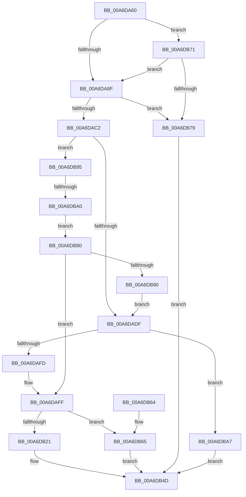

# HvpRecoverDataReadRoutine

- RVA: `0x00A6DA60`–`0x00A6DBAE` (길이 `334` bytes)
- VA: `0x0000000140A6DA60`
- 실행 섹션: `PAGE`
- PDB 이름 있음: `예`; PDB Function 태그: `예`
- unwind 정보 RVA: `0x000B475C`
- 디코드: `103`개 명령, `334/334` bytes 표시
- 미해석 바이트: `0` (있으면 어셈블리에 `.byte`로 보존)

> 이 문서는 커널 이미지의 기계어와 PDB 기호를 분석해 생성했습니다. 4번과 5번은 함수 원형과 자료형을 바이너리 사용 방식에서 추정한 C 해석이며 원본 소스 복구 결과는 아닙니다.

## 1. Dependencies

- 직접 호출 지점: **3**; 고유 호출 대상: **3**
- 직접 호출자로 확인된 함수: **0**
- RIP 상대 이미지 참조: **0**

### Outgoing calls
- `0x00A6DAEC` → [CmpAllocatePool](../../text/3C/CmpAllocatePool_function_003CD504.md) (function, `0x003CD504`)
- `0x00A6DB16` → [guard_dispatch_icall](../../text/6B/guard_dispatch_icall_function_006BAAD0.md) (function, `0x006BAAD0`)
- `0x00A6DB68` → [CmSiFreeMemory](../../text/47/CmSiFreeMemory_function_00475D80.md) (function, `0x00475D80`)

### Direct callers
- 이 함수 시작 RVA로 연결되는 직접 call은 확인되지 않았습니다. 간접 호출은 완전히 역산할 수 없습니다.

### Static image references
- 디코드된 RIP-relative 메모리 참조가 없습니다.

## 2. Other-region calls and transfers

- 다른 실행 섹션으로 향하는 call: **3**
  - `0x00A6DAEC` → [CmpAllocatePool](../../text/3C/CmpAllocatePool_function_003CD504.md) (`PAGE` → `.text`)
  - `0x00A6DB16` → [guard_dispatch_icall](../../text/6B/guard_dispatch_icall_function_006BAAD0.md) (`PAGE` → `.text`)
  - `0x00A6DB68` → [CmSiFreeMemory](../../text/47/CmSiFreeMemory_function_00475D80.md) (`PAGE` → `.text`)
- call이 아닌 외부 분기/꼬리 이동: **1**
  - `0x00A6DB9A` → [sub_00B3F4F4](../B3/Unknown_function_00B3F4F4.md) (`tail-transfer`)

## 3. Assembly (complete function range)

```asm
00A6DA60  48 89 5C 24 10                  mov qword ptr [rsp + 0x10], rbx
00A6DA65  4C 89 4C 24 20                  mov qword ptr [rsp + 0x20], r9
00A6DA6A  55                              push rbp
00A6DA6B  56                              push rsi
00A6DA6C  57                              push rdi
00A6DA6D  41 54                           push r12
00A6DA6F  41 55                           push r13
00A6DA71  41 56                           push r14
00A6DA73  41 57                           push r15
00A6DA75  48 83 EC 30                     sub rsp, 0x30
00A6DA79  33 DB                           xor ebx, ebx
00A6DA7B  42 8D 04 02                     lea eax, [rdx + r8]
00A6DA7F  44 8B E2                        mov r12d, edx
00A6DA82  4C 8B F1                        mov r14, rcx
00A6DA85  8B FB                           mov edi, ebx
00A6DA87  3B C2                           cmp eax, edx
00A6DA89  0F 82 E2 00 00 00               jb 0x140a6db71
00A6DA8F  48 8B 01                        mov rax, qword ptr [rcx]
00A6DA92  48 89 44 24 70                  mov qword ptr [rsp + 0x70], rax
00A6DA97  8B 80 88 00 00 00               mov eax, dword ptr [rax + 0x88]
00A6DA9D  C1 E0 09                        shl eax, 9
00A6DAA0  8D 48 FF                        lea ecx, [rax - 1]
00A6DAA3  F7 D1                           not ecx
00A6DAA5  41 8D 34 04                     lea esi, [r12 + rax]
00A6DAA9  FF CE                           dec esi
00A6DAAB  44 8B E9                        mov r13d, ecx
00A6DAAE  41 03 F0                        add esi, r8d
00A6DAB1  45 23 EC                        and r13d, r12d
00A6DAB4  23 F1                           and esi, ecx
00A6DAB6  41 2B F5                        sub esi, r13d
00A6DAB9  41 3B F0                        cmp esi, r8d
00A6DABC  0F 82 B7 00 00 00               jb 0x140a6db79
00A6DAC2  49 8B 4E 08                     mov rcx, qword ptr [r14 + 8]
00A6DAC6  4D 8D 7E 10                     lea r15, [r14 + 0x10]
00A6DACA  B8 00 00 01 00                  mov eax, 0x10000
00A6DACF  8B EE                           mov ebp, esi
00A6DAD1  3B F0                           cmp esi, eax
00A6DAD3  0F 42 E8                        cmovb ebp, eax
00A6DAD6  48 85 C9                        test rcx, rcx
00A6DAD9  0F 85 B6 00 00 00               jne 0x140a6db95
00A6DADF  8B D6                           mov edx, esi
00A6DAE1  B9 00 01 00 00                  mov ecx, 0x100
00A6DAE6  41 B8 43 4D 49 6F               mov r8d, 0x6f494d43
00A6DAEC  E8 13 FA 95 FF                  call 0x1403cd504
00A6DAF1  48 8B F8                        mov rdi, rax
00A6DAF4  48 85 C0                        test rax, rax
00A6DAF7  0F 84 AA 00 00 00               je 0x140a6dba7
00A6DAFD  8B EE                           mov ebp, esi
00A6DAFF  48 8B 4C 24 70                  mov rcx, qword ptr [rsp + 0x70]
00A6DB04  4C 8B CF                        mov r9, rdi
00A6DB07  41 8B 56 14                     mov edx, dword ptr [r14 + 0x14]
00A6DB0B  45 8B C5                        mov r8d, r13d
00A6DB0E  89 74 24 20                     mov dword ptr [rsp + 0x20], esi
00A6DB12  48 8B 41 30                     mov rax, qword ptr [rcx + 0x30]
00A6DB16  E8 B5 CF C4 FF                  call 0x1406baad0
00A6DB1B  8B F0                           mov esi, eax
00A6DB1D  85 C0                           test eax, eax
00A6DB1F  78 44                           js 0x140a6db65
00A6DB21  48 8B 4C 24 70                  mov rcx, qword ptr [rsp + 0x70]
00A6DB26  33 D2                           xor edx, edx
00A6DB28  49 89 7E 08                     mov qword ptr [r14 + 8], rdi
00A6DB2C  41 8B C4                        mov eax, r12d
00A6DB2F  41 89 2F                        mov dword ptr [r15], ebp
00A6DB32  8B 89 88 00 00 00               mov ecx, dword ptr [rcx + 0x88]
00A6DB38  C1 E1 09                        shl ecx, 9
00A6DB3B  F7 F1                           div ecx
00A6DB3D  48 8B 84 24 88 00 00 00         mov rax, qword ptr [rsp + 0x88]
00A6DB45  8B CA                           mov ecx, edx
00A6DB47  48 03 CF                        add rcx, rdi
00A6DB4A  48 89 08                        mov qword ptr [rax], rcx
00A6DB4D  8B C3                           mov eax, ebx
00A6DB4F  48 8B 5C 24 78                  mov rbx, qword ptr [rsp + 0x78]
00A6DB54  48 83 C4 30                     add rsp, 0x30
00A6DB58  41 5F                           pop r15
00A6DB5A  41 5E                           pop r14
00A6DB5C  41 5D                           pop r13
00A6DB5E  41 5C                           pop r12
00A6DB60  5F                              pop rdi
00A6DB61  5E                              pop rsi
00A6DB62  5D                              pop rbp
00A6DB63  C3                              ret
00A6DB64  CC                              int3
00A6DB65  48 8B CF                        mov rcx, rdi
00A6DB68  E8 13 82 A0 FF                  call 0x140475d80
00A6DB6D  8B DE                           mov ebx, esi
00A6DB6F  EB DC                           jmp 0x140a6db4d
00A6DB71  85 C0                           test eax, eax
00A6DB73  0F 84 16 FF FF FF               je 0x140a6da8f
00A6DB79  BB 0D 00 00 C0                  mov ebx, 0xc000000d
00A6DB7E  EB CD                           jmp 0x140a6db4d
00A6DB80  49 89 5E 08                     mov qword ptr [r14 + 8], rbx
00A6DB84  41 89 1F                        mov dword ptr [r15], ebx
00A6DB87  48 85 FF                        test rdi, rdi
00A6DB8A  0F 85 6F FF FF FF               jne 0x140a6daff
00A6DB90  E9 4A FF FF FF                  jmp 0x140a6dadf
00A6DB95  41 8B 07                        mov eax, dword ptr [r15]
00A6DB98  3B C5                           cmp eax, ebp
00A6DB9A  0F 82 54 19 0D 00               jb 0x140b3f4f4
00A6DBA0  48 8B F9                        mov rdi, rcx
00A6DBA3  8B E8                           mov ebp, eax
00A6DBA5  EB D9                           jmp 0x140a6db80
00A6DBA7  BB 17 00 00 C0                  mov ebx, 0xc0000017
00A6DBAC  EB 9F                           jmp 0x140a6db4d
```

## 4. C-style interpretation (structured pseudocode)

```c
__int64 __fastcall HvpRecoverDataReadRoutine(__int64 a1, __int64 a2, __int64 a3, __int64 a4)
{
    __int64 result;
    __int64 v_r13;
    __int64 v_rbp;
    __int64 v_rbx;
    __int64 v_rsi;
    __int64 v_rsp;
    unsigned int v_stack_m48;
    unsigned __int64 v_stack_p10;
    unsigned __int64 v_stack_p20;
    unsigned __int64 v_stack_p8;

    v_stack_p10 = v_rbx;
    v_stack_p20 = a4;
    v_rsp = (v_rsp) - (48);
    v_rbx = 0;
    if (((unsigned int)(a2 + a3 * 1)) < ((unsigned int)(a2))) goto loc_00A6DB71;
loc_00A6DA8F:
    v_stack_p8 = *(unsigned __int64 *)(a1);
    result = (unsigned int)(((unsigned int)(*(unsigned int *)(*(unsigned __int64 *)(a1) + 136))) << (9));
    a1 = (unsigned int)(~(result - 1));
    v_rsi = (unsigned int)(((unsigned int)((unsigned int)(a2)) + result * 1) - 1);
    v_rsi = (unsigned int)((v_rsi) + ((unsigned int)(a3)));
    v_r13 = (unsigned int)(((unsigned int)((unsigned int)(a1))) & ((unsigned int)((unsigned int)((unsigned int)(a2)))));
    v_rsi = (unsigned int)((v_rsi) & ((unsigned int)(a1)));
    v_rsi = (unsigned int)((v_rsi) - ((unsigned int)(v_r13)));
    if (((unsigned int)(v_rsi)) < ((unsigned int)(a3))) goto loc_00A6DB79;
    v_rbp = (unsigned int)((unsigned int)(v_rsi));
    if (((unsigned int)(v_rsi)) < ((unsigned int)((unsigned int)(0x10000ULL)))) { v_rbp = (unsigned int)((unsigned int)(0x10000ULL)); }
    if (*(unsigned __int64 *)(a1 + 8) != 0) goto loc_00A6DB95;
loc_00A6DADF:
    result = CmpAllocatePool(256, (unsigned int)((unsigned int)(v_rsi)), (unsigned int)(0x6F494D43ULL), a4);
    if (result == 0) goto loc_00A6DBA7;
loc_00A6DAFF:
    v_stack_m48 = (unsigned int)(v_rsi);
    result = guard_dispatch_icall(v_stack_p8, (unsigned int)(*(unsigned int *)(a1 + 20)), (unsigned int)((unsigned int)(v_r13)), result);
    if (sign_flag) goto loc_00A6DB65;
    a2 = 0;
    *(unsigned __int64 *)(a1 + 8) = result;
    *(unsigned int *)(a1 + 16) = (unsigned int)((unsigned int)((unsigned int)(v_rsi)));
    a1 = (unsigned int)(((unsigned int)(*(unsigned int *)(v_stack_p8 + 136))) << (9));
    a1 = (0) + (result);
    *(unsigned __int64 *)(v_stack_p20) = a1;
loc_00A6DB4D:
    v_rsp = (v_rsp) + (48);
    return 0;
loc_00A6DB65:
    result = CmSiFreeMemory(result, a2, (unsigned int)((unsigned int)(v_r13)), result);
    goto loc_00A6DB4D;
loc_00A6DB71:
    if ((unsigned int)(result) == 0) goto loc_00A6DA8F;
loc_00A6DB79:
    goto loc_00A6DB4D;
loc_00A6DB80:
    *(unsigned __int64 *)(a1 + 8) = (unsigned int)(0xC000000DULL);
    *(unsigned int *)(a1 + 16) = (unsigned int)((unsigned int)(0xC000000DULL));
    if (result != 0) goto loc_00A6DAFF;
    goto loc_00A6DADF;
loc_00A6DB95:
    goto loc_00A6DB80;
loc_00A6DBA7:
    goto loc_00A6DB4D;
}
```

## 5. (Beta) C Style

```c
int64_t HvpRecoverDataReadRoutine(void *Arg1, void *Arg2, int64_t Arg3, int64_t Arg4)
{
    uint8_t *arg1 = (uint8_t *)Arg1;
    uint8_t *arg2 = (uint8_t *)Arg2;

    int64_t result;
    int64_t local_r13;
    int64_t local_rbp;
    int64_t local_rbx;
    int64_t local_rsi;
    int64_t local_rsp;
    uint32_t v_stack_m48;
    uint64_t v_stack_p10;
    uint64_t v_stack_p20;
    uint64_t v_stack_p8;

    v_stack_p10 = local_rbx;
    v_stack_p20 = Arg4;
    local_rsp = (local_rsp) - (48);
    local_rbx = 0;
    if (((uint32_t)(Arg2 + Arg3 * 1)) < ((uint32_t)(Arg2))) goto loc_00A6DB71;
loc_00A6DA8F:
    v_stack_p8 = *(uint64_t *)(arg1);
    result = (uint32_t)(((uint32_t)(*(uint32_t *)(*(uint64_t *)(arg1) + 0x88))) << (9));
    Arg1 = (uint32_t)(~(result - 1));
    local_rsi = (uint32_t)(((uint32_t)((uint32_t)(Arg2)) + result * 1) - 1);
    local_rsi = (uint32_t)((local_rsi) + ((uint32_t)(Arg3)));
    local_r13 = (uint32_t)(((uint32_t)((uint32_t)(Arg1))) & ((uint32_t)((uint32_t)((uint32_t)(Arg2)))));
    local_rsi = (uint32_t)((local_rsi) & ((uint32_t)(Arg1)));
    local_rsi = (uint32_t)((local_rsi) - ((uint32_t)(local_r13)));
    if (((uint32_t)(local_rsi)) < ((uint32_t)(Arg3))) goto loc_00A6DB79;
    local_rbp = (uint32_t)((uint32_t)(local_rsi));
    if (((uint32_t)(local_rsi)) < ((uint32_t)((uint32_t)(0x10000ULL)))) { local_rbp = (uint32_t)((uint32_t)(0x10000ULL)); }
    if (*(uint64_t *)(arg1 + 0x8) != 0) goto loc_00A6DB95;
loc_00A6DADF:
    result = CmpAllocatePool(256, (uint32_t)((uint32_t)(local_rsi)), (uint32_t)(0x6F494D43ULL), Arg4);
    if (result == 0) goto loc_00A6DBA7;
loc_00A6DAFF:
    v_stack_m48 = (uint32_t)(local_rsi);
    result = guard_dispatch_icall(v_stack_p8, (uint32_t)(*(uint32_t *)(arg1 + 0x14)), (uint32_t)((uint32_t)(local_r13)), result);
    if (sign_flag) goto loc_00A6DB65;
    Arg2 = 0;
    *(uint64_t *)(arg1 + 0x8) = result;
    *(uint32_t *)(arg1 + 0x10) = (uint32_t)((uint32_t)((uint32_t)(local_rsi)));
    Arg1 = (uint32_t)(((uint32_t)(*(uint32_t *)(v_stack_p8 + 0x88))) << (9));
    Arg1 = (0) + (result);
    *(void **)(v_stack_p20) = Arg1;
loc_00A6DB4D:
    local_rsp = (local_rsp) + (48);
    return 0;
loc_00A6DB65:
    result = CmSiFreeMemory(result, Arg2, (uint32_t)((uint32_t)(local_r13)), result);
    goto loc_00A6DB4D;
loc_00A6DB71:
    if ((uint32_t)(result) == 0) goto loc_00A6DA8F;
loc_00A6DB79:
    goto loc_00A6DB4D;
loc_00A6DB80:
    *(uint64_t *)(arg1 + 0x8) = (uint32_t)(0xC000000DULL);
    *(uint32_t *)(arg1 + 0x10) = (uint32_t)((uint32_t)(0xC000000DULL));
    if (result != 0) goto loc_00A6DAFF;
    goto loc_00A6DADF;
loc_00A6DB95:
    goto loc_00A6DB80;
loc_00A6DBA7:
    goto loc_00A6DB4D;
}
```

### 관측된 메모리 오프셋

구조체 형식이 확인되지 않은 접근은 인자 기준의 오프셋으로만 기록했습니다.

| 기준 인자 | 오프셋 표현 | 폭 (bit) | 접근 |
|---|---:|---:|---|
| `Arg1` | `+ 0x0` | `32` | `R` |
| `Arg1` | `+ 0x0` | `32` | `W` |
| `Arg1` | `+ 0x0` | `64` | `R` |
| `Arg1` | `+ 0x8` | `64` | `R` |
| `Arg1` | `+ 0x8` | `64` | `W` |
| `Arg1` | `+ 0x10` | `64` | `R` |
| `Arg1` | `+ 0x14` | `32` | `R` |
| `Arg2` | `+ 0x0 + r8*1` | `32` | `R` |
| `Arg2` | `+ 0x0 + rax*1` | `32` | `R` |

## 6. Execution-region graph

[열기: 2D/3D 그래프와 함수 탐색 컨트롤 패널](../../../control-panel.html?section=page&rva=0x00A6DA60&view=graph)

- 2D 그래프는 위에서 아래로 흐르고, 3D 그래프는 빈 공간을 드래그해 회전합니다. Shift+드래그는 이동, 휠은 확대·축소, 함수 노드 선택은 대상 보고서 이동입니다.

### Static fallback


