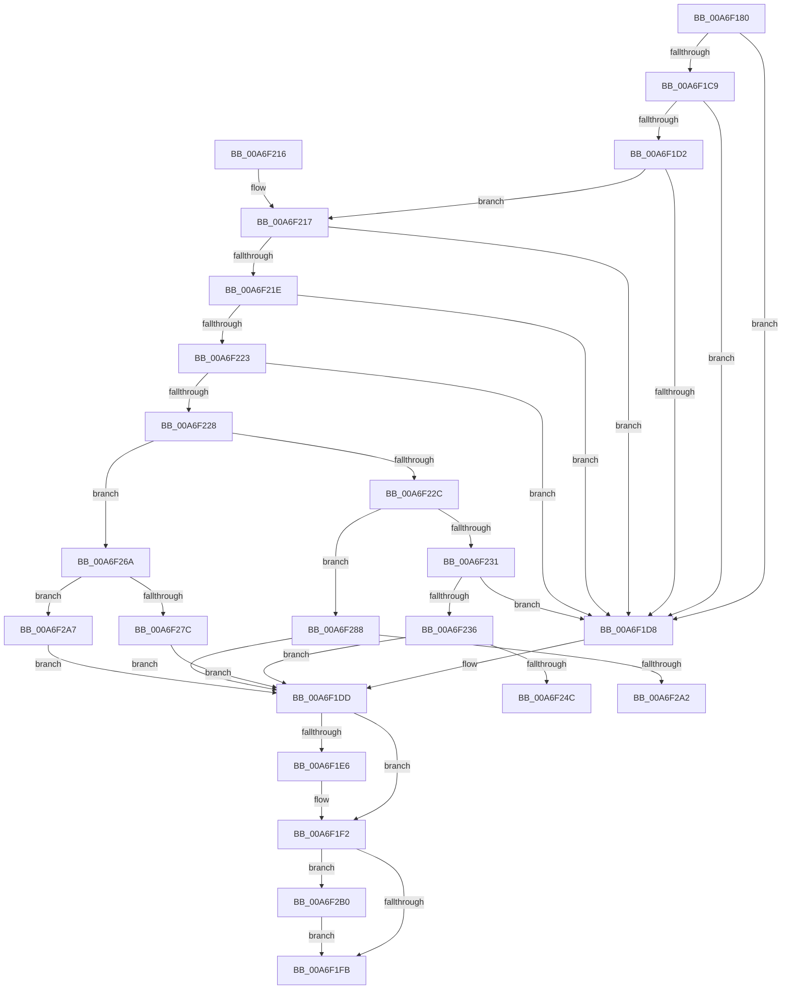

# IoGetDriverDirectory

- RVA: `0x00A6F180`–`0x00A6F2BD` (길이 `317` bytes)
- VA: `0x0000000140A6F180`
- 실행 섹션: `PAGE`
- PDB 이름 있음: `예`; PDB Function 태그: `예`
- unwind 정보 RVA: `0x000B4D48`
- 디코드: `97`개 명령, `317/317` bytes 표시
- 미해석 바이트: `0` (있으면 어셈블리에 `.byte`로 보존)

> 이 문서는 커널 이미지의 기계어와 PDB 기호를 분석해 생성했습니다. 4번과 5번은 함수 원형과 자료형을 바이너리 사용 방식에서 추정한 C 해석이며 원본 소스 복구 결과는 아닙니다.

## 1. Dependencies

- 직접 호출 지점: **6**; 고유 호출 대상: **5**
- 직접 호출자로 확인된 함수: **1**
- RIP 상대 이미지 참조: **2**

### Outgoing calls
- `0x00A6F1BF` → [RtlInitUnicodeString](../../text/42/RtlInitUnicodeString_function_0042A780.md) (function, `0x0042A780`)
- `0x00A6F1E6` → [ExFreePool](../../poolcode/B8/ExFreePool_function_00B82850.md) (function, `0x00B82850`)
- `0x00A6F241` → [PiGetServiceNameInfo](../99/PiGetServiceNameInfo_function_00998AA8.md) (function, `0x00998AA8`)
- `0x00A6F271` → [PiGetDriverImageDirectory](PiGetDriverImageDirectory_function_00A6F2C4.md) (function, `0x00A6F2C4`)
- `0x00A6F293` → [PiGetServiceNameInfo](../99/PiGetServiceNameInfo_function_00998AA8.md) (function, `0x00998AA8`)
- `0x00A6F2B3` → [ZwClose](../../text/6A/ZwClose_function_006AD2B0.md) (function, `0x006AD2B0`)

### Direct callers
- [DifIoGetDriverDirectoryWrapper](../../text/62/DifIoGetDriverDirectoryWrapper_function_0062AEA0.md) at `0x0062AF97`

### Static image references
- `0x00A6F250` → RVA `0x00AFD640` (` ?? ::NNGAKEGL::`string'`; read)
- `0x00A6F257` → RVA `0x00AFD660` (` ?? ::NNGAKEGL::`string'`; read)

## 2. Other-region calls and transfers

- 다른 실행 섹션으로 향하는 call: **3**
  - `0x00A6F1BF` → [RtlInitUnicodeString](../../text/42/RtlInitUnicodeString_function_0042A780.md) (`PAGE` → `.text`)
  - `0x00A6F1E6` → [ExFreePool](../../poolcode/B8/ExFreePool_function_00B82850.md) (`PAGE` → `POOLCODE`)
  - `0x00A6F2B3` → [ZwClose](../../text/6A/ZwClose_function_006AD2B0.md) (`PAGE` → `.text`)
- call이 아닌 외부 분기/꼬리 이동: **2**
  - `0x00A6F265` → [sub_00B3FE64 + 0x19](../B3/Unknown_function_00B3FE64.md) (`tail-transfer`)
  - `0x00A6F2A2` → [sub_00B3FE64](../B3/Unknown_function_00B3FE64.md) (`tail-transfer`)

## 3. Assembly (complete function range)

```asm
00A6F180  48 89 5C 24 10                  mov qword ptr [rsp + 0x10], rbx
00A6F185  48 89 74 24 18                  mov qword ptr [rsp + 0x18], rsi
00A6F18A  55                              push rbp
00A6F18B  57                              push rdi
00A6F18C  41 54                           push r12
00A6F18E  41 56                           push r14
00A6F190  41 57                           push r15
00A6F192  48 8B EC                        mov rbp, rsp
00A6F195  48 83 EC 40                     sub rsp, 0x40
00A6F199  45 33 E4                        xor r12d, r12d
00A6F19C  8B DA                           mov ebx, edx
00A6F19E  48 8B F1                        mov rsi, rcx
00A6F1A1  4C 89 65 E0                     mov qword ptr [rbp - 0x20], r12
00A6F1A5  0F 57 C0                        xorps xmm0, xmm0
00A6F1A8  44 88 65 30                     mov byte ptr [rbp + 0x30], r12b
00A6F1AC  33 D2                           xor edx, edx
00A6F1AE  48 8D 4D E8                     lea rcx, [rbp - 0x18]
00A6F1B2  0F 11 45 E8                     movups xmmword ptr [rbp - 0x18], xmm0
00A6F1B6  41 8B FC                        mov edi, r12d
00A6F1B9  4D 8B F1                        mov r14, r9
00A6F1BC  45 8B F8                        mov r15d, r8d
00A6F1BF  E8 BC B5 9B FF                  call 0x14042a780
00A6F1C4  48 85 F6                        test rsi, rsi
00A6F1C7  74 0F                           je 0x140a6f1d8
00A6F1C9  48 8B 46 30                     mov rax, qword ptr [rsi + 0x30]
00A6F1CD  48 85 C0                        test rax, rax
00A6F1D0  74 06                           je 0x140a6f1d8
00A6F1D2  4C 39 60 20                     cmp qword ptr [rax + 0x20], r12
00A6F1D6  75 3F                           jne 0x140a6f217
00A6F1D8  BB 0D 00 00 C0                  mov ebx, 0xc000000d
00A6F1DD  48 8B 4D F0                     mov rcx, qword ptr [rbp - 0x10]
00A6F1E1  48 85 C9                        test rcx, rcx
00A6F1E4  74 0C                           je 0x140a6f1f2
00A6F1E6  E8 65 36 11 00                  call 0x140b82850
00A6F1EB  0F 57 C0                        xorps xmm0, xmm0
00A6F1EE  0F 11 45 E8                     movups xmmword ptr [rbp - 0x18], xmm0
00A6F1F2  48 85 FF                        test rdi, rdi
00A6F1F5  0F 85 B5 00 00 00               jne 0x140a6f2b0
00A6F1FB  4C 8D 5C 24 40                  lea r11, [rsp + 0x40]
00A6F200  8B C3                           mov eax, ebx
00A6F202  49 8B 5B 38                     mov rbx, qword ptr [r11 + 0x38]
00A6F206  49 8B 73 40                     mov rsi, qword ptr [r11 + 0x40]
00A6F20A  49 8B E3                        mov rsp, r11
00A6F20D  41 5F                           pop r15
00A6F20F  41 5E                           pop r14
00A6F211  41 5C                           pop r12
00A6F213  5F                              pop rdi
00A6F214  5D                              pop rbp
00A6F215  C3                              ret
00A6F216  CC                              int3
00A6F217  66 44 39 60 18                  cmp word ptr [rax + 0x18], r12w
00A6F21C  74 BA                           je 0x140a6f1d8
00A6F21E  45 85 FF                        test r15d, r15d
00A6F221  75 B5                           jne 0x140a6f1d8
00A6F223  4D 85 F6                        test r14, r14
00A6F226  74 B0                           je 0x140a6f1d8
00A6F228  85 DB                           test ebx, ebx
00A6F22A  74 3E                           je 0x140a6f26a
00A6F22C  83 EB 01                        sub ebx, 1
00A6F22F  74 57                           je 0x140a6f288
00A6F231  83 FB 01                        cmp ebx, 1
00A6F234  75 A2                           jne 0x140a6f1d8
00A6F236  4C 8D 45 30                     lea r8, [rbp + 0x30]
00A6F23A  48 8B CE                        mov rcx, rsi
00A6F23D  48 8D 55 E8                     lea rdx, [rbp - 0x18]
00A6F241  E8 62 98 F2 FF                  call 0x140998aa8
00A6F246  8B D8                           mov ebx, eax
00A6F248  85 C0                           test eax, eax
00A6F24A  78 91                           js 0x140a6f1dd
00A6F24C  44 38 65 30                     cmp byte ptr [rbp + 0x30], r12b
00A6F250  48 8D 15 E9 E3 08 00            lea rdx, [rip + 0x8e3e9]
00A6F257  48 8D 05 02 E4 08 00            lea rax, [rip + 0x8e402]
00A6F25E  41 B0 01                        mov r8b, 1
00A6F261  48 0F 45 D0                     cmovne rdx, rax
00A6F265  E9 13 0C 0D 00                  jmp 0x140b3fe7d
00A6F26A  48 8D 55 E0                     lea rdx, [rbp - 0x20]
00A6F26E  48 8B CE                        mov rcx, rsi
00A6F271  E8 4E 00 00 00                  call 0x140a6f2c4
00A6F276  8B D8                           mov ebx, eax
00A6F278  85 C0                           test eax, eax
00A6F27A  78 2B                           js 0x140a6f2a7
00A6F27C  48 8B 45 E0                     mov rax, qword ptr [rbp - 0x20]
00A6F280  49 89 06                        mov qword ptr [r14], rax
00A6F283  E9 55 FF FF FF                  jmp 0x140a6f1dd
00A6F288  4C 8D 45 30                     lea r8, [rbp + 0x30]
00A6F28C  48 8B CE                        mov rcx, rsi
00A6F28F  48 8D 55 E8                     lea rdx, [rbp - 0x18]
00A6F293  E8 10 98 F2 FF                  call 0x140998aa8
00A6F298  8B D8                           mov ebx, eax
00A6F29A  85 C0                           test eax, eax
00A6F29C  0F 88 3B FF FF FF               js 0x140a6f1dd
00A6F2A2  E9 BD 0B 0D 00                  jmp 0x140b3fe64
00A6F2A7  48 8B 7D E0                     mov rdi, qword ptr [rbp - 0x20]
00A6F2AB  E9 2D FF FF FF                  jmp 0x140a6f1dd
00A6F2B0  48 8B CF                        mov rcx, rdi
00A6F2B3  E8 F8 DF C3 FF                  call 0x1406ad2b0
00A6F2B8  E9 3E FF FF FF                  jmp 0x140a6f1fb
```

## 4. C-style interpretation (structured pseudocode)

```c
__int64 __fastcall IoGetDriverDirectory(__int64 a1, int a2, int a3, __int64 a4)
{
    __int64 result;
    __int64 v_r12;
    __int64 v_rbx;
    __int64 v_rsp;
    unsigned __int64 v_stack_m28;
    unsigned __int64 v_stack_m38;
    unsigned __int64 v_stack_m40;
    unsigned __int64 v_stack_m48;
    unsigned __int64 v_stack_p10;
    unsigned __int64 v_stack_p18;
    unsigned __int8 v_stack_p8;

    v_stack_p10 = v_rbx;
    v_stack_p18 = v_rsi;
    v_rsp = (v_rsp) - (64);
    v_r12 = 0;
    v_stack_m48 = 0;
    v_stack_p8 = 0;
    a2 = 0;
    v_stack_m40 = v_xmm0;
    result = RtlInitUnicodeString(v_stack_m40, a2, a3, a4);
    if (a1 == 0) goto loc_00A6F1D8;
    if (*(unsigned __int64 *)(a1 + 48) == 0) goto loc_00A6F1D8;
    if ((*(unsigned __int64 *)(*(unsigned __int64 *)(a1 + 48) + 32)) != 0) goto loc_00A6F217;
loc_00A6F1D8:
loc_00A6F1DD:
    result = *(unsigned __int64 *)(a1 + 48);
    if (v_stack_m38 != 0) {
        result = ExFreePool(v_stack_m38, a2, a3, a4);
        v_stack_m40 = v_xmm0;
    }
    if (0 != 0) goto loc_00A6F2B0;
loc_00A6F1FB:
    return (unsigned int)((unsigned int)((unsigned int)(0xC000000DULL)));
loc_00A6F217:
    if ((*(unsigned __int16 *)((unsigned int)((unsigned int)((unsigned int)(0xC000000DULL))) + 24)) == 0) goto loc_00A6F1D8;
    if ((unsigned int)((unsigned int)(a3)) != 0) goto loc_00A6F1D8;
    if (a4 == 0) goto loc_00A6F1D8;
    if ((unsigned int)(*(unsigned __int64 *)(v_stack_m28 + 56)) == 0) goto loc_00A6F26A;
    v_rbx = (unsigned int)((*(unsigned __int64 *)(v_stack_m28 + 56)) - (1));
    if (condition_is_equal) goto loc_00A6F288;
    if (((unsigned int)(v_rbx)) != 1) goto loc_00A6F1D8;
    result = PiGetServiceNameInfo(*(unsigned __int64 *)(v_stack_m28 + 64), v_stack_m40, v_stack_p8, a4);
    if (sign_flag) goto loc_00A6F1DD;
    a2 = v_rip + 582633;
    if (v_stack_p8 != 0) { a2 = v_rip + 582658; }
loc_00A6F26A:
    result = PiGetDriverImageDirectory(*(unsigned __int64 *)(v_stack_m28 + 64), v_stack_m48, 1, a4);
    if (sign_flag) goto loc_00A6F2A7;
    *(unsigned __int64 *)(a4) = v_stack_m48;
    goto loc_00A6F1DD;
loc_00A6F288:
    result = PiGetServiceNameInfo(*(unsigned __int64 *)(v_stack_m28 + 64), v_stack_m40, v_stack_p8, a4);
    if (sign_flag) goto loc_00A6F1DD;
loc_00A6F2A7:
    goto loc_00A6F1DD;
loc_00A6F2B0:
    result = ZwClose(v_stack_m48, v_stack_m40, v_stack_p8, a4);
    goto loc_00A6F1FB;
}
```

## 5. (Beta) C Style

```c
int64_t IoGetDriverDirectory(int64_t Arg1, int32_t Arg2, int32_t Arg3, int64_t Arg4)
{
    int64_t result;
    int64_t local_r12;
    int64_t local_rbx;
    int64_t local_rsp;
    uint64_t v_stack_m28;
    uint64_t v_stack_m38;
    uint64_t v_stack_m40;
    uint64_t v_stack_m48;
    uint64_t v_stack_p10;
    uint64_t v_stack_p18;
    uint8_t v_stack_p8;

    v_stack_p10 = local_rbx;
    v_stack_p18 = local_rsi;
    local_rsp = (local_rsp) - (64);
    local_r12 = 0;
    v_stack_m48 = 0;
    v_stack_p8 = 0;
    Arg2 = 0;
    v_stack_m40 = v_xmm0;
    result = RtlInitUnicodeString(v_stack_m40, Arg2, Arg3, Arg4);
    if (Arg1 == 0) goto loc_00A6F1D8;
    if (*(uint64_t *)(Arg1 + 0x30) == 0) goto loc_00A6F1D8;
    if ((*(uint64_t *)(*(uint64_t *)(Arg1 + 0x30) + 0x20)) != 0) goto loc_00A6F217;
loc_00A6F1D8:
loc_00A6F1DD:
    result = *(uint64_t *)(Arg1 + 0x30);
    if (v_stack_m38 != 0) {
        result = ExFreePool(v_stack_m38, Arg2, Arg3, Arg4);
        v_stack_m40 = v_xmm0;
    }
    if (0 != 0) goto loc_00A6F2B0;
loc_00A6F1FB:
    return (uint32_t)((uint32_t)((uint32_t)(0xC000000DULL)));
loc_00A6F217:
    if ((*(uint16_t *)((uint32_t)((uint32_t)((uint32_t)(0xC000000DULL))) + 0x18)) == 0) goto loc_00A6F1D8;
    if ((uint32_t)((uint32_t)(Arg3)) != 0) goto loc_00A6F1D8;
    if (Arg4 == 0) goto loc_00A6F1D8;
    if ((uint32_t)(*(uint64_t *)(v_stack_m28 + 0x38)) == 0) goto loc_00A6F26A;
    local_rbx = (uint32_t)((*(uint64_t *)(v_stack_m28 + 0x38)) - (1));
    if (condition_is_equal) goto loc_00A6F288;
    if (((uint32_t)(local_rbx)) != 1) goto loc_00A6F1D8;
    result = PiGetServiceNameInfo(*(uint64_t *)(v_stack_m28 + 0x40), v_stack_m40, v_stack_p8, Arg4);
    if (sign_flag) goto loc_00A6F1DD;
    Arg2 = v_rip + 582633;
    if (v_stack_p8 != 0) { Arg2 = v_rip + 582658; }
loc_00A6F26A:
    result = PiGetDriverImageDirectory(*(uint64_t *)(v_stack_m28 + 0x40), v_stack_m48, 1, Arg4);
    if (sign_flag) goto loc_00A6F2A7;
    *(uint64_t *)(Arg4) = v_stack_m48;
    goto loc_00A6F1DD;
loc_00A6F288:
    result = PiGetServiceNameInfo(*(uint64_t *)(v_stack_m28 + 0x40), v_stack_m40, v_stack_p8, Arg4);
    if (sign_flag) goto loc_00A6F1DD;
loc_00A6F2A7:
    goto loc_00A6F1DD;
loc_00A6F2B0:
    result = ZwClose(v_stack_m48, v_stack_m40, v_stack_p8, Arg4);
    goto loc_00A6F1FB;
}
```

## 6. Execution-region graph

[열기: 2D/3D 그래프와 함수 탐색 컨트롤 패널](../../../control-panel.html?section=page&rva=0x00A6F180&view=graph)

- 2D 그래프는 위에서 아래로 흐르고, 3D 그래프는 빈 공간을 드래그해 회전합니다. Shift+드래그는 이동, 휠은 확대·축소, 함수 노드 선택은 대상 보고서 이동입니다.

### Static fallback


