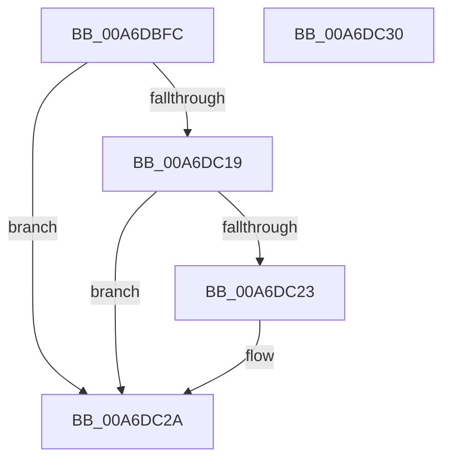

# IoGetRelatedTargetDevice

- RVA: `0x00A6DBFC`–`0x00A6DC31` (길이 `53` bytes)
- VA: `0x0000000140A6DBFC`
- 실행 섹션: `PAGE`
- PDB 이름 있음: `예`; PDB Function 태그: `아니요`
- unwind 정보 RVA: `0x0005CF00`
- 디코드: `17`개 명령, `53/53` bytes 표시
- 미해석 바이트: `0` (있으면 어셈블리에 `.byte`로 보존)

> 이 문서는 커널 이미지의 기계어와 PDB 기호를 분석해 생성했습니다. 4번과 5번은 함수 원형과 자료형을 바이너리 사용 방식에서 추정한 C 해석이며 원본 소스 복구 결과는 아닙니다.

## 1. Dependencies

- 직접 호출 지점: **1**; 고유 호출 대상: **1**
- 직접 호출자로 확인된 함수: **2**
- RIP 상대 이미지 참조: **0**

### Outgoing calls
- `0x00A6DC10` → [PnpGetRelatedTargetDevice](../../text/27/PnpGetRelatedTargetDevice_function_00271F54.md) (function, `0x00271F54`)

### Direct callers
- [NtSetVolumeInformationFile](../72/NtSetVolumeInformationFile_function_00721750.md) at `0x007218F8`
- [PiPagePathSetState](../72/PiPagePathSetState_function_0072BDE0.md) at `0x0072BEA3`

### Static image references
- 디코드된 RIP-relative 메모리 참조가 없습니다.

## 2. Other-region calls and transfers

- 다른 실행 섹션으로 향하는 call: **1**
  - `0x00A6DC10` → [PnpGetRelatedTargetDevice](../../text/27/PnpGetRelatedTargetDevice_function_00271F54.md) (`PAGE` → `.text`)
- 별도 외부 분기/꼬리 이동을 확인하지 못했습니다.

## 3. Assembly (complete function range)

```asm
00A6DBFC  40 53                           push rbx
00A6DBFE  48 83 EC 20                     sub rsp, 0x20
00A6DC02  48 83 64 24 40 00               and qword ptr [rsp + 0x40], 0
00A6DC08  48 8B DA                        mov rbx, rdx
00A6DC0B  48 8D 54 24 40                  lea rdx, [rsp + 0x40]
00A6DC10  E8 3F 43 80 FF                  call 0x140271f54
00A6DC15  85 C0                           test eax, eax
00A6DC17  78 11                           js 0x140a6dc2a
00A6DC19  48 8B 4C 24 40                  mov rcx, qword ptr [rsp + 0x40]
00A6DC1E  48 85 C9                        test rcx, rcx
00A6DC21  74 07                           je 0x140a6dc2a
00A6DC23  48 8B 49 20                     mov rcx, qword ptr [rcx + 0x20]
00A6DC27  48 89 0B                        mov qword ptr [rbx], rcx
00A6DC2A  48 83 C4 20                     add rsp, 0x20
00A6DC2E  5B                              pop rbx
00A6DC2F  C3                              ret
00A6DC30  CC                              int3
```

## 4. C-style interpretation (structured pseudocode)

```c
__int64 __fastcall IoGetRelatedTargetDevice(__int64 a1, __int64 a2)
{
    __int64 result;
    __int64 v_rsp;
    unsigned __int64 v_stack_p18;

    v_rsp = (v_rsp) - (32);
    result = PnpGetRelatedTargetDevice(a1, v_stack_p18, a3, a4);
    if (sign_flag) goto loc_00A6DC2A;
    if (v_stack_p18 != 0) {
        a1 = *(unsigned __int64 *)(v_stack_p18 + 32);
        *(unsigned __int64 *)(a2) = a1;
    }
    v_rsp = (v_rsp) + (32);
    return result;
}
```

## 5. (Beta) C Style

```c
int64_t IoGetRelatedTargetDevice(int64_t Arg1, void *Arg2)
{
    uint8_t *arg2 = (uint8_t *)Arg2;

    int64_t result;
    int64_t local_rsp;
    uint64_t v_stack_p18;

    local_rsp = (local_rsp) - (32);
    result = PnpGetRelatedTargetDevice(Arg1, v_stack_p18, a3, a4);
    if (sign_flag) goto loc_00A6DC2A;
    if (v_stack_p18 != 0) {
        Arg1 = *(uint64_t *)(v_stack_p18 + 0x20);
        *(uint64_t *)(arg2) = Arg1;
    }
    local_rsp = (local_rsp) + (32);
    return result;
}
```

### 관측된 메모리 오프셋

구조체 형식이 확인되지 않은 접근은 인자 기준의 오프셋으로만 기록했습니다.

| 기준 인자 | 오프셋 표현 | 폭 (bit) | 접근 |
|---|---:|---:|---|
| `Arg2` | `+ 0x0` | `64` | `W` |

## 6. Execution-region graph

[열기: 2D/3D 그래프와 함수 탐색 컨트롤 패널](../../../control-panel.html?section=page&rva=0x00A6DBFC&view=graph)

- 2D 그래프는 위에서 아래로 흐르고, 3D 그래프는 빈 공간을 드래그해 회전합니다. Shift+드래그는 이동, 휠은 확대·축소, 함수 노드 선택은 대상 보고서 이동입니다.

### Static fallback


