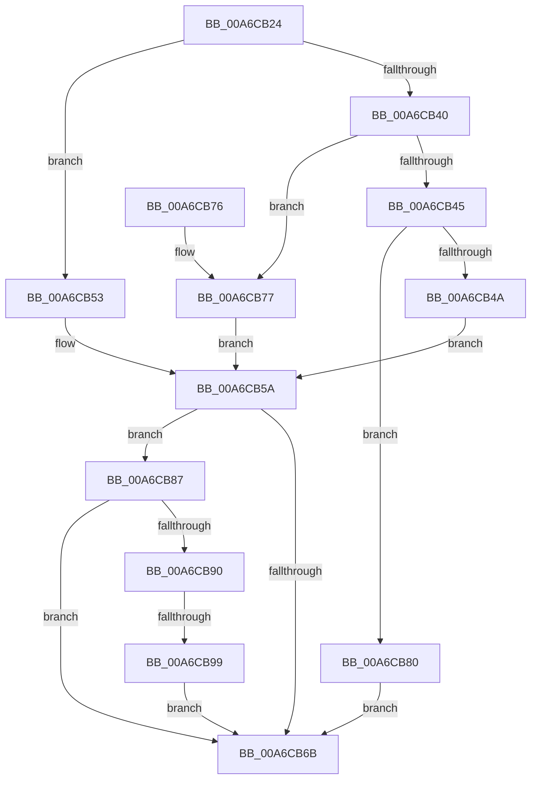

# IoQuerySystemDeviceName

- RVA: `0x00A6CB24`–`0x00A6CBA0` (길이 `124` bytes)
- VA: `0x0000000140A6CB24`
- 실행 섹션: `PAGE`
- PDB 이름 있음: `예`; PDB Function 태그: `예`
- unwind 정보 RVA: `0x000B4578`
- 디코드: `36`개 명령, `124/124` bytes 표시
- 미해석 바이트: `0` (있으면 어셈블리에 `.byte`로 보존)

> 이 문서는 커널 이미지의 기계어와 PDB 기호를 분석해 생성했습니다. 4번과 5번은 함수 원형과 자료형을 바이너리 사용 방식에서 추정한 C 해석이며 원본 소스 복구 결과는 아닙니다.

## 1. Dependencies

- 직접 호출 지점: **1**; 고유 호출 대상: **1**
- 직접 호출자로 확인된 함수: **1**
- RIP 상대 이미지 참조: **4**

### Outgoing calls
- `0x00A6CB5D` → [IopRetrieveSystemDeviceName](IopRetrieveSystemDeviceName_function_00A6CBA8.md) (function, `0x00A6CBA8`)

### Direct callers
- [ExpQuerySystemInformation](../A5/ExpQuerySystemInformation_function_00A57858.md) at `0x00A5AE3B`

### Static image references
- `0x00A6CB4A` → RVA `0x008275D0` (`SyspartDirectGetFirmwareSystemPartition`; read)
- `0x00A6CB53` → RVA `0x00A55890` (`SyspartDirectGetSystemPartition`; read)
- `0x00A6CB77` → RVA `0x00A55860` (`SyspartDirectGetSystemDisk`; read)
- `0x00A6CB87` → RVA `0x00E66219` (`.data`; read)

## 2. Other-region calls and transfers

- 다른 실행 섹션으로 향하는 call: **0**
- call이 아닌 외부 분기/꼬리 이동: **1**
  - `0x00A6CB93` → [sub_00B3F378](../B3/Unknown_function_00B3F378.md) (`tail-transfer`)

## 3. Assembly (complete function range)

```asm
00A6CB24  48 89 5C 24 08                  mov qword ptr [rsp + 8], rbx
00A6CB29  57                              push rdi
00A6CB2A  48 83 EC 30                     sub rsp, 0x30
00A6CB2E  48 83 64 24 20 00               and qword ptr [rsp + 0x20], 0
00A6CB34  4C 8B D2                        mov r10, rdx
00A6CB37  8B D1                           mov edx, ecx
00A6CB39  8B F9                           mov edi, ecx
00A6CB3B  83 EA 62                        sub edx, 0x62
00A6CB3E  74 13                           je 0x140a6cb53
00A6CB40  83 EA 01                        sub edx, 1
00A6CB43  74 32                           je 0x140a6cb77
00A6CB45  83 FA 65                        cmp edx, 0x65
00A6CB48  75 36                           jne 0x140a6cb80
00A6CB4A  48 8D 0D 7F AA DB FF            lea rcx, [rip - 0x245581]
00A6CB51  EB 07                           jmp 0x140a6cb5a
00A6CB53  48 8D 0D 36 8D FE FF            lea rcx, [rip - 0x172ca]
00A6CB5A  49 8B D2                        mov rdx, r10
00A6CB5D  E8 46 00 00 00                  call 0x140a6cba8
00A6CB62  8B D8                           mov ebx, eax
00A6CB64  3D 52 04 00 C0                  cmp eax, 0xc0000452
00A6CB69  74 1C                           je 0x140a6cb87
00A6CB6B  48 8B 5C 24 40                  mov rbx, qword ptr [rsp + 0x40]
00A6CB70  48 83 C4 30                     add rsp, 0x30
00A6CB74  5F                              pop rdi
00A6CB75  C3                              ret
00A6CB76  CC                              int3
00A6CB77  48 8D 0D E2 8C FE FF            lea rcx, [rip - 0x1731e]
00A6CB7E  EB DA                           jmp 0x140a6cb5a
00A6CB80  B8 03 00 00 C0                  mov eax, 0xc0000003
00A6CB85  EB E4                           jmp 0x140a6cb6b
00A6CB87  80 3D 8B 96 3F 00 00            cmp byte ptr [rip + 0x3f968b], 0
00A6CB8E  74 DB                           je 0x140a6cb6b
00A6CB90  83 FF 63                        cmp edi, 0x63
00A6CB93  0F 85 DF 27 0D 00               jne 0x140b3f378
00A6CB99  B8 51 04 00 C0                  mov eax, 0xc0000451
00A6CB9E  EB CB                           jmp 0x140a6cb6b
```

## 4. C-style interpretation (structured pseudocode)

```c
__int64 __fastcall IoQuerySystemDeviceName(int a1, __int64 a2)
{
    __int64 result;
    __int64 v_rsp;
    unsigned __int64 v_stack_m18;
    unsigned __int64 v_stack_p8;

    v_stack_p8 = v_rbx;
    v_rsp = (v_rsp) - (48);
    a2 = (unsigned int)(((unsigned int)(a1)) - (98));
    if (condition_is_equal) goto loc_00A6CB53;
    a2 = (unsigned int)((a2) - (1));
    if (condition_is_equal) goto loc_00A6CB77;
    if (((unsigned int)(a2)) != 101) goto loc_00A6CB80;
    goto loc_00A6CB5A;
loc_00A6CB53:
loc_00A6CB5A:
    result = IopRetrieveSystemDeviceName(v_rip - 94922, a2, a3, a4);
    if (((unsigned int)(result)) == 0xC0000452ULL) goto loc_00A6CB87;
loc_00A6CB6B:
    v_rsp = (v_rsp) + (48);
    return result;
loc_00A6CB77:
    goto loc_00A6CB5A;
loc_00A6CB80:
    goto loc_00A6CB6B;
loc_00A6CB87:
    if ((*(unsigned __int8 *)(v_rip + 4167307)) == 0) goto loc_00A6CB6B;
    goto loc_00A6CB6B;
}
```

## 5. (Beta) C Style

```c
int64_t IoQuerySystemDeviceName(int32_t Arg1, int64_t Arg2)
{
    int64_t result;
    int64_t local_rsp;
    uint64_t v_stack_m18;
    uint64_t v_stack_p8;

    v_stack_p8 = local_rbx;
    local_rsp = (local_rsp) - (48);
    Arg2 = (uint32_t)(((uint32_t)(Arg1)) - (98));
    if (condition_is_equal) goto loc_00A6CB53;
    Arg2 = (uint32_t)((Arg2) - (1));
    if (condition_is_equal) goto loc_00A6CB77;
    if (((uint32_t)(Arg2)) != 101) goto loc_00A6CB80;
    goto loc_00A6CB5A;
loc_00A6CB53:
loc_00A6CB5A:
    result = IopRetrieveSystemDeviceName(v_rip - 94922, Arg2, a3, a4);
    if (((uint32_t)(result)) == 0xC0000452ULL) goto loc_00A6CB87;
loc_00A6CB6B:
    local_rsp = (local_rsp) + (48);
    return result;
loc_00A6CB77:
    goto loc_00A6CB5A;
loc_00A6CB80:
    goto loc_00A6CB6B;
loc_00A6CB87:
    if ((*(uint8_t *)(v_rip + 0x3F968B)) == 0) goto loc_00A6CB6B;
    goto loc_00A6CB6B;
}
```

## 6. Execution-region graph

[열기: 2D/3D 그래프와 함수 탐색 컨트롤 패널](../../../control-panel.html?section=page&rva=0x00A6CB24&view=graph)

- 2D 그래프는 위에서 아래로 흐르고, 3D 그래프는 빈 공간을 드래그해 회전합니다. Shift+드래그는 이동, 휠은 확대·축소, 함수 노드 선택은 대상 보고서 이동입니다.

### Static fallback


