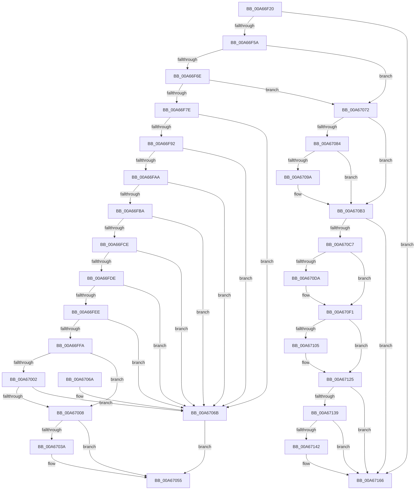

# IoReportTargetDeviceChange

- RVA: `0x00A66F20`–`0x00A6717F` (길이 `607` bytes)
- VA: `0x0000000140A66F20`
- 실행 섹션: `PAGE`
- PDB 이름 있음: `예`; PDB Function 태그: `아니요`
- unwind 정보 RVA: `0x000B3B7C`
- 디코드: `157`개 명령, `607/607` bytes 표시
- 미해석 바이트: `0` (있으면 어셈블리에 `.byte`로 보존)

> 이 문서는 커널 이미지의 기계어와 PDB 기호를 분석해 생성했습니다. 4번과 5번은 함수 원형과 자료형을 바이너리 사용 방식에서 추정한 C 해석이며 원본 소스 복구 결과는 아닙니다.

## 1. Dependencies

- 직접 호출 지점: **18**; 고유 호출 대상: **6**
- 직접 호출자로 확인된 함수: **2**
- RIP 상대 이미지 참조: **3**

### Outgoing calls
- `0x00A66F9C` → [RtlCompareMemory](../../text/6B/RtlCompareMemory_function_006BA670.md) (function, `0x006BA670`)
- `0x00A66FC0` → [RtlCompareMemory](../../text/6B/RtlCompareMemory_function_006BA670.md) (function, `0x006BA670`)
- `0x00A66FE4` → [RtlCompareMemory](../../text/6B/RtlCompareMemory_function_006BA670.md) (function, `0x006BA670`)
- `0x00A67012` → [KeInitializeEvent](../../text/40/KeInitializeEvent_function_0040DD10.md) (function, `0x0040DD10`)
- `0x00A67031` → [PnpSetCustomTargetEvent](../95/PnpSetCustomTargetEvent_function_009519E8.md) (function, `0x009519E8`)
- `0x00A6704C` → [KeWaitForSingleObject](../../text/20/KeWaitForSingleObject_function_0020E6B0.md) (function, `0x0020E6B0`)
- `0x00A67076` → [IoAddTriageDumpDataBlock](../../text/42/IoAddTriageDumpDataBlock_function_00428374.md) (function, `0x00428374`)
- `0x00A67088` → [IoAddTriageDumpDataBlock](../../text/42/IoAddTriageDumpDataBlock_function_00428374.md) (function, `0x00428374`)
- `0x00A6709D` → [IoAddTriageDumpDataBlock](../../text/42/IoAddTriageDumpDataBlock_function_00428374.md) (function, `0x00428374`)
- `0x00A670AE` → [IoAddTriageDumpDataBlock](../../text/42/IoAddTriageDumpDataBlock_function_00428374.md) (function, `0x00428374`)
- `0x00A670D0` → [IoAddTriageDumpDataBlock](../../text/42/IoAddTriageDumpDataBlock_function_00428374.md) (function, `0x00428374`)
- `0x00A670E0` → [IoAddTriageDumpDataBlock](../../text/42/IoAddTriageDumpDataBlock_function_00428374.md) (function, `0x00428374`)
- `0x00A670EC` → [IoAddTriageDumpDataBlock](../../text/42/IoAddTriageDumpDataBlock_function_00428374.md) (function, `0x00428374`)
- `0x00A67108` → [IoAddTriageDumpDataBlock](../../text/42/IoAddTriageDumpDataBlock_function_00428374.md) (function, `0x00428374`)
- `0x00A67120` → [IoAddTriageDumpDataBlock](../../text/42/IoAddTriageDumpDataBlock_function_00428374.md) (function, `0x00428374`)
- `0x00A67145` → [IoAddTriageDumpDataBlock](../../text/42/IoAddTriageDumpDataBlock_function_00428374.md) (function, `0x00428374`)
- `0x00A67161` → [IoAddTriageDumpDataBlock](../../text/42/IoAddTriageDumpDataBlock_function_00428374.md) (function, `0x00428374`)
- `0x00A67179` → [KeBugCheckEx](../../text/4F/KeBugCheckEx_function_004FD660.md) (function, `0x004FD660`)

### Direct callers
- [NtSetVolumeInformationFile](../72/NtSetVolumeInformationFile_function_00721750.md) at `0x00721C36`
- [FsRtlNotifyVolumeEventEx](FsRtlNotifyVolumeEventEx_function_00A66DC0.md) at `0x00A66E80`

### Static image references
- `0x00A66F82` → RVA `0x0001A210` (`.rdata`; read)
- `0x00A66FAA` → RVA `0x00012320` (`.rdata`; read)
- `0x00A66FCE` → RVA `0x0001A220` (`.rdata`; read)

## 2. Other-region calls and transfers

- 다른 실행 섹션으로 향하는 call: **17**
  - `0x00A66F9C` → [RtlCompareMemory](../../text/6B/RtlCompareMemory_function_006BA670.md) (`PAGE` → `.text`)
  - `0x00A66FC0` → [RtlCompareMemory](../../text/6B/RtlCompareMemory_function_006BA670.md) (`PAGE` → `.text`)
  - `0x00A66FE4` → [RtlCompareMemory](../../text/6B/RtlCompareMemory_function_006BA670.md) (`PAGE` → `.text`)
  - `0x00A67012` → [KeInitializeEvent](../../text/40/KeInitializeEvent_function_0040DD10.md) (`PAGE` → `.text`)
  - `0x00A6704C` → [KeWaitForSingleObject](../../text/20/KeWaitForSingleObject_function_0020E6B0.md) (`PAGE` → `.text`)
  - `0x00A67076` → [IoAddTriageDumpDataBlock](../../text/42/IoAddTriageDumpDataBlock_function_00428374.md) (`PAGE` → `.text`)
  - `0x00A67088` → [IoAddTriageDumpDataBlock](../../text/42/IoAddTriageDumpDataBlock_function_00428374.md) (`PAGE` → `.text`)
  - `0x00A6709D` → [IoAddTriageDumpDataBlock](../../text/42/IoAddTriageDumpDataBlock_function_00428374.md) (`PAGE` → `.text`)
  - `0x00A670AE` → [IoAddTriageDumpDataBlock](../../text/42/IoAddTriageDumpDataBlock_function_00428374.md) (`PAGE` → `.text`)
  - `0x00A670D0` → [IoAddTriageDumpDataBlock](../../text/42/IoAddTriageDumpDataBlock_function_00428374.md) (`PAGE` → `.text`)
  - `0x00A670E0` → [IoAddTriageDumpDataBlock](../../text/42/IoAddTriageDumpDataBlock_function_00428374.md) (`PAGE` → `.text`)
  - `0x00A670EC` → [IoAddTriageDumpDataBlock](../../text/42/IoAddTriageDumpDataBlock_function_00428374.md) (`PAGE` → `.text`)
  - `0x00A67108` → [IoAddTriageDumpDataBlock](../../text/42/IoAddTriageDumpDataBlock_function_00428374.md) (`PAGE` → `.text`)
  - `0x00A67120` → [IoAddTriageDumpDataBlock](../../text/42/IoAddTriageDumpDataBlock_function_00428374.md) (`PAGE` → `.text`)
  - `0x00A67145` → [IoAddTriageDumpDataBlock](../../text/42/IoAddTriageDumpDataBlock_function_00428374.md) (`PAGE` → `.text`)
  - `0x00A67161` → [IoAddTriageDumpDataBlock](../../text/42/IoAddTriageDumpDataBlock_function_00428374.md) (`PAGE` → `.text`)
  - `0x00A67179` → [KeBugCheckEx](../../text/4F/KeBugCheckEx_function_004FD660.md) (`PAGE` → `.text`)
- 별도 외부 분기/꼬리 이동을 확인하지 못했습니다.

## 3. Assembly (complete function range)

```asm
00A66F20  48 89 5C 24 10                  mov qword ptr [rsp + 0x10], rbx
00A66F25  48 89 6C 24 18                  mov qword ptr [rsp + 0x18], rbp
00A66F2A  56                              push rsi
00A66F2B  57                              push rdi
00A66F2C  41 56                           push r14
00A66F2E  48 83 EC 50                     sub rsp, 0x50
00A66F32  33 C0                           xor eax, eax
00A66F34  33 ED                           xor ebp, ebp
00A66F36  48 89 44 24 40                  mov qword ptr [rsp + 0x40], rax
00A66F3B  0F 57 C0                        xorps xmm0, xmm0
00A66F3E  89 6C 24 70                     mov dword ptr [rsp + 0x70], ebp
00A66F42  48 8B F2                        mov rsi, rdx
00A66F45  48 8B D9                        mov rbx, rcx
00A66F48  44 8D 70 02                     lea r14d, [rax + 2]
00A66F4C  0F 11 44 24 30                  movups xmmword ptr [rsp + 0x30], xmm0
00A66F51  48 85 C9                        test rcx, rcx
00A66F54  0F 84 0C 02 00 00               je 0x140a67166
00A66F5A  48 8B 81 38 01 00 00            mov rax, qword ptr [rcx + 0x138]
00A66F61  48 8B 40 28                     mov rax, qword ptr [rax + 0x28]
00A66F65  48 85 C0                        test rax, rax
00A66F68  0F 84 04 01 00 00               je 0x140a67072
00A66F6E  F7 80 8C 01 00 00 00 00 02 00   test dword ptr [rax + 0x18c], 0x20000
00A66F78  0F 85 F4 00 00 00               jne 0x140a67072
00A66F7E  48 8D 7A 04                     lea rdi, [rdx + 4]
00A66F82  48 8D 15 87 32 5B FF            lea rdx, [rip - 0xa4cd79]
00A66F89  48 3B FA                        cmp rdi, rdx
00A66F8C  0F 84 D9 00 00 00               je 0x140a6706b
00A66F92  44 8D 75 10                     lea r14d, [rbp + 0x10]
00A66F96  48 8B CF                        mov rcx, rdi
00A66F99  45 8B C6                        mov r8d, r14d
00A66F9C  E8 CF 36 C5 FF                  call 0x1406ba670
00A66FA1  49 3B C6                        cmp rax, r14
00A66FA4  0F 84 C1 00 00 00               je 0x140a6706b
00A66FAA  48 8D 15 6F B3 5A FF            lea rdx, [rip - 0xa54c91]
00A66FB1  48 3B FA                        cmp rdi, rdx
00A66FB4  0F 84 B1 00 00 00               je 0x140a6706b
00A66FBA  45 8B C6                        mov r8d, r14d
00A66FBD  48 8B CF                        mov rcx, rdi
00A66FC0  E8 AB 36 C5 FF                  call 0x1406ba670
00A66FC5  49 3B C6                        cmp rax, r14
00A66FC8  0F 84 9D 00 00 00               je 0x140a6706b
00A66FCE  48 8D 15 4B 32 5B FF            lea rdx, [rip - 0xa4cdb5]
00A66FD5  48 3B FA                        cmp rdi, rdx
00A66FD8  0F 84 8D 00 00 00               je 0x140a6706b
00A66FDE  45 8B C6                        mov r8d, r14d
00A66FE1  48 8B CF                        mov rcx, rdi
00A66FE4  E8 87 36 C5 FF                  call 0x1406ba670
00A66FE9  49 3B C6                        cmp rax, r14
00A66FEC  74 7D                           je 0x140a6706b
00A66FEE  0F B7 46 02                     movzx eax, word ptr [rsi + 2]
00A66FF2  8D 55 24                        lea edx, [rbp + 0x24]
00A66FF5  66 3B C2                        cmp ax, dx
00A66FF8  72 71                           jb 0x140a6706b
00A66FFA  8B 4E 20                        mov ecx, dword ptr [rsi + 0x20]
00A66FFD  83 F9 FF                        cmp ecx, -1
00A67000  74 06                           je 0x140a67008
00A67002  2B C2                           sub eax, edx
00A67004  3B C8                           cmp ecx, eax
00A67006  7F 63                           jg 0x140a6706b
00A67008  45 33 C0                        xor r8d, r8d
00A6700B  48 8D 4C 24 30                  lea rcx, [rsp + 0x30]
00A67010  33 D2                           xor edx, edx
00A67012  E8 F9 6C 9A FF                  call 0x14040dd10
00A67017  45 33 C9                        xor r9d, r9d
00A6701A  48 89 74 24 28                  mov qword ptr [rsp + 0x28], rsi
00A6701F  4C 8D 44 24 70                  lea r8, [rsp + 0x70]
00A67024  48 89 6C 24 20                  mov qword ptr [rsp + 0x20], rbp
00A67029  48 8D 54 24 30                  lea rdx, [rsp + 0x30]
00A6702E  48 8B CB                        mov rcx, rbx
00A67031  E8 B2 A9 EE FF                  call 0x1409519e8
00A67036  85 C0                           test eax, eax
00A67038  78 1B                           js 0x140a67055
00A6703A  45 33 C9                        xor r9d, r9d
00A6703D  48 89 6C 24 20                  mov qword ptr [rsp + 0x20], rbp
00A67042  45 33 C0                        xor r8d, r8d
00A67045  48 8D 4C 24 30                  lea rcx, [rsp + 0x30]
00A6704A  33 D2                           xor edx, edx
00A6704C  E8 5F 76 7A FF                  call 0x14020e6b0
00A67051  8B 44 24 70                     mov eax, dword ptr [rsp + 0x70]
00A67055  4C 8D 5C 24 50                  lea r11, [rsp + 0x50]
00A6705A  49 8B 5B 28                     mov rbx, qword ptr [r11 + 0x28]
00A6705E  49 8B 6B 30                     mov rbp, qword ptr [r11 + 0x30]
00A67062  49 8B E3                        mov rsp, r11
00A67065  41 5E                           pop r14
00A67067  5F                              pop rdi
00A67068  5E                              pop rsi
00A67069  C3                              ret
00A6706A  CC                              int3
00A6706B  B8 10 00 00 C0                  mov eax, 0xc0000010
00A67070  EB E3                           jmp 0x140a67055
00A67072  0F B7 51 02                     movzx edx, word ptr [rcx + 2]
00A67076  E8 F9 12 9C FF                  call 0x140428374
00A6707B  48 8B 4B 08                     mov rcx, qword ptr [rbx + 8]
00A6707F  48 85 C9                        test rcx, rcx
00A67082  74 2F                           je 0x140a670b3
00A67084  0F BF 51 02                     movsx edx, word ptr [rcx + 2]
00A67088  E8 E7 12 9C FF                  call 0x140428374
00A6708D  48 8B 4B 08                     mov rcx, qword ptr [rbx + 8]
00A67091  48 83 C1 38                     add rcx, 0x38
00A67095  66 39 29                        cmp word ptr [rcx], bp
00A67098  74 19                           je 0x140a670b3
00A6709A  41 8B D6                        mov edx, r14d
00A6709D  E8 D2 12 9C FF                  call 0x140428374
00A670A2  48 8B 4B 08                     mov rcx, qword ptr [rbx + 8]
00A670A6  0F B7 51 38                     movzx edx, word ptr [rcx + 0x38]
00A670AA  48 8B 49 40                     mov rcx, qword ptr [rcx + 0x40]
00A670AE  E8 C1 12 9C FF                  call 0x140428374
00A670B3  48 8B 83 38 01 00 00            mov rax, qword ptr [rbx + 0x138]
00A670BA  48 8B 48 28                     mov rcx, qword ptr [rax + 0x28]
00A670BE  48 85 C9                        test rcx, rcx
00A670C1  0F 84 9F 00 00 00               je 0x140a67166
00A670C7  BA 88 03 00 00                  mov edx, 0x388
00A670CC  48 8D 79 28                     lea rdi, [rcx + 0x28]
00A670D0  E8 9F 12 9C FF                  call 0x140428374
00A670D5  66 39 2F                        cmp word ptr [rdi], bp
00A670D8  74 17                           je 0x140a670f1
00A670DA  41 8B D6                        mov edx, r14d
00A670DD  48 8B CF                        mov rcx, rdi
00A670E0  E8 8F 12 9C FF                  call 0x140428374
00A670E5  0F B7 17                        movzx edx, word ptr [rdi]
00A670E8  48 8B 4F 08                     mov rcx, qword ptr [rdi + 8]
00A670EC  E8 83 12 9C FF                  call 0x140428374
00A670F1  48 8B 83 38 01 00 00            mov rax, qword ptr [rbx + 0x138]
00A670F8  48 8B 48 28                     mov rcx, qword ptr [rax + 0x28]
00A670FC  48 83 C1 38                     add rcx, 0x38
00A67100  66 39 29                        cmp word ptr [rcx], bp
00A67103  74 20                           je 0x140a67125
00A67105  41 8B D6                        mov edx, r14d
00A67108  E8 67 12 9C FF                  call 0x140428374
00A6710D  48 8B 83 38 01 00 00            mov rax, qword ptr [rbx + 0x138]
00A67114  48 8B 48 28                     mov rcx, qword ptr [rax + 0x28]
00A67118  0F B7 51 38                     movzx edx, word ptr [rcx + 0x38]
00A6711C  48 8B 49 40                     mov rcx, qword ptr [rcx + 0x40]
00A67120  E8 4F 12 9C FF                  call 0x140428374
00A67125  48 8B 83 38 01 00 00            mov rax, qword ptr [rbx + 0x138]
00A6712C  48 8B 48 28                     mov rcx, qword ptr [rax + 0x28]
00A67130  48 8B 41 10                     mov rax, qword ptr [rcx + 0x10]
00A67134  48 85 C0                        test rax, rax
00A67137  74 2D                           je 0x140a67166
00A67139  48 8D 48 38                     lea rcx, [rax + 0x38]
00A6713D  66 39 29                        cmp word ptr [rcx], bp
00A67140  74 24                           je 0x140a67166
00A67142  41 8B D6                        mov edx, r14d
00A67145  E8 2A 12 9C FF                  call 0x140428374
00A6714A  48 8B 83 38 01 00 00            mov rax, qword ptr [rbx + 0x138]
00A67151  48 8B 48 28                     mov rcx, qword ptr [rax + 0x28]
00A67155  48 8B 49 10                     mov rcx, qword ptr [rcx + 0x10]
00A67159  0F B7 51 38                     movzx edx, word ptr [rcx + 0x38]
00A6715D  48 8B 49 40                     mov rcx, qword ptr [rcx + 0x40]
00A67161  E8 0E 12 9C FF                  call 0x140428374
00A67166  45 33 C9                        xor r9d, r9d
00A67169  48 89 6C 24 20                  mov qword ptr [rsp + 0x20], rbp
00A6716E  4C 8B C3                        mov r8, rbx
00A67171  49 8B D6                        mov rdx, r14
00A67174  B9 CA 00 00 00                  mov ecx, 0xca
00A67179  E8 E2 64 A9 FF                  call 0x1404fd660
00A6717E  CC                              int3
```

## 4. C-style interpretation (structured pseudocode)

```c
__int64 __fastcall IoReportTargetDeviceChange(__int64 a1, __int64 a2, __int64 a3, int a4)
{
    __int64 result;
    __int64 v_rbp;
    __int64 v_rsp;
    unsigned __int64 v_stack_m18;
    unsigned __int64 v_stack_m28;
    unsigned __int64 v_stack_m30;
    unsigned __int64 v_stack_m38;
    unsigned __int64 v_stack_m40;
    unsigned __int64 v_stack_m48;
    unsigned __int64 v_stack_p10;
    unsigned __int64 v_stack_p18;
    unsigned int v_stack_p8;

    v_stack_p10 = v_rbx;
    v_stack_p18 = v_rbp;
    v_rsp = (v_rsp) - (80);
    result = 0;
    v_rbp = 0;
    v_stack_m28 = 0;
    v_stack_p8 = 0;
    v_stack_m38 = v_xmm0;
    if (a1 == 0) goto loc_00A67166;
    if (*(unsigned __int64 *)(*(unsigned __int64 *)(a1 + 312) + 40) == 0) goto loc_00A67072;
    if (((*(unsigned int *)(*(unsigned __int64 *)(*(unsigned __int64 *)(a1 + 312) + 40) + 396)) & (0x20000ULL)) != 0) goto loc_00A67072;
    if ((a2 + 4) == (v_rip - 10800505)) goto loc_00A6706B;
    result = RtlCompareMemory(a2 + 4, v_rip - 10800505, (unsigned int)((unsigned int)(v_rbp + 16)), a4);
    if (result == (v_rbp + 16)) goto loc_00A6706B;
    if ((a2 + 4) == (v_rip - 10833041)) goto loc_00A6706B;
    result = RtlCompareMemory(a2 + 4, v_rip - 10833041, (unsigned int)((unsigned int)(v_rbp + 16)), a4);
    if (result == (v_rbp + 16)) goto loc_00A6706B;
    if ((a2 + 4) == (v_rip - 10800565)) goto loc_00A6706B;
    result = RtlCompareMemory(a2 + 4, v_rip - 10800565, (unsigned int)((unsigned int)(v_rbp + 16)), a4);
    if (result == (v_rbp + 16)) goto loc_00A6706B;
    if (((unsigned __int16)(*(unsigned __int16 *)(a2 + 2))) < ((unsigned __int16)(v_rbp + 36))) goto loc_00A6706B;
    if (((unsigned int)((unsigned int)(*(unsigned int *)(a2 + 32)))) == -1) goto loc_00A67008;
    result = (unsigned int)((*(unsigned __int16 *)(a2 + 2)) - ((unsigned int)(v_rbp + 36)));
    if (((unsigned int)((unsigned int)(*(unsigned int *)(a2 + 32)))) > ((unsigned int)(result))) goto loc_00A6706B;
loc_00A67008:
    a3 = 0;
    a2 = 0;
    result = KeInitializeEvent(v_stack_m38, a2, a3, a4);
    a4 = 0;
    v_stack_m40 = 0;
    v_stack_m48 = 0;
    result = PnpSetCustomTargetEvent(a1, v_stack_m38, v_stack_p8, a4);
    if (!(sign_flag)) {
        a4 = 0;
        v_stack_m48 = 0;
        a3 = 0;
        a1 = v_stack_m38;
        a2 = 0;
        result = KeWaitForSingleObject(a1, a2, a3, a4);
        result = v_stack_p8;
    }
    return result;
loc_00A6706B:
    goto loc_00A67055;
loc_00A67072:
    result = IoAddTriageDumpDataBlock(a1, *(unsigned __int16 *)(a1 + 2), a3, a4);
    if (*(unsigned __int64 *)(*(unsigned __int64 *)(v_stack_m18 + 40) + 8) == 0) goto loc_00A670B3;
    result = IoAddTriageDumpDataBlock(*(unsigned __int64 *)(*(unsigned __int64 *)(v_stack_m18 + 40) + 8), (__int16)(*(unsigned __int16 *)(*(unsigned __int64 *)(*(unsigned __int64 *)(v_stack_m18 + 40) + 8) + 2)), a3, a4);
    a1 = (*(unsigned __int64 *)(*(unsigned __int64 *)(v_stack_m18 + 40) + 8)) + (56);
    if ((*(unsigned __int16 *)(a1)) != ((unsigned __int16)(*(unsigned __int64 *)(v_stack_m18 + 48)))) {
        a2 = (unsigned int)(v_rbp + 16);
        result = IoAddTriageDumpDataBlock(a1, a2, a3, a4);
        a1 = *(unsigned __int64 *)(*(unsigned __int64 *)(v_stack_m18 + 40) + 8);
        a2 = *(unsigned __int16 *)(a1 + 56);
        a1 = *(unsigned __int64 *)(a1 + 64);
        result = IoAddTriageDumpDataBlock(a1, a2, a3, a4);
    }
    if (*(unsigned __int64 *)(*(unsigned __int64 *)(*(unsigned __int64 *)(v_stack_m18 + 40) + 312) + 40) == 0) goto loc_00A67166;
    result = IoAddTriageDumpDataBlock(*(unsigned __int64 *)(*(unsigned __int64 *)(*(unsigned __int64 *)(v_stack_m18 + 40) + 312) + 40), 904, a3, a4);
    if ((*(unsigned __int16 *)(*(unsigned __int64 *)(*(unsigned __int64 *)(*(unsigned __int64 *)(v_stack_m18 + 40) + 312) + 40) + 40)) != ((unsigned __int16)(*(unsigned __int64 *)(v_stack_m18 + 48)))) {
        a2 = (unsigned int)(v_rbp + 16);
        a1 = *(unsigned __int64 *)(*(unsigned __int64 *)(*(unsigned __int64 *)(v_stack_m18 + 40) + 312) + 40) + 40;
        result = IoAddTriageDumpDataBlock(a1, a2, a3, a4);
        a2 = *(unsigned __int16 *)(*(unsigned __int64 *)(*(unsigned __int64 *)(*(unsigned __int64 *)(v_stack_m18 + 40) + 312) + 40) + 40);
        a1 = *(unsigned __int64 *)(*(unsigned __int64 *)(*(unsigned __int64 *)(*(unsigned __int64 *)(v_stack_m18 + 40) + 312) + 40) + 40 + 8);
        result = IoAddTriageDumpDataBlock(a1, a2, a3, a4);
    }
    a1 = (*(unsigned __int64 *)(*(unsigned __int64 *)(*(unsigned __int64 *)(v_stack_m18 + 40) + 312) + 40)) + (56);
    result = *(unsigned __int64 *)(*(unsigned __int64 *)(v_stack_m18 + 40) + 312);
    if ((*(unsigned __int16 *)(a1)) != ((unsigned __int16)(*(unsigned __int64 *)(v_stack_m18 + 48)))) {
        a2 = (unsigned int)(v_rbp + 16);
        result = IoAddTriageDumpDataBlock(a1, a2, a3, a4);
        result = *(unsigned __int64 *)(*(unsigned __int64 *)(v_stack_m18 + 40) + 312);
        a1 = *(unsigned __int64 *)(result + 40);
        a2 = *(unsigned __int16 *)(a1 + 56);
        a1 = *(unsigned __int64 *)(a1 + 64);
        result = IoAddTriageDumpDataBlock(a1, a2, a3, a4);
    }
    if (*(unsigned __int64 *)(*(unsigned __int64 *)(*(unsigned __int64 *)(*(unsigned __int64 *)(v_stack_m18 + 40) + 312) + 40) + 16) == 0) goto loc_00A67166;
    result = *(unsigned __int64 *)(*(unsigned __int64 *)(*(unsigned __int64 *)(*(unsigned __int64 *)(v_stack_m18 + 40) + 312) + 40) + 16);
    if ((*(unsigned __int16 *)(*(unsigned __int64 *)(*(unsigned __int64 *)(*(unsigned __int64 *)(*(unsigned __int64 *)(v_stack_m18 + 40) + 312) + 40) + 16) + 56)) != ((unsigned __int16)(*(unsigned __int64 *)(v_stack_m18 + 48)))) {
        a2 = (unsigned int)(v_rbp + 16);
        result = IoAddTriageDumpDataBlock(*(unsigned __int64 *)(*(unsigned __int64 *)(*(unsigned __int64 *)(*(unsigned __int64 *)(v_stack_m18 + 40) + 312) + 40) + 16) + 56, a2, a3, a4);
        result = *(unsigned __int64 *)(*(unsigned __int64 *)(v_stack_m18 + 40) + 312);
        a1 = *(unsigned __int64 *)(result + 40);
        a1 = *(unsigned __int64 *)(a1 + 16);
        a2 = *(unsigned __int16 *)(a1 + 56);
        a1 = *(unsigned __int64 *)(a1 + 64);
        result = IoAddTriageDumpDataBlock(a1, a2, a3, a4);
    }
    a4 = 0;
    v_stack_m30 = *(unsigned __int64 *)(v_stack_m18 + 48);
    result = KeBugCheckEx(202, v_rbp + 16, *(unsigned __int64 *)(v_stack_m18 + 40), a4);
    return result;
}
```

## 5. (Beta) C Style

```c
int64_t IoReportTargetDeviceChange(void *Arg1, void *Arg2, int64_t Arg3, int32_t Arg4)
{
    uint8_t *arg1 = (uint8_t *)Arg1;
    uint8_t *arg2 = (uint8_t *)Arg2;

    int64_t result;
    int64_t local_rbp;
    int64_t local_rsp;
    uint64_t v_stack_m18;
    uint64_t v_stack_m28;
    uint64_t v_stack_m30;
    uint64_t v_stack_m38;
    uint64_t v_stack_m40;
    uint64_t v_stack_m48;
    uint64_t v_stack_p10;
    uint64_t v_stack_p18;
    uint32_t v_stack_p8;

    v_stack_p10 = local_rbx;
    v_stack_p18 = local_rbp;
    local_rsp = (local_rsp) - (80);
    result = 0;
    local_rbp = 0;
    v_stack_m28 = 0;
    v_stack_p8 = 0;
    v_stack_m38 = v_xmm0;
    if (Arg1 == NULL) goto loc_00A67166;
    if (*(uint64_t *)(*(uint64_t *)(arg1 + 0x138) + 0x28) == 0) goto loc_00A67072;
    if (((*(uint32_t *)(*(uint64_t *)(*(uint64_t *)(arg1 + 0x138) + 0x28) + 0x18C)) & (0x20000ULL)) != 0) goto loc_00A67072;
    if ((Arg2 + 4) == (v_rip - 10800505)) goto loc_00A6706B;
    result = RtlCompareMemory(Arg2 + 4, v_rip - 10800505, (uint32_t)((uint32_t)(local_rbp + 16)), Arg4);
    if (result == (local_rbp + 16)) goto loc_00A6706B;
    if ((Arg2 + 4) == (v_rip - 10833041)) goto loc_00A6706B;
    result = RtlCompareMemory(Arg2 + 4, v_rip - 10833041, (uint32_t)((uint32_t)(local_rbp + 16)), Arg4);
    if (result == (local_rbp + 16)) goto loc_00A6706B;
    if ((Arg2 + 4) == (v_rip - 10800565)) goto loc_00A6706B;
    result = RtlCompareMemory(Arg2 + 4, v_rip - 10800565, (uint32_t)((uint32_t)(local_rbp + 16)), Arg4);
    if (result == (local_rbp + 16)) goto loc_00A6706B;
    if (((uint16_t)(*(uint16_t *)(arg2 + 0x2))) < ((uint16_t)(local_rbp + 36))) goto loc_00A6706B;
    if (((uint32_t)((uint32_t)(*(uint32_t *)(arg2 + 0x20)))) == -1) goto loc_00A67008;
    result = (uint32_t)((*(uint16_t *)(arg2 + 0x2)) - ((uint32_t)(local_rbp + 36)));
    if (((uint32_t)((uint32_t)(*(uint32_t *)(arg2 + 0x20)))) > ((uint32_t)(result))) goto loc_00A6706B;
loc_00A67008:
    Arg3 = 0;
    Arg2 = 0;
    result = KeInitializeEvent(v_stack_m38, Arg2, Arg3, Arg4);
    Arg4 = 0;
    v_stack_m40 = 0;
    v_stack_m48 = 0;
    result = PnpSetCustomTargetEvent(Arg1, v_stack_m38, v_stack_p8, Arg4);
    if (!(sign_flag)) {
        Arg4 = 0;
        v_stack_m48 = 0;
        Arg3 = 0;
        Arg1 = v_stack_m38;
        Arg2 = 0;
        result = KeWaitForSingleObject(Arg1, Arg2, Arg3, Arg4);
        result = v_stack_p8;
    }
    return result;
loc_00A6706B:
    goto loc_00A67055;
loc_00A67072:
    result = IoAddTriageDumpDataBlock(Arg1, *(uint16_t *)(arg1 + 0x2), Arg3, Arg4);
    if (*(uint64_t *)(*(uint64_t *)(v_stack_m18 + 0x28) + 0x8) == 0) goto loc_00A670B3;
    result = IoAddTriageDumpDataBlock(*(uint64_t *)(*(uint64_t *)(v_stack_m18 + 0x28) + 0x8), (int16_t)(*(uint16_t *)(*(uint64_t *)(*(uint64_t *)(v_stack_m18 + 0x28) + 0x8) + 0x2)), Arg3, Arg4);
    Arg1 = (*(uint64_t *)(*(uint64_t *)(v_stack_m18 + 0x28) + 0x8)) + (56);
    if ((*(uint16_t *)(arg1)) != ((uint16_t)(*(uint64_t *)(v_stack_m18 + 0x30)))) {
        Arg2 = (uint32_t)(local_rbp + 16);
        result = IoAddTriageDumpDataBlock(Arg1, Arg2, Arg3, Arg4);
        Arg1 = *(uint64_t *)(*(uint64_t *)(v_stack_m18 + 0x28) + 0x8);
        Arg2 = *(uint16_t *)(arg1 + 0x38);
        Arg1 = *(uint64_t *)(arg1 + 0x40);
        result = IoAddTriageDumpDataBlock(Arg1, Arg2, Arg3, Arg4);
    }
    if (*(uint64_t *)(*(uint64_t *)(*(uint64_t *)(v_stack_m18 + 0x28) + 0x138) + 0x28) == 0) goto loc_00A67166;
    result = IoAddTriageDumpDataBlock(*(uint64_t *)(*(uint64_t *)(*(uint64_t *)(v_stack_m18 + 0x28) + 0x138) + 0x28), 904, Arg3, Arg4);
    if ((*(uint16_t *)(*(uint64_t *)(*(uint64_t *)(*(uint64_t *)(v_stack_m18 + 0x28) + 0x138) + 0x28) + 0x28)) != ((uint16_t)(*(uint64_t *)(v_stack_m18 + 0x30)))) {
        Arg2 = (uint32_t)(local_rbp + 16);
        Arg1 = *(uint64_t *)(*(uint64_t *)(*(uint64_t *)(v_stack_m18 + 0x28) + 0x138) + 0x28) + 40;
        result = IoAddTriageDumpDataBlock(Arg1, Arg2, Arg3, Arg4);
        Arg2 = *(uint16_t *)(*(uint64_t *)(*(uint64_t *)(*(uint64_t *)(v_stack_m18 + 0x28) + 0x138) + 0x28) + 0x28);
        Arg1 = *(uint64_t *)(*(uint64_t *)(*(uint64_t *)(*(uint64_t *)(v_stack_m18 + 0x28) + 0x138) + 0x28) + 0x28 + 0x8);
        result = IoAddTriageDumpDataBlock(Arg1, Arg2, Arg3, Arg4);
    }
    Arg1 = (*(uint64_t *)(*(uint64_t *)(*(uint64_t *)(v_stack_m18 + 0x28) + 0x138) + 0x28)) + (56);
    result = *(uint64_t *)(*(uint64_t *)(v_stack_m18 + 0x28) + 0x138);
    if ((*(uint16_t *)(arg1)) != ((uint16_t)(*(uint64_t *)(v_stack_m18 + 0x30)))) {
        Arg2 = (uint32_t)(local_rbp + 16);
        result = IoAddTriageDumpDataBlock(Arg1, Arg2, Arg3, Arg4);
        result = *(uint64_t *)(*(uint64_t *)(v_stack_m18 + 0x28) + 0x138);
        Arg1 = *(uint64_t *)(result + 0x28);
        Arg2 = *(uint16_t *)(arg1 + 0x38);
        Arg1 = *(uint64_t *)(arg1 + 0x40);
        result = IoAddTriageDumpDataBlock(Arg1, Arg2, Arg3, Arg4);
    }
    if (*(uint64_t *)(*(uint64_t *)(*(uint64_t *)(*(uint64_t *)(v_stack_m18 + 0x28) + 0x138) + 0x28) + 0x10) == 0) goto loc_00A67166;
    result = *(uint64_t *)(*(uint64_t *)(*(uint64_t *)(*(uint64_t *)(v_stack_m18 + 0x28) + 0x138) + 0x28) + 0x10);
    if ((*(uint16_t *)(*(uint64_t *)(*(uint64_t *)(*(uint64_t *)(*(uint64_t *)(v_stack_m18 + 0x28) + 0x138) + 0x28) + 0x10) + 0x38)) != ((uint16_t)(*(uint64_t *)(v_stack_m18 + 0x30)))) {
        Arg2 = (uint32_t)(local_rbp + 16);
        result = IoAddTriageDumpDataBlock(*(uint64_t *)(*(uint64_t *)(*(uint64_t *)(*(uint64_t *)(v_stack_m18 + 0x28) + 0x138) + 0x28) + 0x10) + 56, Arg2, Arg3, Arg4);
        result = *(uint64_t *)(*(uint64_t *)(v_stack_m18 + 0x28) + 0x138);
        Arg1 = *(uint64_t *)(result + 0x28);
        Arg1 = *(uint64_t *)(arg1 + 0x10);
        Arg2 = *(uint16_t *)(arg1 + 0x38);
        Arg1 = *(uint64_t *)(arg1 + 0x40);
        result = IoAddTriageDumpDataBlock(Arg1, Arg2, Arg3, Arg4);
    }
    Arg4 = 0;
    v_stack_m30 = *(uint64_t *)(v_stack_m18 + 0x30);
    result = KeBugCheckEx(202, local_rbp + 16, *(uint64_t *)(v_stack_m18 + 0x28), Arg4);
    return result;
}
```

### 관측된 메모리 오프셋

구조체 형식이 확인되지 않은 접근은 인자 기준의 오프셋으로만 기록했습니다.

| 기준 인자 | 오프셋 표현 | 폭 (bit) | 접근 |
|---|---:|---:|---|
| `Arg1` | `+ 0x8` | `64` | `R` |
| `Arg1` | `+ 0x138` | `64` | `R` |
| `Arg2` | `+ 0x2` | `16` | `R` |
| `Arg2` | `+ 0x4` | `64` | `R` |
| `Arg2` | `+ 0x20` | `32` | `R` |

## 6. Execution-region graph

[열기: 2D/3D 그래프와 함수 탐색 컨트롤 패널](../../../control-panel.html?section=page&rva=0x00A66F20&view=graph)

- 2D 그래프는 위에서 아래로 흐르고, 3D 그래프는 빈 공간을 드래그해 회전합니다. Shift+드래그는 이동, 휠은 확대·축소, 함수 노드 선택은 대상 보고서 이동입니다.

### Static fallback


