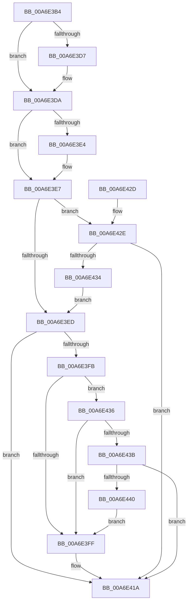

# IopEnumerateRelations

- RVA: `0x00A6E3B4`–`0x00A6E447` (길이 `147` bytes)
- VA: `0x0000000140A6E3B4`
- 실행 섹션: `PAGE`
- PDB 이름 있음: `예`; PDB Function 태그: `아니요`
- unwind 정보 RVA: `0x0005DCDC`
- 디코드: `51`개 명령, `147/147` bytes 표시
- 미해석 바이트: `0` (있으면 어셈블리에 `.byte`로 보존)

> 이 문서는 커널 이미지의 기계어와 PDB 기호를 분석해 생성했습니다. 4번과 5번은 함수 원형과 자료형을 바이너리 사용 방식에서 추정한 C 해석이며 원본 소스 복구 결과는 아닙니다.

## 1. Dependencies

- 직접 호출 지점: **1**; 고유 호출 대상: **1**
- 직접 호출자로 확인된 함수: **2**
- RIP 상대 이미지 참조: **0**

### Outgoing calls
- `0x00A6E40A` → [PipDeviceObjectListElementAt](PipDeviceObjectListElementAt_function_00A6E450.md) (function, `0x00A6E450`)

### Direct callers
- [PnpFinalizeDeviceRemovalForReset](../72/PnpFinalizeDeviceRemovalForReset_function_0072AD04.md) at `0x0072AD48`
- [sub_00B33FE8](../B3/Unknown_function_00B33FE8.md) at `0x00B343AF`

### Static image references
- 디코드된 RIP-relative 메모리 참조가 없습니다.

## 2. Other-region calls and transfers

- 다른 실행 섹션으로 향하는 call: **0**
- 별도 외부 분기/꼬리 이동을 확인하지 못했습니다.

## 3. Assembly (complete function range)

```asm
00A6E3B4  48 89 5C 24 08                  mov qword ptr [rsp + 8], rbx
00A6E3B9  48 89 74 24 10                  mov qword ptr [rsp + 0x10], rsi
00A6E3BE  57                              push rdi
00A6E3BF  48 83 EC 30                     sub rsp, 0x30
00A6E3C3  45 33 D2                        xor r10d, r10d
00A6E3C6  49 8B F8                        mov rdi, r8
00A6E3C9  4D 89 10                        mov qword ptr [r8], r10
00A6E3CC  48 8B DA                        mov rbx, rdx
00A6E3CF  48 8B C1                        mov rax, rcx
00A6E3D2  4D 85 C9                        test r9, r9
00A6E3D5  74 03                           je 0x140a6e3da
00A6E3D7  45 89 11                        mov dword ptr [r9], r10d
00A6E3DA  4C 8B 5C 24 60                  mov r11, qword ptr [rsp + 0x60]
00A6E3DF  4D 85 DB                        test r11, r11
00A6E3E2  74 03                           je 0x140a6e3e7
00A6E3E4  45 89 13                        mov dword ptr [r11], r10d
00A6E3E7  8B 0A                           mov ecx, dword ptr [rdx]
00A6E3E9  85 C9                           test ecx, ecx
00A6E3EB  75 41                           jne 0x140a6e42e
00A6E3ED  48 8B 30                        mov rsi, qword ptr [rax]
00A6E3F0  8B 52 04                        mov edx, dword ptr [rdx + 4]
00A6E3F3  44 8B 06                        mov r8d, dword ptr [rsi]
00A6E3F6  41 3B D0                        cmp edx, r8d
00A6E3F9  73 1F                           jae 0x140a6e41a
00A6E3FB  85 C9                           test ecx, ecx
00A6E3FD  75 37                           jne 0x140a6e436
00A6E3FF  4C 8B C7                        mov r8, rdi
00A6E402  4C 89 5C 24 20                  mov qword ptr [rsp + 0x20], r11
00A6E407  48 8B CE                        mov rcx, rsi
00A6E40A  E8 41 00 00 00                  call 0x140a6e450
00A6E40F  FF 43 04                        inc dword ptr [rbx + 4]
00A6E412  C1 E8 1F                        shr eax, 0x1f
00A6E415  34 01                           xor al, 1
00A6E417  44 8A D0                        mov r10b, al
00A6E41A  48 8B 5C 24 40                  mov rbx, qword ptr [rsp + 0x40]
00A6E41F  41 8A C2                        mov al, r10b
00A6E422  48 8B 74 24 48                  mov rsi, qword ptr [rsp + 0x48]
00A6E427  48 83 C4 30                     add rsp, 0x30
00A6E42B  5F                              pop rdi
00A6E42C  C3                              ret
00A6E42D  CC                              int3
00A6E42E  44 38 50 08                     cmp byte ptr [rax + 8], r10b
00A6E432  74 E6                           je 0x140a6e41a
00A6E434  EB B7                           jmp 0x140a6e3ed
00A6E436  83 E9 01                        sub ecx, 1
00A6E439  74 C4                           je 0x140a6e3ff
00A6E43B  83 F9 01                        cmp ecx, 1
00A6E43E  75 DA                           jne 0x140a6e41a
00A6E440  F7 D2                           not edx
00A6E442  41 03 D0                        add edx, r8d
00A6E445  EB B8                           jmp 0x140a6e3ff
```

## 4. C-style interpretation (structured pseudocode)

```c
__int64 __fastcall IopEnumerateRelations(__int64 a1, __int64 a2, __int64 a3, __int64 a4, __int64 a5)
{
    __int64 result;
    __int64 v_r10;
    __int64 v_rsp;
    unsigned __int64 v_stack_m18;
    unsigned __int64 v_stack_p10;
    unsigned __int64 v_stack_p8;

    v_stack_p8 = v_rbx;
    v_stack_p10 = v_rsi;
    v_rsp = (v_rsp) - (48);
    v_r10 = 0;
    *(unsigned __int64 *)(a3) = 0;
    if (a4 != 0) {
        *(unsigned int *)(a4) = 0;
    }
    if (a5 != 0) {
        *(unsigned int *)(a5) = 0;
    }
    if ((unsigned int)((unsigned int)(*(unsigned int *)(a2))) != 0) goto loc_00A6E42E;
loc_00A6E3ED:
    if (((unsigned int)((unsigned int)(*(unsigned int *)(a2 + 4)))) >= ((unsigned int)((unsigned int)(*(unsigned int *)(*(unsigned __int64 *)(a1)))))) goto loc_00A6E41A;
    if ((unsigned int)((unsigned int)(*(unsigned int *)(a2))) != 0) goto loc_00A6E436;
loc_00A6E3FF:
    v_stack_m18 = a5;
    result = PipDeviceObjectListElementAt(*(unsigned __int64 *)(a1), (unsigned int)(*(unsigned int *)(a2 + 4)), a3, a4);
    result = (unsigned int)((result) >> (31));
    result = (unsigned __int8)((result) ^ (1));
loc_00A6E41A:
    v_rsp = (v_rsp) + (48);
    return (unsigned __int8)((unsigned __int8)(result));
loc_00A6E42E:
    if ((*(unsigned __int8 *)((unsigned __int8)((unsigned __int8)(result)) + 8)) == ((unsigned __int8)((unsigned __int8)(result)))) goto loc_00A6E41A;
    goto loc_00A6E3ED;
loc_00A6E436:
    a1 = (unsigned int)((*(unsigned __int64 *)(a1)) - (1));
    if (condition_is_equal) goto loc_00A6E3FF;
    if (((unsigned int)(a1)) != 1) goto loc_00A6E41A;
    a2 = (unsigned int)(~((unsigned int)(*(unsigned int *)(a2 + 4))));
    a2 = (unsigned int)((a2) + ((unsigned int)(a3)));
    goto loc_00A6E3FF;
}
```

## 5. (Beta) C Style

```c
int64_t IopEnumerateRelations(void *Arg1, void *Arg2, void *Arg3, int64_t Arg4, int64_t Arg5)
{
    uint8_t *arg1 = (uint8_t *)Arg1;
    uint8_t *arg2 = (uint8_t *)Arg2;
    uint8_t *arg3 = (uint8_t *)Arg3;

    int64_t result;
    int64_t local_r10;
    int64_t local_rsp;
    uint64_t v_stack_m18;
    uint64_t v_stack_p10;
    uint64_t v_stack_p8;

    v_stack_p8 = local_rbx;
    v_stack_p10 = local_rsi;
    local_rsp = (local_rsp) - (48);
    local_r10 = 0;
    *(uint64_t *)(arg3) = 0;
    if (Arg4 != 0) {
        *(uint32_t *)(Arg4) = 0;
    }
    if (Arg5 != 0) {
        *(uint32_t *)(Arg5) = 0;
    }
    if ((uint32_t)((uint32_t)(*(uint32_t *)(arg2))) != 0) goto loc_00A6E42E;
loc_00A6E3ED:
    if (((uint32_t)((uint32_t)(*(uint32_t *)(arg2 + 0x4)))) >= ((uint32_t)((uint32_t)(*(uint32_t *)(*(uint64_t *)(arg1)))))) goto loc_00A6E41A;
    if ((uint32_t)((uint32_t)(*(uint32_t *)(arg2))) != 0) goto loc_00A6E436;
loc_00A6E3FF:
    v_stack_m18 = Arg5;
    result = PipDeviceObjectListElementAt(*(uint64_t *)(arg1), (uint32_t)(*(uint32_t *)(arg2 + 0x4)), Arg3, Arg4);
    result = (uint32_t)((result) >> (31));
    result = (uint8_t)((result) ^ (1));
loc_00A6E41A:
    local_rsp = (local_rsp) + (48);
    return (uint8_t)((uint8_t)(result));
loc_00A6E42E:
    if ((*(uint8_t *)((uint8_t)((uint8_t)(result)) + 0x8)) == ((uint8_t)((uint8_t)(result)))) goto loc_00A6E41A;
    goto loc_00A6E3ED;
loc_00A6E436:
    Arg1 = (uint32_t)((*(uint64_t *)(arg1)) - (1));
    if (condition_is_equal) goto loc_00A6E3FF;
    if (((uint32_t)(Arg1)) != 1) goto loc_00A6E41A;
    Arg2 = (uint32_t)(~((uint32_t)(*(uint32_t *)(arg2 + 0x4))));
    Arg2 = (uint32_t)((Arg2) + ((uint32_t)(Arg3)));
    goto loc_00A6E3FF;
}
```

### 관측된 메모리 오프셋

구조체 형식이 확인되지 않은 접근은 인자 기준의 오프셋으로만 기록했습니다.

| 기준 인자 | 오프셋 표현 | 폭 (bit) | 접근 |
|---|---:|---:|---|
| `Arg1` | `+ 0x0` | `64` | `R` |
| `Arg1` | `+ 0x8` | `8` | `R` |
| `Arg2` | `+ 0x0` | `32` | `R` |
| `Arg2` | `+ 0x4` | `32` | `R` |
| `Arg2` | `+ 0x4` | `32` | `R/W` |
| `Arg3` | `+ 0x0` | `64` | `W` |

## 6. Execution-region graph

[열기: 2D/3D 그래프와 함수 탐색 컨트롤 패널](../../../control-panel.html?section=page&rva=0x00A6E3B4&view=graph)

- 2D 그래프는 위에서 아래로 흐르고, 3D 그래프는 빈 공간을 드래그해 회전합니다. Shift+드래그는 이동, 휠은 확대·축소, 함수 노드 선택은 대상 보고서 이동입니다.

### Static fallback


