# IopRaiseHardError

- RVA: `0x00A64260`–`0x00A6450C` (길이 `684` bytes)
- VA: `0x0000000140A64260`
- 실행 섹션: `PAGE`
- PDB 이름 있음: `예`; PDB Function 태그: `예`
- unwind 정보 RVA: `0x000B36B0`
- 디코드: `165`개 명령, `684/684` bytes 표시
- 미해석 바이트: `0` (있으면 어셈블리에 `.byte`로 보존)

> 이 문서는 커널 이미지의 기계어와 PDB 기호를 분석해 생성했습니다. 4번과 5번은 함수 원형과 자료형을 바이너리 사용 방식에서 추정한 C 해석이며 원본 소스 복구 결과는 아닙니다.

## 1. Dependencies

- 직접 호출 지점: **12**; 고유 호출 대상: **10**
- 직접 호출자로 확인된 함수: **1**
- RIP 상대 이미지 참조: **2**

### Outgoing calls
- `0x00A642BD` → [ObQueryNameStringMode](../8A/ObQueryNameStringMode_function_008A7ED0.md) (function, `0x008A7ED0`)
- `0x00A642D0` → [ExAllocatePool2](../../poolcode/B8/ExAllocatePool2_function_00B820F0.md) (function, `0x00B820F0`)
- `0x00A642F4` → [ObQueryNameStringMode](../8A/ObQueryNameStringMode_function_008A7ED0.md) (function, `0x008A7ED0`)
- `0x00A64318` → [RtlInitUnicodeString](../../text/42/RtlInitUnicodeString_function_0042A780.md) (function, `0x0042A780`)
- `0x00A643A8` → [ExRaiseHardError](ExRaiseHardError_function_00A64520.md) (function, `0x00A64520`)
- `0x00A643BD` → [ExFreePoolWithTag](../../poolcode/B8/ExFreePoolWithTag_function_00B82870.md) (function, `0x00B82870`)
- `0x00A643E7` → [IofCompleteRequest](../../text/29/IofCompleteRequest_function_0029B5C0.md) (function, `0x0029B5C0`)
- `0x00A643F3` → [_security_check_cookie](../../text/6A/_security_check_cookie_function_006AC640.md) (function, `0x006AC640`)
- `0x00A64431` → [guard_dispatch_icall](../../text/6B/guard_dispatch_icall_function_006BAAD0.md) (function, `0x006BAAD0`)
- `0x00A6446C` → [KiStackAttachProcess](../../text/21/KiStackAttachProcess_function_00216820.md) (function, `0x00216820`)
- `0x00A644CB` → [KiUnstackDetachProcess](../../text/21/KiUnstackDetachProcess_function_00217D30.md) (function, `0x00217D30`)
- `0x00A64501` → [ExFreePoolWithTag](../../poolcode/B8/ExFreePoolWithTag_function_00B82870.md) (function, `0x00B82870`)

### Direct callers
- [IopApcHardError](IopApcHardError_function_00A64220.md) at `0x00A64235`

### Static image references
- `0x00A64277` → RVA `0x00E0A740` (`.data`; read)
- `0x00A64384` → RVA `0x00E685D0` (`.data`; read)

## 2. Other-region calls and transfers

- 다른 실행 섹션으로 향하는 call: **9**
  - `0x00A642D0` → [ExAllocatePool2](../../poolcode/B8/ExAllocatePool2_function_00B820F0.md) (`PAGE` → `POOLCODE`)
  - `0x00A64318` → [RtlInitUnicodeString](../../text/42/RtlInitUnicodeString_function_0042A780.md) (`PAGE` → `.text`)
  - `0x00A643BD` → [ExFreePoolWithTag](../../poolcode/B8/ExFreePoolWithTag_function_00B82870.md) (`PAGE` → `POOLCODE`)
  - `0x00A643E7` → [IofCompleteRequest](../../text/29/IofCompleteRequest_function_0029B5C0.md) (`PAGE` → `.text`)
  - `0x00A643F3` → [_security_check_cookie](../../text/6A/_security_check_cookie_function_006AC640.md) (`PAGE` → `.text`)
  - `0x00A64431` → [guard_dispatch_icall](../../text/6B/guard_dispatch_icall_function_006BAAD0.md) (`PAGE` → `.text`)
  - `0x00A6446C` → [KiStackAttachProcess](../../text/21/KiStackAttachProcess_function_00216820.md) (`PAGE` → `.text`)
  - `0x00A644CB` → [KiUnstackDetachProcess](../../text/21/KiUnstackDetachProcess_function_00217D30.md) (`PAGE` → `.text`)
  - `0x00A64501` → [ExFreePoolWithTag](../../poolcode/B8/ExFreePoolWithTag_function_00B82870.md) (`PAGE` → `POOLCODE`)
- call이 아닌 외부 분기/꼬리 이동: **8**
  - `0x00A6443D` → [sub_00B3E498 + 0x3F](../B3/Unknown_function_00B3E498.md) (`tail-transfer`)
  - `0x00A64480` → [sub_00B3E498](../B3/Unknown_function_00B3E498.md) (`tail-transfer`)
  - `0x00A6448D` → [sub_00B3E498](../B3/Unknown_function_00B3E498.md) (`tail-transfer`)
  - `0x00A644A7` → [sub_00B3E498](../B3/Unknown_function_00B3E498.md) (`tail-transfer`)
  - `0x00A644B4` → [sub_00B3E498](../B3/Unknown_function_00B3E498.md) (`tail-transfer`)
  - `0x00A644DF` → [sub_00B3E498 + 0x33](../B3/Unknown_function_00B3E498.md) (`tail-transfer`)
  - `0x00A644E9` → [sub_00B3E498 + 0x33](../B3/Unknown_function_00B3E498.md) (`tail-transfer`)
  - `0x00A64507` → [sub_00B3E498 + 0x3F](../B3/Unknown_function_00B3E498.md) (`tail-transfer`)

## 3. Assembly (complete function range)

```asm
00A64260  40 55                           push rbp
00A64262  53                              push rbx
00A64263  56                              push rsi
00A64264  57                              push rdi
00A64265  41 55                           push r13
00A64267  41 56                           push r14
00A64269  41 57                           push r15
00A6426B  48 8D 6C 24 D9                  lea rbp, [rsp - 0x27]
00A64270  48 81 EC A0 00 00 00            sub rsp, 0xa0
00A64277  48 8B 05 C2 64 3A 00            mov rax, qword ptr [rip + 0x3a64c2]
00A6427E  48 33 C4                        xor rax, rsp
00A64281  48 89 45 17                     mov qword ptr [rbp + 0x17], rax
00A64285  83 65 B7 00                     and dword ptr [rbp - 0x49], 0
00A64289  4C 8D 4D BB                     lea r9, [rbp - 0x45]
00A6428D  83 65 BB 00                     and dword ptr [rbp - 0x45], 0
00A64291  0F 57 C0                        xorps xmm0, xmm0
00A64294  49 8B F0                        mov rsi, r8
00A64297  48 8B FA                        mov rdi, rdx
00A6429A  48 8B D9                        mov rbx, rcx
00A6429D  45 32 FF                        xor r15b, r15b
00A642A0  48 8B CE                        mov rcx, rsi
00A642A3  44 88 7C 24 20                  mov byte ptr [rsp + 0x20], r15b
00A642A8  45 33 C0                        xor r8d, r8d
00A642AB  33 D2                           xor edx, edx
00A642AD  0F 11 45 CF                     movups xmmword ptr [rbp - 0x31], xmm0
00A642B1  0F 11 45 DF                     movups xmmword ptr [rbp - 0x21], xmm0
00A642B5  0F 11 45 EF                     movups xmmword ptr [rbp - 0x11], xmm0
00A642B9  0F 11 45 BF                     movups xmmword ptr [rbp - 0x41], xmm0
00A642BD  E8 0E 3C E4 FF                  call 0x1408a7ed0
00A642C2  8B 55 BB                        mov edx, dword ptr [rbp - 0x45]
00A642C5  B9 00 01 00 00                  mov ecx, 0x100
00A642CA  41 B8 49 6F 20 20               mov r8d, 0x20206f49
00A642D0  E8 1B DE 11 00                  call 0x140b820f0
00A642D5  4C 8B F0                        mov r14, rax
00A642D8  48 85 C0                        test rax, rax
00A642DB  0F 84 57 01 00 00               je 0x140a64438
00A642E1  44 8B 45 BB                     mov r8d, dword ptr [rbp - 0x45]
00A642E5  4C 8D 4D B7                     lea r9, [rbp - 0x49]
00A642E9  48 8B D0                        mov rdx, rax
00A642EC  44 88 7C 24 20                  mov byte ptr [rsp + 0x20], r15b
00A642F1  48 8B CE                        mov rcx, rsi
00A642F4  E8 D7 3B E4 FF                  call 0x1408a7ed0
00A642F9  8B F0                           mov esi, eax
00A642FB  85 C0                           test eax, eax
00A642FD  0F 88 F9 01 00 00               js 0x140a644fc
00A64303  41 BD 40 00 00 00               mov r13d, 0x40
00A64309  48 85 FF                        test rdi, rdi
00A6430C  0F 85 30 01 00 00               jne 0x140a64442
00A64312  33 D2                           xor edx, edx
00A64314  48 8D 4D BF                     lea rcx, [rbp - 0x41]
00A64318  E8 63 64 9C FF                  call 0x14042a780
00A6431D  48 8B 83 98 00 00 00            mov rax, qword ptr [rbx + 0x98]
00A64324  48 8B 88 20 02 00 00            mov rcx, qword ptr [rax + 0x220]
00A6432B  65 48 8B 04 25 88 01 00 00      mov rax, qword ptr gs:[0x188]
00A64334  48 3B 88 B8 00 00 00            cmp rcx, qword ptr [rax + 0xb8]
00A6433B  0F 85 25 01 00 00               jne 0x140a64466
00A64341  44 8B 53 30                     mov r10d, dword ptr [rbx + 0x30]
00A64345  BE 03 00 00 00                  mov esi, 3
00A6434A  41 81 FA 12 00 00 C0            cmp r10d, 0xc0000012
00A64351  0F 85 22 01 00 00               jne 0x140a64479
00A64357  48 8D 45 BF                     lea rax, [rbp - 0x41]
00A6435B  4C 89 75 07                     mov qword ptr [rbp + 7], r14
00A6435F  48 89 45 FF                     mov qword ptr [rbp - 1], rax
00A64363  44 8B DE                        mov r11d, esi
00A64366  65 48 8B 04 25 88 01 00 00      mov rax, qword ptr gs:[0x188]
00A6436F  44 8B C6                        mov r8d, esi
00A64372  48 8B 90 B8 00 00 00            mov rdx, qword ptr [rax + 0xb8]
00A64379  48 8B 82 D0 01 00 00            mov rax, qword ptr [rdx + 0x1d0]
00A64380  48 89 45 0F                     mov qword ptr [rbp + 0xf], rax
00A64384  80 3D 45 42 40 00 00            cmp byte ptr [rip + 0x404245], 0
00A6438B  74 7E                           je 0x140a6440b
00A6438D  48 8D 45 B7                     lea rax, [rbp - 0x49]
00A64391  41 8B D3                        mov edx, r11d
00A64394  48 89 44 24 28                  mov qword ptr [rsp + 0x28], rax
00A64399  4C 8D 4D FF                     lea r9, [rbp - 1]
00A6439D  41 8B CA                        mov ecx, r10d
00A643A0  C7 44 24 20 08 00 00 00         mov dword ptr [rsp + 0x20], 8
00A643A8  E8 73 01 00 00                  call 0x140a64520
00A643AD  8B F8                           mov edi, eax
00A643AF  45 84 FF                        test r15b, r15b
00A643B2  0F 85 0D 01 00 00               jne 0x140a644c5
00A643B8  33 D2                           xor edx, edx
00A643BA  49 8B CE                        mov rcx, r14
00A643BD  E8 AE E4 11 00                  call 0x140b82870
00A643C2  85 FF                           test edi, edi
00A643C4  78 06                           js 0x140a643cc
00A643C6  83 7D B7 09                     cmp dword ptr [rbp - 0x49], 9
00A643CA  74 4A                           je 0x140a64416
00A643CC  39 75 B7                        cmp dword ptr [rbp - 0x49], esi
00A643CF  0F 84 00 01 00 00               je 0x140a644d5
00A643D5  8B 43 10                        mov eax, dword ptr [rbx + 0x10]
00A643D8  41 84 C5                        test r13b, al
00A643DB  74 05                           je 0x140a643e2
00A643DD  48 83 63 38 00                  and qword ptr [rbx + 0x38], 0
00A643E2  B2 01                           mov dl, 1
00A643E4  48 8B CB                        mov rcx, rbx
00A643E7  E8 D4 71 83 FF                  call 0x14029b5c0
00A643EC  48 8B 4D 17                     mov rcx, qword ptr [rbp + 0x17]
00A643F0  48 33 CC                        xor rcx, rsp
00A643F3  E8 48 82 C4 FF                  call 0x1406ac640
00A643F8  48 81 C4 A0 00 00 00            add rsp, 0xa0
00A643FF  41 5F                           pop r15
00A64401  41 5E                           pop r14
00A64403  41 5D                           pop r13
00A64405  5F                              pop rdi
00A64406  5E                              pop rsi
00A64407  5B                              pop rbx
00A64408  5D                              pop rbp
00A64409  C3                              ret
00A6440A  CC                              int3
00A6440B  83 65 B7 00                     and dword ptr [rbp - 0x49], 0
00A6440F  BF 01 00 00 C0                  mov edi, 0xc0000001
00A64414  EB 99                           jmp 0x140a643af
00A64416  48 8B 83 B8 00 00 00            mov rax, qword ptr [rbx + 0xb8]
00A6441D  48 8B D3                        mov rdx, rbx
00A64420  48 8B 48 28                     mov rcx, qword ptr [rax + 0x28]
00A64424  44 0F B6 00                     movzx r8d, byte ptr [rax]
00A64428  48 8B 41 08                     mov rax, qword ptr [rcx + 8]
00A6442C  4A 8B 44 C0 70                  mov rax, qword ptr [rax + r8*8 + 0x70]
00A64431  E8 9A 66 C5 FF                  call 0x1406baad0
00A64436  EB B4                           jmp 0x140a643ec
00A64438  BE 9A 00 00 C0                  mov esi, 0xc000009a
00A6443D  E9 95 A0 0D 00                  jmp 0x140b3e4d7
00A64442  F6 47 04 01                     test byte ptr [rdi + 4], 1
00A64446  0F 84 C6 FE FF FF               je 0x140a64312
00A6444C  48 8D 47 20                     lea rax, [rdi + 0x20]
00A64450  66 44 89 6D C1                  mov word ptr [rbp - 0x3f], r13w
00A64455  48 89 45 C7                     mov qword ptr [rbp - 0x39], rax
00A64459  0F B7 47 06                     movzx eax, word ptr [rdi + 6]
00A6445D  66 89 45 BF                     mov word ptr [rbp - 0x41], ax
00A64461  E9 B7 FE FF FF                  jmp 0x140a6431d
00A64466  4C 8D 45 CF                     lea r8, [rbp - 0x31]
00A6446A  33 D2                           xor edx, edx
00A6446C  E8 AF 23 7B FF                  call 0x140216820
00A64471  41 B7 01                        mov r15b, 1
00A64474  E9 C8 FE FF FF                  jmp 0x140a64341
00A64479  41 81 FA 13 00 00 C0            cmp r10d, 0xc0000013
00A64480  0F 84 12 A0 0D 00               je 0x140b3e498
00A64486  41 81 FA 14 00 00 C0            cmp r10d, 0xc0000014
00A6448D  0F 84 05 A0 0D 00               je 0x140b3e498
00A64493  41 81 FA A2 00 00 C0            cmp r10d, 0xc00000a2
00A6449A  0F 84 B7 FE FF FF               je 0x140a64357
00A644A0  41 81 FA A3 00 00 C0            cmp r10d, 0xc00000a3
00A644A7  0F 84 EB 9F 0D 00               je 0x140b3e498
00A644AD  41 81 FA B5 00 00 C0            cmp r10d, 0xc00000b5
00A644B4  0F 84 DE 9F 0D 00               je 0x140b3e498
00A644BA  45 33 DB                        xor r11d, r11d
00A644BD  45 33 C0                        xor r8d, r8d
00A644C0  E9 BF FE FF FF                  jmp 0x140a64384
00A644C5  33 D2                           xor edx, edx
00A644C7  48 8D 4D CF                     lea rcx, [rbp - 0x31]
00A644CB  E8 60 38 7B FF                  call 0x140217d30
00A644D0  E9 E3 FE FF FF                  jmp 0x140a643b8
00A644D5  48 8B 83 B8 00 00 00            mov rax, qword ptr [rbx + 0xb8]
00A644DC  80 38 0D                        cmp byte ptr [rax], 0xd
00A644DF  0F 85 E6 9F 0D 00               jne 0x140b3e4cb
00A644E5  80 78 01 01                     cmp byte ptr [rax + 1], 1
00A644E9  0F 85 DC 9F 0D 00               jne 0x140b3e4cb
00A644EF  48 C7 43 38 01 00 00 00         mov qword ptr [rbx + 0x38], 1
00A644F7  E9 D9 FE FF FF                  jmp 0x140a643d5
00A644FC  33 D2                           xor edx, edx
00A644FE  49 8B CE                        mov rcx, r14
00A64501  E8 6A E3 11 00                  call 0x140b82870
00A64506  90                              nop
00A64507  E9 CB 9F 0D 00                  jmp 0x140b3e4d7
```

## 4. C-style interpretation (structured pseudocode)

```c
__int64 __fastcall IopRaiseHardError(__int64 a1, __int64 a2, __int64 a3)
{
    __int64 result;
    __int64 v_r11;
    __int64 v_r15;
    __int64 v_rsp;
    unsigned __int64 v_stack_m48;
    unsigned __int64 v_stack_m50;
    unsigned __int64 v_stack_m58;
    unsigned __int64 v_stack_m5F;
    unsigned __int64 v_stack_m60;
    unsigned __int64 v_stack_m70;
    unsigned __int64 v_stack_m80;
    unsigned __int64 v_stack_m90;
    unsigned __int64 v_stack_m98;
    unsigned __int16 v_stack_m9E;
    unsigned __int64 v_stack_mA0;
    unsigned __int64 v_stack_mA4;
    unsigned int v_stack_mA8;
    unsigned __int64 v_stack_mB0;
    unsigned __int8 v_stack_mB8;

    v_rsp = (v_rsp) - (160);
    result = (*(unsigned __int64 *)(v_rip + 3826882)) ^ (v_rsp);
    v_stack_m48 = result;
    v_r15 = 0;
    v_stack_mB8 = 0;
    a3 = 0;
    a2 = 0;
    v_stack_m90 = v_xmm0;
    v_stack_m80 = v_xmm0;
    v_stack_m70 = v_xmm0;
    v_stack_mA0 = v_xmm0;
    result = ObQueryNameStringMode(a3, a2, a3, v_stack_mA4);
    result = ExAllocatePool2(256, (unsigned int)(v_stack_mA4), (unsigned int)(0x20206F49ULL), v_stack_mA4);
    if (result == 0) goto loc_00A64438;
    v_stack_mB8 = 0;
    result = ObQueryNameStringMode(0, result, (unsigned int)(v_stack_mA4), v_stack_mA8);
    if (sign_flag) goto loc_00A644FC;
    if (0 != 0) goto loc_00A64442;
loc_00A64312:
    a2 = 0;
    result = RtlInitUnicodeString(v_stack_mA0, a2, (unsigned int)(v_stack_mA4), v_stack_mA8);
loc_00A6431D:
    if ((*(unsigned __int64 *)(*(unsigned __int64 *)(a1 + 152) + 544)) != (*(unsigned __int64 *)(*(unsigned __int64 *)(gs_base + (0 + 392)) + 184))) goto loc_00A64466;
loc_00A64341:
    if (((unsigned int)((unsigned int)(*(unsigned int *)(a1 + 48)))) != 0xC0000012ULL) goto loc_00A64479;
loc_00A64357:
    v_stack_m58 = result;
    v_stack_m60 = v_stack_mA0;
    v_stack_m50 = *(unsigned __int64 *)(*(unsigned __int64 *)(*(unsigned __int64 *)(gs_base + (0 + 392)) + 184) + 464);
loc_00A64384:
    if ((*(unsigned __int8 *)(v_rip + 4211269)) == 0) goto loc_00A6440B;
    v_stack_mB0 = v_stack_mA8;
    v_stack_mB8 = 8;
    result = ExRaiseHardError((unsigned int)((unsigned int)((unsigned int)(*(unsigned int *)(a1 + 48)))), 3, 3, v_stack_m60);
loc_00A643AF:
    if (0 != 0) goto loc_00A644C5;
loc_00A643B8:
    a2 = 0;
    result = ExFreePoolWithTag(result, a2, 3, v_stack_m60);
    if (sign_flag) goto loc_00A643CC;
    if (v_stack_mA8 == 9) goto loc_00A64416;
loc_00A643CC:
    if (v_stack_mA8 == 3) goto loc_00A644D5;
loc_00A643D5:
    if (((64) & ((unsigned __int8)((unsigned int)(*(unsigned int *)(a1 + 16))))) != 0) {
    }
    result = IofCompleteRequest(a1, 1, 3, v_stack_m60);
loc_00A643EC:
    a1 = (v_stack_m48) ^ (v_rsp);
    result = _security_check_cookie(a1, 1, 3, v_stack_m60);
    v_rsp = (v_rsp) + (160);
    return result;
loc_00A6440B:
    goto loc_00A643AF;
loc_00A64416:
    result = guard_dispatch_icall(*(unsigned __int64 *)(*(unsigned __int64 *)(a1 + 184) + 40), a1, *(unsigned __int8 *)(*(unsigned __int64 *)(a1 + 184)), v_stack_m60);
    goto loc_00A643EC;
loc_00A64438:
loc_00A64442:
    if (((*(unsigned __int8 *)((unsigned int)(0xC0000001ULL) + 4)) & (1)) == 0) goto loc_00A64312;
    v_stack_m9E = 64;
    v_stack_m98 = (unsigned int)(0xC0000001ULL) + 32;
    v_stack_mA0 = (unsigned __int16)(*(unsigned __int16 *)((unsigned int)(0xC0000001ULL) + 6));
    goto loc_00A6431D;
loc_00A64466:
    a2 = 0;
    result = KiStackAttachProcess(*(unsigned __int64 *)(*(unsigned __int64 *)(a1 + 184) + 40), a2, v_stack_m90, v_stack_m60);
    goto loc_00A64341;
loc_00A64479:
    if (((unsigned int)((unsigned int)(*(unsigned int *)(a1 + 48)))) == 0xC00000A2ULL) goto loc_00A64357;
    v_r11 = 0;
    a3 = 0;
    goto loc_00A64384;
loc_00A644C5:
    a2 = 0;
    result = KiUnstackDetachProcess(v_stack_m90, a2, a3, v_stack_m60);
    goto loc_00A643B8;
loc_00A644D5:
    *(unsigned __int64 *)(a1 + 56) = 1;
    goto loc_00A643D5;
loc_00A644FC:
    a2 = 0;
    result = ExFreePoolWithTag(result, a2, a3, v_stack_m60);
}
```

## 5. (Beta) C Style

```c
int64_t IopRaiseHardError(void *Arg1, int64_t Arg2, int64_t Arg3)
{
    uint8_t *arg1 = (uint8_t *)Arg1;

    int64_t result;
    int64_t local_r11;
    int64_t local_r15;
    int64_t local_rsp;
    uint64_t v_stack_m48;
    uint64_t v_stack_m50;
    uint64_t v_stack_m58;
    uint64_t v_stack_m5F;
    uint64_t v_stack_m60;
    uint64_t v_stack_m70;
    uint64_t v_stack_m80;
    uint64_t v_stack_m90;
    uint64_t v_stack_m98;
    uint16_t v_stack_m9E;
    uint64_t v_stack_mA0;
    uint64_t v_stack_mA4;
    uint32_t v_stack_mA8;
    uint64_t v_stack_mB0;
    uint8_t v_stack_mB8;

    local_rsp = (local_rsp) - (160);
    result = (*(uint64_t *)(v_rip + 0x3A64C2)) ^ (local_rsp);
    v_stack_m48 = result;
    local_r15 = 0;
    v_stack_mB8 = 0;
    Arg3 = 0;
    Arg2 = 0;
    v_stack_m90 = v_xmm0;
    v_stack_m80 = v_xmm0;
    v_stack_m70 = v_xmm0;
    v_stack_mA0 = v_xmm0;
    result = ObQueryNameStringMode(Arg3, Arg2, Arg3, v_stack_mA4);
    result = ExAllocatePool2(256, (uint32_t)(v_stack_mA4), (uint32_t)(0x20206F49ULL), v_stack_mA4);
    if (result == 0) goto loc_00A64438;
    v_stack_mB8 = 0;
    result = ObQueryNameStringMode(0, result, (uint32_t)(v_stack_mA4), v_stack_mA8);
    if (sign_flag) goto loc_00A644FC;
    if (0 != 0) goto loc_00A64442;
loc_00A64312:
    Arg2 = 0;
    result = RtlInitUnicodeString(v_stack_mA0, Arg2, (uint32_t)(v_stack_mA4), v_stack_mA8);
loc_00A6431D:
    if ((*(uint64_t *)(*(uint64_t *)(arg1 + 0x98) + 0x220)) != (*(uint64_t *)(*(uint64_t *)(gs_base + (0 + 0x188)) + 0xB8))) goto loc_00A64466;
loc_00A64341:
    if (((uint32_t)((uint32_t)(*(uint32_t *)(arg1 + 0x30)))) != 0xC0000012ULL) goto loc_00A64479;
loc_00A64357:
    v_stack_m58 = result;
    v_stack_m60 = v_stack_mA0;
    v_stack_m50 = *(uint64_t *)(*(uint64_t *)(*(uint64_t *)(gs_base + (0 + 0x188)) + 0xB8) + 0x1D0);
loc_00A64384:
    if ((*(uint8_t *)(v_rip + 0x404245)) == 0) goto loc_00A6440B;
    v_stack_mB0 = v_stack_mA8;
    v_stack_mB8 = 8;
    result = ExRaiseHardError((uint32_t)((uint32_t)((uint32_t)(*(uint32_t *)(arg1 + 0x30)))), 3, 3, v_stack_m60);
loc_00A643AF:
    if (0 != 0) goto loc_00A644C5;
loc_00A643B8:
    Arg2 = 0;
    result = ExFreePoolWithTag(result, Arg2, 3, v_stack_m60);
    if (sign_flag) goto loc_00A643CC;
    if (v_stack_mA8 == 9) goto loc_00A64416;
loc_00A643CC:
    if (v_stack_mA8 == 3) goto loc_00A644D5;
loc_00A643D5:
    if (((64) & ((uint8_t)((uint32_t)(*(uint32_t *)(arg1 + 0x10))))) != 0) {
    }
    result = IofCompleteRequest(Arg1, 1, 3, v_stack_m60);
loc_00A643EC:
    Arg1 = (v_stack_m48) ^ (local_rsp);
    result = _security_check_cookie(Arg1, 1, 3, v_stack_m60);
    local_rsp = (local_rsp) + (160);
    return result;
loc_00A6440B:
    goto loc_00A643AF;
loc_00A64416:
    result = guard_dispatch_icall(*(uint64_t *)(*(uint64_t *)(arg1 + 0xB8) + 0x28), Arg1, *(uint8_t *)(*(uint64_t *)(arg1 + 0xB8)), v_stack_m60);
    goto loc_00A643EC;
loc_00A64438:
loc_00A64442:
    if (((*(uint8_t *)((uint32_t)(0xC0000001ULL) + 0x4)) & (1)) == 0) goto loc_00A64312;
    v_stack_m9E = 64;
    v_stack_m98 = (uint32_t)(0xC0000001ULL) + 32;
    v_stack_mA0 = (uint16_t)(*(uint16_t *)((uint32_t)(0xC0000001ULL) + 0x6));
    goto loc_00A6431D;
loc_00A64466:
    Arg2 = 0;
    result = KiStackAttachProcess(*(uint64_t *)(*(uint64_t *)(arg1 + 0xB8) + 0x28), Arg2, v_stack_m90, v_stack_m60);
    goto loc_00A64341;
loc_00A64479:
    if (((uint32_t)((uint32_t)(*(uint32_t *)(arg1 + 0x30)))) == 0xC00000A2ULL) goto loc_00A64357;
    local_r11 = 0;
    Arg3 = 0;
    goto loc_00A64384;
loc_00A644C5:
    Arg2 = 0;
    result = KiUnstackDetachProcess(v_stack_m90, Arg2, Arg3, v_stack_m60);
    goto loc_00A643B8;
loc_00A644D5:
    *(uint64_t *)(arg1 + 0x38) = 1;
    goto loc_00A643D5;
loc_00A644FC:
    Arg2 = 0;
    result = ExFreePoolWithTag(result, Arg2, Arg3, v_stack_m60);
}
```

### 관측된 메모리 오프셋

구조체 형식이 확인되지 않은 접근은 인자 기준의 오프셋으로만 기록했습니다.

| 기준 인자 | 오프셋 표현 | 폭 (bit) | 접근 |
|---|---:|---:|---|
| `Arg1` | `+ 0x10` | `32` | `R` |
| `Arg1` | `+ 0x30` | `32` | `R` |
| `Arg1` | `+ 0x38` | `64` | `R/W` |
| `Arg1` | `+ 0x38` | `64` | `W` |
| `Arg1` | `+ 0x98` | `64` | `R` |
| `Arg1` | `+ 0xB8` | `64` | `R` |

## 6. Execution-region graph

[열기: 2D/3D 그래프와 함수 탐색 컨트롤 패널](../../../control-panel.html?section=page&rva=0x00A64260&view=graph)

- 2D 그래프는 위에서 아래로 흐르고, 3D 그래프는 빈 공간을 드래그해 회전합니다. Shift+드래그는 이동, 휠은 확대·축소, 함수 노드 선택은 대상 보고서 이동입니다.

### Static fallback

```mermaid
flowchart TD
  bb_00A64260[BB_00A64260]
  bb_00A642E1[BB_00A642E1]
  bb_00A64303[BB_00A64303]
  bb_00A64312[BB_00A64312]
  bb_00A6431D[BB_00A6431D]
  bb_00A64341[BB_00A64341]
  bb_00A64357[BB_00A64357]
  bb_00A64384[BB_00A64384]
  bb_00A6438D[BB_00A6438D]
  bb_00A643AF[BB_00A643AF]
  bb_00A643B8[BB_00A643B8]
  bb_00A643C6[BB_00A643C6]
  bb_00A643CC[BB_00A643CC]
  bb_00A643D5[BB_00A643D5]
  bb_00A643DD[BB_00A643DD]
  bb_00A643E2[BB_00A643E2]
  bb_00A643EC[BB_00A643EC]
  bb_00A6440A[BB_00A6440A]
  bb_00A6440B[BB_00A6440B]
  bb_00A64416[BB_00A64416]
  bb_00A64438[BB_00A64438]
  bb_00A64442[BB_00A64442]
  bb_00A6444C[BB_00A6444C]
  bb_00A64466[BB_00A64466]
  bb_00A64479[BB_00A64479]
  bb_00A64486[BB_00A64486]
  bb_00A64493[BB_00A64493]
  bb_00A644A0[BB_00A644A0]
  bb_00A644AD[BB_00A644AD]
  bb_00A644BA[BB_00A644BA]
  bb_00A644C5[BB_00A644C5]
  bb_00A644D5[BB_00A644D5]
  bb_00A644E5[BB_00A644E5]
  bb_00A644EF[BB_00A644EF]
  bb_00A644FC[BB_00A644FC]
  bb_00A64260 -->|branch| bb_00A64438
  bb_00A64260 -->|fallthrough| bb_00A642E1
  bb_00A642E1 -->|branch| bb_00A644FC
  bb_00A642E1 -->|fallthrough| bb_00A64303
  bb_00A64303 -->|branch| bb_00A64442
  bb_00A64303 -->|fallthrough| bb_00A64312
  bb_00A64312 -->|flow| bb_00A6431D
  bb_00A6431D -->|branch| bb_00A64466
  bb_00A6431D -->|fallthrough| bb_00A64341
  bb_00A64341 -->|branch| bb_00A64479
  bb_00A64341 -->|fallthrough| bb_00A64357
  bb_00A64357 -->|flow| bb_00A64384
  bb_00A64384 -->|branch| bb_00A6440B
  bb_00A64384 -->|fallthrough| bb_00A6438D
  bb_00A6438D -->|flow| bb_00A643AF
  bb_00A643AF -->|branch| bb_00A644C5
  bb_00A643AF -->|fallthrough| bb_00A643B8
  bb_00A643B8 -->|branch| bb_00A643CC
  bb_00A643B8 -->|fallthrough| bb_00A643C6
  bb_00A643C6 -->|branch| bb_00A64416
  bb_00A643C6 -->|fallthrough| bb_00A643CC
  bb_00A643CC -->|branch| bb_00A644D5
  bb_00A643CC -->|fallthrough| bb_00A643D5
  bb_00A643D5 -->|branch| bb_00A643E2
  bb_00A643D5 -->|fallthrough| bb_00A643DD
  bb_00A643DD -->|flow| bb_00A643E2
  bb_00A643E2 -->|flow| bb_00A643EC
  bb_00A6440A -->|flow| bb_00A6440B
  bb_00A6440B -->|branch| bb_00A643AF
  bb_00A64416 -->|branch| bb_00A643EC
  bb_00A64442 -->|branch| bb_00A64312
  bb_00A64442 -->|fallthrough| bb_00A6444C
  bb_00A6444C -->|branch| bb_00A6431D
  bb_00A64466 -->|branch| bb_00A64341
  bb_00A64479 -->|fallthrough| bb_00A64486
  bb_00A64486 -->|fallthrough| bb_00A64493
  bb_00A64493 -->|branch| bb_00A64357
  bb_00A64493 -->|fallthrough| bb_00A644A0
  bb_00A644A0 -->|fallthrough| bb_00A644AD
  bb_00A644AD -->|fallthrough| bb_00A644BA
  bb_00A644BA -->|branch| bb_00A64384
  bb_00A644C5 -->|branch| bb_00A643B8
  bb_00A644D5 -->|fallthrough| bb_00A644E5
  bb_00A644E5 -->|fallthrough| bb_00A644EF
  bb_00A644EF -->|branch| bb_00A643D5
```


