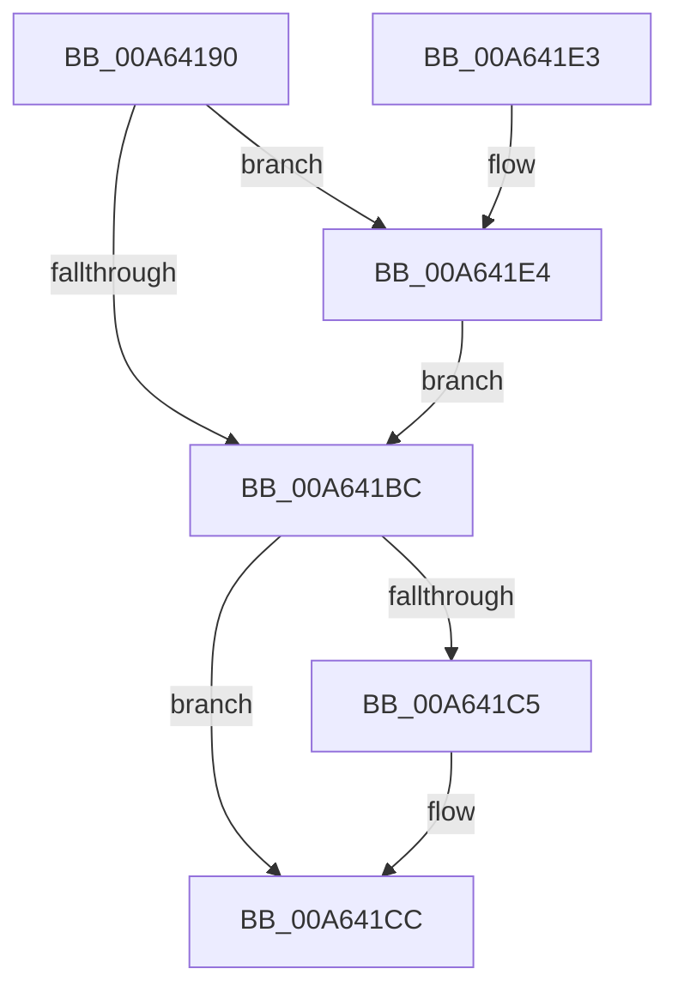

# IopRaiseInformationalHardError

- RVA: `0x00A64190`–`0x00A64211` (길이 `129` bytes)
- VA: `0x0000000140A64190`
- 실행 섹션: `PAGE`
- PDB 이름 있음: `예`; PDB Function 태그: `아니요`
- unwind 정보 RVA: `0x000B36A4`
- 디코드: `36`개 명령, `129/129` bytes 표시
- 미해석 바이트: `0` (있으면 어셈블리에 `.byte`로 보존)

> 이 문서는 커널 이미지의 기계어와 PDB 기호를 분석해 생성했습니다. 4번과 5번은 함수 원형과 자료형을 바이너리 사용 방식에서 추정한 C 해석이며 원본 소스 복구 결과는 아닙니다.

## 1. Dependencies

- 직접 호출 지점: **3**; 고유 호출 대상: **2**
- 직접 호출자로 확인된 함수: **0**
- RIP 상대 이미지 참조: **2**

### Outgoing calls
- `0x00A641C7` → [ExFreePoolWithTag](../../poolcode/B8/ExFreePoolWithTag_function_00B82870.md) (function, `0x00B82870`)
- `0x00A641D1` → [ExFreePoolWithTag](../../poolcode/B8/ExFreePoolWithTag_function_00B82870.md) (function, `0x00B82870`)
- `0x00A6420A` → [ExRaiseHardError](ExRaiseHardError_function_00A64520.md) (function, `0x00A64520`)

### Direct callers
- 이 함수 시작 RVA로 연결되는 직접 call은 확인되지 않았습니다. 간접 호출은 완전히 역산할 수 없습니다.

### Static image references
- `0x00A641B3` → RVA `0x00E685D0` (`.data`; read)
- `0x00A641D6` → RVA `0x00F8D7DC` (`.data`; read/write)

## 2. Other-region calls and transfers

- 다른 실행 섹션으로 향하는 call: **2**
  - `0x00A641C7` → [ExFreePoolWithTag](../../poolcode/B8/ExFreePoolWithTag_function_00B82870.md) (`PAGE` → `POOLCODE`)
  - `0x00A641D1` → [ExFreePoolWithTag](../../poolcode/B8/ExFreePoolWithTag_function_00B82870.md) (`PAGE` → `POOLCODE`)
- 별도 외부 분기/꼬리 이동을 확인하지 못했습니다.

## 3. Assembly (complete function range)

```asm
00A64190  40 53                           push rbx
00A64192  48 83 EC 30                     sub rsp, 0x30
00A64196  83 64 24 40 00                  and dword ptr [rsp + 0x40], 0
00A6419B  48 8D 41 18                     lea rax, [rcx + 0x18]
00A6419F  33 D2                           xor edx, edx
00A641A1  48 89 44 24 58                  mov qword ptr [rsp + 0x58], rax
00A641A6  48 8B 41 20                     mov rax, qword ptr [rcx + 0x20]
00A641AA  48 8B D9                        mov rbx, rcx
00A641AD  48 85 C0                        test rax, rax
00A641B0  0F 95 C2                        setne dl
00A641B3  80 3D 16 44 40 00 00            cmp byte ptr [rip + 0x404416], 0
00A641BA  75 28                           jne 0x140a641e4
00A641BC  48 8B 4B 20                     mov rcx, qword ptr [rbx + 0x20]
00A641C0  48 85 C9                        test rcx, rcx
00A641C3  74 07                           je 0x140a641cc
00A641C5  33 D2                           xor edx, edx
00A641C7  E8 A4 E6 11 00                  call 0x140b82870
00A641CC  33 D2                           xor edx, edx
00A641CE  48 8B CB                        mov rcx, rbx
00A641D1  E8 9A E6 11 00                  call 0x140b82870
00A641D6  F0 FF 0D FF 95 52 00            lock dec dword ptr [rip + 0x5295ff]
00A641DD  48 83 C4 30                     add rsp, 0x30
00A641E1  5B                              pop rbx
00A641E2  C3                              ret
00A641E3  CC                              int3
00A641E4  8B 49 10                        mov ecx, dword ptr [rcx + 0x10]
00A641E7  48 F7 D8                        neg rax
00A641EA  48 8D 44 24 58                  lea rax, [rsp + 0x58]
00A641EF  44 8B C2                        mov r8d, edx
00A641F2  4D 1B C9                        sbb r9, r9
00A641F5  4C 23 C8                        and r9, rax
00A641F8  48 8D 44 24 40                  lea rax, [rsp + 0x40]
00A641FD  48 89 44 24 28                  mov qword ptr [rsp + 0x28], rax
00A64202  C7 44 24 20 07 00 00 00         mov dword ptr [rsp + 0x20], 7
00A6420A  E8 11 03 00 00                  call 0x140a64520
00A6420F  EB AB                           jmp 0x140a641bc
```

## 4. C-style interpretation (structured pseudocode)

```c
__int64 __fastcall IopRaiseInformationalHardError(__int64 a1, int a2, __int64 a3, __int64 a4)
{
    __int64 result;
    __int64 v_rsp;
    unsigned __int64 v_stack_p20;
    unsigned __int64 v_stack_p28;
    unsigned __int64 v_stack_p40;
    unsigned __int64 v_stack_p58;
    unsigned int v_stack_p8;

    v_rsp = (v_rsp) - (48);
    a2 = 0;
    v_stack_p20 = a1 + 24;
    a2 = (*(unsigned __int64 *)(a1 + 32) != 0) ? 1 : 0;
    if ((*(unsigned __int8 *)(v_rip + 4211734)) != 0) goto loc_00A641E4;
loc_00A641BC:
    result = *(unsigned __int64 *)(a1 + 32);
    if (*(unsigned __int64 *)(a1 + 32) != 0) {
        a2 = 0;
        result = ExFreePoolWithTag(*(unsigned __int64 *)(a1 + 32), a2, a3, a4);
    }
    a2 = 0;
    result = ExFreePoolWithTag(a1, a2, a3, a4);
    v_rsp = (v_rsp) + (48);
    return result;
loc_00A641E4:
    result = -(result);
    a4 = (a4) & (v_stack_p58);
    v_stack_p28 = v_stack_p40;
    v_stack_p20 = 7;
    result = ExRaiseHardError((unsigned int)(*(unsigned int *)(a1 + 16)), a2, 0, a4);
    goto loc_00A641BC;
}
```

## 5. (Beta) C Style

```c
int64_t IopRaiseInformationalHardError(void *Arg1, int32_t Arg2, int64_t Arg3, int64_t Arg4)
{
    uint8_t *arg1 = (uint8_t *)Arg1;

    int64_t result;
    int64_t local_rsp;
    uint64_t v_stack_p20;
    uint64_t v_stack_p28;
    uint64_t v_stack_p40;
    uint64_t v_stack_p58;
    uint32_t v_stack_p8;

    local_rsp = (local_rsp) - (48);
    Arg2 = 0;
    v_stack_p20 = Arg1 + 24;
    Arg2 = (*(uint64_t *)(arg1 + 0x20) != 0) ? 1 : 0;
    if ((*(uint8_t *)(v_rip + 0x404416)) != 0) goto loc_00A641E4;
loc_00A641BC:
    result = *(uint64_t *)(arg1 + 0x20);
    if (*(uint64_t *)(arg1 + 0x20) != 0) {
        Arg2 = 0;
        result = ExFreePoolWithTag(*(uint64_t *)(arg1 + 0x20), Arg2, Arg3, Arg4);
    }
    Arg2 = 0;
    result = ExFreePoolWithTag(Arg1, Arg2, Arg3, Arg4);
    local_rsp = (local_rsp) + (48);
    return result;
loc_00A641E4:
    result = -(result);
    Arg4 = (Arg4) & (v_stack_p58);
    v_stack_p28 = v_stack_p40;
    v_stack_p20 = 7;
    result = ExRaiseHardError((uint32_t)(*(uint32_t *)(arg1 + 0x10)), Arg2, 0, Arg4);
    goto loc_00A641BC;
}
```

### 관측된 메모리 오프셋

구조체 형식이 확인되지 않은 접근은 인자 기준의 오프셋으로만 기록했습니다.

| 기준 인자 | 오프셋 표현 | 폭 (bit) | 접근 |
|---|---:|---:|---|
| `Arg1` | `+ 0x10` | `32` | `R` |
| `Arg1` | `+ 0x18` | `64` | `R` |
| `Arg1` | `+ 0x20` | `64` | `R` |

## 6. Execution-region graph

[열기: 2D/3D 그래프와 함수 탐색 컨트롤 패널](../../../control-panel.html?section=page&rva=0x00A64190&view=graph)

- 2D 그래프는 위에서 아래로 흐르고, 3D 그래프는 빈 공간을 드래그해 회전합니다. Shift+드래그는 이동, 휠은 확대·축소, 함수 노드 선택은 대상 보고서 이동입니다.

### Static fallback


