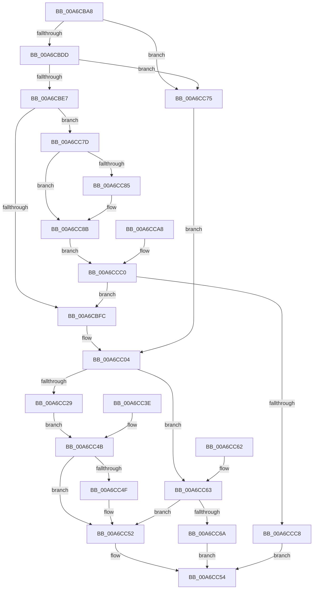

# IopRetrieveSystemDeviceName

- RVA: `0x00A6CBA8`–`0x00A6CCCA` (길이 `290` bytes)
- VA: `0x0000000140A6CBA8`
- 실행 섹션: `PAGE`
- PDB 이름 있음: `예`; PDB Function 태그: `아니요`
- unwind 정보 RVA: `0x000B4598`
- 디코드: `90`개 명령, `290/290` bytes 표시
- 미해석 바이트: `0` (있으면 어셈블리에 `.byte`로 보존)

> 이 문서는 커널 이미지의 기계어와 PDB 기호를 분석해 생성했습니다. 4번과 5번은 함수 원형과 자료형을 바이너리 사용 방식에서 추정한 C 해석이며 원본 소스 복구 결과는 아닙니다.

## 1. Dependencies

- 직접 호출 지점: **2**; 고유 호출 대상: **2**
- 직접 호출자로 확인된 함수: **1**
- RIP 상대 이미지 참조: **0**

### Outgoing calls
- `0x00A6CC1E` → [guard_dispatch_icall](../../text/6B/guard_dispatch_icall_function_006BAAD0.md) (function, `0x006BAAD0`)
- `0x00A6CC85` → [ExRaiseDatatypeMisalignment](../89/ExRaiseDatatypeMisalignment_function_00899FD0.md) (function, `0x00899FD0`)

### Direct callers
- [IoQuerySystemDeviceName](IoQuerySystemDeviceName_function_00A6CB24.md) at `0x00A6CB5D`

### Static image references
- 디코드된 RIP-relative 메모리 참조가 없습니다.

## 2. Other-region calls and transfers

- 다른 실행 섹션으로 향하는 call: **1**
  - `0x00A6CC1E` → [guard_dispatch_icall](../../text/6B/guard_dispatch_icall_function_006BAAD0.md) (`PAGE` → `.text`)
- 별도 외부 분기/꼬리 이동을 확인하지 못했습니다.

## 3. Assembly (complete function range)

```asm
00A6CBA8  48 8B C4                        mov rax, rsp
00A6CBAB  4C 89 48 20                     mov qword ptr [rax + 0x20], r9
00A6CBAF  44 89 40 18                     mov dword ptr [rax + 0x18], r8d
00A6CBB3  48 89 50 10                     mov qword ptr [rax + 0x10], rdx
00A6CBB7  48 89 48 08                     mov qword ptr [rax + 8], rcx
00A6CBBB  53                              push rbx
00A6CBBC  56                              push rsi
00A6CBBD  57                              push rdi
00A6CBBE  41 56                           push r14
00A6CBC0  41 57                           push r15
00A6CBC2  48 83 EC 30                     sub rsp, 0x30
00A6CBC6  49 8B F1                        mov rsi, r9
00A6CBC9  48 8B FA                        mov rdi, rdx
00A6CBCC  4C 8B C9                        mov r9, rcx
00A6CBCF  33 DB                           xor ebx, ebx
00A6CBD1  89 58 C8                        mov dword ptr [rax - 0x38], ebx
00A6CBD4  48 85 D2                        test rdx, rdx
00A6CBD7  0F 84 98 00 00 00               je 0x140a6cc75
00A6CBDD  41 83 F8 10                     cmp r8d, 0x10
00A6CBE1  0F 86 8E 00 00 00               jbe 0x140a6cc75
00A6CBE7  65 48 8B 04 25 88 01 00 00      mov rax, qword ptr gs:[0x188]
00A6CBF0  38 98 32 02 00 00               cmp byte ptr [rax + 0x232], bl
00A6CBF6  0F 85 81 00 00 00               jne 0x140a6cc7d
00A6CBFC  45 8D 70 F0                     lea r14d, [r8 - 0x10]
00A6CC00  4C 8D 7F 10                     lea r15, [rdi + 0x10]
00A6CC04  B8 FF FF 00 00                  mov eax, 0xffff
00A6CC09  44 3B F0                        cmp r14d, eax
00A6CC0C  44 0F 47 F0                     cmova r14d, eax
00A6CC10  4C 8D 44 24 20                  lea r8, [rsp + 0x20]
00A6CC15  41 8B D6                        mov edx, r14d
00A6CC18  49 8B CF                        mov rcx, r15
00A6CC1B  49 8B C1                        mov rax, r9
00A6CC1E  E8 AD DE C4 FF                  call 0x1406baad0
00A6CC23  8B D0                           mov edx, eax
00A6CC25  85 C0                           test eax, eax
00A6CC27  78 3A                           js 0x140a6cc63
00A6CC29  8B 44 24 20                     mov eax, dword ptr [rsp + 0x20]
00A6CC2D  8D 48 FE                        lea ecx, [rax - 2]
00A6CC30  66 89 0F                        mov word ptr [rdi], cx
00A6CC33  66 44 89 77 02                  mov word ptr [rdi + 2], r14w
00A6CC38  4C 89 7F 08                     mov qword ptr [rdi + 8], r15
00A6CC3C  EB 0D                           jmp 0x140a6cc4b
00A6CC3E  8B D0                           mov edx, eax
00A6CC40  33 DB                           xor ebx, ebx
00A6CC42  48 8B 74 24 78                  mov rsi, qword ptr [rsp + 0x78]
00A6CC47  8B 44 24 20                     mov eax, dword ptr [rsp + 0x20]
00A6CC4B  85 D2                           test edx, edx
00A6CC4D  78 03                           js 0x140a6cc52
00A6CC4F  8D 58 10                        lea ebx, [rax + 0x10]
00A6CC52  89 1E                           mov dword ptr [rsi], ebx
00A6CC54  8B C2                           mov eax, edx
00A6CC56  48 83 C4 30                     add rsp, 0x30
00A6CC5A  41 5F                           pop r15
00A6CC5C  41 5E                           pop r14
00A6CC5E  5F                              pop rdi
00A6CC5F  5E                              pop rsi
00A6CC60  5B                              pop rbx
00A6CC61  C3                              ret
00A6CC62  CC                              int3
00A6CC63  3D 23 00 00 C0                  cmp eax, 0xc0000023
00A6CC68  75 E8                           jne 0x140a6cc52
00A6CC6A  8B 44 24 20                     mov eax, dword ptr [rsp + 0x20]
00A6CC6E  83 C0 10                        add eax, 0x10
00A6CC71  89 06                           mov dword ptr [rsi], eax
00A6CC73  EB DF                           jmp 0x140a6cc54
00A6CC75  44 8B F3                        mov r14d, ebx
00A6CC78  4C 8B FB                        mov r15, rbx
00A6CC7B  EB 87                           jmp 0x140a6cc04
00A6CC7D  8B D3                           mov edx, ebx
00A6CC7F  40 F6 C7 07                     test dil, 7
00A6CC83  74 06                           je 0x140a6cc8b
00A6CC85  E8 46 D3 E2 FF                  call 0x140899fd0
00A6CC8A  CC                              int3
00A6CC8B  48 B9 00 00 FF FF FF 7F 00 00   movabs rcx, 0x7fffffff0000
00A6CC95  48 3B F9                        cmp rdi, rcx
00A6CC98  48 0F 42 CF                     cmovb rcx, rdi
00A6CC9C  8A 01                           mov al, byte ptr [rcx]
00A6CC9E  88 01                           mov byte ptr [rcx], al
00A6CCA0  8A 41 0F                        mov al, byte ptr [rcx + 0xf]
00A6CCA3  88 41 0F                        mov byte ptr [rcx + 0xf], al
00A6CCA6  EB 18                           jmp 0x140a6ccc0
00A6CCA8  8B D0                           mov edx, eax
00A6CCAA  33 DB                           xor ebx, ebx
00A6CCAC  48 8B 74 24 78                  mov rsi, qword ptr [rsp + 0x78]
00A6CCB1  44 8B 44 24 70                  mov r8d, dword ptr [rsp + 0x70]
00A6CCB6  48 8B 7C 24 68                  mov rdi, qword ptr [rsp + 0x68]
00A6CCBB  4C 8B 4C 24 60                  mov r9, qword ptr [rsp + 0x60]
00A6CCC0  85 D2                           test edx, edx
00A6CCC2  0F 89 34 FF FF FF               jns 0x140a6cbfc
00A6CCC8  EB 8A                           jmp 0x140a6cc54
```

## 4. C-style interpretation (structured pseudocode)

```c
__int64 __fastcall IopRetrieveSystemDeviceName(__int64 a1, __int64 a2, __int64 a3, __int64 a4)
{
    __int64 result;
    __int64 v_r14;
    __int64 v_rbx;
    __int64 v_rsp;
    unsigned __int64 v_stack_m38;
    unsigned __int64 v_stack_p20;
    unsigned __int64 v_stack_p60;
    unsigned __int64 v_stack_p68;
    unsigned int v_stack_p70;
    unsigned __int64 v_stack_p78;

    *(unsigned __int64 *)(v_rsp + 32) = a4;
    *(unsigned int *)(v_rsp + 24) = (unsigned int)(a3);
    *(unsigned __int64 *)(v_rsp + 16) = a2;
    *(unsigned __int64 *)(v_rsp + 8) = a1;
    v_rsp = (v_rsp) - (48);
    v_rbx = 0;
    *(unsigned int *)(v_rsp - 56) = 0;
    if (a2 == 0) goto loc_00A6CC75;
    if (((unsigned int)(a3)) <= 16) goto loc_00A6CC75;
    if ((*(unsigned __int8 *)(*(unsigned __int64 *)(gs_base + (0 + 392)) + 562)) != 0) goto loc_00A6CC7D;
loc_00A6CBFC:
loc_00A6CC04:
    v_r14 = a3 - 16;
    if (((unsigned int)(a3 - 16)) > ((unsigned int)((unsigned int)(0xFFFFULL)))) { v_r14 = (unsigned int)((unsigned int)(0xFFFFULL)); }
    result = guard_dispatch_icall(a2 + 16, (unsigned int)((unsigned int)(v_r14)), v_stack_m38, a1);
    if (sign_flag) goto loc_00A6CC63;
    *(unsigned __int16 *)(a2) = (unsigned __int16)((unsigned int)(v_stack_m38) - 2);
    *(unsigned __int16 *)(a2 + 2) = (unsigned __int16)(v_r14);
    *(unsigned __int64 *)(a2 + 8) = a2 + 16;
    goto loc_00A6CC4B;
loc_00A6CC4B:
    if (!(sign_flag)) {
        v_rbx = (unsigned int)(v_stack_m38) + 16;
    }
    *(unsigned int *)(a4) = (unsigned int)(v_rbx);
loc_00A6CC54:
    v_rsp = (v_rsp) + (48);
    return (unsigned int)((unsigned int)((unsigned int)((unsigned int)(result))));
loc_00A6CC63:
    if (((unsigned int)((unsigned int)((unsigned int)((unsigned int)((unsigned int)(result)))))) != 0xC0000023ULL) goto loc_00A6CC52;
    result = (unsigned int)(((unsigned int)(v_stack_p20)) + (16));
    *(unsigned int *)(a4) = (unsigned int)(result);
    goto loc_00A6CC54;
loc_00A6CC75:
    goto loc_00A6CC04;
loc_00A6CC7D:
    if ((((unsigned __int8)(a2)) & (7)) != 0) {
        result = ExRaiseDatatypeMisalignment((unsigned int)(v_stack_m38) - 2, (unsigned int)((unsigned int)(v_rbx)), v_stack_m38, a1);
    }
    a1 = (unsigned int)(v_stack_m38) - 2;
    if (a2 < ((unsigned int)(v_stack_m38) - 2)) { a1 = a2; }
    *(unsigned __int8 *)(a1) = (unsigned __int8)(*(unsigned __int8 *)(a1));
    *(unsigned __int8 *)(a1 + 15) = (unsigned __int8)(*(unsigned __int8 *)(a1 + 15));
    goto loc_00A6CCC0;
loc_00A6CCC0:
    if (!sign_flag) goto loc_00A6CBFC;
    goto loc_00A6CC54;
}
```

## 5. (Beta) C Style

```c
int64_t IopRetrieveSystemDeviceName(int64_t Arg1, int64_t Arg2, int64_t Arg3, void *Arg4)
{
    uint8_t *arg4 = (uint8_t *)Arg4;

    int64_t result;
    int64_t local_r14;
    int64_t local_rbx;
    int64_t local_rsp;
    uint64_t v_stack_m38;
    uint64_t v_stack_p20;
    uint64_t v_stack_p60;
    uint64_t v_stack_p68;
    uint32_t v_stack_p70;
    uint64_t v_stack_p78;

    *(void **)(local_rsp + 0x20) = Arg4;
    *(uint32_t *)(local_rsp + 0x18) = (uint32_t)(Arg3);
    *(uint64_t *)(local_rsp + 0x10) = Arg2;
    *(uint64_t *)(local_rsp + 0x8) = Arg1;
    local_rsp = (local_rsp) - (48);
    local_rbx = 0;
    *(uint32_t *)(local_rsp - 0x38) = 0;
    if (Arg2 == 0) goto loc_00A6CC75;
    if (((uint32_t)(Arg3)) <= 16) goto loc_00A6CC75;
    if ((*(uint8_t *)(*(uint64_t *)(gs_base + (0 + 0x188)) + 0x232)) != 0) goto loc_00A6CC7D;
loc_00A6CBFC:
loc_00A6CC04:
    local_r14 = Arg3 - 16;
    if (((uint32_t)(Arg3 - 16)) > ((uint32_t)((uint32_t)(0xFFFFULL)))) { local_r14 = (uint32_t)((uint32_t)(0xFFFFULL)); }
    result = guard_dispatch_icall(Arg2 + 16, (uint32_t)((uint32_t)(local_r14)), v_stack_m38, Arg1);
    if (sign_flag) goto loc_00A6CC63;
    *(uint16_t *)(Arg2) = (uint16_t)((uint32_t)(v_stack_m38) - 2);
    *(uint16_t *)(Arg2 + 0x2) = (uint16_t)(local_r14);
    *(uint64_t *)(Arg2 + 0x8) = Arg2 + 16;
    goto loc_00A6CC4B;
loc_00A6CC4B:
    if (!(sign_flag)) {
        local_rbx = (uint32_t)(v_stack_m38) + 16;
    }
    *(uint32_t *)(arg4) = (uint32_t)(local_rbx);
loc_00A6CC54:
    local_rsp = (local_rsp) + (48);
    return (uint32_t)((uint32_t)((uint32_t)((uint32_t)(result))));
loc_00A6CC63:
    if (((uint32_t)((uint32_t)((uint32_t)((uint32_t)((uint32_t)(result)))))) != 0xC0000023ULL) goto loc_00A6CC52;
    result = (uint32_t)(((uint32_t)(v_stack_p20)) + (16));
    *(uint32_t *)(arg4) = (uint32_t)(result);
    goto loc_00A6CC54;
loc_00A6CC75:
    goto loc_00A6CC04;
loc_00A6CC7D:
    if ((((uint8_t)(Arg2)) & (7)) != 0) {
        result = ExRaiseDatatypeMisalignment((uint32_t)(v_stack_m38) - 2, (uint32_t)((uint32_t)(local_rbx)), v_stack_m38, Arg1);
    }
    Arg1 = (uint32_t)(v_stack_m38) - 2;
    if (Arg2 < ((uint32_t)(v_stack_m38) - 2)) { Arg1 = Arg2; }
    *(uint8_t *)(Arg1) = (uint8_t)(*(uint8_t *)(Arg1));
    *(uint8_t *)(Arg1 + 0xF) = (uint8_t)(*(uint8_t *)(Arg1 + 0xF));
    goto loc_00A6CCC0;
loc_00A6CCC0:
    if (!sign_flag) goto loc_00A6CBFC;
    goto loc_00A6CC54;
}
```

### 관측된 메모리 오프셋

구조체 형식이 확인되지 않은 접근은 인자 기준의 오프셋으로만 기록했습니다.

| 기준 인자 | 오프셋 표현 | 폭 (bit) | 접근 |
|---|---:|---:|---|
| `Arg4` | `+ 0x0` | `32` | `W` |

## 6. Execution-region graph

[열기: 2D/3D 그래프와 함수 탐색 컨트롤 패널](../../../control-panel.html?section=page&rva=0x00A6CBA8&view=graph)

- 2D 그래프는 위에서 아래로 흐르고, 3D 그래프는 빈 공간을 드래그해 회전합니다. Shift+드래그는 이동, 휠은 확대·축소, 함수 노드 선택은 대상 보고서 이동입니다.

### Static fallback


