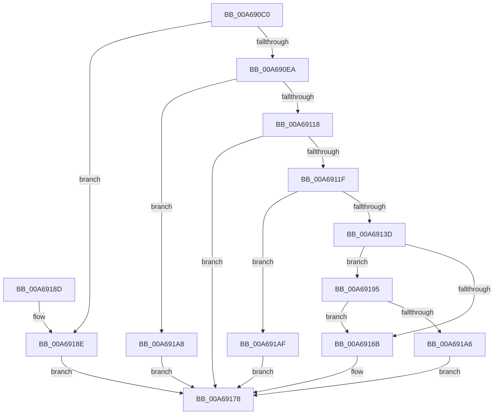

# KGetAppModelStateSeparatedRegKeyPath

- RVA: `0x00A690C0`–`0x00A691B6` (길이 `246` bytes)
- VA: `0x0000000140A690C0`
- 실행 섹션: `PAGE`
- PDB 이름 있음: `예`; PDB Function 태그: `아니요`
- unwind 정보 RVA: `0x000B4030`
- 디코드: `71`개 명령, `246/246` bytes 표시
- 미해석 바이트: `0` (있으면 어셈블리에 `.byte`로 보존)

> 이 문서는 커널 이미지의 기계어와 PDB 기호를 분석해 생성했습니다. 4번과 5번은 함수 원형과 자료형을 바이너리 사용 방식에서 추정한 C 해석이며 원본 소스 복구 결과는 아닙니다.

## 1. Dependencies

- 직접 호출 지점: **5**; 고유 호출 대상: **4**
- 직접 호출자로 확인된 함수: **2**
- RIP 상대 이미지 참조: **1**

### Outgoing calls
- `0x00A69109` → [RtlGetPersistedStateLocation](../8C/RtlGetPersistedStateLocation_function_008C8DE0.md) (function, `0x008C8DE0`)
- `0x00A69130` → [ExAllocatePoolWithTag](../../poolcode/B8/ExAllocatePoolWithTag_function_00B82010.md) (function, `0x00B82010`)
- `0x00A69160` → [RtlGetPersistedStateLocation](../8C/RtlGetPersistedStateLocation_function_008C8DE0.md) (function, `0x008C8DE0`)
- `0x00A69173` → [ExFreePoolWithTag](../../poolcode/B8/ExFreePoolWithTag_function_00B82870.md) (function, `0x00B82870`)
- `0x00A6919B` → [RtlInitUnicodeStringEx](../../text/46/RtlInitUnicodeStringEx_function_00463960.md) (function, `0x00463960`)

### Direct callers
- [KIsSideloadingEnabled](../7D/KIsSideloadingEnabled_function_007D9DD8.md) at `0x007D9E2F`
- [KIsUnlockSettingEnabled](KIsUnlockSettingEnabled_function_00A68F54.md) at `0x00A68FBD`
- [KIsUnlockSettingEnabled](KIsUnlockSettingEnabled_function_00A68F54.md) at `0x00A69052`

### Static image references
- `0x00A690F5` → RVA `0x0001AA88` (`.rdata`; read)

## 2. Other-region calls and transfers

- 다른 실행 섹션으로 향하는 call: **3**
  - `0x00A69130` → [ExAllocatePoolWithTag](../../poolcode/B8/ExAllocatePoolWithTag_function_00B82010.md) (`PAGE` → `POOLCODE`)
  - `0x00A69173` → [ExFreePoolWithTag](../../poolcode/B8/ExFreePoolWithTag_function_00B82870.md) (`PAGE` → `POOLCODE`)
  - `0x00A6919B` → [RtlInitUnicodeStringEx](../../text/46/RtlInitUnicodeStringEx_function_00463960.md) (`PAGE` → `.text`)
- 별도 외부 분기/꼬리 이동을 확인하지 못했습니다.

## 3. Assembly (complete function range)

```asm
00A690C0  4C 8B DC                        mov r11, rsp
00A690C3  49 89 5B 08                     mov qword ptr [r11 + 8], rbx
00A690C7  49 89 6B 10                     mov qword ptr [r11 + 0x10], rbp
00A690CB  56                              push rsi
00A690CC  57                              push rdi
00A690CD  41 56                           push r14
00A690CF  48 83 EC 40                     sub rsp, 0x40
00A690D3  83 64 24 70 00                  and dword ptr [rsp + 0x70], 0
00A690D8  49 8B F0                        mov rsi, r8
00A690DB  48 8B EA                        mov rbp, rdx
00A690DE  4C 8B F1                        mov r14, rcx
00A690E1  4D 85 C0                        test r8, r8
00A690E4  0F 84 A4 00 00 00               je 0x140a6918e
00A690EA  49 8D 43 18                     lea rax, [r11 + 0x18]
00A690EE  4C 8B C2                        mov r8, rdx
00A690F1  49 89 43 D8                     mov qword ptr [r11 - 0x28], rax
00A690F5  48 8D 15 8C 19 5B FF            lea rdx, [rip - 0xa4e674]
00A690FC  83 64 24 28 00                  and dword ptr [rsp + 0x28], 0
00A69101  45 33 C9                        xor r9d, r9d
00A69104  49 83 63 C8 00                  and qword ptr [r11 - 0x38], 0
00A69109  E8 D2 FC E5 FF                  call 0x1408c8de0
00A6910E  8B D8                           mov ebx, eax
00A69110  85 C0                           test eax, eax
00A69112  0F 89 90 00 00 00               jns 0x140a691a8
00A69118  3D 05 00 00 80                  cmp eax, 0x80000005
00A6911D  75 59                           jne 0x140a69178
00A6911F  8B 5C 24 70                     mov ebx, dword ptr [rsp + 0x70]
00A69123  B9 01 00 00 00                  mov ecx, 1
00A69128  8B D3                           mov edx, ebx
00A6912A  41 B8 41 70 70 4D               mov r8d, 0x4d707041
00A69130  E8 DB 8E 11 00                  call 0x140b82010
00A69135  48 8B F8                        mov rdi, rax
00A69138  48 85 C0                        test rax, rax
00A6913B  74 72                           je 0x140a691af
00A6913D  48 8D 44 24 70                  lea rax, [rsp + 0x70]
00A69142  45 33 C9                        xor r9d, r9d
00A69145  48 89 44 24 30                  mov qword ptr [rsp + 0x30], rax
00A6914A  48 8D 15 37 19 5B FF            lea rdx, [rip - 0xa4e6c9]
00A69151  89 5C 24 28                     mov dword ptr [rsp + 0x28], ebx
00A69155  4C 8B C5                        mov r8, rbp
00A69158  49 8B CE                        mov rcx, r14
00A6915B  48 89 7C 24 20                  mov qword ptr [rsp + 0x20], rdi
00A69160  E8 7B FC E5 FF                  call 0x1408c8de0
00A69165  8B D8                           mov ebx, eax
00A69167  85 C0                           test eax, eax
00A69169  79 2A                           jns 0x140a69195
00A6916B  BA 41 70 70 4D                  mov edx, 0x4d707041
00A69170  48 8B CF                        mov rcx, rdi
00A69173  E8 F8 96 11 00                  call 0x140b82870
00A69178  48 8B 6C 24 68                  mov rbp, qword ptr [rsp + 0x68]
00A6917D  8B C3                           mov eax, ebx
00A6917F  48 8B 5C 24 60                  mov rbx, qword ptr [rsp + 0x60]
00A69184  48 83 C4 40                     add rsp, 0x40
00A69188  41 5E                           pop r14
00A6918A  5F                              pop rdi
00A6918B  5E                              pop rsi
00A6918C  C3                              ret
00A6918D  CC                              int3
00A6918E  BB 0D 00 00 C0                  mov ebx, 0xc000000d
00A69193  EB E3                           jmp 0x140a69178
00A69195  48 8B D7                        mov rdx, rdi
00A69198  48 8B CE                        mov rcx, rsi
00A6919B  E8 C0 A7 9F FF                  call 0x140463960
00A691A0  8B D8                           mov ebx, eax
00A691A2  85 C0                           test eax, eax
00A691A4  78 C5                           js 0x140a6916b
00A691A6  EB D0                           jmp 0x140a69178
00A691A8  BB 01 00 00 C0                  mov ebx, 0xc0000001
00A691AD  EB C9                           jmp 0x140a69178
00A691AF  BB 9A 00 00 C0                  mov ebx, 0xc000009a
00A691B4  EB C2                           jmp 0x140a69178
```

## 4. C-style interpretation (structured pseudocode)

```c
__int64 __fastcall KGetAppModelStateSeparatedRegKeyPath(__int64 a1, __int64 a2, __int64 a3, int a4)
{
    __int64 result;
    __int64 v_rsp;
    unsigned __int64 v_stack_m28;
    unsigned int v_stack_m30;
    unsigned __int64 v_stack_m38;
    unsigned __int64 v_stack_p10;
    unsigned int v_stack_p18;
    unsigned __int64 v_stack_p8;

    *(unsigned __int64 *)(v_rsp + 8) = v_rbx;
    *(unsigned __int64 *)(v_rsp + 16) = v_rbp;
    v_rsp = (v_rsp) - (64);
    if (a3 == 0) goto loc_00A6918E;
    *(unsigned __int64 *)(v_rsp - 40) = v_rsp + 24;
    a4 = 0;
    result = RtlGetPersistedStateLocation(a1, v_rip - 10806900, a2, a4);
    if (!sign_flag) goto loc_00A691A8;
    if (((unsigned int)(result)) != 0x80000005ULL) goto loc_00A69178;
    result = ExAllocatePoolWithTag(1, (unsigned int)((unsigned int)((unsigned int)(v_stack_p18))), (unsigned int)(0x4D707041ULL), a4);
    if (result == 0) goto loc_00A691AF;
    a4 = 0;
    v_stack_m28 = v_stack_p18;
    v_stack_m30 = (unsigned int)((unsigned int)(v_stack_p18));
    v_stack_m38 = result;
    result = RtlGetPersistedStateLocation(a1, v_rip - 10806985, a2, a4);
    if (!sign_flag) goto loc_00A69195;
loc_00A6916B:
    result = ExFreePoolWithTag(result, (unsigned int)(0x4D707041ULL), a2, a4);
loc_00A69178:
    v_rsp = (v_rsp) + (64);
    return (unsigned int)((unsigned int)((unsigned int)((unsigned int)(result))));
loc_00A6918E:
    goto loc_00A69178;
loc_00A69195:
    result = RtlInitUnicodeStringEx(a3, result, a2, a4);
    if (sign_flag) goto loc_00A6916B;
    goto loc_00A69178;
loc_00A691A8:
    goto loc_00A69178;
loc_00A691AF:
    goto loc_00A69178;
}
```

## 5. (Beta) C Style

```c
int64_t KGetAppModelStateSeparatedRegKeyPath(int64_t Arg1, int64_t Arg2, int64_t Arg3, int32_t Arg4)
{
    int64_t result;
    int64_t local_rsp;
    uint64_t v_stack_m28;
    uint32_t v_stack_m30;
    uint64_t v_stack_m38;
    uint64_t v_stack_p10;
    uint32_t v_stack_p18;
    uint64_t v_stack_p8;

    *(uint64_t *)(local_rsp + 0x8) = local_rbx;
    *(uint64_t *)(local_rsp + 0x10) = local_rbp;
    local_rsp = (local_rsp) - (64);
    if (Arg3 == 0) goto loc_00A6918E;
    *(uint64_t *)(local_rsp - 0x28) = local_rsp + 24;
    Arg4 = 0;
    result = RtlGetPersistedStateLocation(Arg1, v_rip - 10806900, Arg2, Arg4);
    if (!sign_flag) goto loc_00A691A8;
    if (((uint32_t)(result)) != 0x80000005ULL) goto loc_00A69178;
    result = ExAllocatePoolWithTag(1, (uint32_t)((uint32_t)((uint32_t)(v_stack_p18))), (uint32_t)(0x4D707041ULL), Arg4);
    if (result == 0) goto loc_00A691AF;
    Arg4 = 0;
    v_stack_m28 = v_stack_p18;
    v_stack_m30 = (uint32_t)((uint32_t)(v_stack_p18));
    v_stack_m38 = result;
    result = RtlGetPersistedStateLocation(Arg1, v_rip - 10806985, Arg2, Arg4);
    if (!sign_flag) goto loc_00A69195;
loc_00A6916B:
    result = ExFreePoolWithTag(result, (uint32_t)(0x4D707041ULL), Arg2, Arg4);
loc_00A69178:
    local_rsp = (local_rsp) + (64);
    return (uint32_t)((uint32_t)((uint32_t)((uint32_t)(result))));
loc_00A6918E:
    goto loc_00A69178;
loc_00A69195:
    result = RtlInitUnicodeStringEx(Arg3, result, Arg2, Arg4);
    if (sign_flag) goto loc_00A6916B;
    goto loc_00A69178;
loc_00A691A8:
    goto loc_00A69178;
loc_00A691AF:
    goto loc_00A69178;
}
```

## 6. Execution-region graph

[열기: 2D/3D 그래프와 함수 탐색 컨트롤 패널](../../../control-panel.html?section=page&rva=0x00A690C0&view=graph)

- 2D 그래프는 위에서 아래로 흐르고, 3D 그래프는 빈 공간을 드래그해 회전합니다. Shift+드래그는 이동, 휠은 확대·축소, 함수 노드 선택은 대상 보고서 이동입니다.

### Static fallback


