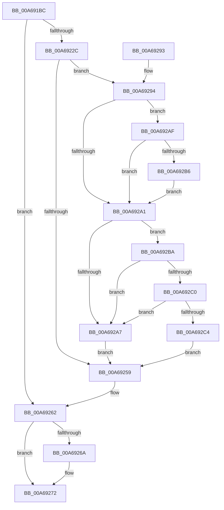

# KGetUnlockSetting

- RVA: `0x00A691BC`–`0x00A692C8` (길이 `268` bytes)
- VA: `0x0000000140A691BC`
- 실행 섹션: `PAGE`
- PDB 이름 있음: `예`; PDB Function 태그: `아니요`
- unwind 정보 RVA: `0x000B4048`
- 디코드: `74`개 명령, `268/268` bytes 표시
- 미해석 바이트: `0` (있으면 어셈블리에 `.byte`로 보존)

> 이 문서는 커널 이미지의 기계어와 PDB 기호를 분석해 생성했습니다. 4번과 5번은 함수 원형과 자료형을 바이너리 사용 방식에서 추정한 C 해석이며 원본 소스 복구 결과는 아닙니다.

## 1. Dependencies

- 직접 호출 지점: **4**; 고유 호출 대상: **4**
- 직접 호출자로 확인된 함수: **2**
- RIP 상대 이미지 참조: **1**

### Outgoing calls
- `0x00A69221` → [ZwOpenKey](../../text/6A/ZwOpenKey_function_006AD310.md) (function, `0x006AD310`)
- `0x00A6924E` → [ZwQueryValueKey](../../text/6A/ZwQueryValueKey_function_006AD3B0.md) (function, `0x006AD3B0`)
- `0x00A6925D` → [ZwClose](../../text/6A/ZwClose_function_006AD2B0.md) (function, `0x006AD2B0`)
- `0x00A6927B` → [_security_check_cookie](../../text/6A/_security_check_cookie_function_006AC640.md) (function, `0x006AC640`)

### Direct callers
- [KIsSideloadingEnabled](../7D/KIsSideloadingEnabled_function_007D9DD8.md) at `0x007D9E46`
- [KIsSideloadingEnabled](../7D/KIsSideloadingEnabled_function_007D9DD8.md) at `0x007D9E70`
- [KIsUnlockSettingEnabled](KIsUnlockSettingEnabled_function_00A68F54.md) at `0x00A68FD2`
- [KIsUnlockSettingEnabled](KIsUnlockSettingEnabled_function_00A68F54.md) at `0x00A69034`
- [KIsUnlockSettingEnabled](KIsUnlockSettingEnabled_function_00A68F54.md) at `0x00A69067`
- [KIsUnlockSettingEnabled](KIsUnlockSettingEnabled_function_00A68F54.md) at `0x00A69096`

### Static image references
- `0x00A691D0` → RVA `0x00E0A740` (`.data`; read)

## 2. Other-region calls and transfers

- 다른 실행 섹션으로 향하는 call: **4**
  - `0x00A69221` → [ZwOpenKey](../../text/6A/ZwOpenKey_function_006AD310.md) (`PAGE` → `.text`)
  - `0x00A6924E` → [ZwQueryValueKey](../../text/6A/ZwQueryValueKey_function_006AD3B0.md) (`PAGE` → `.text`)
  - `0x00A6925D` → [ZwClose](../../text/6A/ZwClose_function_006AD2B0.md) (`PAGE` → `.text`)
  - `0x00A6927B` → [_security_check_cookie](../../text/6A/_security_check_cookie_function_006AC640.md) (`PAGE` → `.text`)
- 별도 외부 분기/꼬리 이동을 확인하지 못했습니다.

## 3. Assembly (complete function range)

```asm
00A691BC  48 89 5C 24 20                  mov qword ptr [rsp + 0x20], rbx
00A691C1  55                              push rbp
00A691C2  56                              push rsi
00A691C3  57                              push rdi
00A691C4  48 8D 6C 24 B9                  lea rbp, [rsp - 0x47]
00A691C9  48 81 EC 90 00 00 00            sub rsp, 0x90
00A691D0  48 8B 05 69 15 3A 00            mov rax, qword ptr [rip + 0x3a1569]
00A691D7  48 33 C4                        xor rax, rsp
00A691DA  48 89 45 3F                     mov qword ptr [rbp + 0x3f], rax
00A691DE  83 65 FB 00                     and dword ptr [rbp - 5], 0
00A691E2  49 8B F8                        mov rdi, r8
00A691E5  83 65 13 00                     and dword ptr [rbp + 0x13], 0
00A691E9  4C 8D 45 F7                     lea r8, [rbp - 9]
00A691ED  48 83 65 EF 00                  and qword ptr [rbp - 0x11], 0
00A691F2  48 8B F2                        mov rsi, rdx
00A691F5  83 65 E7 00                     and dword ptr [rbp - 0x19], 0
00A691F9  0F 57 C0                        xorps xmm0, xmm0
00A691FC  48 83 65 FF 00                  and qword ptr [rbp - 1], 0
00A69201  BA 19 01 02 00                  mov edx, 0x20119
00A69206  48 89 4D 07                     mov qword ptr [rbp + 7], rcx
00A6920A  48 8D 4D EF                     lea rcx, [rbp - 0x11]
00A6920E  F3 0F 7F 45 17                  movdqu xmmword ptr [rbp + 0x17], xmm0
00A69213  C7 45 F7 30 00 00 00            mov dword ptr [rbp - 9], 0x30
00A6921A  C7 45 0F 40 02 00 00            mov dword ptr [rbp + 0xf], 0x240
00A69221  E8 EA 40 C4 FF                  call 0x1406ad310
00A69226  8B D8                           mov ebx, eax
00A69228  85 C0                           test eax, eax
00A6922A  78 36                           js 0x140a69262
00A6922C  48 8B 4D EF                     mov rcx, qword ptr [rbp - 0x11]
00A69230  48 8D 45 E7                     lea rax, [rbp - 0x19]
00A69234  48 89 44 24 28                  mov qword ptr [rsp + 0x28], rax
00A69239  4C 8D 4D 27                     lea r9, [rbp + 0x27]
00A6923D  41 B8 02 00 00 00               mov r8d, 2
00A69243  C7 44 24 20 18 00 00 00         mov dword ptr [rsp + 0x20], 0x18
00A6924B  48 8B D6                        mov rdx, rsi
00A6924E  E8 5D 41 C4 FF                  call 0x1406ad3b0
00A69253  8B D8                           mov ebx, eax
00A69255  85 C0                           test eax, eax
00A69257  79 3B                           jns 0x140a69294
00A69259  48 8B 4D EF                     mov rcx, qword ptr [rbp - 0x11]
00A6925D  E8 4E 40 C4 FF                  call 0x1406ad2b0
00A69262  81 FB 34 00 00 C0               cmp ebx, 0xc0000034
00A69268  75 08                           jne 0x140a69272
00A6926A  C7 07 FF FF 00 00               mov dword ptr [rdi], 0xffff
00A69270  33 DB                           xor ebx, ebx
00A69272  8B C3                           mov eax, ebx
00A69274  48 8B 4D 3F                     mov rcx, qword ptr [rbp + 0x3f]
00A69278  48 33 CC                        xor rcx, rsp
00A6927B  E8 C0 33 C4 FF                  call 0x1406ac640
00A69280  48 8B 9C 24 C8 00 00 00         mov rbx, qword ptr [rsp + 0xc8]
00A69288  48 81 C4 90 00 00 00            add rsp, 0x90
00A6928F  5F                              pop rdi
00A69290  5E                              pop rsi
00A69291  5D                              pop rbp
00A69292  C3                              ret
00A69293  CC                              int3
00A69294  48 8B 45 33                     mov rax, qword ptr [rbp + 0x33]
00A69298  B9 01 00 00 00                  mov ecx, 1
00A6929D  3B C1                           cmp eax, ecx
00A6929F  77 0E                           ja 0x140a692af
00A692A1  83 7D 2B 04                     cmp dword ptr [rbp + 0x2b], 4
00A692A5  74 13                           je 0x140a692ba
00A692A7  C7 07 FF FF 00 00               mov dword ptr [rdi], 0xffff
00A692AD  EB AA                           jmp 0x140a69259
00A692AF  3D FF FF 00 00                  cmp eax, 0xffff
00A692B4  74 EB                           je 0x140a692a1
00A692B6  32 C9                           xor cl, cl
00A692B8  EB E7                           jmp 0x140a692a1
00A692BA  83 7D 2F 04                     cmp dword ptr [rbp + 0x2f], 4
00A692BE  72 E7                           jb 0x140a692a7
00A692C0  84 C9                           test cl, cl
00A692C2  74 E3                           je 0x140a692a7
00A692C4  89 07                           mov dword ptr [rdi], eax
00A692C6  EB 91                           jmp 0x140a69259
```

## 4. C-style interpretation (structured pseudocode)

```c
__int64 __fastcall KGetUnlockSetting(__int64 a1, __int64 a2, __int64 a3)
{
    __int64 result;
    __int64 v_rbx;
    __int64 v_rsp;
    unsigned __int64 v_stack_m20;
    unsigned __int64 v_stack_m2C;
    unsigned int v_stack_m30;
    unsigned int v_stack_m34;
    unsigned __int64 v_stack_m38;
    unsigned __int64 v_stack_m48;
    unsigned int v_stack_m4C;
    unsigned int v_stack_m50;
    unsigned __int64 v_stack_m58;
    unsigned __int64 v_stack_m5F;
    unsigned __int64 v_stack_m60;
    unsigned int v_stack_m64;
    unsigned __int64 v_stack_m68;
    unsigned __int64 v_stack_m70;
    unsigned int v_stack_m78;
    unsigned __int64 v_stack_m80;
    unsigned int v_stack_m88;
    unsigned __int64 v_stack_p20;

    v_stack_p20 = v_rbx;
    v_rsp = (v_rsp) - (144);
    result = (*(unsigned __int64 *)(v_rip + 3806569)) ^ (v_rsp);
    v_stack_m20 = result;
    v_stack_m58 = a1;
    v_stack_m48 = v_xmm0;
    v_stack_m68 = 48;
    v_stack_m50 = 576;
    result = ZwOpenKey(v_stack_m70, (unsigned int)(0x20119ULL), v_stack_m68, a4);
    if (sign_flag) goto loc_00A69262;
    v_stack_m80 = v_stack_m78;
    v_stack_m88 = 24;
    result = ZwQueryValueKey(v_stack_m70, a2, 2, v_stack_m38);
    if (!sign_flag) goto loc_00A69294;
loc_00A69259:
    result = ZwClose(v_stack_m70, a2, 2, v_stack_m38);
loc_00A69262:
    v_rbx = (unsigned int)((unsigned int)(result));
    if (((unsigned int)((unsigned int)((unsigned int)(result)))) == 0xC0000034ULL) {
        *(unsigned int *)(a3) = 0xFFFFULL;
        v_rbx = 0;
    }
    a1 = (v_stack_m20) ^ (v_rsp);
    result = _security_check_cookie(a1, a2, 2, v_stack_m38);
    v_rsp = (v_rsp) + (144);
    return result;
loc_00A69294:
    if (((unsigned int)(v_stack_m2C)) > 1) goto loc_00A692AF;
loc_00A692A1:
    if (v_stack_m34 == 4) goto loc_00A692BA;
loc_00A692A7:
    *(unsigned int *)(a3) = 0xFFFFULL;
    goto loc_00A69259;
loc_00A692AF:
    if (((unsigned int)(v_stack_m2C)) == 0xFFFFULL) goto loc_00A692A1;
    a1 = 0;
    goto loc_00A692A1;
loc_00A692BA:
    if (v_stack_m30 < 4) goto loc_00A692A7;
    if (0 == 0) goto loc_00A692A7;
    *(unsigned int *)(a3) = (unsigned int)(v_stack_m2C);
    goto loc_00A69259;
}
```

## 5. (Beta) C Style

```c
int64_t KGetUnlockSetting(int64_t Arg1, int64_t Arg2, void *Arg3)
{
    uint8_t *arg3 = (uint8_t *)Arg3;

    int64_t result;
    int64_t local_rbx;
    int64_t local_rsp;
    uint64_t v_stack_m20;
    uint64_t v_stack_m2C;
    uint32_t v_stack_m30;
    uint32_t v_stack_m34;
    uint64_t v_stack_m38;
    uint64_t v_stack_m48;
    uint32_t v_stack_m4C;
    uint32_t v_stack_m50;
    uint64_t v_stack_m58;
    uint64_t v_stack_m5F;
    uint64_t v_stack_m60;
    uint32_t v_stack_m64;
    uint64_t v_stack_m68;
    uint64_t v_stack_m70;
    uint32_t v_stack_m78;
    uint64_t v_stack_m80;
    uint32_t v_stack_m88;
    uint64_t v_stack_p20;

    v_stack_p20 = local_rbx;
    local_rsp = (local_rsp) - (144);
    result = (*(uint64_t *)(v_rip + 0x3A1569)) ^ (local_rsp);
    v_stack_m20 = result;
    v_stack_m58 = Arg1;
    v_stack_m48 = v_xmm0;
    v_stack_m68 = 48;
    v_stack_m50 = 576;
    result = ZwOpenKey(v_stack_m70, (uint32_t)(0x20119ULL), v_stack_m68, a4);
    if (sign_flag) goto loc_00A69262;
    v_stack_m80 = v_stack_m78;
    v_stack_m88 = 24;
    result = ZwQueryValueKey(v_stack_m70, Arg2, 2, v_stack_m38);
    if (!sign_flag) goto loc_00A69294;
loc_00A69259:
    result = ZwClose(v_stack_m70, Arg2, 2, v_stack_m38);
loc_00A69262:
    local_rbx = (uint32_t)((uint32_t)(result));
    if (((uint32_t)((uint32_t)((uint32_t)(result)))) == 0xC0000034ULL) {
        *(uint32_t *)(arg3) = 0xFFFFULL;
        local_rbx = 0;
    }
    Arg1 = (v_stack_m20) ^ (local_rsp);
    result = _security_check_cookie(Arg1, Arg2, 2, v_stack_m38);
    local_rsp = (local_rsp) + (144);
    return result;
loc_00A69294:
    if (((uint32_t)(v_stack_m2C)) > 1) goto loc_00A692AF;
loc_00A692A1:
    if (v_stack_m34 == 4) goto loc_00A692BA;
loc_00A692A7:
    *(uint32_t *)(arg3) = 0xFFFFULL;
    goto loc_00A69259;
loc_00A692AF:
    if (((uint32_t)(v_stack_m2C)) == 0xFFFFULL) goto loc_00A692A1;
    Arg1 = 0;
    goto loc_00A692A1;
loc_00A692BA:
    if (v_stack_m30 < 4) goto loc_00A692A7;
    if (0 == 0) goto loc_00A692A7;
    *(uint32_t *)(arg3) = (uint32_t)(v_stack_m2C);
    goto loc_00A69259;
}
```

### 관측된 메모리 오프셋

구조체 형식이 확인되지 않은 접근은 인자 기준의 오프셋으로만 기록했습니다.

| 기준 인자 | 오프셋 표현 | 폭 (bit) | 접근 |
|---|---:|---:|---|
| `Arg3` | `+ 0x0` | `32` | `W` |

## 6. Execution-region graph

[열기: 2D/3D 그래프와 함수 탐색 컨트롤 패널](../../../control-panel.html?section=page&rva=0x00A691BC&view=graph)

- 2D 그래프는 위에서 아래로 흐르고, 3D 그래프는 빈 공간을 드래그해 회전합니다. Shift+드래그는 이동, 휠은 확대·축소, 함수 노드 선택은 대상 보고서 이동입니다.

### Static fallback


