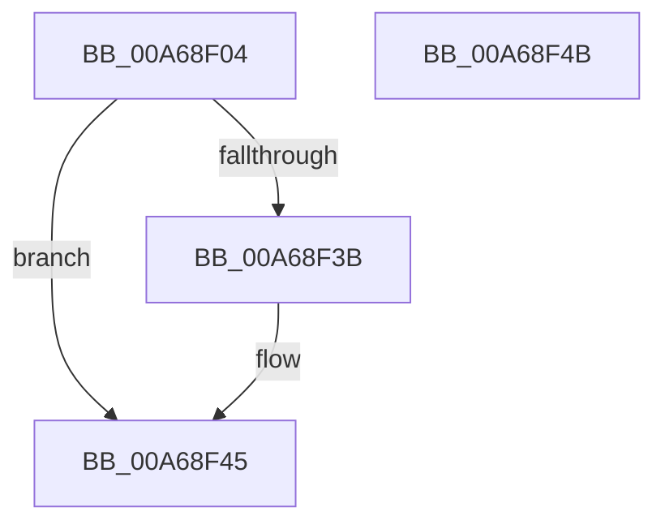

# KIsDeveloperModeEnabled

- RVA: `0x00A68F04`–`0x00A68F4C` (길이 `72` bytes)
- VA: `0x0000000140A68F04`
- 실행 섹션: `PAGE`
- PDB 이름 있음: `예`; PDB Function 태그: `아니요`
- unwind 정보 RVA: `0x000AA39C`
- 디코드: `20`개 명령, `72/72` bytes 표시
- 미해석 바이트: `0` (있으면 어셈블리에 `.byte`로 보존)

> 이 문서는 커널 이미지의 기계어와 PDB 기호를 분석해 생성했습니다. 4번과 5번은 함수 원형과 자료형을 바이너리 사용 방식에서 추정한 C 해석이며 원본 소스 복구 결과는 아닙니다.

## 1. Dependencies

- 직접 호출 지점: **1**; 고유 호출 대상: **1**
- 직접 호출자로 확인된 함수: **1**
- RIP 상대 이미지 참조: **1**

### Outgoing calls
- `0x00A68F32` → [KIsUnlockSettingEnabled](KIsUnlockSettingEnabled_function_00A68F54.md) (function, `0x00A68F54`)

### Direct callers
- [ExQueryFastCacheDevLicense](ExQueryFastCacheDevLicense_function_00A68ED0.md) at `0x00A68EE1`

### Static image references
- `0x00A68F17` → RVA `0x0001AAD0` (`.rdata`; read)

## 2. Other-region calls and transfers

- 다른 실행 섹션으로 향하는 call: **0**
- 별도 외부 분기/꼬리 이동을 확인하지 못했습니다.

## 3. Assembly (complete function range)

```asm
00A68F04  4C 8B DC                        mov r11, rsp
00A68F07  53                              push rbx
00A68F08  48 83 EC 30                     sub rsp, 0x30
00A68F0C  48 8B D9                        mov rbx, rcx
00A68F0F  49 C7 43 E8 42 00 44 00         mov qword ptr [r11 - 0x18], 0x440042
00A68F17  48 8D 05 B2 1B 5B FF            lea rax, [rip - 0xa4e44e]
00A68F1E  C7 44 24 48 FF FF 00 00         mov dword ptr [rsp + 0x48], 0xffff
00A68F26  49 8D 4B E8                     lea rcx, [r11 - 0x18]
00A68F2A  49 89 43 F0                     mov qword ptr [r11 - 0x10], rax
00A68F2E  49 8D 53 10                     lea rdx, [r11 + 0x10]
00A68F32  E8 1D 00 00 00                  call 0x140a68f54
00A68F37  85 C0                           test eax, eax
00A68F39  78 0A                           js 0x140a68f45
00A68F3B  83 7C 24 48 01                  cmp dword ptr [rsp + 0x48], 1
00A68F40  0F 94 C1                        sete cl
00A68F43  88 0B                           mov byte ptr [rbx], cl
00A68F45  48 83 C4 30                     add rsp, 0x30
00A68F49  5B                              pop rbx
00A68F4A  C3                              ret
00A68F4B  CC                              int3
```

## 4. C-style interpretation (structured pseudocode)

```c
__int64 __fastcall KIsDeveloperModeEnabled(__int64 a1)
{
    __int64 result;
    __int64 v_rsp;
    unsigned int v_stack_p10;

    v_rsp = (v_rsp) - (48);
    *(unsigned __int64 *)(v_rsp - 24) = 0x440042ULL;
    v_stack_p10 = 0xFFFFULL;
    *(unsigned __int64 *)(v_rsp - 16) = v_rip - 10806350;
    result = KIsUnlockSettingEnabled(v_rsp - 24, v_rsp + 16, a3, a4);
    if (!(sign_flag)) {
        a1 = (v_stack_p10 == 1) ? 1 : 0;
        *(unsigned __int8 *)(a1) = (unsigned __int8)(a1);
    }
    v_rsp = (v_rsp) + (48);
    return result;
}
```

## 5. (Beta) C Style

```c
int64_t KIsDeveloperModeEnabled(void *Arg1)
{
    uint8_t *arg1 = (uint8_t *)Arg1;

    int64_t result;
    int64_t local_rsp;
    uint32_t v_stack_p10;

    local_rsp = (local_rsp) - (48);
    *(uint64_t *)(local_rsp - 0x18) = 0x440042ULL;
    v_stack_p10 = 0xFFFFULL;
    *(uint64_t *)(local_rsp - 0x10) = v_rip - 10806350;
    result = KIsUnlockSettingEnabled(local_rsp - 24, local_rsp + 16, a3, a4);
    if (!(sign_flag)) {
        Arg1 = (v_stack_p10 == 1) ? 1 : 0;
        *(uint8_t *)(arg1) = (uint8_t)(Arg1);
    }
    local_rsp = (local_rsp) + (48);
    return result;
}
```

### 관측된 메모리 오프셋

구조체 형식이 확인되지 않은 접근은 인자 기준의 오프셋으로만 기록했습니다.

| 기준 인자 | 오프셋 표현 | 폭 (bit) | 접근 |
|---|---:|---:|---|
| `Arg1` | `+ 0x0` | `8` | `W` |

## 6. Execution-region graph

[열기: 2D/3D 그래프와 함수 탐색 컨트롤 패널](../../../control-panel.html?section=page&rva=0x00A68F04&view=graph)

- 2D 그래프는 위에서 아래로 흐르고, 3D 그래프는 빈 공간을 드래그해 회전합니다. Shift+드래그는 이동, 휠은 확대·축소, 함수 노드 선택은 대상 보고서 이동입니다.

### Static fallback


