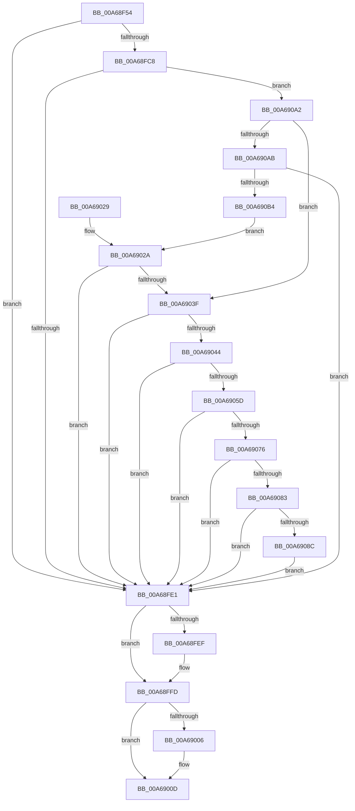

# KIsUnlockSettingEnabled

- RVA: `0x00A68F54`–`0x00A690B9` (길이 `357` bytes)
- VA: `0x0000000140A68F54`
- 실행 섹션: `PAGE`
- PDB 이름 있음: `예`; PDB Function 태그: `아니요`
- unwind 정보 RVA: `0x000B4014`
- 디코드: `99`개 명령, `357/357` bytes 표시
- 미해석 바이트: `0` (있으면 어셈블리에 `.byte`로 보존)

> 이 문서는 커널 이미지의 기계어와 PDB 기호를 분석해 생성했습니다. 4번과 5번은 함수 원형과 자료형을 바이너리 사용 방식에서 추정한 C 해석이며 원본 소스 복구 결과는 아닙니다.

## 1. Dependencies

- 직접 호출 지점: **10**; 고유 호출 대상: **4**
- 직접 호출자로 확인된 함수: **1**
- RIP 상대 이미지 참조: **4**

### Outgoing calls
- `0x00A68FBD` → [KGetAppModelStateSeparatedRegKeyPath](KGetAppModelStateSeparatedRegKeyPath_function_00A690C0.md) (function, `0x00A690C0`)
- `0x00A68FD2` → [KGetUnlockSetting](KGetUnlockSetting_function_00A691BC.md) (function, `0x00A691BC`)
- `0x00A68FF1` → [ExFreePoolWithTag](../../poolcode/B8/ExFreePoolWithTag_function_00B82870.md) (function, `0x00B82870`)
- `0x00A69008` → [ExFreePoolWithTag](../../poolcode/B8/ExFreePoolWithTag_function_00B82870.md) (function, `0x00B82870`)
- `0x00A69034` → [KGetUnlockSetting](KGetUnlockSetting_function_00A691BC.md) (function, `0x00A691BC`)
- `0x00A69052` → [KGetAppModelStateSeparatedRegKeyPath](KGetAppModelStateSeparatedRegKeyPath_function_00A690C0.md) (function, `0x00A690C0`)
- `0x00A69067` → [KGetUnlockSetting](KGetUnlockSetting_function_00A691BC.md) (function, `0x00A691BC`)
- `0x00A69076` → [CmIsStateSeparationEnabled](../../text/4A/CmIsStateSeparationEnabled_function_004A4754.md) (function, `0x004A4754`)
- `0x00A69096` → [KGetUnlockSetting](KGetUnlockSetting_function_00A691BC.md) (function, `0x00A691BC`)
- `0x00A690A2` → [CmIsStateSeparationEnabled](../../text/4A/CmIsStateSeparationEnabled_function_004A4754.md) (function, `0x004A4754`)

### Direct callers
- [KIsDeveloperModeEnabled](KIsDeveloperModeEnabled_function_00A68F04.md) at `0x00A68F32`

### Static image references
- `0x00A68F88` → RVA `0x0001AA10` (`.rdata`; read)
- `0x00A68F96` → RVA `0x0001A950` (`.rdata`; read)
- `0x00A68FAA` → RVA `0x0001A9E8` (`.rdata`; read)
- `0x00A6904B` → RVA `0x0001AAA8` (`.rdata`; read)

## 2. Other-region calls and transfers

- 다른 실행 섹션으로 향하는 call: **4**
  - `0x00A68FF1` → [ExFreePoolWithTag](../../poolcode/B8/ExFreePoolWithTag_function_00B82870.md) (`PAGE` → `POOLCODE`)
  - `0x00A69008` → [ExFreePoolWithTag](../../poolcode/B8/ExFreePoolWithTag_function_00B82870.md) (`PAGE` → `POOLCODE`)
  - `0x00A69076` → [CmIsStateSeparationEnabled](../../text/4A/CmIsStateSeparationEnabled_function_004A4754.md) (`PAGE` → `.text`)
  - `0x00A690A2` → [CmIsStateSeparationEnabled](../../text/4A/CmIsStateSeparationEnabled_function_004A4754.md) (`PAGE` → `.text`)
- 별도 외부 분기/꼬리 이동을 확인하지 못했습니다.

## 3. Assembly (complete function range)

```asm
00A68F54  48 89 5C 24 08                  mov qword ptr [rsp + 8], rbx
00A68F59  48 89 74 24 18                  mov qword ptr [rsp + 0x18], rsi
00A68F5E  48 89 7C 24 20                  mov qword ptr [rsp + 0x20], rdi
00A68F63  55                              push rbp
00A68F64  41 56                           push r14
00A68F66  41 57                           push r15
00A68F68  48 8B EC                        mov rbp, rsp
00A68F6B  48 83 EC 60                     sub rsp, 0x60
00A68F6F  48 8B FA                        mov rdi, rdx
00A68F72  48 C7 45 D0 94 00 96 00         mov qword ptr [rbp - 0x30], 0x960094
00A68F7A  48 8B F1                        mov rsi, rcx
00A68F7D  48 C7 45 C0 74 00 76 00         mov qword ptr [rbp - 0x40], 0x760074
00A68F85  0F 57 C0                        xorps xmm0, xmm0
00A68F88  48 8D 15 81 1A 5B FF            lea rdx, [rip - 0xa4e57f]
00A68F8F  0F 57 C9                        xorps xmm1, xmm1
00A68F92  48 89 55 C8                     mov qword ptr [rbp - 0x38], rdx
00A68F96  4C 8D 3D B3 19 5B FF            lea r15, [rip - 0xa4e64d]
00A68F9D  41 BE FF FF 00 00               mov r14d, 0xffff
00A68FA3  4C 8D 45 F0                     lea r8, [rbp - 0x10]
00A68FA7  44 89 37                        mov dword ptr [rdi], r14d
00A68FAA  48 8D 0D 37 1A 5B FF            lea rcx, [rip - 0xa4e5c9]
00A68FB1  4C 89 7D D8                     mov qword ptr [rbp - 0x28], r15
00A68FB5  0F 11 45 E0                     movups xmmword ptr [rbp - 0x20], xmm0
00A68FB9  0F 11 4D F0                     movups xmmword ptr [rbp - 0x10], xmm1
00A68FBD  E8 FE 00 00 00                  call 0x140a690c0
00A68FC2  8B D8                           mov ebx, eax
00A68FC4  85 C0                           test eax, eax
00A68FC6  78 19                           js 0x140a68fe1
00A68FC8  4C 8B C7                        mov r8, rdi
00A68FCB  48 8D 4D F0                     lea rcx, [rbp - 0x10]
00A68FCF  48 8B D6                        mov rdx, rsi
00A68FD2  E8 E5 01 00 00                  call 0x140a691bc
00A68FD7  8B D8                           mov ebx, eax
00A68FD9  85 C0                           test eax, eax
00A68FDB  0F 89 C1 00 00 00               jns 0x140a690a2
00A68FE1  48 8B 4D E8                     mov rcx, qword ptr [rbp - 0x18]
00A68FE5  BF 41 70 70 4D                  mov edi, 0x4d707041
00A68FEA  48 85 C9                        test rcx, rcx
00A68FED  74 0E                           je 0x140a68ffd
00A68FEF  8B D7                           mov edx, edi
00A68FF1  E8 7A 98 11 00                  call 0x140b82870
00A68FF6  0F 57 C0                        xorps xmm0, xmm0
00A68FF9  0F 11 45 E0                     movups xmmword ptr [rbp - 0x20], xmm0
00A68FFD  48 8B 4D F8                     mov rcx, qword ptr [rbp - 8]
00A69001  48 85 C9                        test rcx, rcx
00A69004  74 07                           je 0x140a6900d
00A69006  8B D7                           mov edx, edi
00A69008  E8 63 98 11 00                  call 0x140b82870
00A6900D  4C 8D 5C 24 60                  lea r11, [rsp + 0x60]
00A69012  8B C3                           mov eax, ebx
00A69014  49 8B 5B 20                     mov rbx, qword ptr [r11 + 0x20]
00A69018  49 8B 73 30                     mov rsi, qword ptr [r11 + 0x30]
00A6901C  49 8B 7B 38                     mov rdi, qword ptr [r11 + 0x38]
00A69020  49 8B E3                        mov rsp, r11
00A69023  41 5F                           pop r15
00A69025  41 5E                           pop r14
00A69027  5D                              pop rbp
00A69028  C3                              ret
00A69029  CC                              int3
00A6902A  4C 8B C7                        mov r8, rdi
00A6902D  48 8D 4D C0                     lea rcx, [rbp - 0x40]
00A69031  48 8B D6                        mov rdx, rsi
00A69034  E8 83 01 00 00                  call 0x140a691bc
00A69039  8B D8                           mov ebx, eax
00A6903B  85 C0                           test eax, eax
00A6903D  78 A2                           js 0x140a68fe1
00A6903F  44 39 37                        cmp dword ptr [rdi], r14d
00A69042  75 9D                           jne 0x140a68fe1
00A69044  4C 8D 45 E0                     lea r8, [rbp - 0x20]
00A69048  49 8B D7                        mov rdx, r15
00A6904B  48 8D 0D 56 1A 5B FF            lea rcx, [rip - 0xa4e5aa]
00A69052  E8 69 00 00 00                  call 0x140a690c0
00A69057  8B D8                           mov ebx, eax
00A69059  85 C0                           test eax, eax
00A6905B  78 84                           js 0x140a68fe1
00A6905D  4C 8B C7                        mov r8, rdi
00A69060  48 8D 4D E0                     lea rcx, [rbp - 0x20]
00A69064  48 8B D6                        mov rdx, rsi
00A69067  E8 50 01 00 00                  call 0x140a691bc
00A6906C  8B D8                           mov ebx, eax
00A6906E  85 C0                           test eax, eax
00A69070  0F 88 6B FF FF FF               js 0x140a68fe1
00A69076  E8 D9 B6 A3 FF                  call 0x1404a4754
00A6907B  84 C0                           test al, al
00A6907D  0F 84 5E FF FF FF               je 0x140a68fe1
00A69083  44 39 37                        cmp dword ptr [rdi], r14d
00A69086  0F 85 55 FF FF FF               jne 0x140a68fe1
00A6908C  4C 8B C7                        mov r8, rdi
00A6908F  48 8D 4D D0                     lea rcx, [rbp - 0x30]
00A69093  48 8B D6                        mov rdx, rsi
00A69096  E8 21 01 00 00                  call 0x140a691bc
00A6909B  8B D8                           mov ebx, eax
00A6909D  E9 3F FF FF FF                  jmp 0x140a68fe1
00A690A2  E8 AD B6 A3 FF                  call 0x1404a4754
00A690A7  84 C0                           test al, al
00A690A9  74 94                           je 0x140a6903f
00A690AB  44 39 37                        cmp dword ptr [rdi], r14d
00A690AE  0F 85 2D FF FF FF               jne 0x140a68fe1
00A690B4  E9 71 FF FF FF                  jmp 0x140a6902a
```

## 4. C-style interpretation (structured pseudocode)

```c
__int64 __fastcall KIsUnlockSettingEnabled(__int64 a1, __int64 a2)
{
    __int64 result;
    __int64 v_rsp;
    unsigned __int64 v_stack_m18;
    unsigned __int64 v_stack_m20;
    unsigned __int64 v_stack_m28;
    unsigned __int64 v_stack_m30;
    unsigned __int64 v_stack_m38;
    unsigned __int64 v_stack_m40;
    unsigned __int64 v_stack_m48;
    unsigned __int64 v_stack_m50;
    unsigned __int64 v_stack_m58;
    unsigned __int64 v_stack_p18;
    unsigned __int64 v_stack_p20;
    unsigned __int64 v_stack_p8;

    v_stack_p8 = v_rbx;
    v_stack_p18 = v_rsi;
    v_stack_p20 = v_rdi;
    v_rsp = (v_rsp) - (96);
    v_stack_m48 = 0x960094ULL;
    v_stack_m58 = 0x760074ULL;
    v_stack_m50 = v_rip - 10806655;
    *(unsigned int *)(a2) = (unsigned int)((unsigned int)(0xFFFFULL));
    v_stack_m40 = v_rip - 10806861;
    v_stack_m38 = v_xmm0;
    v_stack_m28 = v_xmm1;
    result = KGetAppModelStateSeparatedRegKeyPath(v_rip - 10806729, v_rip - 10806655, v_stack_m28, a4);
    if (sign_flag) goto loc_00A68FE1;
    result = KGetUnlockSetting(v_stack_m28, a1, a2, a4);
    if (!sign_flag) goto loc_00A690A2;
loc_00A68FE1:
    if (v_stack_m30 != 0) {
        a2 = (unsigned int)((unsigned int)(0x4D707041ULL));
        result = ExFreePoolWithTag(v_stack_m30, a2, a2, a4);
        v_stack_m38 = v_xmm0;
    }
    if (v_stack_m20 != 0) {
        a2 = (unsigned int)((unsigned int)(0x4D707041ULL));
        result = ExFreePoolWithTag(v_stack_m20, a2, a2, a4);
    }
    return (unsigned int)((unsigned int)((unsigned int)((unsigned int)(result))));
loc_00A6902A:
    result = KGetUnlockSetting(v_stack_m58, *(unsigned __int64 *)(v_stack_m18 + 48), *(unsigned __int64 *)(v_stack_m18 + 56), a4);
    if (sign_flag) goto loc_00A68FE1;
loc_00A6903F:
    if ((*(unsigned int *)(*(unsigned __int64 *)(v_stack_m18 + 56))) != ((unsigned int)((unsigned int)(0xFFFFULL)))) goto loc_00A68FE1;
    result = KGetAppModelStateSeparatedRegKeyPath(v_rip - 10806698, v_rip - 10806861, v_stack_m38, a4);
    if (sign_flag) goto loc_00A68FE1;
    result = KGetUnlockSetting(v_stack_m38, *(unsigned __int64 *)(v_stack_m18 + 48), *(unsigned __int64 *)(v_stack_m18 + 56), a4);
    if (sign_flag) goto loc_00A68FE1;
    result = CmIsStateSeparationEnabled(v_stack_m38, *(unsigned __int64 *)(v_stack_m18 + 48), *(unsigned __int64 *)(v_stack_m18 + 56), a4);
    if ((unsigned __int8)(result) == 0) goto loc_00A68FE1;
    if ((*(unsigned int *)(*(unsigned __int64 *)(v_stack_m18 + 56))) != ((unsigned int)((unsigned int)(0xFFFFULL)))) goto loc_00A68FE1;
    result = KGetUnlockSetting(v_stack_m48, *(unsigned __int64 *)(v_stack_m18 + 48), *(unsigned __int64 *)(v_stack_m18 + 56), a4);
    goto loc_00A68FE1;
loc_00A690A2:
    result = CmIsStateSeparationEnabled(v_stack_m48, *(unsigned __int64 *)(v_stack_m18 + 48), *(unsigned __int64 *)(v_stack_m18 + 56), a4);
    if ((unsigned __int8)(result) == 0) goto loc_00A6903F;
    if ((*(unsigned int *)(*(unsigned __int64 *)(v_stack_m18 + 56))) != ((unsigned int)((unsigned int)(0xFFFFULL)))) goto loc_00A68FE1;
    goto loc_00A6902A;
}
```

## 5. (Beta) C Style

```c
int64_t KIsUnlockSettingEnabled(int64_t Arg1, void *Arg2)
{
    uint8_t *arg2 = (uint8_t *)Arg2;

    int64_t result;
    int64_t local_rsp;
    uint64_t v_stack_m18;
    uint64_t v_stack_m20;
    uint64_t v_stack_m28;
    uint64_t v_stack_m30;
    uint64_t v_stack_m38;
    uint64_t v_stack_m40;
    uint64_t v_stack_m48;
    uint64_t v_stack_m50;
    uint64_t v_stack_m58;
    uint64_t v_stack_p18;
    uint64_t v_stack_p20;
    uint64_t v_stack_p8;

    v_stack_p8 = local_rbx;
    v_stack_p18 = local_rsi;
    v_stack_p20 = local_rdi;
    local_rsp = (local_rsp) - (96);
    v_stack_m48 = 0x960094ULL;
    v_stack_m58 = 0x760074ULL;
    v_stack_m50 = v_rip - 10806655;
    *(uint32_t *)(arg2) = (uint32_t)((uint32_t)(0xFFFFULL));
    v_stack_m40 = v_rip - 10806861;
    v_stack_m38 = v_xmm0;
    v_stack_m28 = v_xmm1;
    result = KGetAppModelStateSeparatedRegKeyPath(v_rip - 10806729, v_rip - 10806655, v_stack_m28, a4);
    if (sign_flag) goto loc_00A68FE1;
    result = KGetUnlockSetting(v_stack_m28, Arg1, Arg2, a4);
    if (!sign_flag) goto loc_00A690A2;
loc_00A68FE1:
    if (v_stack_m30 != 0) {
        Arg2 = (uint32_t)((uint32_t)(0x4D707041ULL));
        result = ExFreePoolWithTag(v_stack_m30, Arg2, Arg2, a4);
        v_stack_m38 = v_xmm0;
    }
    if (v_stack_m20 != 0) {
        Arg2 = (uint32_t)((uint32_t)(0x4D707041ULL));
        result = ExFreePoolWithTag(v_stack_m20, Arg2, Arg2, a4);
    }
    return (uint32_t)((uint32_t)((uint32_t)((uint32_t)(result))));
loc_00A6902A:
    result = KGetUnlockSetting(v_stack_m58, *(uint64_t *)(v_stack_m18 + 0x30), *(uint64_t *)(v_stack_m18 + 0x38), a4);
    if (sign_flag) goto loc_00A68FE1;
loc_00A6903F:
    if ((*(uint32_t *)(*(uint64_t *)(v_stack_m18 + 0x38))) != ((uint32_t)((uint32_t)(0xFFFFULL)))) goto loc_00A68FE1;
    result = KGetAppModelStateSeparatedRegKeyPath(v_rip - 10806698, v_rip - 10806861, v_stack_m38, a4);
    if (sign_flag) goto loc_00A68FE1;
    result = KGetUnlockSetting(v_stack_m38, *(uint64_t *)(v_stack_m18 + 0x30), *(uint64_t *)(v_stack_m18 + 0x38), a4);
    if (sign_flag) goto loc_00A68FE1;
    result = CmIsStateSeparationEnabled(v_stack_m38, *(uint64_t *)(v_stack_m18 + 0x30), *(uint64_t *)(v_stack_m18 + 0x38), a4);
    if ((uint8_t)(result) == 0) goto loc_00A68FE1;
    if ((*(uint32_t *)(*(uint64_t *)(v_stack_m18 + 0x38))) != ((uint32_t)((uint32_t)(0xFFFFULL)))) goto loc_00A68FE1;
    result = KGetUnlockSetting(v_stack_m48, *(uint64_t *)(v_stack_m18 + 0x30), *(uint64_t *)(v_stack_m18 + 0x38), a4);
    goto loc_00A68FE1;
loc_00A690A2:
    result = CmIsStateSeparationEnabled(v_stack_m48, *(uint64_t *)(v_stack_m18 + 0x30), *(uint64_t *)(v_stack_m18 + 0x38), a4);
    if ((uint8_t)(result) == 0) goto loc_00A6903F;
    if ((*(uint32_t *)(*(uint64_t *)(v_stack_m18 + 0x38))) != ((uint32_t)((uint32_t)(0xFFFFULL)))) goto loc_00A68FE1;
    goto loc_00A6902A;
}
```

### 관측된 메모리 오프셋

구조체 형식이 확인되지 않은 접근은 인자 기준의 오프셋으로만 기록했습니다.

| 기준 인자 | 오프셋 표현 | 폭 (bit) | 접근 |
|---|---:|---:|---|
| `Arg2` | `+ 0x0` | `32` | `R` |
| `Arg2` | `+ 0x0` | `32` | `W` |

## 6. Execution-region graph

[열기: 2D/3D 그래프와 함수 탐색 컨트롤 패널](../../../control-panel.html?section=page&rva=0x00A68F54&view=graph)

- 2D 그래프는 위에서 아래로 흐르고, 3D 그래프는 빈 공간을 드래그해 회전합니다. Shift+드래그는 이동, 휠은 확대·축소, 함수 노드 선택은 대상 보고서 이동입니다.

### Static fallback


