# KeInitializeProcess

- RVA: `0x00A63CF4`–`0x00A64185` (길이 `1,169` bytes)
- VA: `0x0000000140A63CF4`
- 실행 섹션: `PAGE`
- PDB 이름 있음: `예`; PDB Function 태그: `예`
- unwind 정보 RVA: `0x000B3670`
- 디코드: `293`개 명령, `1,169/1,169` bytes 표시
- 미해석 바이트: `0` (있으면 어셈블리에 `.byte`로 보존)

> 이 문서는 커널 이미지의 기계어와 PDB 기호를 분석해 생성했습니다. 4번과 5번은 함수 원형과 자료형을 바이너리 사용 방식에서 추정한 C 해석이며 원본 소스 복구 결과는 아닙니다.

## 1. Dependencies

- 직접 호출 지점: **27**; 고유 호출 대상: **18**
- 직접 호출자로 확인된 함수: **2**
- RIP 상대 이미지 참조: **6**

### Outgoing calls
- `0x00A63D8F` → [memset](../../text/6C/memset_function_006C6C40.md) (function, `0x006C6C40`)
- `0x00A63DBF` → [memset](../../text/6C/memset_function_006C6C40.md) (function, `0x006C6C40`)
- `0x00A63DCF` → [KiCopyAffinityEx](../../text/2C/KiCopyAffinityEx_function_002CE860.md) (function, `0x002CE860`)
- `0x00A63E01` → [memset](../../text/6C/memset_function_006C6C40.md) (function, `0x006C6C40`)
- `0x00A63E10` → [KiCopyAffinityEx](../../text/2C/KiCopyAffinityEx_function_002CE860.md) (function, `0x002CE860`)
- `0x00A63E22` → [KiInitializeProcessAvailableCpuState](../../text/4B/KiInitializeProcessAvailableCpuState_function_004B7154.md) (function, `0x004B7154`)
- `0x00A63E3C` → [KiInitializeIdealProcessorAssignmentBlock](../../text/4B/KiInitializeIdealProcessorAssignmentBlock_function_004BA7B0.md) (function, `0x004BA7B0`)
- `0x00A63E67` → [KeSetBitGroupMask](../../text/4B/KeSetBitGroupMask_function_004BEF90.md) (function, `0x004BEF90`)
- `0x00A63E85` → [KeSetGroupMaskProcess](../../text/4A/KeSetGroupMaskProcess_function_004A4FE4.md) (function, `0x004A4FE4`)
- `0x00A63F06` → [KeAndGroupMasks](../../text/4B/KeAndGroupMasks_function_004B5A34.md) (function, `0x004B5A34`)
- `0x00A63F0F` → [KeIsEmptyGroupMask](../../text/25/KeIsEmptyGroupMask_function_002553B0.md) (function, `0x002553B0`)
- `0x00A63F2F` → [KeIsEmptyGroupMask](../../text/25/KeIsEmptyGroupMask_function_002553B0.md) (function, `0x002553B0`)
- `0x00A63F3C` → [KeFindFirstSetRightGroupMask](../../text/25/KeFindFirstSetRightGroupMask_function_00256BE4.md) (function, `0x00256BE4`)
- `0x00A63F4E` → [KiSetIdealNodeProcessByGroup](../../text/3C/KiSetIdealNodeProcessByGroup_function_003C0888.md) (function, `0x003C0888`)
- `0x00A63F5A` → [KeClearBitGroupMask](../../text/46/KeClearBitGroupMask_function_00467898.md) (function, `0x00467898`)
- `0x00A63F63` → [KeClearBitGroupMask](../../text/46/KeClearBitGroupMask_function_00467898.md) (function, `0x00467898`)
- `0x00A63F6C` → [KeIsEmptyGroupMask](../../text/25/KeIsEmptyGroupMask_function_002553B0.md) (function, `0x002553B0`)
- `0x00A63F7E` → [KeIsEmptyGroupMask](../../text/25/KeIsEmptyGroupMask_function_002553B0.md) (function, `0x002553B0`)
- `0x00A63F8F` → [KeIsEmptyGroupMask](../../text/25/KeIsEmptyGroupMask_function_002553B0.md) (function, `0x002553B0`)
- `0x00A63FBA` → [ExSaAllocate](../../text/3B/ExSaAllocate_function_003B3FB0.md) (function, `0x003B3FB0`)
- `0x00A63FD6` → [KeQueryMaximumProcessorCountEx](../../text/26/KeQueryMaximumProcessorCountEx_function_00264D60.md) (function, `0x00264D60`)
- `0x00A64037` → [KeQueryMaximumProcessorCountEx](../../text/26/KeQueryMaximumProcessorCountEx_function_00264D60.md) (function, `0x00264D60`)
- `0x00A64080` → [KiComputeProcessAutoBoostTreeCount](../../text/4B/KiComputeProcessAutoBoostTreeCount_function_004BBFA8.md) (function, `0x004BBFA8`)
- `0x00A640B4` → [KiStartIdealProcessorAssignmentBlock](../../text/3C/KiStartIdealProcessorAssignmentBlock_function_003C0D14.md) (function, `0x003C0D14`)
- `0x00A640C3` → [_security_check_cookie](../../text/6A/_security_check_cookie_function_006AC640.md) (function, `0x006AC640`)
- `0x00A640F1` → [MmGetNextNode](../../text/43/MmGetNextNode_function_00436620.md) (function, `0x00436620`)
- `0x00A64150` → [VslCreateSecureProcess](../A9/VslCreateSecureProcess_function_00A9C308.md) (function, `0x00A9C308`)

### Direct callers
- [PspAllocateProcess](../A1/PspAllocateProcess_function_00A13B3C.md) at `0x00A15260`
- [KiInitializeIdleProcess](../../init/C3/KiInitializeIdleProcess_function_00C38900.md) at `0x00C3898B`

### Static image references
- `0x00A63D0B` → RVA `0x00E0A740` (`.data`; read)
- `0x00A63D20` → RVA `0x00FC5014` (`ALMOSTRO`; read)
- `0x00A63EE8` → RVA `0x00FCF6C0` (`CACHEALI`; read)
- `0x00A63FA7` → RVA `0x00FC5084` (`ALMOSTRO`; read)
- `0x00A63FFE` → RVA `0x00EFA278` (`.data`; read)
- `0x00A6405D` → RVA `0x00FC6B30` (`ALMOSTRO`; read)

## 2. Other-region calls and transfers

- 다른 실행 섹션으로 향하는 call: **26**
  - `0x00A63D8F` → [memset](../../text/6C/memset_function_006C6C40.md) (`PAGE` → `.text`)
  - `0x00A63DBF` → [memset](../../text/6C/memset_function_006C6C40.md) (`PAGE` → `.text`)
  - `0x00A63DCF` → [KiCopyAffinityEx](../../text/2C/KiCopyAffinityEx_function_002CE860.md) (`PAGE` → `.text`)
  - `0x00A63E01` → [memset](../../text/6C/memset_function_006C6C40.md) (`PAGE` → `.text`)
  - `0x00A63E10` → [KiCopyAffinityEx](../../text/2C/KiCopyAffinityEx_function_002CE860.md) (`PAGE` → `.text`)
  - `0x00A63E22` → [KiInitializeProcessAvailableCpuState](../../text/4B/KiInitializeProcessAvailableCpuState_function_004B7154.md) (`PAGE` → `.text`)
  - `0x00A63E3C` → [KiInitializeIdealProcessorAssignmentBlock](../../text/4B/KiInitializeIdealProcessorAssignmentBlock_function_004BA7B0.md) (`PAGE` → `.text`)
  - `0x00A63E67` → [KeSetBitGroupMask](../../text/4B/KeSetBitGroupMask_function_004BEF90.md) (`PAGE` → `.text`)
  - `0x00A63E85` → [KeSetGroupMaskProcess](../../text/4A/KeSetGroupMaskProcess_function_004A4FE4.md) (`PAGE` → `.text`)
  - `0x00A63F06` → [KeAndGroupMasks](../../text/4B/KeAndGroupMasks_function_004B5A34.md) (`PAGE` → `.text`)
  - `0x00A63F0F` → [KeIsEmptyGroupMask](../../text/25/KeIsEmptyGroupMask_function_002553B0.md) (`PAGE` → `.text`)
  - `0x00A63F2F` → [KeIsEmptyGroupMask](../../text/25/KeIsEmptyGroupMask_function_002553B0.md) (`PAGE` → `.text`)
  - `0x00A63F3C` → [KeFindFirstSetRightGroupMask](../../text/25/KeFindFirstSetRightGroupMask_function_00256BE4.md) (`PAGE` → `.text`)
  - `0x00A63F4E` → [KiSetIdealNodeProcessByGroup](../../text/3C/KiSetIdealNodeProcessByGroup_function_003C0888.md) (`PAGE` → `.text`)
  - `0x00A63F5A` → [KeClearBitGroupMask](../../text/46/KeClearBitGroupMask_function_00467898.md) (`PAGE` → `.text`)
  - `0x00A63F63` → [KeClearBitGroupMask](../../text/46/KeClearBitGroupMask_function_00467898.md) (`PAGE` → `.text`)
  - `0x00A63F6C` → [KeIsEmptyGroupMask](../../text/25/KeIsEmptyGroupMask_function_002553B0.md) (`PAGE` → `.text`)
  - `0x00A63F7E` → [KeIsEmptyGroupMask](../../text/25/KeIsEmptyGroupMask_function_002553B0.md) (`PAGE` → `.text`)
  - `0x00A63F8F` → [KeIsEmptyGroupMask](../../text/25/KeIsEmptyGroupMask_function_002553B0.md) (`PAGE` → `.text`)
  - `0x00A63FBA` → [ExSaAllocate](../../text/3B/ExSaAllocate_function_003B3FB0.md) (`PAGE` → `.text`)
  - `0x00A63FD6` → [KeQueryMaximumProcessorCountEx](../../text/26/KeQueryMaximumProcessorCountEx_function_00264D60.md) (`PAGE` → `.text`)
  - `0x00A64037` → [KeQueryMaximumProcessorCountEx](../../text/26/KeQueryMaximumProcessorCountEx_function_00264D60.md) (`PAGE` → `.text`)
  - `0x00A64080` → [KiComputeProcessAutoBoostTreeCount](../../text/4B/KiComputeProcessAutoBoostTreeCount_function_004BBFA8.md) (`PAGE` → `.text`)
  - `0x00A640B4` → [KiStartIdealProcessorAssignmentBlock](../../text/3C/KiStartIdealProcessorAssignmentBlock_function_003C0D14.md) (`PAGE` → `.text`)
  - `0x00A640C3` → [_security_check_cookie](../../text/6A/_security_check_cookie_function_006AC640.md) (`PAGE` → `.text`)
  - `0x00A640F1` → [MmGetNextNode](../../text/43/MmGetNextNode_function_00436620.md) (`PAGE` → `.text`)
- call이 아닌 외부 분기/꼬리 이동: **2**
  - `0x00A64129` → [sub_00B3E480](../B3/Unknown_function_00B3E480.md) (`tail-transfer`)
  - `0x00A64134` → [sub_00B3E480 + 0x3](../B3/Unknown_function_00B3E480.md) (`tail-transfer`)

## 3. Assembly (complete function range)

```asm
00A63CF4  48 89 5C 24 10                  mov qword ptr [rsp + 0x10], rbx
00A63CF9  55                              push rbp
00A63CFA  56                              push rsi
00A63CFB  57                              push rdi
00A63CFC  41 54                           push r12
00A63CFE  41 55                           push r13
00A63D00  41 56                           push r14
00A63D02  41 57                           push r15
00A63D04  48 8B EC                        mov rbp, rsp
00A63D07  48 83 EC 70                     sub rsp, 0x70
00A63D0B  48 8B 05 2E 6A 3A 00            mov rax, qword ptr [rip + 0x3a6a2e]
00A63D12  48 33 C4                        xor rax, rsp
00A63D15  48 89 45 F0                     mov qword ptr [rbp - 0x10], rax
00A63D19  48 8B 75 60                     mov rsi, qword ptr [rbp + 0x60]
00A63D1D  48 8B F9                        mov rdi, rcx
00A63D20  0F B7 0D ED 12 56 00            movzx ecx, word ptr [rip + 0x5612ed]
00A63D27  45 33 D2                        xor r10d, r10d
00A63D2A  45 0F B7 F8                     movzx r15d, r8w
00A63D2E  4D 8B F1                        mov r14, r9
00A63D31  4C 8B 8D 80 00 00 00            mov r9, qword ptr [rbp + 0x80]
00A63D38  48 8D 47 08                     lea rax, [rdi + 8]
00A63D3C  C6 07 03                        mov byte ptr [rdi], 3
00A63D3F  48 89 40 08                     mov qword ptr [rax + 8], rax
00A63D43  4C 8D 04 CD 00 00 00 00         lea r8, [rcx*8]
00A63D4B  48 89 00                        mov qword ptr [rax], rax
00A63D4E  49 8D 58 08                     lea rbx, [r8 + 8]
00A63D52  41 8D 42 01                     lea eax, [r10 + 1]
00A63D56  66 89 4D B0                     mov word ptr [rbp - 0x50], cx
00A63D5A  4C 89 45 B8                     mov qword ptr [rbp - 0x48], r8
00A63D5E  48 89 5D C0                     mov qword ptr [rbp - 0x40], rbx
00A63D62  88 97 90 00 00 00               mov byte ptr [rdi + 0x90], dl
00A63D68  84 45 78                        test byte ptr [rbp + 0x78], al
00A63D6B  0F 85 93 03 00 00               jne 0x140a64104
00A63D71  4C 89 8F 80 00 00 00            mov qword ptr [rdi + 0x80], r9
00A63D78  4D 8D 2C 19                     lea r13, [r9 + rbx]
00A63D7C  66 41 89 09                     mov word ptr [r9], cx
00A63D80  33 D2                           xor edx, edx
00A63D82  66 41 89 49 02                  mov word ptr [r9 + 2], cx
00A63D87  49 8D 49 08                     lea rcx, [r9 + 8]
00A63D8B  45 89 51 04                     mov dword ptr [r9 + 4], r10d
00A63D8F  E8 AC 2E C6 FF                  call 0x1406c6c40
00A63D94  4C 89 6F 50                     mov qword ptr [rdi + 0x50], r13
00A63D98  49 8B CD                        mov rcx, r13
00A63D9B  0F B7 05 72 12 56 00            movzx eax, word ptr [rip + 0x561272]
00A63DA2  33 D2                           xor edx, edx
00A63DA4  44 8B C0                        mov r8d, eax
00A63DA7  4C 03 EB                        add r13, rbx
00A63DAA  49 C1 E0 03                     shl r8, 3
00A63DAE  83 61 04 00                     and dword ptr [rcx + 4], 0
00A63DB2  66 C7 01 01 00                  mov word ptr [rcx], 1
00A63DB7  66 89 41 02                     mov word ptr [rcx + 2], ax
00A63DBB  48 83 C1 08                     add rcx, 8
00A63DBF  E8 7C 2E C6 FF                  call 0x1406c6c40
00A63DC4  48 8B 4F 50                     mov rcx, qword ptr [rdi + 0x50]
00A63DC8  4D 8B C6                        mov r8, r14
00A63DCB  0F B7 51 02                     movzx edx, word ptr [rcx + 2]
00A63DCF  E8 8C AA 86 FF                  call 0x1402ce860
00A63DD4  0F B7 45 B0                     movzx eax, word ptr [rbp - 0x50]
00A63DD8  33 D2                           xor edx, edx
00A63DDA  4C 8B 45 B8                     mov r8, qword ptr [rbp - 0x48]
00A63DDE  4C 89 AF C0 01 00 00            mov qword ptr [rdi + 0x1c0], r13
00A63DE5  49 83 C5 78                     add r13, 0x78
00A63DE9  49 8B DD                        mov rbx, r13
00A63DEC  4C 03 6D C0                     add r13, qword ptr [rbp - 0x40]
00A63DF0  83 63 04 00                     and dword ptr [rbx + 4], 0
00A63DF4  48 8D 4B 08                     lea rcx, [rbx + 8]
00A63DF8  66 C7 03 01 00                  mov word ptr [rbx], 1
00A63DFD  66 89 43 02                     mov word ptr [rbx + 2], ax
00A63E01  E8 3A 2E C6 FF                  call 0x1406c6c40
00A63E06  0F B7 53 02                     movzx edx, word ptr [rbx + 2]
00A63E0A  4D 8B C6                        mov r8, r14
00A63E0D  48 8B CB                        mov rcx, rbx
00A63E10  E8 4B AA 86 FF                  call 0x1402ce860
00A63E15  48 8B 8F C0 01 00 00            mov rcx, qword ptr [rdi + 0x1c0]
00A63E1C  4C 8B C7                        mov r8, rdi
00A63E1F  48 8B D3                        mov rdx, rbx
00A63E22  E8 2D 33 A5 FF                  call 0x1404b7154
00A63E27  49 8B CD                        mov rcx, r13
00A63E2A  4C 89 AF B8 00 00 00            mov qword ptr [rdi + 0xb8], r13
00A63E31  49 81 C5 D8 01 00 00            add r13, 0x1d8
00A63E38  4C 89 6D B8                     mov qword ptr [rbp - 0x48], r13
00A63E3C  E8 6F 69 A5 FF                  call 0x1404ba7b0
00A63E41  45 33 C0                        xor r8d, r8d
00A63E44  0F 57 C9                        xorps xmm1, xmm1
00A63E47  41 0F B7 D0                     movzx edx, r8w
00A63E4B  0F 29 4D E0                     movaps xmmword ptr [rbp - 0x20], xmm1
00A63E4F  41 8D 58 01                     lea ebx, [r8 + 1]
00A63E53  66 45 3B 06                     cmp r8w, word ptr [r14]
00A63E57  73 20                           jae 0x140a63e79
00A63E59  0F B7 C2                        movzx eax, dx
00A63E5C  4D 39 44 C6 08                  cmp qword ptr [r14 + rax*8 + 8], r8
00A63E61  74 09                           je 0x140a63e6c
00A63E63  48 8D 4D E0                     lea rcx, [rbp - 0x20]
00A63E67  E8 24 B1 A5 FF                  call 0x1404bef90
00A63E6C  66 03 D3                        add dx, bx
00A63E6F  66 41 3B 16                     cmp dx, word ptr [r14]
00A63E73  72 E4                           jb 0x140a63e59
00A63E75  0F 28 4D E0                     movaps xmm1, xmmword ptr [rbp - 0x20]
00A63E79  48 8D 55 C0                     lea rdx, [rbp - 0x40]
00A63E7D  66 0F 7F 4D C0                  movdqa xmmword ptr [rbp - 0x40], xmm1
00A63E82  48 8B CF                        mov rcx, rdi
00A63E85  E8 5A 11 A4 FF                  call 0x1404a4fe4
00A63E8A  66 44 89 BF A0 01 00 00         mov word ptr [rdi + 0x1a0], r15w
00A63E92  48 8D 47 18                     lea rax, [rdi + 0x18]
00A63E96  48 89 40 08                     mov qword ptr [rax + 8], rax
00A63E9A  48 89 00                        mov qword ptr [rax], rax
00A63E9D  48 8D 47 68                     lea rax, [rdi + 0x68]
00A63EA1  48 89 40 08                     mov qword ptr [rax + 8], rax
00A63EA5  48 89 00                        mov qword ptr [rax], rax
00A63EA8  48 8D 47 30                     lea rax, [rdi + 0x30]
00A63EAC  48 89 40 08                     mov qword ptr [rax + 8], rax
00A63EB0  48 89 00                        mov qword ptr [rax], rax
00A63EB3  C6 87 91 00 00 00 06            mov byte ptr [rdi + 0x91], 6
00A63EBA  44 89 87 08 01 00 00            mov dword ptr [rdi + 0x108], r8d
00A63EC1  48 85 F6                        test rsi, rsi
00A63EC4  0F 84 4F 02 00 00               je 0x140a64119
00A63ECA  0F B7 0E                        movzx ecx, word ptr [rsi]
00A63ECD  45 33 E4                        xor r12d, r12d
00A63ED0  66 89 8F 04 01 00 00            mov word ptr [rdi + 0x104], cx
00A63ED7  45 8A FC                        mov r15b, r12b
00A63EDA  66 0F 7F 4D D0                  movdqa xmmword ptr [rbp - 0x30], xmm1
00A63EDF  0F B7 06                        movzx eax, word ptr [rsi]
00A63EE2  44 89 65 B0                     mov dword ptr [rbp - 0x50], r12d
00A63EE6  8B C0                           mov eax, eax
00A63EE8  4C 8D 35 D1 B7 56 00            lea r14, [rip + 0x56b7d1]
00A63EEF  0F 57 C0                        xorps xmm0, xmm0
00A63EF2  4C 8D 45 C0                     lea r8, [rbp - 0x40]
00A63EF6  48 8D 55 D0                     lea rdx, [rbp - 0x30]
00A63EFA  0F 11 45 C0                     movups xmmword ptr [rbp - 0x40], xmm0
00A63EFE  4D 8B 34 C6                     mov r14, qword ptr [r14 + rax*8]
00A63F02  49 8D 4E 10                     lea rcx, [r14 + 0x10]
00A63F06  E8 29 1B A5 FF                  call 0x1404b5a34
00A63F0B  48 8D 4D C0                     lea rcx, [rbp - 0x40]
00A63F0F  E8 9C 14 7F FF                  call 0x1402553b0
00A63F14  85 C0                           test eax, eax
00A63F16  0F 85 CE 01 00 00               jne 0x140a640ea
00A63F1C  41 8A 46 0A                     mov al, byte ptr [r14 + 0xa]
00A63F20  22 C3                           and al, bl
00A63F22  41 3A C7                        cmp al, r15b
00A63F25  0F 85 B6 01 00 00               jne 0x140a640e1
00A63F2B  48 8D 4D C0                     lea rcx, [rbp - 0x40]
00A63F2F  E8 7C 14 7F FF                  call 0x1402553b0
00A63F34  85 C0                           test eax, eax
00A63F36  75 42                           jne 0x140a63f7a
00A63F38  48 8D 4D C0                     lea rcx, [rbp - 0x40]
00A63F3C  E8 A3 2C 7F FF                  call 0x140256be4
00A63F41  44 0F B7 C0                     movzx r8d, ax
00A63F45  49 8B D6                        mov rdx, r14
00A63F48  48 8B CF                        mov rcx, rdi
00A63F4B  0F B7 D8                        movzx ebx, ax
00A63F4E  E8 35 C9 95 FF                  call 0x1403c0888
00A63F53  0F B7 D3                        movzx edx, bx
00A63F56  48 8D 4D C0                     lea rcx, [rbp - 0x40]
00A63F5A  E8 39 39 A0 FF                  call 0x140467898
00A63F5F  48 8D 4D D0                     lea rcx, [rbp - 0x30]
00A63F63  E8 30 39 A0 FF                  call 0x140467898
00A63F68  48 8D 4D C0                     lea rcx, [rbp - 0x40]
00A63F6C  E8 3F 14 7F FF                  call 0x1402553b0
00A63F71  85 C0                           test eax, eax
00A63F73  74 C3                           je 0x140a63f38
00A63F75  BB 01 00 00 00                  mov ebx, 1
00A63F7A  48 8D 4D D0                     lea rcx, [rbp - 0x30]
00A63F7E  E8 2D 14 7F FF                  call 0x1402553b0
00A63F83  85 C0                           test eax, eax
00A63F85  0F 84 5F 01 00 00               je 0x140a640ea
00A63F8B  48 8D 4D D0                     lea rcx, [rbp - 0x30]
00A63F8F  E8 1C 14 7F FF                  call 0x1402553b0
00A63F94  85 C0                           test eax, eax
00A63F96  0F 84 9D 01 00 00               je 0x140a64139
00A63F9C  48 8B 45 68                     mov rax, qword ptr [rbp + 0x68]
00A63FA0  48 89 87 30 01 00 00            mov qword ptr [rdi + 0x130], rax
00A63FA7  8B 05 D7 10 56 00               mov eax, dword ptr [rip + 0x5610d7]
00A63FAD  A8 08                           test al, 8
00A63FAF  0F 84 97 00 00 00               je 0x140a6404c
00A63FB5  33 D2                           xor edx, edx
00A63FB7  8D 4A 10                        lea ecx, [rdx + 0x10]
00A63FBA  E8 F1 FF 94 FF                  call 0x1403b3fb0
00A63FBF  4C 8B F0                        mov r14, rax
00A63FC2  48 83 F8 FF                     cmp rax, -1
00A63FC6  0F 84 43 01 00 00               je 0x140a6410f
00A63FCC  33 DB                           xor ebx, ebx
00A63FCE  B9 FF FF 00 00                  mov ecx, 0xffff
00A63FD3  44 8B FB                        mov r15d, ebx
00A63FD6  E8 85 0D 80 FF                  call 0x140264d60
00A63FDB  85 C0                           test eax, eax
00A63FDD  74 66                           je 0x140a64045
00A63FDF  41 8B F6                        mov esi, r14d
00A63FE2  41 8B DE                        mov ebx, r14d
00A63FE5  C1 EE 0D                        shr esi, 0xd
00A63FE8  41 BD 01 00 00 00               mov r13d, 1
00A63FEE  81 E6 FF FF 03 00               and esi, 0x3ffff
00A63FF4  48 C1 EB 04                     shr rbx, 4
00A63FF8  81 E3 FF 01 00 00               and ebx, 0x1ff
00A63FFE  48 8B 05 73 62 49 00            mov rax, qword ptr [rip + 0x496273]
00A64005  0F 57 C0                        xorps xmm0, xmm0
00A64008  0F BD CE                        bsr ecx, esi
00A6400B  41 8B D7                        mov edx, r15d
00A6400E  45 03 FD                        add r15d, r13d
00A64011  4C 8B 04 D0                     mov r8, qword ptr [rax + rdx*8]
00A64015  44 8D 49 FE                     lea r9d, [rcx - 2]
00A64019  41 8B C5                        mov eax, r13d
00A6401C  D3 E0                           shl eax, cl
00A6401E  8B C8                           mov ecx, eax
00A64020  8B C6                           mov eax, esi
00A64022  48 33 C8                        xor rcx, rax
00A64025  4B 8B 04 C8                     mov rax, qword ptr [r8 + r9*8]
00A64029  48 8B 4C C8 08                  mov rcx, qword ptr [rax + rcx*8 + 8]
00A6402E  0F 11 04 D9                     movups xmmword ptr [rcx + rbx*8], xmm0
00A64032  B9 FF FF 00 00                  mov ecx, 0xffff
00A64037  E8 24 0D 80 FF                  call 0x140264d60
00A6403C  44 3B F8                        cmp r15d, eax
00A6403F  72 BD                           jb 0x140a63ffe
00A64041  4C 8B 6D B8                     mov r13, qword ptr [rbp - 0x48]
00A64045  4C 89 B7 90 01 00 00            mov qword ptr [rdi + 0x190], r14
00A6404C  F6 45 78 02                     test byte ptr [rbp + 0x78], 2
00A64050  0F 85 EB 00 00 00               jne 0x140a64141
00A64056  45 33 C0                        xor r8d, r8d
00A64059  45 8D 48 01                     lea r9d, [r8 + 1]
00A6405D  48 0F BA 25 CA 2A 56 00 37      bt qword ptr [rip + 0x562aca], 0x37
00A64066  0F 82 03 01 00 00               jb 0x140a6416f
00A6406C  F6 45 78 04                     test byte ptr [rbp + 0x78], 4
00A64070  48 8D 87 B0 01 00 00            lea rax, [rdi + 0x1b0]
00A64077  48 89 40 08                     mov qword ptr [rax + 8], rax
00A6407B  48 89 00                        mov qword ptr [rax], rax
00A6407E  74 2A                           je 0x140a640aa
00A64080  E8 23 7F A5 FF                  call 0x1404bbfa8
00A64085  85 C0                           test eax, eax
00A64087  74 1A                           je 0x140a640a3
00A64089  49 8D 4D 10                     lea rcx, [r13 + 0x10]
00A6408D  8B D0                           mov edx, eax
00A6408F  4C 89 41 F0                     mov qword ptr [rcx - 0x10], r8
00A64093  4C 89 41 F8                     mov qword ptr [rcx - 8], r8
00A64097  4C 89 01                        mov qword ptr [rcx], r8
00A6409A  48 8D 49 18                     lea rcx, [rcx + 0x18]
00A6409E  49 2B D1                        sub rdx, r9
00A640A1  75 EC                           jne 0x140a6408f
00A640A3  4C 89 6F 58                     mov qword ptr [rdi + 0x58], r13
00A640A7  89 47 60                        mov dword ptr [rdi + 0x60], eax
00A640AA  48 8B 8F B8 00 00 00            mov rcx, qword ptr [rdi + 0xb8]
00A640B1  48 8B D7                        mov rdx, rdi
00A640B4  E8 5B CC 95 FF                  call 0x1403c0d14
00A640B9  41 8B C4                        mov eax, r12d
00A640BC  48 8B 4D F0                     mov rcx, qword ptr [rbp - 0x10]
00A640C0  48 33 CC                        xor rcx, rsp
00A640C3  E8 78 85 C4 FF                  call 0x1406ac640
00A640C8  48 8B 9C 24 B8 00 00 00         mov rbx, qword ptr [rsp + 0xb8]
00A640D0  48 83 C4 70                     add rsp, 0x70
00A640D4  41 5F                           pop r15
00A640D6  41 5E                           pop r14
00A640D8  41 5D                           pop r13
00A640DA  41 5C                           pop r12
00A640DC  5F                              pop rdi
00A640DD  5E                              pop rsi
00A640DE  5D                              pop rbp
00A640DF  C3                              ret
00A640E0  CC                              int3
00A640E1  4C 3B F6                        cmp r14, rsi
00A640E4  0F 84 41 FE FF FF               je 0x140a63f2b
00A640EA  0F B7 0E                        movzx ecx, word ptr [rsi]
00A640ED  48 8D 55 B0                     lea rdx, [rbp - 0x50]
00A640F1  E8 2A 25 9D FF                  call 0x140436620
00A640F6  83 F8 FF                        cmp eax, -1
00A640F9  0F 85 E7 FD FF FF               jne 0x140a63ee6
00A640FF  E9 87 FE FF FF                  jmp 0x140a63f8b
00A64104  09 87 88 00 00 00               or dword ptr [rdi + 0x88], eax
00A6410A  E9 62 FC FF FF                  jmp 0x140a63d71
00A6410F  33 C0                           xor eax, eax
00A64111  44 8B F0                        mov r14d, eax
00A64114  E9 2C FF FF FF                  jmp 0x140a64045
00A64119  0F 57 C0                        xorps xmm0, xmm0
00A6411C  0F 11 45 C0                     movups xmmword ptr [rbp - 0x40], xmm0
00A64120  66 44 89 7D C8                  mov word ptr [rbp - 0x38], r15w
00A64125  66 45 3B 3E                     cmp r15w, word ptr [r14]
00A64129  0F 83 51 A3 0D 00               jae 0x140b3e480
00A6412F  4B 8B 4C FE 08                  mov rcx, qword ptr [r14 + r15*8 + 8]
00A64134  E9 4A A3 0D 00                  jmp 0x140b3e483
00A64139  44 8A FB                        mov r15b, bl
00A6413C  E9 9E FD FF FF                  jmp 0x140a63edf
00A64141  48 8D 9F 70 01 00 00            lea rbx, [rdi + 0x170]
00A64148  33 D2                           xor edx, edx
00A6414A  4C 8B C3                        mov r8, rbx
00A6414D  48 8B CF                        mov rcx, rdi
00A64150  E8 B3 81 03 00                  call 0x140a9c308
00A64155  45 33 C0                        xor r8d, r8d
00A64158  44 8B E0                        mov r12d, eax
00A6415B  45 8D 48 01                     lea r9d, [r8 + 1]
00A6415F  85 C0                           test eax, eax
00A64161  0F 88 F6 FE FF FF               js 0x140a6405d
00A64167  4C 09 0B                        or qword ptr [rbx], r9
00A6416A  E9 EE FE FF FF                  jmp 0x140a6405d
00A6416F  48 A1 10 07 00 00 80 F7 FF FF   movabs rax, qword ptr [0xfffff78000000710]
00A64179  48 89 87 98 01 00 00            mov qword ptr [rdi + 0x198], rax
00A64180  E9 E7 FE FF FF                  jmp 0x140a6406c
```

## 4. C-style interpretation (structured pseudocode)

```c
__int64 __fastcall KeInitializeProcess(__int64 a1, int a2, unsigned __int16 a3, __int64 a4, __int64 a5, __int64 a6, __int64 a7, unsigned __int8 a8, __int64 a9)
{
    __int64 result;
    __int64 v_r10;
    __int64 v_r12;
    __int64 v_r13;
    __int64 v_r15;
    __int64 v_rbx;
    __int64 v_rsi;
    __int64 v_rsp;
    unsigned __int64 v_stack_m48;
    unsigned __int64 v_stack_m58;
    unsigned __int64 v_stack_m68;
    unsigned __int16 v_stack_m70;
    unsigned __int64 v_stack_m78;
    unsigned __int64 v_stack_m80;
    unsigned __int16 v_stack_m88;
    unsigned __int64 v_stack_p10;
    unsigned __int8 v_stack_p40;

    v_stack_p10 = v_rbx;
    v_rsp = (v_rsp) - (112);
    result = (*(unsigned __int64 *)(v_rip + 3828270)) ^ (v_rsp);
    v_stack_m48 = result;
    v_r10 = 0;
    *(unsigned __int8 *)(a1) = 3;
    *(unsigned __int64 *)(a1 + 8 + 8) = a1 + 8;
    *(unsigned __int64 *)(a1 + 8) = a1 + 8;
    v_stack_m88 = (unsigned __int16)(*(unsigned __int16 *)(v_rip + 5640941));
    v_stack_m80 = *(unsigned __int16 *)(v_rip + 5640941) * 8;
    v_stack_m78 = *(unsigned __int16 *)(v_rip + 5640941) * 8 + 8;
    *(unsigned __int8 *)(a1 + 144) = (unsigned __int8)(a2);
    if (((v_stack_p40) & ((unsigned __int8)(v_r10 + 1))) != 0) goto loc_00A64104;
loc_00A63D71:
    *(unsigned __int64 *)(a1 + 128) = a9;
    *(unsigned __int16 *)(a9) = (unsigned __int16)(*(unsigned __int16 *)(v_rip + 5640941));
    a2 = 0;
    *(unsigned __int16 *)(a9 + 2) = (unsigned __int16)(*(unsigned __int16 *)(v_rip + 5640941));
    *(unsigned int *)(a9 + 4) = 0;
    result = memset(a9 + 8, a2, *(unsigned __int16 *)(v_rip + 5640941) * 8, a9);
    *(unsigned __int64 *)(a1 + 80) = a9 + *(unsigned __int16 *)(v_rip + 5640941) * 8 + 8 * 1;
    a2 = 0;
    v_r13 = (a9 + *(unsigned __int16 *)(v_rip + 5640941) * 8 + 8 * 1) + (*(unsigned __int16 *)(v_rip + 5640941) * 8 + 8);
    a3 = ((unsigned int)((unsigned int)(*(unsigned __int16 *)(v_rip + 5640818)))) << (3);
    *(unsigned __int16 *)(a9 + *(unsigned __int16 *)(v_rip + 5640941) * 8 + 8 * 1) = 1;
    *(unsigned __int16 *)(a9 + *(unsigned __int16 *)(v_rip + 5640941) * 8 + 8 * 1 + 2) = (unsigned __int16)(*(unsigned __int16 *)(v_rip + 5640818));
    a1 = (a9 + *(unsigned __int16 *)(v_rip + 5640941) * 8 + 8 * 1) + (8);
    result = memset(a1, a2, a3, a9);
    result = KiCopyAffinityEx(*(unsigned __int64 *)(a1 + 80), *(unsigned __int16 *)(*(unsigned __int64 *)(a1 + 80) + 2), a4, a9);
    a2 = 0;
    *(unsigned __int64 *)(a1 + 448) = v_r13;
    v_r13 = (v_r13) + (120);
    v_r13 = (v_r13) + (v_stack_m78);
    *(unsigned __int16 *)(v_r13) = 1;
    *(unsigned __int16 *)(v_r13 + 2) = (unsigned __int16)(v_stack_m88);
    result = memset(v_r13 + 8, a2, v_stack_m80, a9);
    result = KiCopyAffinityEx(v_r13, *(unsigned __int16 *)(v_r13 + 2), a4, a9);
    result = KiInitializeProcessAvailableCpuState(*(unsigned __int64 *)(a1 + 448), v_r13, a1, a9);
    *(unsigned __int64 *)(a1 + 184) = v_r13;
    v_r13 = (v_r13) + (472);
    v_stack_m80 = v_r13;
    result = KiInitializeIdealProcessorAssignmentBlock(v_r13, v_r13, a1, a9);
    a3 = 0;
    v_stack_m58 = v_xmm1;
    if (0 >= (*(unsigned __int16 *)(a4))) goto loc_00A63E79;
loc_00A63E59:
    result = 0;
    if ((*(unsigned __int64 *)(a4 + 0 * 8 + 8)) != 0) {
        a1 = v_stack_m58;
        result = KeSetBitGroupMask(a1, 0, a3, a9);
    }
    a2 = (unsigned __int16)((0) + ((unsigned __int16)(a3 + 1)));
    if (((unsigned __int16)(a2)) < (*(unsigned __int16 *)(a4))) goto loc_00A63E59;
loc_00A63E79:
    v_stack_m78 = v_xmm1;
    result = KeSetGroupMaskProcess(a1, v_stack_m78, a3, a9);
    *(unsigned __int16 *)(a1 + 416) = 0;
    *(unsigned __int64 *)(a1 + 24 + 8) = a1 + 24;
    *(unsigned __int64 *)(a1 + 24) = a1 + 24;
    *(unsigned __int64 *)(a1 + 104 + 8) = a1 + 104;
    *(unsigned __int64 *)(a1 + 104) = a1 + 104;
    *(unsigned __int64 *)(a1 + 48 + 8) = a1 + 48;
    *(unsigned __int64 *)(a1 + 48) = a1 + 48;
    *(unsigned __int8 *)(a1 + 145) = 6;
    *(unsigned int *)(a1 + 264) = 0;
    if (a5 == 0) goto loc_00A64119;
    v_r12 = 0;
    *(unsigned __int16 *)(a1 + 260) = (unsigned __int16)(*(unsigned __int16 *)(a5));
    v_stack_m68 = v_xmm1;
loc_00A63EDF:
    v_stack_m88 = 0;
loc_00A63EE6:
    v_stack_m78 = v_xmm0;
    result = KeAndGroupMasks(*(unsigned __int64 *)(v_rip + 5683153 + (unsigned int)((unsigned int)(*(unsigned __int16 *)(a5))) * 8) + 16, v_stack_m68, v_stack_m78, a9);
    result = KeIsEmptyGroupMask(v_stack_m78, v_stack_m68, v_stack_m78, a9);
    if ((unsigned int)(result) != 0) goto loc_00A640EA;
    result = (unsigned __int8)((*(unsigned __int8 *)(*(unsigned __int64 *)(v_rip + 5683153 + (unsigned int)((unsigned int)(*(unsigned __int16 *)(a5))) * 8) + 10)) & ((unsigned __int8)(a3 + 1)));
    if (((unsigned __int8)(result)) != 0) goto loc_00A640E1;
loc_00A63F2B:
    result = KeIsEmptyGroupMask(v_stack_m78, v_stack_m68, v_stack_m78, a9);
    if ((unsigned int)(result) != 0) goto loc_00A63F7A;
loc_00A63F38:
    result = KeFindFirstSetRightGroupMask(v_stack_m78, v_stack_m68, v_stack_m78, a9);
    result = KiSetIdealNodeProcessByGroup(a1, *(unsigned __int64 *)(v_rip + 5683153 + (unsigned int)((unsigned int)(*(unsigned __int16 *)(a5))) * 8), (unsigned __int16)(result), a9);
    result = KeClearBitGroupMask(v_stack_m78, (unsigned __int16)((unsigned __int16)(result)), (unsigned __int16)(result), a9);
    result = KeClearBitGroupMask(v_stack_m68, (unsigned __int16)((unsigned __int16)(result)), (unsigned __int16)(result), a9);
    result = KeIsEmptyGroupMask(v_stack_m78, (unsigned __int16)((unsigned __int16)(result)), (unsigned __int16)(result), a9);
    if ((unsigned int)(result) == 0) goto loc_00A63F38;
loc_00A63F7A:
    result = KeIsEmptyGroupMask(v_stack_m68, (unsigned __int16)((unsigned __int16)(result)), (unsigned __int16)(result), a9);
    if ((unsigned int)(result) == 0) goto loc_00A640EA;
loc_00A63F8B:
    result = KeIsEmptyGroupMask(v_stack_m68, (unsigned __int16)((unsigned __int16)(result)), (unsigned __int16)(result), a9);
    if ((unsigned int)(result) == 0) goto loc_00A64139;
    *(unsigned __int64 *)(a1 + 304) = a6;
    if ((((unsigned __int8)((unsigned int)(*(unsigned int *)(v_rip + 5640407)))) & (8)) == 0) goto loc_00A6404C;
    a2 = 0;
    result = ExSaAllocate(a2 + 16, a2, (unsigned __int16)(result), a9);
    if (result == -1) goto loc_00A6410F;
    v_rbx = 0;
    result = KeQueryMaximumProcessorCountEx((unsigned int)(0xFFFFULL), a2, (unsigned __int16)(result), a9);
    if ((unsigned int)(result) == 0) goto loc_00A64045;
    v_rsi = (unsigned int)(((unsigned int)((unsigned int)(result))) >> (13));
    v_rsi = (unsigned int)((v_rsi) & (0x3FFFFULL));
    v_rbx = ((unsigned int)((unsigned int)(result))) >> (4);
    v_rbx = (unsigned int)((v_rbx) & (511));
loc_00A63FFE:
    v_r15 = (unsigned int)((0) + (1));
    result = (unsigned int)((1) << ((unsigned __int8)((unsigned int)(0xFFFFULL))));
    a1 = ((unsigned int)((unsigned int)(result))) ^ ((unsigned int)((unsigned int)(v_rsi)));
    *(unsigned __int64 *)(*(unsigned __int64 *)(*(unsigned __int64 *)(*(unsigned __int64 *)(*(unsigned __int64 *)(v_rip + 4809331) + 0 * 8) + (unsigned int)(0xFFFFULL) - 2 * 8) + a1 * 8 + 8) + v_rbx * 8) = v_xmm0;
    result = KeQueryMaximumProcessorCountEx((unsigned int)(0xFFFFULL), 0, *(unsigned __int64 *)(*(unsigned __int64 *)(v_rip + 4809331) + 0 * 8), (unsigned int)(0xFFFFULL) - 2);
    if (((unsigned int)(v_r15)) < ((unsigned int)(result))) goto loc_00A63FFE;
loc_00A64045:
    *(unsigned __int64 *)(a1 + 400) = result;
loc_00A6404C:
    if (((a8) & (2)) != 0) goto loc_00A64141;
    a3 = 0;
loc_00A6405D:
    if (condition_is_below) goto loc_00A6416F;
loc_00A6406C:
    *(unsigned __int64 *)(a1 + 432 + 8) = a1 + 432;
    *(unsigned __int64 *)(a1 + 432) = a1 + 432;
    if (((a8) & (4)) == 0) goto loc_00A640AA;
    result = KiComputeProcessAutoBoostTreeCount((unsigned int)(0xFFFFULL), 0, a3, a3 + 1);
    if ((unsigned int)(result) == 0) goto loc_00A640A3;
loc_00A6408F:
    *(unsigned __int64 *)(v_stack_m80 + 16 - 16) = 0;
    *(unsigned __int64 *)(v_stack_m80 + 16 - 8) = 0;
    *(unsigned __int64 *)(v_stack_m80 + 16) = 0;
    a2 = ((unsigned int)((unsigned int)(result))) - (a3 + 1);
    if (condition_is_not_equal) goto loc_00A6408F;
loc_00A640A3:
    *(unsigned __int64 *)(a1 + 88) = v_stack_m80;
    *(unsigned int *)(a1 + 96) = (unsigned int)(result);
loc_00A640AA:
    result = KiStartIdealProcessorAssignmentBlock(*(unsigned __int64 *)(a1 + 184), a1, a3, a3 + 1);
    a1 = (v_stack_m48) ^ (v_rsp);
    result = _security_check_cookie(a1, a1, a3, a3 + 1);
    v_rsp = (v_rsp) + (112);
    return result;
loc_00A640E1:
    if (result == v_rsi) goto loc_00A63F2B;
loc_00A640EA:
    result = MmGetNextNode(*(unsigned __int16 *)(v_rsi), v_stack_m88, a3, a3 + 1);
    if (((unsigned int)(result)) != -1) goto loc_00A63EE6;
    goto loc_00A63F8B;
loc_00A64104:
    goto loc_00A63D71;
loc_00A6410F:
    result = 0;
    goto loc_00A64045;
loc_00A64119:
    v_stack_m78 = v_xmm0;
    v_stack_m70 = (unsigned __int16)(v_r15);
loc_00A64139:
    goto loc_00A63EDF;
loc_00A64141:
    a2 = 0;
    result = VslCreateSecureProcess(a1, a2, a1 + 368, a3 + 1);
    a3 = 0;
    if (sign_flag) goto loc_00A6405D;
    goto loc_00A6405D;
loc_00A6416F:
    *(unsigned __int64 *)(a1 + 408) = result;
    goto loc_00A6406C;
}
```

## 5. (Beta) C Style

```c
int64_t KeInitializeProcess(void *Process, int32_t Arg2, uint16_t Arg3, void *Arg4, int64_t Arg5, int64_t Arg6, uint64_t Arg7, uint8_t Arg8, void *Arg9)
{
    uint8_t *process = (uint8_t *)Process;
    uint8_t *arg4 = (uint8_t *)Arg4;
    uint8_t *arg9 = (uint8_t *)Arg9;

    int64_t result;
    int64_t local_r10;
    int64_t local_r12;
    int64_t local_r13;
    int64_t local_r15;
    int64_t local_rbx;
    int64_t local_rsi;
    int64_t local_rsp;
    uint64_t v_stack_m48;
    uint64_t v_stack_m58;
    uint64_t v_stack_m68;
    uint16_t v_stack_m70;
    uint64_t v_stack_m78;
    uint64_t v_stack_m80;
    uint16_t v_stack_m88;
    uint64_t v_stack_p10;
    uint8_t v_stack_p40;

    v_stack_p10 = local_rbx;
    local_rsp = (local_rsp) - (112);
    result = (*(uint64_t *)(v_rip + 0x3A6A2E)) ^ (local_rsp);
    v_stack_m48 = result;
    local_r10 = 0;
    *(uint8_t *)(process) = 3;
    *(void **)(process + 0x8 + 0x8) = Process + 8;
    *(void **)(process + 0x8) = Process + 8;
    v_stack_m88 = (uint16_t)(*(uint16_t *)(v_rip + 0x5612ED));
    v_stack_m80 = *(uint16_t *)(v_rip + 0x5612ED) * 8;
    v_stack_m78 = *(uint16_t *)(v_rip + 0x5612ED) * 8 + 8;
    *(uint8_t *)(process + 0x90) = (uint8_t)(Arg2);
    if (((v_stack_p40) & ((uint8_t)(local_r10 + 1))) != 0) goto loc_00A64104;
loc_00A63D71:
    *(void **)(process + 0x80) = Arg9;
    *(uint16_t *)(arg9) = (uint16_t)(*(uint16_t *)(v_rip + 0x5612ED));
    Arg2 = 0;
    *(uint16_t *)(arg9 + 0x2) = (uint16_t)(*(uint16_t *)(v_rip + 0x5612ED));
    *(uint32_t *)(arg9 + 0x4) = 0;
    result = memset(Arg9 + 8, Arg2, *(uint16_t *)(v_rip + 0x5612ED) * 8, Arg9);
    *(void **)(process + 0x50) = Arg9 + *(uint16_t *)(v_rip + 0x5612ED) * 8 + 8 * 1;
    Arg2 = 0;
    local_r13 = (Arg9 + *(uint16_t *)(v_rip + 0x5612ED) * 8 + 8 * 1) + (*(uint16_t *)(v_rip + 0x5612ED) * 8 + 8);
    Arg3 = ((uint32_t)((uint32_t)(*(uint16_t *)(v_rip + 0x561272)))) << (3);
    *(uint16_t *)(arg9 + *(uint16_t *)(v_rip + 0x5612ED) * 8 + 0x8 * 1) = 1;
    *(uint16_t *)(arg9 + *(uint16_t *)(v_rip + 0x5612ED) * 8 + 0x8 * 1 + 0x2) = (uint16_t)(*(uint16_t *)(v_rip + 0x561272));
    Process = (Arg9 + *(uint16_t *)(v_rip + 0x5612ED) * 8 + 8 * 1) + (8);
    result = memset(Process, Arg2, Arg3, Arg9);
    result = KiCopyAffinityEx(*(uint64_t *)(process + 0x50), *(uint16_t *)(*(uint64_t *)(process + 0x50) + 0x2), Arg4, Arg9);
    Arg2 = 0;
    *(uint64_t *)(process + 0x1C0) = local_r13;
    local_r13 = (local_r13) + (120);
    local_r13 = (local_r13) + (v_stack_m78);
    *(uint16_t *)(local_r13) = 1;
    *(uint16_t *)(local_r13 + 0x2) = (uint16_t)(v_stack_m88);
    result = memset(local_r13 + 8, Arg2, v_stack_m80, Arg9);
    result = KiCopyAffinityEx(local_r13, *(uint16_t *)(local_r13 + 0x2), Arg4, Arg9);
    result = KiInitializeProcessAvailableCpuState(*(uint64_t *)(process + 0x1C0), local_r13, Process, Arg9);
    *(uint64_t *)(process + 0xB8) = local_r13;
    local_r13 = (local_r13) + (472);
    v_stack_m80 = local_r13;
    result = KiInitializeIdealProcessorAssignmentBlock(local_r13, local_r13, Process, Arg9);
    Arg3 = 0;
    v_stack_m58 = v_xmm1;
    if (0 >= (*(uint16_t *)(arg4))) goto loc_00A63E79;
loc_00A63E59:
    result = 0;
    if ((*(uint64_t *)(arg4 + 0x0 * 8 + 0x8)) != 0) {
        Process = v_stack_m58;
        result = KeSetBitGroupMask(Process, 0, Arg3, Arg9);
    }
    Arg2 = (uint16_t)((0) + ((uint16_t)(Arg3 + 1)));
    if (((uint16_t)(Arg2)) < (*(uint16_t *)(arg4))) goto loc_00A63E59;
loc_00A63E79:
    v_stack_m78 = v_xmm1;
    result = KeSetGroupMaskProcess(Process, v_stack_m78, Arg3, Arg9);
    *(uint16_t *)(process + 0x1A0) = 0;
    *(void **)(process + 0x18 + 0x8) = Process + 24;
    *(void **)(process + 0x18) = Process + 24;
    *(void **)(process + 0x68 + 0x8) = Process + 104;
    *(void **)(process + 0x68) = Process + 104;
    *(void **)(process + 0x30 + 0x8) = Process + 48;
    *(void **)(process + 0x30) = Process + 48;
    *(uint8_t *)(process + 0x91) = 6;
    *(uint32_t *)(process + 0x108) = 0;
    if (Arg5 == 0) goto loc_00A64119;
    local_r12 = 0;
    *(uint16_t *)(process + 0x104) = (uint16_t)(*(uint16_t *)(Arg5));
    v_stack_m68 = v_xmm1;
loc_00A63EDF:
    v_stack_m88 = 0;
loc_00A63EE6:
    v_stack_m78 = v_xmm0;
    result = KeAndGroupMasks(*(uint64_t *)(v_rip + 0x56B7D1 + (uint32_t)((uint32_t)(*(uint16_t *)(Arg5))) * 8) + 16, v_stack_m68, v_stack_m78, Arg9);
    result = KeIsEmptyGroupMask(v_stack_m78, v_stack_m68, v_stack_m78, Arg9);
    if ((uint32_t)(result) != 0) goto loc_00A640EA;
    result = (uint8_t)((*(uint8_t *)(*(uint64_t *)(v_rip + 0x56B7D1 + (uint32_t)((uint32_t)(*(uint16_t *)(Arg5))) * 8) + 0xA)) & ((uint8_t)(Arg3 + 1)));
    if (((uint8_t)(result)) != 0) goto loc_00A640E1;
loc_00A63F2B:
    result = KeIsEmptyGroupMask(v_stack_m78, v_stack_m68, v_stack_m78, Arg9);
    if ((uint32_t)(result) != 0) goto loc_00A63F7A;
loc_00A63F38:
    result = KeFindFirstSetRightGroupMask(v_stack_m78, v_stack_m68, v_stack_m78, Arg9);
    result = KiSetIdealNodeProcessByGroup(Process, *(uint64_t *)(v_rip + 0x56B7D1 + (uint32_t)((uint32_t)(*(uint16_t *)(Arg5))) * 8), (uint16_t)(result), Arg9);
    result = KeClearBitGroupMask(v_stack_m78, (uint16_t)((uint16_t)(result)), (uint16_t)(result), Arg9);
    result = KeClearBitGroupMask(v_stack_m68, (uint16_t)((uint16_t)(result)), (uint16_t)(result), Arg9);
    result = KeIsEmptyGroupMask(v_stack_m78, (uint16_t)((uint16_t)(result)), (uint16_t)(result), Arg9);
    if ((uint32_t)(result) == 0) goto loc_00A63F38;
loc_00A63F7A:
    result = KeIsEmptyGroupMask(v_stack_m68, (uint16_t)((uint16_t)(result)), (uint16_t)(result), Arg9);
    if ((uint32_t)(result) == 0) goto loc_00A640EA;
loc_00A63F8B:
    result = KeIsEmptyGroupMask(v_stack_m68, (uint16_t)((uint16_t)(result)), (uint16_t)(result), Arg9);
    if ((uint32_t)(result) == 0) goto loc_00A64139;
    *(uint64_t *)(process + 0x130) = Arg6;
    if ((((uint8_t)((uint32_t)(*(uint32_t *)(v_rip + 0x5610D7)))) & (8)) == 0) goto loc_00A6404C;
    Arg2 = 0;
    result = ExSaAllocate(Arg2 + 16, Arg2, (uint16_t)(result), Arg9);
    if (result == -1) goto loc_00A6410F;
    local_rbx = 0;
    result = KeQueryMaximumProcessorCountEx((uint32_t)(0xFFFFULL), Arg2, (uint16_t)(result), Arg9);
    if ((uint32_t)(result) == 0) goto loc_00A64045;
    local_rsi = (uint32_t)(((uint32_t)((uint32_t)(result))) >> (13));
    local_rsi = (uint32_t)((local_rsi) & (0x3FFFFULL));
    local_rbx = ((uint32_t)((uint32_t)(result))) >> (4);
    local_rbx = (uint32_t)((local_rbx) & (511));
loc_00A63FFE:
    local_r15 = (uint32_t)((0) + (1));
    result = (uint32_t)((1) << ((uint8_t)((uint32_t)(0xFFFFULL))));
    Process = ((uint32_t)((uint32_t)(result))) ^ ((uint32_t)((uint32_t)(local_rsi)));
    *(uint64_t *)(*(uint64_t *)(*(uint64_t *)(*(uint64_t *)(*(uint64_t *)(v_rip + 0x496273) + 0x0 * 8) + (uint32_t)(0xFFFFULL) - 0x2 * 8) + process * 8 + 0x8) + local_rbx * 8) = v_xmm0;
    result = KeQueryMaximumProcessorCountEx((uint32_t)(0xFFFFULL), 0, *(uint64_t *)(*(uint64_t *)(v_rip + 0x496273) + 0x0 * 8), (uint32_t)(0xFFFFULL) - 2);
    if (((uint32_t)(local_r15)) < ((uint32_t)(result))) goto loc_00A63FFE;
loc_00A64045:
    *(uint64_t *)(process + 0x190) = result;
loc_00A6404C:
    if (((Arg8) & (2)) != 0) goto loc_00A64141;
    Arg3 = 0;
loc_00A6405D:
    if (condition_is_below) goto loc_00A6416F;
loc_00A6406C:
    *(void **)(process + 0x1B0 + 0x8) = Process + 432;
    *(void **)(process + 0x1B0) = Process + 432;
    if (((Arg8) & (4)) == 0) goto loc_00A640AA;
    result = KiComputeProcessAutoBoostTreeCount((uint32_t)(0xFFFFULL), 0, Arg3, Arg3 + 1);
    if ((uint32_t)(result) == 0) goto loc_00A640A3;
loc_00A6408F:
    *(uint64_t *)(v_stack_m80 + 0x10 - 0x10) = 0;
    *(uint64_t *)(v_stack_m80 + 0x10 - 0x8) = 0;
    *(uint64_t *)(v_stack_m80 + 0x10) = 0;
    Arg2 = ((uint32_t)((uint32_t)(result))) - (Arg3 + 1);
    if (condition_is_not_equal) goto loc_00A6408F;
loc_00A640A3:
    *(uint64_t *)(process + 0x58) = v_stack_m80;
    *(uint32_t *)(process + 0x60) = (uint32_t)(result);
loc_00A640AA:
    result = KiStartIdealProcessorAssignmentBlock(*(uint64_t *)(process + 0xB8), Process, Arg3, Arg3 + 1);
    Process = (v_stack_m48) ^ (local_rsp);
    result = _security_check_cookie(Process, Process, Arg3, Arg3 + 1);
    local_rsp = (local_rsp) + (112);
    return result;
loc_00A640E1:
    if (result == local_rsi) goto loc_00A63F2B;
loc_00A640EA:
    result = MmGetNextNode(*(uint16_t *)(local_rsi), v_stack_m88, Arg3, Arg3 + 1);
    if (((uint32_t)(result)) != -1) goto loc_00A63EE6;
    goto loc_00A63F8B;
loc_00A64104:
    goto loc_00A63D71;
loc_00A6410F:
    result = 0;
    goto loc_00A64045;
loc_00A64119:
    v_stack_m78 = v_xmm0;
    v_stack_m70 = (uint16_t)(local_r15);
loc_00A64139:
    goto loc_00A63EDF;
loc_00A64141:
    Arg2 = 0;
    result = VslCreateSecureProcess(Process, Arg2, Process + 368, Arg3 + 1);
    Arg3 = 0;
    if (sign_flag) goto loc_00A6405D;
    goto loc_00A6405D;
loc_00A6416F:
    *(uint64_t *)(process + 0x198) = result;
    goto loc_00A6406C;
}
```

### 관측된 메모리 오프셋

구조체 형식이 확인되지 않은 접근은 인자 기준의 오프셋으로만 기록했습니다.

| 기준 인자 | 오프셋 표현 | 폭 (bit) | 접근 |
|---|---:|---:|---|
| `Process` | `+ 0x0` | `8` | `W` |
| `Process` | `+ 0x0` | `64` | `R/W` |
| `Process` | `+ 0x0` | `64` | `W` |
| `Process` | `+ 0x8` | `64` | `R` |
| `Process` | `+ 0x8` | `64` | `W` |
| `Process` | `+ 0x18` | `64` | `R` |
| `Process` | `+ 0x30` | `64` | `R` |
| `Process` | `+ 0x50` | `64` | `R` |
| `Process` | `+ 0x50` | `64` | `W` |
| `Process` | `+ 0x58` | `64` | `W` |
| `Process` | `+ 0x60` | `32` | `W` |
| `Process` | `+ 0x68` | `64` | `R` |
| `Process` | `+ 0x80` | `64` | `W` |
| `Process` | `+ 0x88` | `32` | `R/W` |
| `Process` | `+ 0x90` | `8` | `W` |
| `Process` | `+ 0x91` | `8` | `W` |
| `Process` | `+ 0xB8` | `64` | `R` |
| `Process` | `+ 0xB8` | `64` | `W` |
| `Process` | `+ 0x104` | `16` | `W` |
| `Process` | `+ 0x108` | `32` | `W` |
| `Process` | `+ 0x130` | `64` | `W` |
| `Process` | `+ 0x170` | `64` | `R` |
| `Process` | `+ 0x190` | `64` | `W` |
| `Process` | `+ 0x198` | `64` | `W` |
| `Process` | `+ 0x1A0` | `16` | `W` |
| `Process` | `+ 0x1B0` | `64` | `R` |
| `Process` | `+ 0x1C0` | `64` | `R` |
| `Process` | `+ 0x1C0` | `64` | `W` |
| `Arg4` | `+ 0x0` | `16` | `R` |
| `Arg4` | `+ 0x8 + r15*8` | `64` | `R` |
| `Arg4` | `+ 0x8 + rax*8` | `64` | `R` |
| `Arg9` | `+ 0x0` | `16` | `W` |

추가 오프셋 6개는 표에서 생략했습니다.

## 6. Execution-region graph

[열기: 2D/3D 그래프와 함수 탐색 컨트롤 패널](../../../control-panel.html?section=page&rva=0x00A63CF4&view=graph)

- 2D 그래프는 위에서 아래로 흐르고, 3D 그래프는 빈 공간을 드래그해 회전합니다. Shift+드래그는 이동, 휠은 확대·축소, 함수 노드 선택은 대상 보고서 이동입니다.

### Static fallback

```mermaid
flowchart TD
  bb_00A63CF4[BB_00A63CF4]
  bb_00A63D71[BB_00A63D71]
  bb_00A63E59[BB_00A63E59]
  bb_00A63E63[BB_00A63E63]
  bb_00A63E6C[BB_00A63E6C]
  bb_00A63E75[BB_00A63E75]
  bb_00A63E79[BB_00A63E79]
  bb_00A63ECA[BB_00A63ECA]
  bb_00A63EDF[BB_00A63EDF]
  bb_00A63EE6[BB_00A63EE6]
  bb_00A63F1C[BB_00A63F1C]
  bb_00A63F2B[BB_00A63F2B]
  bb_00A63F38[BB_00A63F38]
  bb_00A63F75[BB_00A63F75]
  bb_00A63F7A[BB_00A63F7A]
  bb_00A63F8B[BB_00A63F8B]
  bb_00A63F9C[BB_00A63F9C]
  bb_00A63FB5[BB_00A63FB5]
  bb_00A63FCC[BB_00A63FCC]
  bb_00A63FDF[BB_00A63FDF]
  bb_00A63FFE[BB_00A63FFE]
  bb_00A64041[BB_00A64041]
  bb_00A64045[BB_00A64045]
  bb_00A6404C[BB_00A6404C]
  bb_00A64056[BB_00A64056]
  bb_00A6405D[BB_00A6405D]
  bb_00A6406C[BB_00A6406C]
  bb_00A64080[BB_00A64080]
  bb_00A64089[BB_00A64089]
  bb_00A6408F[BB_00A6408F]
  bb_00A640A3[BB_00A640A3]
  bb_00A640AA[BB_00A640AA]
  bb_00A640E0[BB_00A640E0]
  bb_00A640E1[BB_00A640E1]
  bb_00A640EA[BB_00A640EA]
  bb_00A640FF[BB_00A640FF]
  bb_00A64104[BB_00A64104]
  bb_00A6410F[BB_00A6410F]
  bb_00A64119[BB_00A64119]
  bb_00A6412F[BB_00A6412F]
  bb_00A64139[BB_00A64139]
  bb_00A64141[BB_00A64141]
  bb_00A64167[BB_00A64167]
  bb_00A6416F[BB_00A6416F]
  bb_00A63CF4 -->|branch| bb_00A64104
  bb_00A63CF4 -->|fallthrough| bb_00A63D71
  bb_00A63D71 -->|branch| bb_00A63E79
  bb_00A63D71 -->|fallthrough| bb_00A63E59
  bb_00A63E59 -->|branch| bb_00A63E6C
  bb_00A63E59 -->|fallthrough| bb_00A63E63
  bb_00A63E63 -->|flow| bb_00A63E6C
  bb_00A63E6C -->|branch| bb_00A63E59
  bb_00A63E6C -->|fallthrough| bb_00A63E75
  bb_00A63E75 -->|flow| bb_00A63E79
  bb_00A63E79 -->|branch| bb_00A64119
  bb_00A63E79 -->|fallthrough| bb_00A63ECA
  bb_00A63ECA -->|flow| bb_00A63EDF
  bb_00A63EDF -->|flow| bb_00A63EE6
  bb_00A63EE6 -->|branch| bb_00A640EA
  bb_00A63EE6 -->|fallthrough| bb_00A63F1C
  bb_00A63F1C -->|branch| bb_00A640E1
  bb_00A63F1C -->|fallthrough| bb_00A63F2B
  bb_00A63F2B -->|branch| bb_00A63F7A
  bb_00A63F2B -->|fallthrough| bb_00A63F38
  bb_00A63F38 -->|branch| bb_00A63F38
  bb_00A63F38 -->|fallthrough| bb_00A63F75
  bb_00A63F75 -->|flow| bb_00A63F7A
  bb_00A63F7A -->|branch| bb_00A640EA
  bb_00A63F7A -->|fallthrough| bb_00A63F8B
  bb_00A63F8B -->|branch| bb_00A64139
  bb_00A63F8B -->|fallthrough| bb_00A63F9C
  bb_00A63F9C -->|branch| bb_00A6404C
  bb_00A63F9C -->|fallthrough| bb_00A63FB5
  bb_00A63FB5 -->|branch| bb_00A6410F
  bb_00A63FB5 -->|fallthrough| bb_00A63FCC
  bb_00A63FCC -->|branch| bb_00A64045
  bb_00A63FCC -->|fallthrough| bb_00A63FDF
  bb_00A63FDF -->|flow| bb_00A63FFE
  bb_00A63FFE -->|branch| bb_00A63FFE
  bb_00A63FFE -->|fallthrough| bb_00A64041
  bb_00A64041 -->|flow| bb_00A64045
  bb_00A64045 -->|flow| bb_00A6404C
  bb_00A6404C -->|branch| bb_00A64141
  bb_00A6404C -->|fallthrough| bb_00A64056
  bb_00A64056 -->|flow| bb_00A6405D
  bb_00A6405D -->|branch| bb_00A6416F
  bb_00A6405D -->|fallthrough| bb_00A6406C
  bb_00A6406C -->|branch| bb_00A640AA
  bb_00A6406C -->|fallthrough| bb_00A64080
  bb_00A64080 -->|branch| bb_00A640A3
  bb_00A64080 -->|fallthrough| bb_00A64089
  bb_00A64089 -->|flow| bb_00A6408F
  bb_00A6408F -->|branch| bb_00A6408F
  bb_00A6408F -->|fallthrough| bb_00A640A3
  bb_00A640A3 -->|flow| bb_00A640AA
  bb_00A640E0 -->|flow| bb_00A640E1
  bb_00A640E1 -->|branch| bb_00A63F2B
  bb_00A640E1 -->|fallthrough| bb_00A640EA
  bb_00A640EA -->|branch| bb_00A63EE6
  bb_00A640EA -->|fallthrough| bb_00A640FF
  bb_00A640FF -->|branch| bb_00A63F8B
  bb_00A64104 -->|branch| bb_00A63D71
  bb_00A6410F -->|branch| bb_00A64045
  bb_00A64119 -->|fallthrough| bb_00A6412F
  bb_00A64139 -->|branch| bb_00A63EDF
  bb_00A64141 -->|branch| bb_00A6405D
  bb_00A64141 -->|fallthrough| bb_00A64167
  bb_00A64167 -->|branch| bb_00A6405D
  bb_00A6416F -->|branch| bb_00A6406C
```


