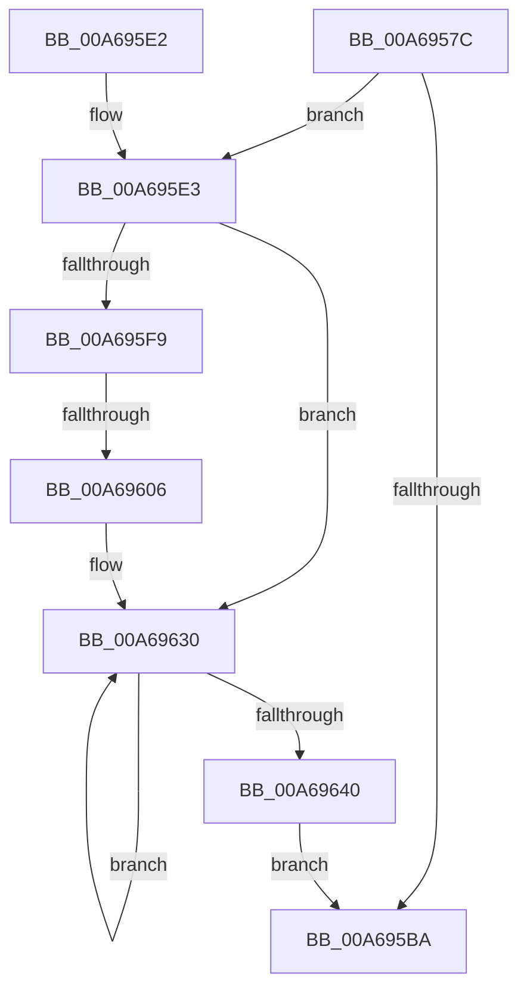

# LookUpTableFlushComplete

- RVA: `0x00A6957C`–`0x00A69645` (길이 `201` bytes)
- VA: `0x0000000140A6957C`
- 실행 섹션: `PAGE`
- PDB 이름 있음: `예`; PDB Function 태그: `예`
- unwind 정보 RVA: `0x000B4094`
- 디코드: `47`개 명령, `201/201` bytes 표시
- 미해석 바이트: `0` (있으면 어셈블리에 `.byte`로 보존)

> 이 문서는 커널 이미지의 기계어와 PDB 기호를 분석해 생성했습니다. 4번과 5번은 함수 원형과 자료형을 바이너리 사용 방식에서 추정한 C 해석이며 원본 소스 복구 결과는 아닙니다.

## 1. Dependencies

- 직접 호출 지점: **3**; 고유 호출 대상: **3**
- 직접 호출자로 확인된 함수: **4**
- RIP 상대 이미지 참조: **2**

### Outgoing calls
- `0x00A695C4` → [_security_check_cookie](../../text/6A/_security_check_cookie_function_006AC640.md) (function, `0x006AC640`)
- `0x00A695E3` → [UpdateInternalStatsOnFlush](UpdateInternalStatsOnFlush_function_00A694B0.md) (function, `0x00A694B0`)
- `0x00A69635` → [FlushLookUpTableBucket](../../text/49/FlushLookUpTableBucket_function_00497690.md) (function, `0x00497690`)

### Direct callers
- [TlgAggregateFlush](../../text/6A/TlgAggregateFlush_function_006A5DCC.md) at `0x006A5DF8`
- [TlgAggregateInternalFlushWorkItemRoutineKernelMode](TlgAggregateInternalFlushWorkItemRoutineKernelMode_function_00A693B0.md) at `0x00A69400`
- [TlgAggregateInternalRegisteredProviderEtwCallback](TlgAggregateInternalRegisteredProviderEtwCallback_function_00A69500.md) at `0x00A69553`
- [TlgAggregateInternalProviderCallback](../AC/TlgAggregateInternalProviderCallback_function_00AC1A80.md) at `0x00AC1ACB`

### Static image references
- `0x00A6959A` → RVA `0x00E0A740` (`.data`; read)
- `0x00A695F9` → RVA `0x00E0A580` (`.data`; read)

## 2. Other-region calls and transfers

- 다른 실행 섹션으로 향하는 call: **2**
  - `0x00A695C4` → [_security_check_cookie](../../text/6A/_security_check_cookie_function_006AC640.md) (`PAGE` → `.text`)
  - `0x00A69635` → [FlushLookUpTableBucket](../../text/49/FlushLookUpTableBucket_function_00497690.md) (`PAGE` → `.text`)
- call이 아닌 외부 분기/꼬리 이동: **1**
  - `0x00A69600` → [sub_00B3EDC0](../B3/Unknown_function_00B3EDC0.md) (`tail-transfer`)

## 3. Assembly (complete function range)

```asm
00A6957C  48 8B C4                        mov rax, rsp
00A6957F  48 89 58 10                     mov qword ptr [rax + 0x10], rbx
00A69583  48 89 70 18                     mov qword ptr [rax + 0x18], rsi
00A69587  48 89 78 20                     mov qword ptr [rax + 0x20], rdi
00A6958B  55                              push rbp
00A6958C  48 8D A8 38 FF FF FF            lea rbp, [rax - 0xc8]
00A69593  48 81 EC 60 02 00 00            sub rsp, 0x260
00A6959A  48 8B 05 9F 11 3A 00            mov rax, qword ptr [rip + 0x3a119f]
00A695A1  48 33 C4                        xor rax, rsp
00A695A4  48 89 85 B0 00 00 00            mov qword ptr [rbp + 0xb0], rax
00A695AB  8B 91 00 01 00 00               mov edx, dword ptr [rcx + 0x100]
00A695B1  33 FF                           xor edi, edi
00A695B3  48 8B D9                        mov rbx, rcx
00A695B6  85 D2                           test edx, edx
00A695B8  75 29                           jne 0x140a695e3
00A695BA  48 8B 8D B0 00 00 00            mov rcx, qword ptr [rbp + 0xb0]
00A695C1  48 33 CC                        xor rcx, rsp
00A695C4  E8 77 30 C4 FF                  call 0x1406ac640
00A695C9  4C 8D 9C 24 60 02 00 00         lea r11, [rsp + 0x260]
00A695D1  49 8B 5B 18                     mov rbx, qword ptr [r11 + 0x18]
00A695D5  49 8B 73 20                     mov rsi, qword ptr [r11 + 0x20]
00A695D9  49 8B 7B 28                     mov rdi, qword ptr [r11 + 0x28]
00A695DD  49 8B E3                        mov rsp, r11
00A695E0  5D                              pop rbp
00A695E1  C3                              ret
00A695E2  CC                              int3
00A695E3  E8 C8 FE FF FF                  call 0x140a694b0
00A695E8  4C 8B 81 20 01 00 00            mov r8, qword ptr [rcx + 0x120]
00A695EF  BE 20 00 00 00                  mov esi, 0x20
00A695F4  4D 85 C0                        test r8, r8
00A695F7  74 37                           je 0x140a69630
00A695F9  83 3D 80 0F 3A 00 05            cmp dword ptr [rip + 0x3a0f80], 5
00A69600  0F 87 BA 57 0D 00               ja 0x140b3edc0
00A69606  0F 57 C0                        xorps xmm0, xmm0
00A69609  33 C0                           xor eax, eax
00A6960B  0F 11 83 20 01 00 00            movups xmmword ptr [rbx + 0x120], xmm0
00A69612  48 89 85 98 00 00 00            mov qword ptr [rbp + 0x98], rax
00A69619  0F 11 83 30 01 00 00            movups xmmword ptr [rbx + 0x130], xmm0
00A69620  F2 0F 10 85 98 00 00 00         movsd xmm0, qword ptr [rbp + 0x98]
00A69628  F2 0F 11 83 40 01 00 00         movsd qword ptr [rbx + 0x140], xmm0
00A69630  8B D7                           mov edx, edi
00A69632  48 8B CB                        mov rcx, rbx
00A69635  E8 56 E0 A2 FF                  call 0x140497690
00A6963A  FF C7                           inc edi
00A6963C  3B FE                           cmp edi, esi
00A6963E  72 F0                           jb 0x140a69630
00A69640  E9 75 FF FF FF                  jmp 0x140a695ba
```

## 4. C-style interpretation (structured pseudocode)

```c
__int64 __fastcall LookUpTableFlushComplete(__int64 a1)
{
    __int64 result;
    __int64 v_rdi;
    __int64 v_rsp;
    unsigned __int64 v_stack_m8;

    *(unsigned __int64 *)(v_rsp + 16) = v_rbx;
    *(unsigned __int64 *)(v_rsp + 24) = v_rsi;
    *(unsigned __int64 *)(v_rsp + 32) = v_rdi;
    v_rsp = (v_rsp) - (608);
    result = (*(unsigned __int64 *)(v_rip + 3805599)) ^ (v_rsp);
    *(unsigned __int64 *)(v_rsp - 200 + 176) = result;
    v_rdi = 0;
    if ((unsigned int)((unsigned int)(*(unsigned int *)(a1 + 256))) != 0) goto loc_00A695E3;
loc_00A695BA:
    a1 = (*(unsigned __int64 *)(v_rsp - 200 + 176)) ^ (v_rsp);
    result = _security_check_cookie(a1, (unsigned int)(*(unsigned int *)(a1 + 256)), a3, a4);
    return result;
loc_00A695E3:
    result = UpdateInternalStatsOnFlush(a1, (unsigned int)(*(unsigned int *)(a1 + 256)), a3, a4);
    if (*(unsigned __int64 *)(a1 + 288) == 0) goto loc_00A69630;
    result = 0;
    *(unsigned __int64 *)(*(unsigned __int64 *)(v_stack_m8 + 24) + 288) = v_xmm0;
    *(unsigned __int64 *)(v_rsp - 200 + 152) = 0;
    *(unsigned __int64 *)(*(unsigned __int64 *)(v_stack_m8 + 24) + 304) = v_xmm0;
    *(unsigned __int64 *)(*(unsigned __int64 *)(v_stack_m8 + 24) + 320) = v_xmm0;
loc_00A69630:
    result = FlushLookUpTableBucket(*(unsigned __int64 *)(v_stack_m8 + 24), (unsigned int)((unsigned int)(*(unsigned __int64 *)(v_stack_m8 + 40))), *(unsigned __int64 *)(a1 + 288), a4);
    v_rdi = (unsigned int)((*(unsigned __int64 *)(v_stack_m8 + 40)) + 1);
    if (((unsigned int)(v_rdi)) < 32) goto loc_00A69630;
    goto loc_00A695BA;
}
```

## 5. (Beta) C Style

```c
int64_t LookUpTableFlushComplete(void *Arg1)
{
    uint8_t *arg1 = (uint8_t *)Arg1;

    int64_t result;
    int64_t local_rdi;
    int64_t local_rsp;
    uint64_t v_stack_m8;

    *(uint64_t *)(local_rsp + 0x10) = local_rbx;
    *(uint64_t *)(local_rsp + 0x18) = local_rsi;
    *(uint64_t *)(local_rsp + 0x20) = local_rdi;
    local_rsp = (local_rsp) - (608);
    result = (*(uint64_t *)(v_rip + 0x3A119F)) ^ (local_rsp);
    *(uint64_t *)(local_rsp - 0xC8 + 0xB0) = result;
    local_rdi = 0;
    if ((uint32_t)((uint32_t)(*(uint32_t *)(arg1 + 0x100))) != 0) goto loc_00A695E3;
loc_00A695BA:
    Arg1 = (*(uint64_t *)(local_rsp - 0xC8 + 0xB0)) ^ (local_rsp);
    result = _security_check_cookie(Arg1, (uint32_t)(*(uint32_t *)(arg1 + 0x100)), a3, a4);
    return result;
loc_00A695E3:
    result = UpdateInternalStatsOnFlush(Arg1, (uint32_t)(*(uint32_t *)(arg1 + 0x100)), a3, a4);
    if (*(uint64_t *)(arg1 + 0x120) == 0) goto loc_00A69630;
    result = 0;
    *(uint64_t *)(*(uint64_t *)(v_stack_m8 + 0x18) + 0x120) = v_xmm0;
    *(uint64_t *)(local_rsp - 0xC8 + 0x98) = 0;
    *(uint64_t *)(*(uint64_t *)(v_stack_m8 + 0x18) + 0x130) = v_xmm0;
    *(uint64_t *)(*(uint64_t *)(v_stack_m8 + 0x18) + 0x140) = v_xmm0;
loc_00A69630:
    result = FlushLookUpTableBucket(*(uint64_t *)(v_stack_m8 + 0x18), (uint32_t)((uint32_t)(*(uint64_t *)(v_stack_m8 + 0x28))), *(uint64_t *)(arg1 + 0x120), a4);
    local_rdi = (uint32_t)((*(uint64_t *)(v_stack_m8 + 0x28)) + 1);
    if (((uint32_t)(local_rdi)) < 32) goto loc_00A69630;
    goto loc_00A695BA;
}
```

### 관측된 메모리 오프셋

구조체 형식이 확인되지 않은 접근은 인자 기준의 오프셋으로만 기록했습니다.

| 기준 인자 | 오프셋 표현 | 폭 (bit) | 접근 |
|---|---:|---:|---|
| `Arg1` | `+ 0x100` | `32` | `R` |
| `Arg1` | `+ 0x120` | `128` | `R` |
| `Arg1` | `+ 0x130` | `128` | `R` |
| `Arg1` | `+ 0x140` | `64` | `W` |

## 6. Execution-region graph

[열기: 2D/3D 그래프와 함수 탐색 컨트롤 패널](../../../control-panel.html?section=page&rva=0x00A6957C&view=graph)

- 2D 그래프는 위에서 아래로 흐르고, 3D 그래프는 빈 공간을 드래그해 회전합니다. Shift+드래그는 이동, 휠은 확대·축소, 함수 노드 선택은 대상 보고서 이동입니다.

### Static fallback


