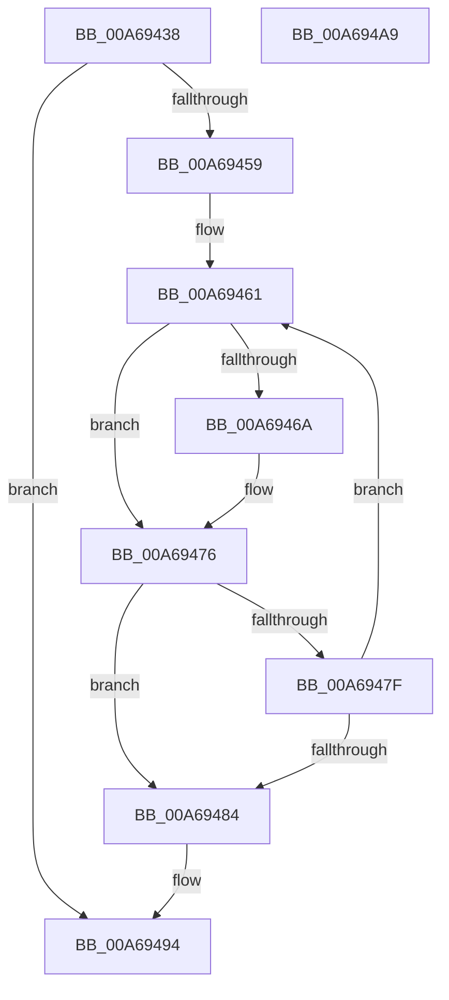

# LookUpTableFlushPartial

- RVA: `0x00A69438`–`0x00A694AA` (길이 `114` bytes)
- VA: `0x0000000140A69438`
- 실행 섹션: `PAGE`
- PDB 이름 있음: `예`; PDB Function 태그: `예`
- unwind 정보 RVA: `0x0005C954`
- 디코드: `35`개 명령, `114/114` bytes 표시
- 미해석 바이트: `0` (있으면 어셈블리에 `.byte`로 보존)

> 이 문서는 커널 이미지의 기계어와 PDB 기호를 분석해 생성했습니다. 4번과 5번은 함수 원형과 자료형을 바이너리 사용 방식에서 추정한 C 해석이며 원본 소스 복구 결과는 아닙니다.

## 1. Dependencies

- 직접 호출 지점: **2**; 고유 호출 대상: **2**
- 직접 호출자로 확인된 함수: **2**
- RIP 상대 이미지 참조: **0**

### Outgoing calls
- `0x00A6946F` → [FlushLookUpTableBucket](../../text/49/FlushLookUpTableBucket_function_00497690.md) (function, `0x00497690`)
- `0x00A6948F` → [UpdateInternalStatsOnFlush](UpdateInternalStatsOnFlush_function_00A694B0.md) (function, `0x00A694B0`)

### Direct callers
- [TlgAggregateInternalFlushWorkItemRoutineKernelMode](TlgAggregateInternalFlushWorkItemRoutineKernelMode_function_00A693B0.md) at `0x00A693C8`
- [TlgAggregateInternalRegisteredProviderEtwCallback](TlgAggregateInternalRegisteredProviderEtwCallback_function_00A69500.md) at `0x00A6956C`

### Static image references
- 디코드된 RIP-relative 메모리 참조가 없습니다.

## 2. Other-region calls and transfers

- 다른 실행 섹션으로 향하는 call: **1**
  - `0x00A6946F` → [FlushLookUpTableBucket](../../text/49/FlushLookUpTableBucket_function_00497690.md) (`PAGE` → `.text`)
- 별도 외부 분기/꼬리 이동을 확인하지 못했습니다.

## 3. Assembly (complete function range)

```asm
00A69438  48 89 5C 24 08                  mov qword ptr [rsp + 8], rbx
00A6943D  48 89 6C 24 10                  mov qword ptr [rsp + 0x10], rbp
00A69442  48 89 74 24 18                  mov qword ptr [rsp + 0x18], rsi
00A69447  57                              push rdi
00A69448  48 83 EC 20                     sub rsp, 0x20
00A6944C  33 F6                           xor esi, esi
00A6944E  48 8B F9                        mov rdi, rcx
00A69451  39 B1 00 01 00 00               cmp dword ptr [rcx + 0x100], esi
00A69457  74 3B                           je 0x140a69494
00A69459  8B A9 04 01 00 00               mov ebp, dword ptr [rcx + 0x104]
00A6945F  8B DD                           mov ebx, ebp
00A69461  8B C3                           mov eax, ebx
00A69463  48 83 3C C7 00                  cmp qword ptr [rdi + rax*8], 0
00A69468  74 0C                           je 0x140a69476
00A6946A  8B D3                           mov edx, ebx
00A6946C  48 8B CF                        mov rcx, rdi
00A6946F  E8 1C E2 A2 FF                  call 0x140497690
00A69474  03 F0                           add esi, eax
00A69476  FF C3                           inc ebx
00A69478  83 E3 1F                        and ebx, 0x1f
00A6947B  3B DD                           cmp ebx, ebp
00A6947D  74 05                           je 0x140a69484
00A6947F  83 FE 10                        cmp esi, 0x10
00A69482  72 DD                           jb 0x140a69461
00A69484  8B D6                           mov edx, esi
00A69486  89 9F 04 01 00 00               mov dword ptr [rdi + 0x104], ebx
00A6948C  48 8B CF                        mov rcx, rdi
00A6948F  E8 1C 00 00 00                  call 0x140a694b0
00A69494  48 8B 5C 24 30                  mov rbx, qword ptr [rsp + 0x30]
00A69499  48 8B 6C 24 38                  mov rbp, qword ptr [rsp + 0x38]
00A6949E  48 8B 74 24 40                  mov rsi, qword ptr [rsp + 0x40]
00A694A3  48 83 C4 20                     add rsp, 0x20
00A694A7  5F                              pop rdi
00A694A8  C3                              ret
00A694A9  CC                              int3
```

## 4. C-style interpretation (structured pseudocode)

```c
__int64 __fastcall LookUpTableFlushPartial(__int64 a1)
{
    __int64 result;
    __int64 v_rbx;
    __int64 v_rsi;
    __int64 v_rsp;
    unsigned __int64 v_stack_p10;
    unsigned __int64 v_stack_p18;
    unsigned __int64 v_stack_p8;

    v_stack_p8 = v_rbx;
    v_stack_p10 = v_rbp;
    v_stack_p18 = v_rsi;
    v_rsp = (v_rsp) - (32);
    v_rsi = 0;
    if ((*(unsigned int *)(a1 + 256)) == 0) goto loc_00A69494;
loc_00A69461:
    result = (unsigned int)((unsigned int)((unsigned int)((unsigned int)((unsigned int)(*(unsigned int *)(a1 + 260))))));
    if ((*(unsigned __int64 *)(a1 + (unsigned int)((unsigned int)((unsigned int)((unsigned int)((unsigned int)(*(unsigned int *)(a1 + 260)))))) * 8)) != 0) {
        a2 = (unsigned int)((unsigned int)((unsigned int)((unsigned int)(*(unsigned int *)(a1 + 260)))));
        a1 = a1;
        result = FlushLookUpTableBucket(a1, a2, a3, a4);
        v_rsi = (unsigned int)((v_rsi) + ((unsigned int)(result)));
    }
    v_rbx = (unsigned int)(((unsigned int)((unsigned int)((unsigned int)(*(unsigned int *)(a1 + 260))))) + 1);
    v_rbx = (unsigned int)((v_rbx) & (31));
    if (((unsigned int)(v_rbx)) == ((unsigned int)((unsigned int)(*(unsigned int *)(a1 + 260))))) goto loc_00A69484;
    if (((unsigned int)(v_rsi)) < 16) goto loc_00A69461;
loc_00A69484:
    *(unsigned int *)(a1 + 260) = (unsigned int)(v_rbx);
    result = UpdateInternalStatsOnFlush(a1, (unsigned int)((unsigned int)(v_rsi)), a3, a4);
loc_00A69494:
    v_rsp = (v_rsp) + (32);
    return result;
}
```

## 5. (Beta) C Style

```c
int64_t LookUpTableFlushPartial(void *Arg1)
{
    uint8_t *arg1 = (uint8_t *)Arg1;

    int64_t result;
    int64_t local_rbx;
    int64_t local_rsi;
    int64_t local_rsp;
    uint64_t v_stack_p10;
    uint64_t v_stack_p18;
    uint64_t v_stack_p8;

    v_stack_p8 = local_rbx;
    v_stack_p10 = local_rbp;
    v_stack_p18 = local_rsi;
    local_rsp = (local_rsp) - (32);
    local_rsi = 0;
    if ((*(uint32_t *)(arg1 + 0x100)) == 0) goto loc_00A69494;
loc_00A69461:
    result = (uint32_t)((uint32_t)((uint32_t)((uint32_t)((uint32_t)(*(uint32_t *)(arg1 + 0x104))))));
    if ((*(uint64_t *)(arg1 + (uint32_t)((uint32_t)((uint32_t)((uint32_t)((uint32_t)(*(uint32_t *)(arg1 + 0x104)))))) * 8)) != 0) {
        a2 = (uint32_t)((uint32_t)((uint32_t)((uint32_t)(*(uint32_t *)(arg1 + 0x104)))));
        Arg1 = Arg1;
        result = FlushLookUpTableBucket(Arg1, a2, a3, a4);
        local_rsi = (uint32_t)((local_rsi) + ((uint32_t)(result)));
    }
    local_rbx = (uint32_t)(((uint32_t)((uint32_t)((uint32_t)(*(uint32_t *)(arg1 + 0x104))))) + 1);
    local_rbx = (uint32_t)((local_rbx) & (31));
    if (((uint32_t)(local_rbx)) == ((uint32_t)((uint32_t)(*(uint32_t *)(arg1 + 0x104))))) goto loc_00A69484;
    if (((uint32_t)(local_rsi)) < 16) goto loc_00A69461;
loc_00A69484:
    *(uint32_t *)(arg1 + 0x104) = (uint32_t)(local_rbx);
    result = UpdateInternalStatsOnFlush(Arg1, (uint32_t)((uint32_t)(local_rsi)), a3, a4);
loc_00A69494:
    local_rsp = (local_rsp) + (32);
    return result;
}
```

### 관측된 메모리 오프셋

구조체 형식이 확인되지 않은 접근은 인자 기준의 오프셋으로만 기록했습니다.

| 기준 인자 | 오프셋 표현 | 폭 (bit) | 접근 |
|---|---:|---:|---|
| `Arg1` | `+ 0x0 + rax*8` | `64` | `R` |
| `Arg1` | `+ 0x100` | `32` | `R` |
| `Arg1` | `+ 0x104` | `32` | `R` |
| `Arg1` | `+ 0x104` | `32` | `W` |

## 6. Execution-region graph

[열기: 2D/3D 그래프와 함수 탐색 컨트롤 패널](../../../control-panel.html?section=page&rva=0x00A69438&view=graph)

- 2D 그래프는 위에서 아래로 흐르고, 3D 그래프는 빈 공간을 드래그해 회전합니다. Shift+드래그는 이동, 휠은 확대·축소, 함수 노드 선택은 대상 보고서 이동입니다.

### Static fallback


