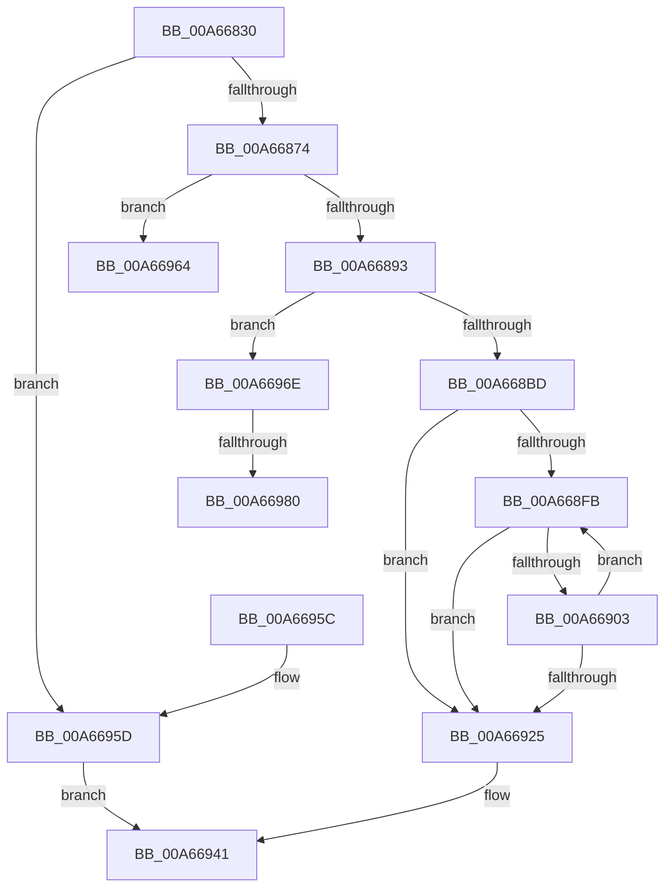

# MiAllocatePerSessionProtos

- RVA: `0x00A66830`–`0x00A6698D` (길이 `349` bytes)
- VA: `0x0000000140A66830`
- 실행 섹션: `PAGE`
- PDB 이름 있음: `예`; PDB Function 태그: `예`
- unwind 정보 RVA: `0x0005CA74`
- 디코드: `93`개 명령, `349/349` bytes 표시
- 미해석 바이트: `0` (있으면 어셈블리에 `.byte`로 보존)

> 이 문서는 커널 이미지의 기계어와 PDB 기호를 분석해 생성했습니다. 4번과 5번은 함수 원형과 자료형을 바이너리 사용 방식에서 추정한 C 해석이며 원본 소스 복구 결과는 아닙니다.

## 1. Dependencies

- 직접 호출 지점: **9**; 고유 호출 대상: **8**
- 직접 호출자로 확인된 함수: **1**
- RIP 상대 이미지 참조: **0**

### Outgoing calls
- `0x00A66856` → [MiGetControlAreaPartition](../../text/43/MiGetControlAreaPartition_function_0043E560.md) (function, `0x0043E560`)
- `0x00A66867` → [MiChargeCommit](../../text/28/MiChargeCommit_function_00286EB0.md) (function, `0x00286EB0`)
- `0x00A66882` → [MiAllocatePool](../../text/35/MiAllocatePool_function_0035B540.md) (function, `0x0035B540`)
- `0x00A668AC` → [MiAllocatePool](../../text/35/MiAllocatePool_function_0035B540.md) (function, `0x0035B540`)
- `0x00A668CE` → [memset](../../text/6C/memset_function_006C6C40.md) (function, `0x006C6C40`)
- `0x00A668D6` → [MiMakeSubsectionPte](../../text/47/MiMakeSubsectionPte_function_0047B4F0.md) (function, `0x0047B4F0`)
- `0x00A66906` → [IS_PTE_NOT_DEMAND_ZERO](../../text/22/IS_PTE_NOT_DEMAND_ZERO_function_0022F4D0.md) (function, `0x0022F4D0`)
- `0x00A66935` → [MiUpdateSystemProtoPtesTree](../../text/29/MiUpdateSystemProtoPtesTree_function_00295F0C.md) (function, `0x00295F0C`)
- `0x00A66982` → [ExFreePoolWithTag](../../poolcode/B8/ExFreePoolWithTag_function_00B82870.md) (function, `0x00B82870`)

### Direct callers
- [MiCreatePerSessionProtos](MiCreatePerSessionProtos_function_00A666D8.md) at `0x00A667E0`

### Static image references
- 디코드된 RIP-relative 메모리 참조가 없습니다.

## 2. Other-region calls and transfers

- 다른 실행 섹션으로 향하는 call: **9**
  - `0x00A66856` → [MiGetControlAreaPartition](../../text/43/MiGetControlAreaPartition_function_0043E560.md) (`PAGE` → `.text`)
  - `0x00A66867` → [MiChargeCommit](../../text/28/MiChargeCommit_function_00286EB0.md) (`PAGE` → `.text`)
  - `0x00A66882` → [MiAllocatePool](../../text/35/MiAllocatePool_function_0035B540.md) (`PAGE` → `.text`)
  - `0x00A668AC` → [MiAllocatePool](../../text/35/MiAllocatePool_function_0035B540.md) (`PAGE` → `.text`)
  - `0x00A668CE` → [memset](../../text/6C/memset_function_006C6C40.md) (`PAGE` → `.text`)
  - `0x00A668D6` → [MiMakeSubsectionPte](../../text/47/MiMakeSubsectionPte_function_0047B4F0.md) (`PAGE` → `.text`)
  - `0x00A66906` → [IS_PTE_NOT_DEMAND_ZERO](../../text/22/IS_PTE_NOT_DEMAND_ZERO_function_0022F4D0.md) (`PAGE` → `.text`)
  - `0x00A66935` → [MiUpdateSystemProtoPtesTree](../../text/29/MiUpdateSystemProtoPtesTree_function_00295F0C.md) (`PAGE` → `.text`)
  - `0x00A66982` → [ExFreePoolWithTag](../../poolcode/B8/ExFreePoolWithTag_function_00B82870.md) (`PAGE` → `POOLCODE`)
- call이 아닌 외부 분기/꼬리 이동: **3**
  - `0x00A66969` → [sub_00B3E76E + 0xA](../B3/Unknown_function_00B3E76E.md) (`tail-transfer`)
  - `0x00A6697A` → [sub_00B3E76E](../B3/Unknown_function_00B3E76E.md) (`tail-transfer`)
  - `0x00A66988` → [sub_00B3E76E](../B3/Unknown_function_00B3E76E.md) (`tail-transfer`)

## 3. Assembly (complete function range)

```asm
00A66830  48 8B C4                        mov rax, rsp
00A66833  48 89 58 08                     mov qword ptr [rax + 8], rbx
00A66837  48 89 68 10                     mov qword ptr [rax + 0x10], rbp
00A6683B  48 89 70 18                     mov qword ptr [rax + 0x18], rsi
00A6683F  48 89 78 20                     mov qword ptr [rax + 0x20], rdi
00A66843  41 56                           push r14
00A66845  48 83 EC 20                     sub rsp, 0x20
00A66849  48 83 22 00                     and qword ptr [rdx], 0
00A6684D  48 8B F1                        mov rsi, rcx
00A66850  48 8B 09                        mov rcx, qword ptr [rcx]
00A66853  4C 8B F2                        mov r14, rdx
00A66856  E8 05 7D 9D FF                  call 0x14043e560
00A6685B  8B 56 2C                        mov edx, dword ptr [rsi + 0x2c]
00A6685E  48 8B C8                        mov rcx, rax
00A66861  45 33 C0                        xor r8d, r8d
00A66864  48 8B E8                        mov rbp, rax
00A66867  E8 44 06 82 FF                  call 0x140286eb0
00A6686C  85 C0                           test eax, eax
00A6686E  0F 84 E9 00 00 00               je 0x140a6695d
00A66874  BA 58 00 00 00                  mov edx, 0x58
00A66879  41 B8 4D 6D 53 73               mov r8d, 0x73536d4d
00A6687F  8D 4A E8                        lea ecx, [rdx - 0x18]
00A66882  E8 B9 4C 8F FF                  call 0x14035b540
00A66887  48 8B F8                        mov rdi, rax
00A6688A  48 85 C0                        test rax, rax
00A6688D  0F 84 D1 00 00 00               je 0x140a66964
00A66893  C7 40 50 01 00 00 00            mov dword ptr [rax + 0x50], 1
00A6689A  B9 12 01 00 00                  mov ecx, 0x112
00A6689F  8B 56 2C                        mov edx, dword ptr [rsi + 0x2c]
00A668A2  41 B8 4D 6D 53 74               mov r8d, 0x74536d4d
00A668A8  48 C1 E2 03                     shl rdx, 3
00A668AC  E8 8F 4C 8F FF                  call 0x14035b540
00A668B1  48 8B D8                        mov rbx, rax
00A668B4  48 85 C0                        test rax, rax
00A668B7  0F 84 B1 00 00 00               je 0x140a6696e
00A668BD  48 89 47 48                     mov qword ptr [rdi + 0x48], rax
00A668C1  33 D2                           xor edx, edx
00A668C3  44 8B 46 2C                     mov r8d, dword ptr [rsi + 0x2c]
00A668C7  48 8B C8                        mov rcx, rax
00A668CA  49 C1 E0 03                     shl r8, 3
00A668CE  E8 6D 03 C6 FF                  call 0x1406c6c40
00A668D3  48 8B CE                        mov rcx, rsi
00A668D6  E8 15 4C A1 FF                  call 0x14047b4f0
00A668DB  4C 8B C8                        mov r9, rax
00A668DE  45 33 D2                        xor r10d, r10d
00A668E1  48 8B 47 30                     mov rax, qword ptr [rdi + 0x30]
00A668E5  48 83 E0 FB                     and rax, 0xfffffffffffffffb
00A668E9  48 83 C8 03                     or rax, 3
00A668ED  48 89 47 30                     mov qword ptr [rdi + 0x30], rax
00A668F1  4C 8B 5E 08                     mov r11, qword ptr [rsi + 8]
00A668F5  44 39 56 2C                     cmp dword ptr [rsi + 0x2c], r10d
00A668F9  76 2A                           jbe 0x140a66925
00A668FB  4D 8B 03                        mov r8, qword ptr [r11]
00A668FE  4D 85 C0                        test r8, r8
00A66901  74 22                           je 0x140a66925
00A66903  49 8B C8                        mov rcx, r8
00A66906  E8 C5 8B 7C FF                  call 0x14022f4d0
00A6690B  85 C0                           test eax, eax
00A6690D  4D 0F 45 C1                     cmovne r8, r9
00A66911  49 83 C3 08                     add r11, 8
00A66915  4C 89 03                        mov qword ptr [rbx], r8
00A66918  41 FF C2                        inc r10d
00A6691B  48 83 C3 08                     add rbx, 8
00A6691F  44 3B 56 2C                     cmp r10d, dword ptr [rsi + 0x2c]
00A66923  72 D6                           jb 0x140a668fb
00A66925  41 8B C2                        mov eax, r10d
00A66928  48 8D 4F 18                     lea rcx, [rdi + 0x18]
00A6692C  BA 01 00 00 00                  mov edx, 1
00A66931  48 89 47 38                     mov qword ptr [rdi + 0x38], rax
00A66935  E8 D2 F5 82 FF                  call 0x140295f0c
00A6693A  33 DB                           xor ebx, ebx
00A6693C  49 89 3E                        mov qword ptr [r14], rdi
00A6693F  8B C3                           mov eax, ebx
00A66941  48 8B 5C 24 30                  mov rbx, qword ptr [rsp + 0x30]
00A66946  48 8B 6C 24 38                  mov rbp, qword ptr [rsp + 0x38]
00A6694B  48 8B 74 24 40                  mov rsi, qword ptr [rsp + 0x40]
00A66950  48 8B 7C 24 48                  mov rdi, qword ptr [rsp + 0x48]
00A66955  48 83 C4 20                     add rsp, 0x20
00A66959  41 5E                           pop r14
00A6695B  C3                              ret
00A6695C  CC                              int3
00A6695D  B8 2D 01 00 C0                  mov eax, 0xc000012d
00A66962  EB DD                           jmp 0x140a66941
00A66964  BB 9A 00 00 C0                  mov ebx, 0xc000009a
00A66969  E9 0A 7E 0D 00                  jmp 0x140b3e778
00A6696E  48 8B 4F 48                     mov rcx, qword ptr [rdi + 0x48]
00A66972  BB 9A 00 00 C0                  mov ebx, 0xc000009a
00A66977  48 85 C9                        test rcx, rcx
00A6697A  0F 84 EE 7D 0D 00               je 0x140b3e76e
00A66980  33 D2                           xor edx, edx
00A66982  E8 E9 BE 11 00                  call 0x140b82870
00A66987  90                              nop
00A66988  E9 E1 7D 0D 00                  jmp 0x140b3e76e
```

## 4. C-style interpretation (structured pseudocode)

```c
__int64 __fastcall MiAllocatePerSessionProtos(__int64 a1, __int64 a2, int a3)
{
    __int64 result;
    __int64 v_r10;
    __int64 v_r11;
    __int64 v_rbx;
    __int64 v_rsp;
    unsigned __int64 v_stack_p10;
    unsigned __int64 v_stack_p18;
    unsigned __int64 v_stack_p20;
    unsigned __int64 v_stack_p8;

    *(unsigned __int64 *)(v_rsp + 8) = v_rbx;
    *(unsigned __int64 *)(v_rsp + 16) = v_rbp;
    *(unsigned __int64 *)(v_rsp + 24) = v_rsi;
    *(unsigned __int64 *)(v_rsp + 32) = v_rdi;
    v_rsp = (v_rsp) - (32);
    result = MiGetControlAreaPartition(*(unsigned __int64 *)(a1), a2, a3, a4);
    a3 = 0;
    result = MiChargeCommit(result, (unsigned int)(*(unsigned int *)(a1 + 44)), a3, a4);
    if ((unsigned int)(result) == 0) goto loc_00A6695D;
    result = MiAllocatePool(88 - 24, 88, (unsigned int)(0x73536D4DULL), a4);
    if (result == 0) goto loc_00A66964;
    *(unsigned int *)(result + 80) = 1;
    a2 = ((unsigned int)(*(unsigned int *)(a1 + 44))) << (3);
    result = MiAllocatePool(274, a2, (unsigned int)(0x74536D4DULL), a4);
    if (result == 0) goto loc_00A6696E;
    *(unsigned __int64 *)(result + 72) = result;
    a2 = 0;
    a3 = ((unsigned int)(*(unsigned int *)(a1 + 44))) << (3);
    result = memset(result, a2, a3, a4);
    result = MiMakeSubsectionPte(a1, a2, a3, a4);
    v_r10 = 0;
    result = (*(unsigned __int64 *)(result + 48)) & (-5);
    result = (result) | (3);
    *(unsigned __int64 *)(result + 48) = result;
    if ((*(unsigned int *)(a1 + 44)) <= 0) goto loc_00A66925;
loc_00A668FB:
    if (*(unsigned __int64 *)(*(unsigned __int64 *)(a1 + 8)) == 0) goto loc_00A66925;
    result = IS_PTE_NOT_DEMAND_ZERO(*(unsigned __int64 *)(*(unsigned __int64 *)(a1 + 8)), a2, *(unsigned __int64 *)(*(unsigned __int64 *)(a1 + 8)), result);
    a3 = *(unsigned __int64 *)(*(unsigned __int64 *)(a1 + 8));
    if ((unsigned int)(result) != 0) { a3 = result; }
    v_r11 = (*(unsigned __int64 *)(a1 + 8)) + (8);
    *(unsigned __int64 *)(result) = a3;
    v_r10 = (unsigned int)((v_r10) + 1);
    v_rbx = (result) + (8);
    if (((unsigned int)(v_r10)) < (*(unsigned int *)(a1 + 44))) goto loc_00A668FB;
loc_00A66925:
    *(unsigned __int64 *)(result + 56) = (unsigned int)((unsigned int)(v_r10));
    result = MiUpdateSystemProtoPtesTree(result + 24, 1, a3, result);
    v_rbx = 0;
    *(unsigned __int64 *)(a2) = result;
loc_00A66941:
    v_rsp = (v_rsp) + (32);
    return 0;
loc_00A6695D:
    goto loc_00A66941;
loc_00A66964:
loc_00A6696E:
    a2 = 0;
    result = ExFreePoolWithTag(*(unsigned __int64 *)(v_stack_p20 + 72), a2, a3, result);
}
```

## 5. (Beta) C Style

```c
int64_t MiAllocatePerSessionProtos(void *Arg1, void *Arg2, int32_t Arg3)
{
    uint8_t *arg1 = (uint8_t *)Arg1;
    uint8_t *arg2 = (uint8_t *)Arg2;

    int64_t result;
    int64_t local_r10;
    int64_t local_r11;
    int64_t local_rbx;
    int64_t local_rsp;
    uint64_t v_stack_p10;
    uint64_t v_stack_p18;
    uint64_t v_stack_p20;
    uint64_t v_stack_p8;

    *(uint64_t *)(local_rsp + 0x8) = local_rbx;
    *(uint64_t *)(local_rsp + 0x10) = local_rbp;
    *(uint64_t *)(local_rsp + 0x18) = local_rsi;
    *(uint64_t *)(local_rsp + 0x20) = local_rdi;
    local_rsp = (local_rsp) - (32);
    result = MiGetControlAreaPartition(*(uint64_t *)(arg1), Arg2, Arg3, a4);
    Arg3 = 0;
    result = MiChargeCommit(result, (uint32_t)(*(uint32_t *)(arg1 + 0x2C)), Arg3, a4);
    if ((uint32_t)(result) == 0) goto loc_00A6695D;
    result = MiAllocatePool(88 - 24, 88, (uint32_t)(0x73536D4DULL), a4);
    if (result == 0) goto loc_00A66964;
    *(uint32_t *)(result + 0x50) = 1;
    Arg2 = ((uint32_t)(*(uint32_t *)(arg1 + 0x2C))) << (3);
    result = MiAllocatePool(274, Arg2, (uint32_t)(0x74536D4DULL), a4);
    if (result == 0) goto loc_00A6696E;
    *(uint64_t *)(result + 0x48) = result;
    Arg2 = 0;
    Arg3 = ((uint32_t)(*(uint32_t *)(arg1 + 0x2C))) << (3);
    result = memset(result, Arg2, Arg3, a4);
    result = MiMakeSubsectionPte(Arg1, Arg2, Arg3, a4);
    local_r10 = 0;
    result = (*(uint64_t *)(result + 0x30)) & (-5);
    result = (result) | (3);
    *(uint64_t *)(result + 0x30) = result;
    if ((*(uint32_t *)(arg1 + 0x2C)) <= 0) goto loc_00A66925;
loc_00A668FB:
    if (*(uint64_t *)(*(uint64_t *)(arg1 + 0x8)) == 0) goto loc_00A66925;
    result = IS_PTE_NOT_DEMAND_ZERO(*(uint64_t *)(*(uint64_t *)(arg1 + 0x8)), Arg2, *(uint64_t *)(*(uint64_t *)(arg1 + 0x8)), result);
    Arg3 = *(uint64_t *)(*(uint64_t *)(arg1 + 0x8));
    if ((uint32_t)(result) != 0) { Arg3 = result; }
    local_r11 = (*(uint64_t *)(arg1 + 0x8)) + (8);
    *(uint64_t *)(result) = Arg3;
    local_r10 = (uint32_t)((local_r10) + 1);
    local_rbx = (result) + (8);
    if (((uint32_t)(local_r10)) < (*(uint32_t *)(arg1 + 0x2C))) goto loc_00A668FB;
loc_00A66925:
    *(uint64_t *)(result + 0x38) = (uint32_t)((uint32_t)(local_r10));
    result = MiUpdateSystemProtoPtesTree(result + 24, 1, Arg3, result);
    local_rbx = 0;
    *(uint64_t *)(arg2) = result;
loc_00A66941:
    local_rsp = (local_rsp) + (32);
    return 0;
loc_00A6695D:
    goto loc_00A66941;
loc_00A66964:
loc_00A6696E:
    Arg2 = 0;
    result = ExFreePoolWithTag(*(uint64_t *)(v_stack_p20 + 0x48), Arg2, Arg3, result);
}
```

### 관측된 메모리 오프셋

구조체 형식이 확인되지 않은 접근은 인자 기준의 오프셋으로만 기록했습니다.

| 기준 인자 | 오프셋 표현 | 폭 (bit) | 접근 |
|---|---:|---:|---|
| `Arg1` | `+ 0x0` | `64` | `R` |
| `Arg1` | `+ 0x8` | `64` | `R` |
| `Arg1` | `+ 0x2C` | `32` | `R` |
| `Arg2` | `+ 0x0` | `64` | `R/W` |
| `Arg2` | `+ 0x0` | `64` | `W` |

## 6. Execution-region graph

[열기: 2D/3D 그래프와 함수 탐색 컨트롤 패널](../../../control-panel.html?section=page&rva=0x00A66830&view=graph)

- 2D 그래프는 위에서 아래로 흐르고, 3D 그래프는 빈 공간을 드래그해 회전합니다. Shift+드래그는 이동, 휠은 확대·축소, 함수 노드 선택은 대상 보고서 이동입니다.

### Static fallback


