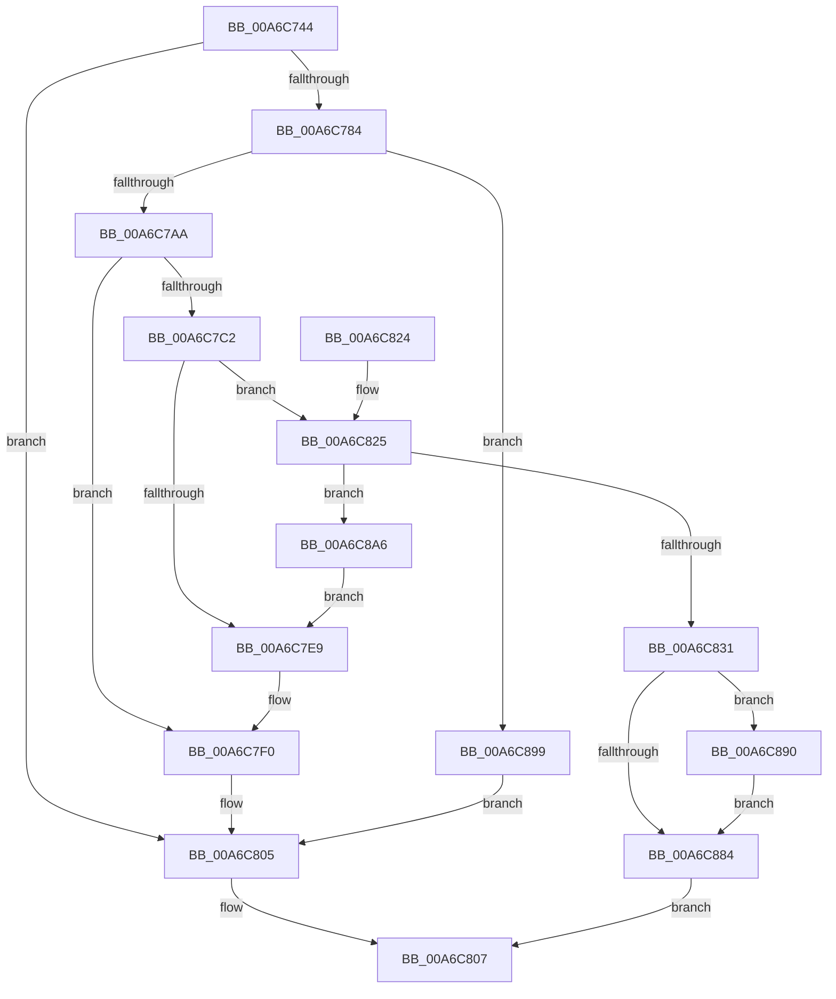

# MiBuildNewCloneDescriptor

- RVA: `0x00A6C744`–`0x00A6C8B8` (길이 `372` bytes)
- VA: `0x0000000140A6C744`
- 실행 섹션: `PAGE`
- PDB 이름 있음: `예`; PDB Function 태그: `아니요`
- unwind 정보 RVA: `0x000B44A8`
- 디코드: `103`개 명령, `372/372` bytes 표시
- 미해석 바이트: `0` (있으면 어셈블리에 `.byte`로 보존)

> 이 문서는 커널 이미지의 기계어와 PDB 기호를 분석해 생성했습니다. 4번과 5번은 함수 원형과 자료형을 바이너리 사용 방식에서 추정한 C 해석이며 원본 소스 복구 결과는 아닙니다.

## 1. Dependencies

- 직접 호출 지점: **11**; 고유 호출 대상: **6**
- 직접 호출자로 확인된 함수: **2**
- RIP 상대 이미지 참조: **0**

### Outgoing calls
- `0x00A6C777` → [PsChargeProcessNonPagedPoolQuota](../../text/2A/PsChargeProcessNonPagedPoolQuota_function_002A7B80.md) (function, `0x002A7B80`)
- `0x00A6C796` → [MiAllocatePool](../../text/35/MiAllocatePool_function_0035B540.md) (function, `0x0035B540`)
- `0x00A6C7B5` → [MiAllocatePool](../../text/35/MiAllocatePool_function_0035B540.md) (function, `0x0035B540`)
- `0x00A6C7D9` → [MiAllocatePool](../../text/35/MiAllocatePool_function_0035B540.md) (function, `0x0035B540`)
- `0x00A6C7EB` → [ExFreePoolWithTag](../../poolcode/B8/ExFreePoolWithTag_function_00B82870.md) (function, `0x00B82870`)
- `0x00A6C7F6` → [PsReturnProcessNonPagedPoolQuota](../../text/41/PsReturnProcessNonPagedPoolQuota_function_0041C200.md) (function, `0x0041C200`)
- `0x00A6C800` → [ExFreePoolWithTag](../../poolcode/B8/ExFreePoolWithTag_function_00B82870.md) (function, `0x00B82870`)
- `0x00A6C828` → [MiLockPagedRange](MiLockPagedRange_function_00A6C8C0.md) (function, `0x00A6C8C0`)
- `0x00A6C838` → [MiGetVmPartition](../../text/41/MiGetVmPartition_function_00418950.md) (function, `0x00418950`)
- `0x00A6C89C` → [PsReturnProcessNonPagedPoolQuota](../../text/41/PsReturnProcessNonPagedPoolQuota_function_0041C200.md) (function, `0x0041C200`)
- `0x00A6C8AB` → [ExFreePoolWithTag](../../poolcode/B8/ExFreePoolWithTag_function_00B82870.md) (function, `0x00B82870`)

### Direct callers
- [MiCloneVads](../../text/22/MiCloneVads_function_0022DC1C.md) at `0x0022DCEE`
- [MiCloneProcessAddressSpace](../AD/MiCloneProcessAddressSpace_function_00AD6F7C.md) at `0x00AD714F`

### Static image references
- 디코드된 RIP-relative 메모리 참조가 없습니다.

## 2. Other-region calls and transfers

- 다른 실행 섹션으로 향하는 call: **10**
  - `0x00A6C777` → [PsChargeProcessNonPagedPoolQuota](../../text/2A/PsChargeProcessNonPagedPoolQuota_function_002A7B80.md) (`PAGE` → `.text`)
  - `0x00A6C796` → [MiAllocatePool](../../text/35/MiAllocatePool_function_0035B540.md) (`PAGE` → `.text`)
  - `0x00A6C7B5` → [MiAllocatePool](../../text/35/MiAllocatePool_function_0035B540.md) (`PAGE` → `.text`)
  - `0x00A6C7D9` → [MiAllocatePool](../../text/35/MiAllocatePool_function_0035B540.md) (`PAGE` → `.text`)
  - `0x00A6C7EB` → [ExFreePoolWithTag](../../poolcode/B8/ExFreePoolWithTag_function_00B82870.md) (`PAGE` → `POOLCODE`)
  - `0x00A6C7F6` → [PsReturnProcessNonPagedPoolQuota](../../text/41/PsReturnProcessNonPagedPoolQuota_function_0041C200.md) (`PAGE` → `.text`)
  - `0x00A6C800` → [ExFreePoolWithTag](../../poolcode/B8/ExFreePoolWithTag_function_00B82870.md) (`PAGE` → `POOLCODE`)
  - `0x00A6C838` → [MiGetVmPartition](../../text/41/MiGetVmPartition_function_00418950.md) (`PAGE` → `.text`)
  - `0x00A6C89C` → [PsReturnProcessNonPagedPoolQuota](../../text/41/PsReturnProcessNonPagedPoolQuota_function_0041C200.md) (`PAGE` → `.text`)
  - `0x00A6C8AB` → [ExFreePoolWithTag](../../poolcode/B8/ExFreePoolWithTag_function_00B82870.md) (`PAGE` → `POOLCODE`)
- 별도 외부 분기/꼬리 이동을 확인하지 못했습니다.

## 3. Assembly (complete function range)

```asm
00A6C744  48 89 5C 24 08                  mov qword ptr [rsp + 8], rbx
00A6C749  48 89 6C 24 10                  mov qword ptr [rsp + 0x10], rbp
00A6C74E  48 89 74 24 18                  mov qword ptr [rsp + 0x18], rsi
00A6C753  57                              push rdi
00A6C754  41 54                           push r12
00A6C756  41 55                           push r13
00A6C758  41 56                           push r14
00A6C75A  41 57                           push r15
00A6C75C  48 83 EC 20                     sub rsp, 0x20
00A6C760  4C 8B FA                        mov r15, rdx
00A6C763  4C 8B E2                        mov r12, rdx
00A6C766  49 C1 E7 05                     shl r15, 5
00A6C76A  4D 8B E8                        mov r13, r8
00A6C76D  48 8B E9                        mov rbp, rcx
00A6C770  49 8D 7F 20                     lea rdi, [r15 + 0x20]
00A6C774  48 8B D7                        mov rdx, rdi
00A6C777  E8 04 B4 83 FF                  call 0x1402a7b80
00A6C77C  85 C0                           test eax, eax
00A6C77E  0F 88 81 00 00 00               js 0x140a6c805
00A6C784  BA 70 00 00 00                  mov edx, 0x70
00A6C789  41 B8 4D 6D 43 64               mov r8d, 0x64436d4d
00A6C78F  44 8D 72 D0                     lea r14d, [rdx - 0x30]
00A6C793  41 8B CE                        mov ecx, r14d
00A6C796  E8 A5 ED 8E FF                  call 0x14035b540
00A6C79B  48 8B D8                        mov rbx, rax
00A6C79E  48 8B D7                        mov rdx, rdi
00A6C7A1  48 85 C0                        test rax, rax
00A6C7A4  0F 84 EF 00 00 00               je 0x140a6c899
00A6C7AA  41 B8 4D 6D 43 6C               mov r8d, 0x6c436d4d
00A6C7B0  B9 12 01 00 00                  mov ecx, 0x112
00A6C7B5  E8 86 ED 8E FF                  call 0x14035b540
00A6C7BA  48 8B F0                        mov rsi, rax
00A6C7BD  48 85 C0                        test rax, rax
00A6C7C0  74 2E                           je 0x140a6c7f0
00A6C7C2  0F 57 C0                        xorps xmm0, xmm0
00A6C7C5  41 8D 56 E0                     lea edx, [r14 - 0x20]
00A6C7C9  0F 11 00                        movups xmmword ptr [rax], xmm0
00A6C7CC  41 B8 4D 6D 43 68               mov r8d, 0x68436d4d
00A6C7D2  41 8B CE                        mov ecx, r14d
00A6C7D5  0F 11 40 10                     movups xmmword ptr [rax + 0x10], xmm0
00A6C7D9  E8 62 ED 8E FF                  call 0x14035b540
00A6C7DE  4C 8B F0                        mov r14, rax
00A6C7E1  48 8B CE                        mov rcx, rsi
00A6C7E4  48 85 C0                        test rax, rax
00A6C7E7  75 3C                           jne 0x140a6c825
00A6C7E9  33 D2                           xor edx, edx
00A6C7EB  E8 80 60 11 00                  call 0x140b82870
00A6C7F0  48 8B D7                        mov rdx, rdi
00A6C7F3  48 8B CD                        mov rcx, rbp
00A6C7F6  E8 05 FA 9A FF                  call 0x14041c200
00A6C7FB  33 D2                           xor edx, edx
00A6C7FD  48 8B CB                        mov rcx, rbx
00A6C800  E8 6B 60 11 00                  call 0x140b82870
00A6C805  33 C0                           xor eax, eax
00A6C807  48 8B 5C 24 50                  mov rbx, qword ptr [rsp + 0x50]
00A6C80C  48 8B 6C 24 58                  mov rbp, qword ptr [rsp + 0x58]
00A6C811  48 8B 74 24 60                  mov rsi, qword ptr [rsp + 0x60]
00A6C816  48 83 C4 20                     add rsp, 0x20
00A6C81A  41 5F                           pop r15
00A6C81C  41 5E                           pop r14
00A6C81E  41 5D                           pop r13
00A6C820  41 5C                           pop r12
00A6C822  5F                              pop rdi
00A6C823  C3                              ret
00A6C824  CC                              int3
00A6C825  48 8B D7                        mov rdx, rdi
00A6C828  E8 93 00 00 00                  call 0x140a6c8c0
00A6C82D  85 C0                           test eax, eax
00A6C82F  74 75                           je 0x140a6c8a6
00A6C831  48 8D 8D 00 04 00 00            lea rcx, [rbp + 0x400]
00A6C838  E8 13 C1 9A FF                  call 0x140418950
00A6C83D  4D 89 26                        mov qword ptr [r14], r12
00A6C840  49 8D 4F E0                     lea rcx, [r15 - 0x20]
00A6C844  49 89 76 10                     mov qword ptr [r14 + 0x10], rsi
00A6C848  48 03 CE                        add rcx, rsi
00A6C84B  BA 01 00 00 00                  mov edx, 1
00A6C850  49 89 56 08                     mov qword ptr [r14 + 8], rdx
00A6C854  48 83 63 30 00                  and qword ptr [rbx + 0x30], 0
00A6C859  48 89 4B 20                     mov qword ptr [rbx + 0x20], rcx
00A6C85D  8B CA                           mov ecx, edx
00A6C85F  48 89 73 18                     mov qword ptr [rbx + 0x18], rsi
00A6C863  4C 89 63 28                     mov qword ptr [rbx + 0x28], r12
00A6C867  4C 89 73 38                     mov qword ptr [rbx + 0x38], r14
00A6C86B  48 89 7B 40                     mov qword ptr [rbx + 0x40], rdi
00A6C86F  4C 89 6B 60                     mov qword ptr [rbx + 0x60], r13
00A6C873  F0 48 0F C1 88 D8 06 00 00      lock xadd qword ptr [rax + 0x6d8], rcx
00A6C87C  48 03 CA                        add rcx, rdx
00A6C87F  48 3B CA                        cmp rcx, rdx
00A6C882  7E 0C                           jle 0x140a6c890
00A6C884  49 89 46 18                     mov qword ptr [r14 + 0x18], rax
00A6C888  48 8B C3                        mov rax, rbx
00A6C88B  E9 77 FF FF FF                  jmp 0x140a6c807
00A6C890  B9 0E 00 00 00                  mov ecx, 0xe
00A6C895  CD 29                           int 0x29
00A6C897  EB EB                           jmp 0x140a6c884
00A6C899  48 8B CD                        mov rcx, rbp
00A6C89C  E8 5F F9 9A FF                  call 0x14041c200
00A6C8A1  E9 5F FF FF FF                  jmp 0x140a6c805
00A6C8A6  33 D2                           xor edx, edx
00A6C8A8  49 8B CE                        mov rcx, r14
00A6C8AB  E8 C0 5F 11 00                  call 0x140b82870
00A6C8B0  48 8B CE                        mov rcx, rsi
00A6C8B3  E9 31 FF FF FF                  jmp 0x140a6c7e9
```

## 4. C-style interpretation (structured pseudocode)

```c
__int64 __fastcall MiBuildNewCloneDescriptor(__int64 a1, __int64 a2, __int64 a3)
{
    __int64 result;
    __int64 v_r15;
    __int64 v_rsp;
    unsigned __int64 v_stack_p10;
    unsigned __int64 v_stack_p18;
    unsigned __int64 v_stack_p8;

    v_stack_p8 = v_rbx;
    v_stack_p10 = v_rbp;
    v_stack_p18 = v_rsi;
    v_rsp = (v_rsp) - (32);
    v_r15 = (a2) << (5);
    result = PsChargeProcessNonPagedPoolQuota(a1, v_r15 + 32, a3, a4);
    if (sign_flag) goto loc_00A6C805;
    result = MiAllocatePool((unsigned int)((unsigned int)(112 - 48)), 112, (unsigned int)(0x64436D4DULL), a4);
    if (result == 0) goto loc_00A6C899;
    result = MiAllocatePool(274, v_r15 + 32, (unsigned int)(0x6C436D4DULL), a4);
    if (result == 0) goto loc_00A6C7F0;
    *(unsigned __int64 *)(result) = v_xmm0;
    *(unsigned __int64 *)(result + 16) = v_xmm0;
    result = MiAllocatePool((unsigned int)((unsigned int)(112 - 48)), 112 - 48 - 32, (unsigned int)(0x68436D4DULL), a4);
    if (result != 0) goto loc_00A6C825;
loc_00A6C7E9:
    a2 = 0;
    result = ExFreePoolWithTag(result, a2, (unsigned int)(0x68436D4DULL), a4);
loc_00A6C7F0:
    result = PsReturnProcessNonPagedPoolQuota(a1, v_r15 + 32, (unsigned int)(0x68436D4DULL), a4);
    a2 = 0;
    result = ExFreePoolWithTag(result, a2, (unsigned int)(0x68436D4DULL), a4);
loc_00A6C805:
    result = 0;
loc_00A6C807:
    v_rsp = (v_rsp) + (32);
    return result;
loc_00A6C825:
    result = MiLockPagedRange(result, v_r15 + 32, (unsigned int)(0x68436D4DULL), a4);
    if ((unsigned int)(result) == 0) goto loc_00A6C8A6;
    result = MiGetVmPartition(v_stack_p10 + 1024, v_r15 + 32, (unsigned int)(0x68436D4DULL), a4);
    *(unsigned __int64 *)(result) = 0;
    *(unsigned __int64 *)(result + 16) = v_stack_p18;
    a1 = (v_r15 - 32) + (v_stack_p18);
    *(unsigned __int64 *)(result + 8) = 1;
    *(unsigned __int64 *)(v_stack_p8 + 32) = a1;
    *(unsigned __int64 *)(v_stack_p8 + 24) = v_stack_p18;
    *(unsigned __int64 *)(v_stack_p8 + 40) = 0;
    *(unsigned __int64 *)(v_stack_p8 + 56) = result;
    *(unsigned __int64 *)(v_stack_p8 + 64) = v_r15 + 32;
    *(unsigned __int64 *)(v_stack_p8 + 96) = a3;
    a1 = (1) + (1);
    if (a1 <= 1) goto loc_00A6C890;
loc_00A6C884:
    *(unsigned __int64 *)(result + 24) = result;
    goto loc_00A6C807;
loc_00A6C890:
    goto loc_00A6C884;
loc_00A6C899:
    result = PsReturnProcessNonPagedPoolQuota(v_stack_p10, 1, (unsigned int)(0x68436D4DULL), a4);
    goto loc_00A6C805;
loc_00A6C8A6:
    a2 = 0;
    result = ExFreePoolWithTag(result, a2, (unsigned int)(0x68436D4DULL), a4);
    goto loc_00A6C7E9;
}
```

## 5. (Beta) C Style

```c
int64_t MiBuildNewCloneDescriptor(void *Arg1, int64_t Arg2, int64_t Arg3)
{
    uint8_t *arg1 = (uint8_t *)Arg1;

    int64_t result;
    int64_t local_r15;
    int64_t local_rsp;
    uint64_t v_stack_p10;
    uint64_t v_stack_p18;
    uint64_t v_stack_p8;

    v_stack_p8 = local_rbx;
    v_stack_p10 = local_rbp;
    v_stack_p18 = local_rsi;
    local_rsp = (local_rsp) - (32);
    local_r15 = (Arg2) << (5);
    result = PsChargeProcessNonPagedPoolQuota(Arg1, local_r15 + 32, Arg3, a4);
    if (sign_flag) goto loc_00A6C805;
    result = MiAllocatePool((uint32_t)((uint32_t)(112 - 48)), 112, (uint32_t)(0x64436D4DULL), a4);
    if (result == 0) goto loc_00A6C899;
    result = MiAllocatePool(274, local_r15 + 32, (uint32_t)(0x6C436D4DULL), a4);
    if (result == 0) goto loc_00A6C7F0;
    *(uint64_t *)(result) = v_xmm0;
    *(uint64_t *)(result + 0x10) = v_xmm0;
    result = MiAllocatePool((uint32_t)((uint32_t)(112 - 48)), 112 - 48 - 32, (uint32_t)(0x68436D4DULL), a4);
    if (result != 0) goto loc_00A6C825;
loc_00A6C7E9:
    Arg2 = 0;
    result = ExFreePoolWithTag(result, Arg2, (uint32_t)(0x68436D4DULL), a4);
loc_00A6C7F0:
    result = PsReturnProcessNonPagedPoolQuota(Arg1, local_r15 + 32, (uint32_t)(0x68436D4DULL), a4);
    Arg2 = 0;
    result = ExFreePoolWithTag(result, Arg2, (uint32_t)(0x68436D4DULL), a4);
loc_00A6C805:
    result = 0;
loc_00A6C807:
    local_rsp = (local_rsp) + (32);
    return result;
loc_00A6C825:
    result = MiLockPagedRange(result, local_r15 + 32, (uint32_t)(0x68436D4DULL), a4);
    if ((uint32_t)(result) == 0) goto loc_00A6C8A6;
    result = MiGetVmPartition(v_stack_p10 + 1024, local_r15 + 32, (uint32_t)(0x68436D4DULL), a4);
    *(uint64_t *)(result) = 0;
    *(uint64_t *)(result + 0x10) = v_stack_p18;
    Arg1 = (local_r15 - 32) + (v_stack_p18);
    *(uint64_t *)(result + 0x8) = 1;
    *(void **)(v_stack_p8 + 0x20) = Arg1;
    *(uint64_t *)(v_stack_p8 + 0x18) = v_stack_p18;
    *(uint64_t *)(v_stack_p8 + 0x28) = 0;
    *(uint64_t *)(v_stack_p8 + 0x38) = result;
    *(uint64_t *)(v_stack_p8 + 0x40) = local_r15 + 32;
    *(uint64_t *)(v_stack_p8 + 0x60) = Arg3;
    Arg1 = (1) + (1);
    if (Arg1 <= 1) goto loc_00A6C890;
loc_00A6C884:
    *(uint64_t *)(result + 0x18) = result;
    goto loc_00A6C807;
loc_00A6C890:
    goto loc_00A6C884;
loc_00A6C899:
    result = PsReturnProcessNonPagedPoolQuota(v_stack_p10, 1, (uint32_t)(0x68436D4DULL), a4);
    goto loc_00A6C805;
loc_00A6C8A6:
    Arg2 = 0;
    result = ExFreePoolWithTag(result, Arg2, (uint32_t)(0x68436D4DULL), a4);
    goto loc_00A6C7E9;
}
```

### 관측된 메모리 오프셋

구조체 형식이 확인되지 않은 접근은 인자 기준의 오프셋으로만 기록했습니다.

| 기준 인자 | 오프셋 표현 | 폭 (bit) | 접근 |
|---|---:|---:|---|
| `Arg1` | `+ 0x400` | `64` | `R` |

## 6. Execution-region graph

[열기: 2D/3D 그래프와 함수 탐색 컨트롤 패널](../../../control-panel.html?section=page&rva=0x00A6C744&view=graph)

- 2D 그래프는 위에서 아래로 흐르고, 3D 그래프는 빈 공간을 드래그해 회전합니다. Shift+드래그는 이동, 휠은 확대·축소, 함수 노드 선택은 대상 보고서 이동입니다.

### Static fallback


