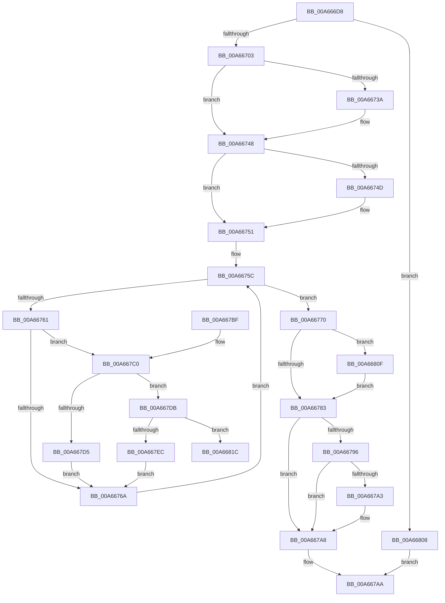

# MiCreatePerSessionProtos

- RVA: `0x00A666D8`–`0x00A66827` (길이 `335` bytes)
- VA: `0x0000000140A666D8`
- 실행 섹션: `PAGE`
- PDB 이름 있음: `예`; PDB Function 태그: `예`
- unwind 정보 RVA: `0x000B39B0`
- 디코드: `97`개 명령, `335/335` bytes 표시
- 미해석 바이트: `0` (있으면 어셈블리에 `.byte`로 보존)

> 이 문서는 커널 이미지의 기계어와 PDB 기호를 분석해 생성했습니다. 4번과 5번은 함수 원형과 자료형을 바이너리 사용 방식에서 추정한 C 해석이며 원본 소스 복구 결과는 아닙니다.

## 1. Dependencies

- 직접 호출 지점: **8**; 고유 호출 대상: **8**
- 직접 호출자로 확인된 함수: **6**
- RIP 상대 이미지 참조: **0**

### Outgoing calls
- `0x00A6672A` → [KeAbPreAcquire](../../text/21/KeAbPreAcquire_function_00210230.md) (function, `0x00210230`)
- `0x00A66743` → [ExfAcquirePushLockExclusiveEx](../../text/20/ExfAcquirePushLockExclusiveEx_function_0020FC90.md) (function, `0x0020FC90`)
- `0x00A66786` → [KeAbPostRelease](../../text/2E/KeAbPostRelease_function_002E1600.md) (function, `0x002E1600`)
- `0x00A667A3` → [KiCheckForKernelApcDelivery](../../text/2E/KiCheckForKernelApcDelivery_function_002E2C80.md) (function, `0x002E2C80`)
- `0x00A667C6` → [MiLocateSessionProtosInSubsection](../../text/24/MiLocateSessionProtosInSubsection_function_0024A5D0.md) (function, `0x0024A5D0`)
- `0x00A667E0` → [MiAllocatePerSessionProtos](MiAllocatePerSessionProtos_function_00A66830.md) (function, `0x00A66830`)
- `0x00A667FE` → [MiUpdatePerSessionProto](../../text/4A/MiUpdatePerSessionProto_function_004AD938.md) (function, `0x004AD938`)
- `0x00A66812` → [ExfTryToWakePushLock](../../text/26/ExfTryToWakePushLock_function_00265DD0.md) (function, `0x00265DD0`)

### Direct callers
- [MiInsertInSystemSpace](../../text/3B/MiInsertInSystemSpace_function_003B2F5C.md) at `0x003B35A3`
- [MiCloneImageVad](../../text/69/MiCloneImageVad_function_006979F8.md) at `0x00697A88`
- [MiInitializeImageExtents](../80/MiInitializeImageExtents_function_00800FE8.md) at `0x00801006`
- [MiValidateSectionCreate](../94/MiValidateSectionCreate_function_00940190.md) at `0x00940B4F`
- [MiMapViewOfImageSection](../97/MiMapViewOfImageSection_function_0097E92C.md) at `0x0097F810`
- [MiFinishCreateSection](../98/MiFinishCreateSection_function_009844FC.md) at `0x009847B8`

### Static image references
- 디코드된 RIP-relative 메모리 참조가 없습니다.

## 2. Other-region calls and transfers

- 다른 실행 섹션으로 향하는 call: **7**
  - `0x00A6672A` → [KeAbPreAcquire](../../text/21/KeAbPreAcquire_function_00210230.md) (`PAGE` → `.text`)
  - `0x00A66743` → [ExfAcquirePushLockExclusiveEx](../../text/20/ExfAcquirePushLockExclusiveEx_function_0020FC90.md) (`PAGE` → `.text`)
  - `0x00A66786` → [KeAbPostRelease](../../text/2E/KeAbPostRelease_function_002E1600.md) (`PAGE` → `.text`)
  - `0x00A667A3` → [KiCheckForKernelApcDelivery](../../text/2E/KiCheckForKernelApcDelivery_function_002E2C80.md) (`PAGE` → `.text`)
  - `0x00A667C6` → [MiLocateSessionProtosInSubsection](../../text/24/MiLocateSessionProtosInSubsection_function_0024A5D0.md) (`PAGE` → `.text`)
  - `0x00A667FE` → [MiUpdatePerSessionProto](../../text/4A/MiUpdatePerSessionProto_function_004AD938.md) (`PAGE` → `.text`)
  - `0x00A66812` → [ExfTryToWakePushLock](../../text/26/ExfTryToWakePushLock_function_00265DD0.md) (`PAGE` → `.text`)
- call이 아닌 외부 분기/꼬리 이동: **1**
  - `0x00A66822` → [sub_00B3E706 + 0x14](../B3/Unknown_function_00B3E706.md) (`tail-transfer`)

## 3. Assembly (complete function range)

```asm
00A666D8  48 89 5C 24 08                  mov qword ptr [rsp + 8], rbx
00A666DD  55                              push rbp
00A666DE  56                              push rsi
00A666DF  57                              push rdi
00A666E0  41 54                           push r12
00A666E2  41 55                           push r13
00A666E4  41 56                           push r14
00A666E6  41 57                           push r15
00A666E8  48 83 EC 20                     sub rsp, 0x20
00A666EC  8D 82 01 00 F8 FF               lea eax, [rdx - 0x7ffff]
00A666F2  44 8B F2                        mov r14d, edx
00A666F5  4C 8B E1                        mov r12, rcx
00A666F8  3D FF FF F7 FF                  cmp eax, 0xfff7ffff
00A666FD  0F 86 05 01 00 00               jbe 0x140a66808
00A66703  65 48 8B 34 25 88 01 00 00      mov rsi, qword ptr gs:[0x188]
00A6670C  41 BD 01 00 00 00               mov r13d, 1
00A66712  48 8B 19                        mov rbx, qword ptr [rcx]
00A66715  45 33 C0                        xor r8d, r8d
00A66718  48 83 C3 28                     add rbx, 0x28
00A6671C  33 D2                           xor edx, edx
00A6671E  48 8B CB                        mov rcx, rbx
00A66721  66 44 29 AE E6 01 00 00         sub word ptr [rsi + 0x1e6], r13w
00A66729  90                              nop
00A6672A  E8 01 9B 7A FF                  call 0x140210230
00A6672F  F0 48 0F BA 2B 00               lock bts qword ptr [rbx], 0
00A66735  48 8B F8                        mov rdi, rax
00A66738  73 0E                           jae 0x140a66748
00A6673A  4C 8B C3                        mov r8, rbx
00A6673D  48 8B D0                        mov rdx, rax
00A66740  48 8B CB                        mov rcx, rbx
00A66743  E8 48 95 7A FF                  call 0x14020fc90
00A66748  48 85 FF                        test rdi, rdi
00A6674B  74 04                           je 0x140a66751
00A6674D  44 88 6F 0A                     mov byte ptr [rdi + 0xa], r13b
00A66751  49 8D AC 24 80 00 00 00         lea rbp, [r12 + 0x80]
00A66759  48 8B FD                        mov rdi, rbp
00A6675C  48 85 FF                        test rdi, rdi
00A6675F  74 0F                           je 0x140a66770
00A66761  8B 47 20                        mov eax, dword ptr [rdi + 0x20]
00A66764  0F BA E0 11                     bt eax, 0x11
00A66768  72 56                           jb 0x140a667c0
00A6676A  48 8B 7F 10                     mov rdi, qword ptr [rdi + 0x10]
00A6676E  EB EC                           jmp 0x140a6675c
00A66770  48 83 C8 FF                     or rax, 0xffffffffffffffff
00A66774  F0 48 0F C1 03                  lock xadd qword ptr [rbx], rax
00A66779  24 06                           and al, 6
00A6677B  3C 02                           cmp al, 2
00A6677D  0F 84 8C 00 00 00               je 0x140a6680f
00A66783  48 8B CB                        mov rcx, rbx
00A66786  E8 75 AE 87 FF                  call 0x1402e1600
00A6678B  90                              nop
00A6678C  66 44 01 AE E6 01 00 00         add word ptr [rsi + 0x1e6], r13w
00A66794  75 12                           jne 0x140a667a8
00A66796  48 8D 86 98 00 00 00            lea rax, [rsi + 0x98]
00A6679D  90                              nop
00A6679E  48 39 00                        cmp qword ptr [rax], rax
00A667A1  74 05                           je 0x140a667a8
00A667A3  E8 D8 C4 87 FF                  call 0x1402e2c80
00A667A8  33 C0                           xor eax, eax
00A667AA  48 8B 5C 24 60                  mov rbx, qword ptr [rsp + 0x60]
00A667AF  48 83 C4 20                     add rsp, 0x20
00A667B3  41 5F                           pop r15
00A667B5  41 5E                           pop r14
00A667B7  41 5D                           pop r13
00A667B9  41 5C                           pop r12
00A667BB  5F                              pop rdi
00A667BC  5E                              pop rsi
00A667BD  5D                              pop rbp
00A667BE  C3                              ret
00A667BF  CC                              int3
00A667C0  41 8B D6                        mov edx, r14d
00A667C3  48 8B CF                        mov rcx, rdi
00A667C6  E8 05 3E 7E FF                  call 0x14024a5d0
00A667CB  48 89 44 24 70                  mov qword ptr [rsp + 0x70], rax
00A667D0  48 85 C0                        test rax, rax
00A667D3  74 06                           je 0x140a667db
00A667D5  44 01 68 50                     add dword ptr [rax + 0x50], r13d
00A667D9  EB 8F                           jmp 0x140a6676a
00A667DB  48 8D 54 24 70                  lea rdx, [rsp + 0x70]
00A667E0  E8 4B 00 00 00                  call 0x140a66830
00A667E5  44 8B F8                        mov r15d, eax
00A667E8  85 C0                           test eax, eax
00A667EA  78 30                           js 0x140a6681c
00A667EC  4C 8B 44 24 70                  mov r8, qword ptr [rsp + 0x70]
00A667F1  45 8B CD                        mov r9d, r13d
00A667F4  48 8B D7                        mov rdx, rdi
00A667F7  49 8B CC                        mov rcx, r12
00A667FA  45 89 70 40                     mov dword ptr [r8 + 0x40], r14d
00A667FE  E8 35 71 A4 FF                  call 0x1404ad938
00A66803  E9 62 FF FF FF                  jmp 0x140a6676a
00A66808  B8 CE 00 00 C0                  mov eax, 0xc00000ce
00A6680D  EB 9B                           jmp 0x140a667aa
00A6680F  48 8B CB                        mov rcx, rbx
00A66812  E8 B9 F5 7F FF                  call 0x140265dd0
00A66817  E9 67 FF FF FF                  jmp 0x140a66783
00A6681C  48 83 64 24 78 00               and qword ptr [rsp + 0x78], 0
00A66822  E9 F3 7E 0D 00                  jmp 0x140b3e71a
```

## 4. C-style interpretation (structured pseudocode)

```c
__int64 __fastcall MiCreatePerSessionProtos(__int64 a1, __int64 a2, int a3)
{
    __int64 result;
    __int64 v_rbx;
    __int64 v_rsp;
    unsigned __int64 v_stack_p70;
    unsigned __int64 v_stack_p78;
    unsigned __int64 v_stack_p8;

    v_stack_p8 = v_rbx;
    v_rsp = (v_rsp) - (32);
    if (((unsigned int)(a2 - 524287)) <= 0xFFF7FFFFULL) goto loc_00A66808;
    a3 = 0;
    v_rbx = (*(unsigned __int64 *)(a1)) + (40);
    a2 = 0;
    result = KeAbPreAcquire(v_rbx, a2, a3, a4);
    if (!(condition_is_above_or_equal)) {
        a3 = v_rbx;
        a2 = result;
        a1 = v_rbx;
        result = ExfAcquirePushLockExclusiveEx(a1, a2, a3, a4);
    }
    if (result != 0) {
        *(unsigned __int8 *)(result + 10) = 1;
    }
loc_00A6675C:
    if (a1 + 128 == 0) goto loc_00A66770;
    if (condition_is_below) goto loc_00A667C0;
loc_00A6676A:
    goto loc_00A6675C;
loc_00A66770:
    result = ((unsigned int)(*(unsigned int *)(a1 + 128 + 32))) | (-1);
    result = (unsigned __int8)((result) & (6));
    if (((unsigned __int8)(result)) == 2) goto loc_00A6680F;
loc_00A66783:
    result = KeAbPostRelease(v_rbx, a2, a3, a4);
    if (((unsigned __int8)(result)) != 2) goto loc_00A667A8;
    result = *(unsigned __int64 *)(gs_base + (0 + 392)) + 152;
    if ((*(unsigned __int64 *)(*(unsigned __int64 *)(gs_base + (0 + 392)) + 152)) != (*(unsigned __int64 *)(gs_base + (0 + 392)) + 152)) {
        result = KiCheckForKernelApcDelivery(v_rbx, a2, a3, a4);
    }
    result = 0;
loc_00A667AA:
    v_rsp = (v_rsp) + (32);
    return result;
loc_00A667C0:
    result = MiLocateSessionProtosInSubsection(*(unsigned __int64 *)(a1 + 128 + 16), (unsigned int)((unsigned int)((unsigned int)((unsigned int)(a2)))), a3, a4);
    v_stack_p70 = result;
    if (result == 0) goto loc_00A667DB;
    goto loc_00A6676A;
loc_00A667DB:
    result = MiAllocatePerSessionProtos(*(unsigned __int64 *)(a1 + 128 + 16), v_stack_p70, a3, a4);
    if (sign_flag) goto loc_00A6681C;
    *(unsigned int *)(v_stack_p70 + 64) = (unsigned int)((unsigned int)((unsigned int)(a2)));
    result = MiUpdatePerSessionProto(a1, *(unsigned __int64 *)(a1 + 128 + 16), v_stack_p70, 1);
    goto loc_00A6676A;
loc_00A66808:
    goto loc_00A667AA;
loc_00A6680F:
    result = ExfTryToWakePushLock(v_stack_p8, *(unsigned __int64 *)(a1 + 128 + 16), v_stack_p70, 1);
    goto loc_00A66783;
loc_00A6681C:
}
```

## 5. (Beta) C Style

```c
int64_t MiCreatePerSessionProtos(void *Arg1, void *Arg2, int32_t Arg3)
{
    uint8_t *arg1 = (uint8_t *)Arg1;
    uint8_t *arg2 = (uint8_t *)Arg2;

    int64_t result;
    int64_t local_rbx;
    int64_t local_rsp;
    uint64_t v_stack_p70;
    uint64_t v_stack_p78;
    uint64_t v_stack_p8;

    v_stack_p8 = local_rbx;
    local_rsp = (local_rsp) - (32);
    if (((uint32_t)(Arg2 - 524287)) <= 0xFFF7FFFFULL) goto loc_00A66808;
    Arg3 = 0;
    local_rbx = (*(uint64_t *)(arg1)) + (40);
    Arg2 = 0;
    result = KeAbPreAcquire(local_rbx, Arg2, Arg3, a4);
    if (!(condition_is_above_or_equal)) {
        Arg3 = local_rbx;
        Arg2 = result;
        Arg1 = local_rbx;
        result = ExfAcquirePushLockExclusiveEx(Arg1, Arg2, Arg3, a4);
    }
    if (result != 0) {
        *(uint8_t *)(result + 0xA) = 1;
    }
loc_00A6675C:
    if (Arg1 + 128 == 0) goto loc_00A66770;
    if (condition_is_below) goto loc_00A667C0;
loc_00A6676A:
    goto loc_00A6675C;
loc_00A66770:
    result = ((uint32_t)(*(uint32_t *)(arg1 + 0x80 + 0x20))) | (-1);
    result = (uint8_t)((result) & (6));
    if (((uint8_t)(result)) == 2) goto loc_00A6680F;
loc_00A66783:
    result = KeAbPostRelease(local_rbx, Arg2, Arg3, a4);
    if (((uint8_t)(result)) != 2) goto loc_00A667A8;
    result = *(uint64_t *)(gs_base + (0 + 0x188)) + 152;
    if ((*(uint64_t *)(*(uint64_t *)(gs_base + (0 + 0x188)) + 0x98)) != (*(uint64_t *)(gs_base + (0 + 0x188)) + 152)) {
        result = KiCheckForKernelApcDelivery(local_rbx, Arg2, Arg3, a4);
    }
    result = 0;
loc_00A667AA:
    local_rsp = (local_rsp) + (32);
    return result;
loc_00A667C0:
    result = MiLocateSessionProtosInSubsection(*(uint64_t *)(arg1 + 0x80 + 0x10), (uint32_t)((uint32_t)((uint32_t)((uint32_t)(Arg2)))), Arg3, a4);
    v_stack_p70 = result;
    if (result == 0) goto loc_00A667DB;
    goto loc_00A6676A;
loc_00A667DB:
    result = MiAllocatePerSessionProtos(*(uint64_t *)(arg1 + 0x80 + 0x10), v_stack_p70, Arg3, a4);
    if (sign_flag) goto loc_00A6681C;
    *(uint32_t *)(v_stack_p70 + 0x40) = (uint32_t)((uint32_t)((uint32_t)(Arg2)));
    result = MiUpdatePerSessionProto(Arg1, *(uint64_t *)(arg1 + 0x80 + 0x10), v_stack_p70, 1);
    goto loc_00A6676A;
loc_00A66808:
    goto loc_00A667AA;
loc_00A6680F:
    result = ExfTryToWakePushLock(v_stack_p8, *(uint64_t *)(arg1 + 0x80 + 0x10), v_stack_p70, 1);
    goto loc_00A66783;
loc_00A6681C:
}
```

### 관측된 메모리 오프셋

구조체 형식이 확인되지 않은 접근은 인자 기준의 오프셋으로만 기록했습니다.

| 기준 인자 | 오프셋 표현 | 폭 (bit) | 접근 |
|---|---:|---:|---|
| `Arg1` | `+ 0x0` | `64` | `R` |
| `Arg1` | `+ 0x80` | `64` | `R` |
| `Arg2` | `- 0x7FFFF` | `32` | `R` |

## 6. Execution-region graph

[열기: 2D/3D 그래프와 함수 탐색 컨트롤 패널](../../../control-panel.html?section=page&rva=0x00A666D8&view=graph)

- 2D 그래프는 위에서 아래로 흐르고, 3D 그래프는 빈 공간을 드래그해 회전합니다. Shift+드래그는 이동, 휠은 확대·축소, 함수 노드 선택은 대상 보고서 이동입니다.

### Static fallback


