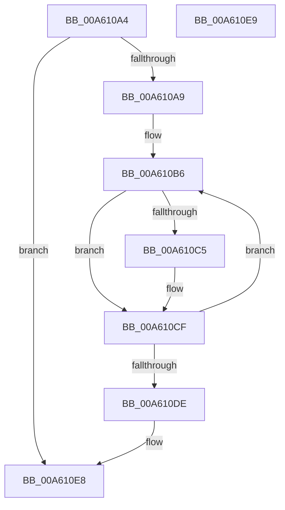

# MiDeleteTrimViewInfoList

- RVA: `0x00A610A4`–`0x00A610EA` (길이 `70` bytes)
- VA: `0x0000000140A610A4`
- 실행 섹션: `PAGE`
- PDB 이름 있음: `예`; PDB Function 태그: `아니요`
- unwind 정보 RVA: `0x00084918`
- 디코드: `23`개 명령, `70/70` bytes 표시
- 미해석 바이트: `0` (있으면 어셈블리에 `.byte`로 보존)

> 이 문서는 커널 이미지의 기계어와 PDB 기호를 분석해 생성했습니다. 4번과 5번은 함수 원형과 자료형을 바이너리 사용 방식에서 추정한 C 해석이며 원본 소스 복구 결과는 아닙니다.

## 1. Dependencies

- 직접 호출 지점: **2**; 고유 호출 대상: **2**
- 직접 호출자로 확인된 함수: **3**
- RIP 상대 이미지 참조: **0**

### Outgoing calls
- `0x00A610CA` → [ObDereferenceObjectDeferDeleteWithTag](../../text/26/ObDereferenceObjectDeferDeleteWithTag_function_00263EA0.md) (function, `0x00263EA0`)
- `0x00A610D4` → [ExFreePoolWithTag](../../poolcode/B8/ExFreePoolWithTag_function_00B82870.md) (function, `0x00B82870`)

### Direct callers
- [MiTrimSharedPageFromViews](../../text/2E/MiTrimSharedPageFromViews_function_002E16F8.md) at `0x002E22B2`
- [MiLocateSharedPageViews](../../text/67/MiLocateSharedPageViews_function_0067F1E4.md) at `0x0067F436`
- [MmQueryBadAddresses](../AD/MmQueryBadAddresses_function_00AD5430.md) at `0x00AD57CD`

### Static image references
- 디코드된 RIP-relative 메모리 참조가 없습니다.

## 2. Other-region calls and transfers

- 다른 실행 섹션으로 향하는 call: **2**
  - `0x00A610CA` → [ObDereferenceObjectDeferDeleteWithTag](../../text/26/ObDereferenceObjectDeferDeleteWithTag_function_00263EA0.md) (`PAGE` → `.text`)
  - `0x00A610D4` → [ExFreePoolWithTag](../../poolcode/B8/ExFreePoolWithTag_function_00B82870.md) (`PAGE` → `POOLCODE`)
- 별도 외부 분기/꼬리 이동을 확인하지 못했습니다.

## 3. Assembly (complete function range)

```asm
00A610A4  48 85 C9                        test rcx, rcx
00A610A7  74 3F                           je 0x140a610e8
00A610A9  48 89 5C 24 08                  mov qword ptr [rsp + 8], rbx
00A610AE  57                              push rdi
00A610AF  48 83 EC 20                     sub rsp, 0x20
00A610B3  48 8B D9                        mov rbx, rcx
00A610B6  48 8B FB                        mov rdi, rbx
00A610B9  48 8B 1B                        mov rbx, qword ptr [rbx]
00A610BC  48 8B 4F 08                     mov rcx, qword ptr [rdi + 8]
00A610C0  48 85 C9                        test rcx, rcx
00A610C3  74 0A                           je 0x140a610cf
00A610C5  BA 4D 6D 56 77                  mov edx, 0x77566d4d
00A610CA  E8 D1 2D 80 FF                  call 0x140263ea0
00A610CF  33 D2                           xor edx, edx
00A610D1  48 8B CF                        mov rcx, rdi
00A610D4  E8 97 17 12 00                  call 0x140b82870
00A610D9  48 85 DB                        test rbx, rbx
00A610DC  75 D8                           jne 0x140a610b6
00A610DE  48 8B 5C 24 30                  mov rbx, qword ptr [rsp + 0x30]
00A610E3  48 83 C4 20                     add rsp, 0x20
00A610E7  5F                              pop rdi
00A610E8  C3                              ret
00A610E9  CC                              int3
```

## 4. C-style interpretation (structured pseudocode)

```c
__int64 __fastcall MiDeleteTrimViewInfoList(__int64 a1)
{
    __int64 result;
    __int64 v_rsp;
    unsigned __int64 v_stack_p8;

    if (a1 == 0) goto loc_00A610E8;
    v_stack_p8 = v_rbx;
    v_rsp = (v_rsp) - (32);
loc_00A610B6:
    if (*(unsigned __int64 *)(a1 + 8) != 0) {
        a2 = 0x77566D4DULL;
        result = ObDereferenceObjectDeferDeleteWithTag(*(unsigned __int64 *)(a1 + 8), a2, a3, a4);
    }
    a2 = 0;
    result = ExFreePoolWithTag(a1, a2, a3, a4);
    if (*(unsigned __int64 *)(a1) != 0) goto loc_00A610B6;
    v_rsp = (v_rsp) + (32);
loc_00A610E8:
    return result;
}
```

## 5. (Beta) C Style

```c
int64_t MiDeleteTrimViewInfoList(int64_t Arg1)
{
    int64_t result;
    int64_t local_rsp;
    uint64_t v_stack_p8;

    if (Arg1 == 0) goto loc_00A610E8;
    v_stack_p8 = local_rbx;
    local_rsp = (local_rsp) - (32);
loc_00A610B6:
    if (*(uint64_t *)(Arg1 + 0x8) != 0) {
        a2 = 0x77566D4DULL;
        result = ObDereferenceObjectDeferDeleteWithTag(*(uint64_t *)(Arg1 + 0x8), a2, a3, a4);
    }
    a2 = 0;
    result = ExFreePoolWithTag(Arg1, a2, a3, a4);
    if (*(uint64_t *)(Arg1) != 0) goto loc_00A610B6;
    local_rsp = (local_rsp) + (32);
loc_00A610E8:
    return result;
}
```

## 6. Execution-region graph

[열기: 2D/3D 그래프와 함수 탐색 컨트롤 패널](../../../control-panel.html?section=page&rva=0x00A610A4&view=graph)

- 2D 그래프는 위에서 아래로 흐르고, 3D 그래프는 빈 공간을 드래그해 회전합니다. Shift+드래그는 이동, 휠은 확대·축소, 함수 노드 선택은 대상 보고서 이동입니다.

### Static fallback


