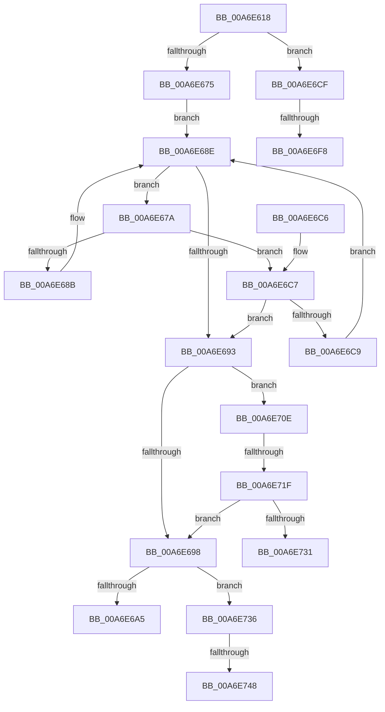

# MiFindHotPatchRecord

- RVA: `0x00A6E618`–`0x00A6E756` (길이 `318` bytes)
- VA: `0x0000000140A6E618`
- 실행 섹션: `PAGE`
- PDB 이름 있음: `예`; PDB Function 태그: `예`
- unwind 정보 RVA: `0x000B4A58`
- 디코드: `88`개 명령, `318/318` bytes 표시
- 미해석 바이트: `0` (있으면 어셈블리에 `.byte`로 보존)

> 이 문서는 커널 이미지의 기계어와 PDB 기호를 분석해 생성했습니다. 4번과 5번은 함수 원형과 자료형을 바이너리 사용 방식에서 추정한 C 해석이며 원본 소스 복구 결과는 아닙니다.

## 1. Dependencies

- 직접 호출 지점: **5**; 고유 호출 대상: **5**
- 직접 호출자로 확인된 함수: **5**
- RIP 상대 이미지 참조: **1**

### Outgoing calls
- `0x00A6E682` → [MiCompareHotPatchNodes](../80/MiCompareHotPatchNodes_function_00803114.md) (function, `0x00803114`)
- `0x00A6E6DF` → [KeAbPreAcquire](../../text/21/KeAbPreAcquire_function_00210230.md) (function, `0x00210230`)
- `0x00A6E703` → [ExfAcquirePushLockSharedEx](../../text/21/ExfAcquirePushLockSharedEx_function_0021044C.md) (function, `0x0021044C`)
- `0x00A6E724` → [RtlIsPatchMachineApplicable](../84/RtlIsPatchMachineApplicable_function_00841194.md) (function, `0x00841194`)
- `0x00A6E74B` → [ExfReleasePushLockShared](../../text/26/ExfReleasePushLockShared_function_00263440.md) (function, `0x00263440`)

### Direct callers
- [MiApplyRequiredDriverHotPatches](../70/MiApplyRequiredDriverHotPatches_function_007053D4.md) at `0x00705446`
- [MmInsertSecureImageActivePatch](../80/MmInsertSecureImageActivePatch_function_008073E4.md) at `0x00807447`
- [NtManageHotPatch](../AF/NtManageHotPatch_function_00AF8660.md) at `0x00AF8C08`
- [sub_00B3ABCE](../B3/Unknown_function_00B3ABCE.md) at `0x00B3AC2B`
- [MmRegisterHotPatches](../../init/C6/MmRegisterHotPatches_function_00C678DC.md) at `0x00C67BB6`

### Static image references
- `0x00A6E63E` → RVA `0x00E37590` (`.data`; read)

## 2. Other-region calls and transfers

- 다른 실행 섹션으로 향하는 call: **3**
  - `0x00A6E6DF` → [KeAbPreAcquire](../../text/21/KeAbPreAcquire_function_00210230.md) (`PAGE` → `.text`)
  - `0x00A6E703` → [ExfAcquirePushLockSharedEx](../../text/21/ExfAcquirePushLockSharedEx_function_0021044C.md) (`PAGE` → `.text`)
  - `0x00A6E74B` → [ExfReleasePushLockShared](../../text/26/ExfReleasePushLockShared_function_00263440.md) (`PAGE` → `.text`)
- call이 아닌 외부 분기/꼬리 이동: **6**
  - `0x00A6E6F2` → [sub_00B3F7C0](../B3/Unknown_function_00B3F7C0.md) (`tail-transfer`)
  - `0x00A6E709` → [sub_00B3F7C0](../B3/Unknown_function_00B3F7C0.md) (`tail-transfer`)
  - `0x00A6E719` → [sub_00B3F7C0 + 0x12](../B3/Unknown_function_00B3F7C0.md) (`tail-transfer`)
  - `0x00A6E731` → [sub_00B3F7C0 + 0x12](../B3/Unknown_function_00B3F7C0.md) (`tail-transfer`)
  - `0x00A6E742` → [sub_00B3F7C0 + 0x4E](../B3/Unknown_function_00B3F7C0.md) (`tail-transfer`)
  - `0x00A6E751` → [sub_00B3F7C0 + 0x4E](../B3/Unknown_function_00B3F7C0.md) (`tail-transfer`)

## 3. Assembly (complete function range)

```asm
00A6E618  4C 8B DC                        mov r11, rsp
00A6E61B  49 89 5B 08                     mov qword ptr [r11 + 8], rbx
00A6E61F  49 89 6B 10                     mov qword ptr [r11 + 0x10], rbp
00A6E623  49 89 73 18                     mov qword ptr [r11 + 0x18], rsi
00A6E627  49 89 7B 20                     mov qword ptr [r11 + 0x20], rdi
00A6E62B  41 54                           push r12
00A6E62D  41 56                           push r14
00A6E62F  41 57                           push r15
00A6E631  48 83 EC 60                     sub rsp, 0x60
00A6E635  65 48 8B 34 25 88 01 00 00      mov rsi, qword ptr gs:[0x188]
00A6E63E  4C 8D 3D 4B 8F 3C 00            lea r15, [rip + 0x3c8f4b]
00A6E645  33 C0                           xor eax, eax
00A6E647  0F 57 C0                        xorps xmm0, xmm0
00A6E64A  0F 11 44 24 28                  movups xmmword ptr [rsp + 0x28], xmm0
00A6E64F  45 33 F6                        xor r14d, r14d
00A6E652  8B EA                           mov ebp, edx
00A6E654  48 8B F9                        mov rdi, rcx
00A6E657  44 8D 60 11                     lea r12d, [rax + 0x11]
00A6E65B  0F 11 44 24 38                  movups xmmword ptr [rsp + 0x38], xmm0
00A6E660  0F 11 44 24 48                  movups xmmword ptr [rsp + 0x48], xmm0
00A6E665  49 89 43 E0                     mov qword ptr [r11 - 0x20], rax
00A6E669  45 89 43 C8                     mov dword ptr [r11 - 0x38], r8d
00A6E66D  45 89 4B CC                     mov dword ptr [r11 - 0x34], r9d
00A6E671  85 D2                           test edx, edx
00A6E673  74 5A                           je 0x140a6e6cf
00A6E675  48 8B 1F                        mov rbx, qword ptr [rdi]
00A6E678  EB 14                           jmp 0x140a6e68e
00A6E67A  48 8B D3                        mov rdx, rbx
00A6E67D  48 8D 4C 24 28                  lea rcx, [rsp + 0x28]
00A6E682  E8 8D 4A D9 FF                  call 0x140803114
00A6E687  85 C0                           test eax, eax
00A6E689  79 3C                           jns 0x140a6e6c7
00A6E68B  48 8B 1B                        mov rbx, qword ptr [rbx]
00A6E68E  48 85 DB                        test rbx, rbx
00A6E691  75 E7                           jne 0x140a6e67a
00A6E693  48 85 DB                        test rbx, rbx
00A6E696  75 76                           jne 0x140a6e70e
00A6E698  BF 25 02 00 C0                  mov edi, 0xc0000225
00A6E69D  85 ED                           test ebp, ebp
00A6E69F  0F 84 91 00 00 00               je 0x140a6e736
00A6E6A5  4C 8D 5C 24 60                  lea r11, [rsp + 0x60]
00A6E6AA  8B C7                           mov eax, edi
00A6E6AC  49 8B 5B 20                     mov rbx, qword ptr [r11 + 0x20]
00A6E6B0  49 8B 6B 28                     mov rbp, qword ptr [r11 + 0x28]
00A6E6B4  49 8B 73 30                     mov rsi, qword ptr [r11 + 0x30]
00A6E6B8  49 8B 7B 38                     mov rdi, qword ptr [r11 + 0x38]
00A6E6BC  49 8B E3                        mov rsp, r11
00A6E6BF  41 5F                           pop r15
00A6E6C1  41 5E                           pop r14
00A6E6C3  41 5C                           pop r12
00A6E6C5  C3                              ret
00A6E6C6  CC                              int3
00A6E6C7  7E CA                           jle 0x140a6e693
00A6E6C9  48 8B 5B 08                     mov rbx, qword ptr [rbx + 8]
00A6E6CD  EB BF                           jmp 0x140a6e68e
00A6E6CF  66 FF 8E E6 01 00 00            dec word ptr [rsi + 0x1e6]
00A6E6D6  45 33 C0                        xor r8d, r8d
00A6E6D9  33 D2                           xor edx, edx
00A6E6DB  49 8B CF                        mov rcx, r15
00A6E6DE  90                              nop
00A6E6DF  E8 4C 1B 7A FF                  call 0x140210230
00A6E6E4  48 8B D8                        mov rbx, rax
00A6E6E7  33 C0                           xor eax, eax
00A6E6E9  F0 4C 0F B1 25 9E 8E 3C 00      lock cmpxchg qword ptr [rip + 0x3c8e9e], r12
00A6E6F2  0F 84 C8 10 0D 00               je 0x140b3f7c0
00A6E6F8  4D 8B CF                        mov r9, r15
00A6E6FB  4C 8B C3                        mov r8, rbx
00A6E6FE  33 D2                           xor edx, edx
00A6E700  49 8B CF                        mov rcx, r15
00A6E703  E8 44 1D 7A FF                  call 0x14021044c
00A6E708  90                              nop
00A6E709  E9 B2 10 0D 00                  jmp 0x140b3f7c0
00A6E70E  0F B7 84 24 A0 00 00 00         movzx eax, word ptr [rsp + 0xa0]
00A6E716  66 85 C0                        test ax, ax
00A6E719  0F 84 B3 10 0D 00               je 0x140b3f7d2
00A6E71F  8B 53 24                        mov edx, dword ptr [rbx + 0x24]
00A6E722  8B C8                           mov ecx, eax
00A6E724  E8 6B 2A DD FF                  call 0x140841194
00A6E729  84 C0                           test al, al
00A6E72B  0F 84 67 FF FF FF               je 0x140a6e698
00A6E731  E9 9C 10 0D 00                  jmp 0x140b3f7d2
00A6E736  49 8B C4                        mov rax, r12
00A6E739  F0 4C 0F B1 35 4E 8E 3C 00      lock cmpxchg qword ptr [rip + 0x3c8e4e], r14
00A6E742  0F 84 C6 10 0D 00               je 0x140b3f80e
00A6E748  49 8B CF                        mov rcx, r15
00A6E74B  E8 F0 4C 7F FF                  call 0x140263440
00A6E750  90                              nop
00A6E751  E9 B8 10 0D 00                  jmp 0x140b3f80e
```

## 4. C-style interpretation (structured pseudocode)

```c
__int64 __fastcall MiFindHotPatchRecord(__int64 a1, int a2, int a3, int a4, unsigned __int16 a5)
{
    __int64 result;
    __int64 v_r14;
    __int64 v_rsp;
    unsigned __int64 v_stack_m18;
    unsigned __int64 v_stack_m30;
    unsigned __int64 v_stack_m40;
    unsigned __int64 v_stack_m50;

    *(unsigned __int64 *)(v_rsp + 8) = v_rbx;
    *(unsigned __int64 *)(v_rsp + 16) = v_rbp;
    *(unsigned __int64 *)(v_rsp + 24) = v_rsi;
    *(unsigned __int64 *)(v_rsp + 32) = v_rdi;
    v_rsp = (v_rsp) - (96);
    result = 0;
    v_stack_m50 = v_xmm0;
    v_r14 = 0;
    v_stack_m40 = v_xmm0;
    v_stack_m30 = v_xmm0;
    *(unsigned __int64 *)(v_rsp - 32) = 0;
    *(unsigned int *)(v_rsp - 56) = a3;
    *(unsigned int *)(v_rsp - 52) = a4;
    if (a2 == 0) goto loc_00A6E6CF;
    goto loc_00A6E68E;
loc_00A6E67A:
    result = MiCompareHotPatchNodes(v_stack_m50, *(unsigned __int64 *)(a1), a3, a4);
    if (!sign_flag) goto loc_00A6E6C7;
loc_00A6E68E:
    if (*(unsigned __int64 *)(*(unsigned __int64 *)(a1)) != 0) goto loc_00A6E67A;
loc_00A6E693:
    if (*(unsigned __int64 *)(*(unsigned __int64 *)(a1)) != 0) goto loc_00A6E70E;
loc_00A6E698:
    if ((unsigned int)((unsigned int)(a2)) == 0) goto loc_00A6E736;
    return (unsigned int)((unsigned int)((unsigned int)(0xC0000225ULL)));
loc_00A6E6C7:
    if (condition_is_less_or_equal) goto loc_00A6E693;
    goto loc_00A6E68E;
loc_00A6E6CF:
    a3 = 0;
    a2 = 0;
    result = KeAbPreAcquire(v_rip + 3968843, a2, a3, a4);
    result = 0;
    a2 = 0;
    result = ExfAcquirePushLockSharedEx(v_rip + 3968843, a2, 0, v_rip + 3968843);
loc_00A6E70E:
    result = RtlIsPatchMachineApplicable((unsigned int)(a5), (unsigned int)(*(unsigned int *)(result + 36)), 0, v_rip + 3968843);
    if ((unsigned __int8)(result) == 0) goto loc_00A6E698;
loc_00A6E736:
    result = ExfReleasePushLockShared(v_rip + 3968843, (unsigned int)(*(unsigned int *)(result + 36)), 0, v_rip + 3968843);
}
```

## 5. (Beta) C Style

```c
int64_t MiFindHotPatchRecord(void *Arg1, int32_t Arg2, int32_t Arg3, int32_t Arg4, uint16_t Arg5)
{
    uint8_t *arg1 = (uint8_t *)Arg1;

    int64_t result;
    int64_t local_r14;
    int64_t local_rsp;
    uint64_t v_stack_m18;
    uint64_t v_stack_m30;
    uint64_t v_stack_m40;
    uint64_t v_stack_m50;

    *(uint64_t *)(local_rsp + 0x8) = local_rbx;
    *(uint64_t *)(local_rsp + 0x10) = local_rbp;
    *(uint64_t *)(local_rsp + 0x18) = local_rsi;
    *(uint64_t *)(local_rsp + 0x20) = local_rdi;
    local_rsp = (local_rsp) - (96);
    result = 0;
    v_stack_m50 = v_xmm0;
    local_r14 = 0;
    v_stack_m40 = v_xmm0;
    v_stack_m30 = v_xmm0;
    *(uint64_t *)(local_rsp - 0x20) = 0;
    *(uint32_t *)(local_rsp - 0x38) = Arg3;
    *(uint32_t *)(local_rsp - 0x34) = Arg4;
    if (Arg2 == 0) goto loc_00A6E6CF;
    goto loc_00A6E68E;
loc_00A6E67A:
    result = MiCompareHotPatchNodes(v_stack_m50, *(uint64_t *)(arg1), Arg3, Arg4);
    if (!sign_flag) goto loc_00A6E6C7;
loc_00A6E68E:
    if (*(uint64_t *)(*(uint64_t *)(arg1)) != 0) goto loc_00A6E67A;
loc_00A6E693:
    if (*(uint64_t *)(*(uint64_t *)(arg1)) != 0) goto loc_00A6E70E;
loc_00A6E698:
    if ((uint32_t)((uint32_t)(Arg2)) == 0) goto loc_00A6E736;
    return (uint32_t)((uint32_t)((uint32_t)(0xC0000225ULL)));
loc_00A6E6C7:
    if (condition_is_less_or_equal) goto loc_00A6E693;
    goto loc_00A6E68E;
loc_00A6E6CF:
    Arg3 = 0;
    Arg2 = 0;
    result = KeAbPreAcquire(v_rip + 3968843, Arg2, Arg3, Arg4);
    result = 0;
    Arg2 = 0;
    result = ExfAcquirePushLockSharedEx(v_rip + 3968843, Arg2, 0, v_rip + 3968843);
loc_00A6E70E:
    result = RtlIsPatchMachineApplicable((uint32_t)(Arg5), (uint32_t)(*(uint32_t *)(result + 0x24)), 0, v_rip + 3968843);
    if ((uint8_t)(result) == 0) goto loc_00A6E698;
loc_00A6E736:
    result = ExfReleasePushLockShared(v_rip + 3968843, (uint32_t)(*(uint32_t *)(result + 0x24)), 0, v_rip + 3968843);
}
```

### 관측된 메모리 오프셋

구조체 형식이 확인되지 않은 접근은 인자 기준의 오프셋으로만 기록했습니다.

| 기준 인자 | 오프셋 표현 | 폭 (bit) | 접근 |
|---|---:|---:|---|
| `Arg1` | `+ 0x0` | `64` | `R` |

## 6. Execution-region graph

[열기: 2D/3D 그래프와 함수 탐색 컨트롤 패널](../../../control-panel.html?section=page&rva=0x00A6E618&view=graph)

- 2D 그래프는 위에서 아래로 흐르고, 3D 그래프는 빈 공간을 드래그해 회전합니다. Shift+드래그는 이동, 휠은 확대·축소, 함수 노드 선택은 대상 보고서 이동입니다.

### Static fallback


