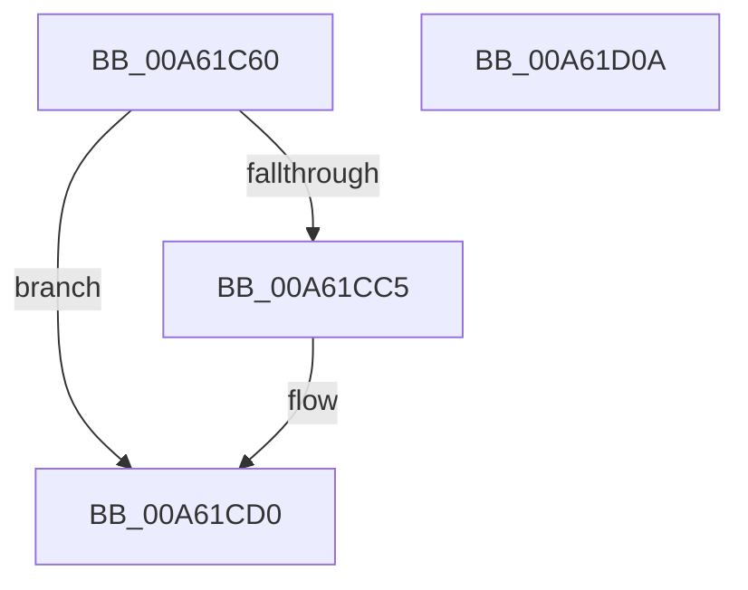

# MiInSwapStoreWorker

- RVA: `0x00A61C60`–`0x00A61D0B` (길이 `171` bytes)
- VA: `0x0000000140A61C60`
- 실행 섹션: `PAGE`
- PDB 이름 있음: `예`; PDB Function 태그: `아니요`
- unwind 정보 RVA: `0x0005DD4C`
- 디코드: `44`개 명령, `171/171` bytes 표시
- 미해석 바이트: `0` (있으면 어셈블리에 `.byte`로 보존)

> 이 문서는 커널 이미지의 기계어와 PDB 기호를 분석해 생성했습니다. 4번과 5번은 함수 원형과 자료형을 바이너리 사용 방식에서 추정한 C 해석이며 원본 소스 복구 결과는 아닙니다.

## 1. Dependencies

- 직접 호출 지점: **8**; 고유 호출 대상: **8**
- 직접 호출자로 확인된 함수: **0**
- RIP 상대 이미지 참조: **1**

### Outgoing calls
- `0x00A61C97` → [KeStackAttachProcess](../../text/21/KeStackAttachProcess_function_00216800.md) (function, `0x00216800`)
- `0x00A61CAC` → [SmSwapStore](SmSwapStore_function_00A61D14.md) (function, `0x00A61D14`)
- `0x00A61CBC` → [KeSetEvent](../../text/33/KeSetEvent_function_0033F310.md) (function, `0x0033F310`)
- `0x00A61CCB` → [EtwTraceWorkingSetInSwapStoreFail](EtwTraceWorkingSetInSwapStoreFail_function_00A61DBC.md) (function, `0x00A61DBC`)
- `0x00A61CD7` → [KiUnstackDetachProcess](../../text/21/KiUnstackDetachProcess_function_00217D30.md) (function, `0x00217D30`)
- `0x00A61CE5` → [ObfDereferenceObjectWithTag](../../text/2F/ObfDereferenceObjectWithTag_function_002F78E0.md) (function, `0x002F78E0`)
- `0x00A61CED` → [MiInSwapStoreContextDereference](MiInSwapStoreContextDereference_function_00A61D98.md) (function, `0x00A61D98`)
- `0x00A61CFA` → [_security_check_cookie](../../text/6A/_security_check_cookie_function_006AC640.md) (function, `0x006AC640`)

### Direct callers
- 이 함수 시작 RVA로 연결되는 직접 call은 확인되지 않았습니다. 간접 호출은 완전히 역산할 수 없습니다.

### Static image references
- `0x00A61C6A` → RVA `0x00E0A740` (`.data`; read)

## 2. Other-region calls and transfers

- 다른 실행 섹션으로 향하는 call: **5**
  - `0x00A61C97` → [KeStackAttachProcess](../../text/21/KeStackAttachProcess_function_00216800.md) (`PAGE` → `.text`)
  - `0x00A61CBC` → [KeSetEvent](../../text/33/KeSetEvent_function_0033F310.md) (`PAGE` → `.text`)
  - `0x00A61CD7` → [KiUnstackDetachProcess](../../text/21/KiUnstackDetachProcess_function_00217D30.md) (`PAGE` → `.text`)
  - `0x00A61CE5` → [ObfDereferenceObjectWithTag](../../text/2F/ObfDereferenceObjectWithTag_function_002F78E0.md) (`PAGE` → `.text`)
  - `0x00A61CFA` → [_security_check_cookie](../../text/6A/_security_check_cookie_function_006AC640.md) (`PAGE` → `.text`)
- 별도 외부 분기/꼬리 이동을 확인하지 못했습니다.

## 3. Assembly (complete function range)

```asm
00A61C60  48 89 5C 24 10                  mov qword ptr [rsp + 0x10], rbx
00A61C65  57                              push rdi
00A61C66  48 83 EC 60                     sub rsp, 0x60
00A61C6A  48 8B 05 CF 8A 3A 00            mov rax, qword ptr [rip + 0x3a8acf]
00A61C71  48 33 C4                        xor rax, rsp
00A61C74  48 89 44 24 50                  mov qword ptr [rsp + 0x50], rax
00A61C79  0F 57 C0                        xorps xmm0, xmm0
00A61C7C  48 8D 54 24 20                  lea rdx, [rsp + 0x20]
00A61C81  48 8B D9                        mov rbx, rcx
00A61C84  48 8B 49 20                     mov rcx, qword ptr [rcx + 0x20]
00A61C88  0F 11 44 24 20                  movups xmmword ptr [rsp + 0x20], xmm0
00A61C8D  0F 11 44 24 30                  movups xmmword ptr [rsp + 0x30], xmm0
00A61C92  0F 11 44 24 40                  movups xmmword ptr [rsp + 0x40], xmm0
00A61C97  E8 64 4B 7B FF                  call 0x140216800
00A61C9C  48 8B 43 20                     mov rax, qword ptr [rbx + 0x20]
00A61CA0  BA 02 00 00 00                  mov edx, 2
00A61CA5  48 8B 88 58 07 00 00            mov rcx, qword ptr [rax + 0x758]
00A61CAC  E8 63 00 00 00                  call 0x140a61d14
00A61CB1  48 8D 4B 28                     lea rcx, [rbx + 0x28]
00A61CB5  45 33 C0                        xor r8d, r8d
00A61CB8  33 D2                           xor edx, edx
00A61CBA  8B F8                           mov edi, eax
00A61CBC  E8 4F D6 8D FF                  call 0x14033f310
00A61CC1  85 FF                           test edi, edi
00A61CC3  79 0B                           jns 0x140a61cd0
00A61CC5  48 8B 4B 20                     mov rcx, qword ptr [rbx + 0x20]
00A61CC9  8B D7                           mov edx, edi
00A61CCB  E8 EC 00 00 00                  call 0x140a61dbc
00A61CD0  33 D2                           xor edx, edx
00A61CD2  48 8D 4C 24 20                  lea rcx, [rsp + 0x20]
00A61CD7  E8 54 60 7B FF                  call 0x140217d30
00A61CDC  48 8B 4B 20                     mov rcx, qword ptr [rbx + 0x20]
00A61CE0  BA 4D 6D 57 73                  mov edx, 0x73576d4d
00A61CE5  E8 F6 5B 89 FF                  call 0x1402f78e0
00A61CEA  48 8B CB                        mov rcx, rbx
00A61CED  E8 A6 00 00 00                  call 0x140a61d98
00A61CF2  48 8B 4C 24 50                  mov rcx, qword ptr [rsp + 0x50]
00A61CF7  48 33 CC                        xor rcx, rsp
00A61CFA  E8 41 A9 C4 FF                  call 0x1406ac640
00A61CFF  48 8B 5C 24 78                  mov rbx, qword ptr [rsp + 0x78]
00A61D04  48 83 C4 60                     add rsp, 0x60
00A61D08  5F                              pop rdi
00A61D09  C3                              ret
00A61D0A  CC                              int3
```

## 4. C-style interpretation (structured pseudocode)

```c
__int64 __fastcall MiInSwapStoreWorker(__int64 a1, __int64 a2, int a3)
{
    __int64 result;
    __int64 v_rsp;
    unsigned __int64 v_stack_m18;
    unsigned __int64 v_stack_m28;
    unsigned __int64 v_stack_m38;
    unsigned __int64 v_stack_m48;
    unsigned __int64 v_stack_p10;

    v_stack_p10 = v_rbx;
    v_rsp = (v_rsp) - (96);
    result = (*(unsigned __int64 *)(v_rip + 3836623)) ^ (v_rsp);
    v_stack_m18 = result;
    v_stack_m48 = v_xmm0;
    v_stack_m38 = v_xmm0;
    v_stack_m28 = v_xmm0;
    result = KeStackAttachProcess(*(unsigned __int64 *)(a1 + 32), v_stack_m48, a3, a4);
    result = SmSwapStore(*(unsigned __int64 *)(*(unsigned __int64 *)(a1 + 32) + 1880), 2, a3, a4);
    a3 = 0;
    a2 = 0;
    result = KeSetEvent(a1 + 40, a2, a3, a4);
    if (sign_flag) {
        a1 = *(unsigned __int64 *)(a1 + 32);
        a2 = (unsigned int)((unsigned int)((unsigned int)(result)));
        result = EtwTraceWorkingSetInSwapStoreFail(a1, a2, a3, a4);
    }
    a2 = 0;
    result = KiUnstackDetachProcess(v_stack_m48, a2, a3, a4);
    result = ObfDereferenceObjectWithTag(*(unsigned __int64 *)(a1 + 32), (unsigned int)(0x73576D4DULL), a3, a4);
    result = MiInSwapStoreContextDereference(a1, (unsigned int)(0x73576D4DULL), a3, a4);
    a1 = (v_stack_m18) ^ (v_rsp);
    result = _security_check_cookie(a1, (unsigned int)(0x73576D4DULL), a3, a4);
    v_rsp = (v_rsp) + (96);
    return result;
}
```

## 5. (Beta) C Style

```c
int64_t MiInSwapStoreWorker(void *Arg1, int64_t Arg2, int32_t Arg3)
{
    uint8_t *arg1 = (uint8_t *)Arg1;

    int64_t result;
    int64_t local_rsp;
    uint64_t v_stack_m18;
    uint64_t v_stack_m28;
    uint64_t v_stack_m38;
    uint64_t v_stack_m48;
    uint64_t v_stack_p10;

    v_stack_p10 = local_rbx;
    local_rsp = (local_rsp) - (96);
    result = (*(uint64_t *)(v_rip + 0x3A8ACF)) ^ (local_rsp);
    v_stack_m18 = result;
    v_stack_m48 = v_xmm0;
    v_stack_m38 = v_xmm0;
    v_stack_m28 = v_xmm0;
    result = KeStackAttachProcess(*(uint64_t *)(arg1 + 0x20), v_stack_m48, Arg3, a4);
    result = SmSwapStore(*(uint64_t *)(*(uint64_t *)(arg1 + 0x20) + 0x758), 2, Arg3, a4);
    Arg3 = 0;
    Arg2 = 0;
    result = KeSetEvent(Arg1 + 40, Arg2, Arg3, a4);
    if (sign_flag) {
        Arg1 = *(uint64_t *)(arg1 + 0x20);
        Arg2 = (uint32_t)((uint32_t)((uint32_t)(result)));
        result = EtwTraceWorkingSetInSwapStoreFail(Arg1, Arg2, Arg3, a4);
    }
    Arg2 = 0;
    result = KiUnstackDetachProcess(v_stack_m48, Arg2, Arg3, a4);
    result = ObfDereferenceObjectWithTag(*(uint64_t *)(arg1 + 0x20), (uint32_t)(0x73576D4DULL), Arg3, a4);
    result = MiInSwapStoreContextDereference(Arg1, (uint32_t)(0x73576D4DULL), Arg3, a4);
    Arg1 = (v_stack_m18) ^ (local_rsp);
    result = _security_check_cookie(Arg1, (uint32_t)(0x73576D4DULL), Arg3, a4);
    local_rsp = (local_rsp) + (96);
    return result;
}
```

### 관측된 메모리 오프셋

구조체 형식이 확인되지 않은 접근은 인자 기준의 오프셋으로만 기록했습니다.

| 기준 인자 | 오프셋 표현 | 폭 (bit) | 접근 |
|---|---:|---:|---|
| `Arg1` | `+ 0x20` | `64` | `R` |
| `Arg1` | `+ 0x28` | `64` | `R` |

## 6. Execution-region graph

[열기: 2D/3D 그래프와 함수 탐색 컨트롤 패널](../../../control-panel.html?section=page&rva=0x00A61C60&view=graph)

- 2D 그래프는 위에서 아래로 흐르고, 3D 그래프는 빈 공간을 드래그해 회전합니다. Shift+드래그는 이동, 휠은 확대·축소, 함수 노드 선택은 대상 보고서 이동입니다.

### Static fallback


