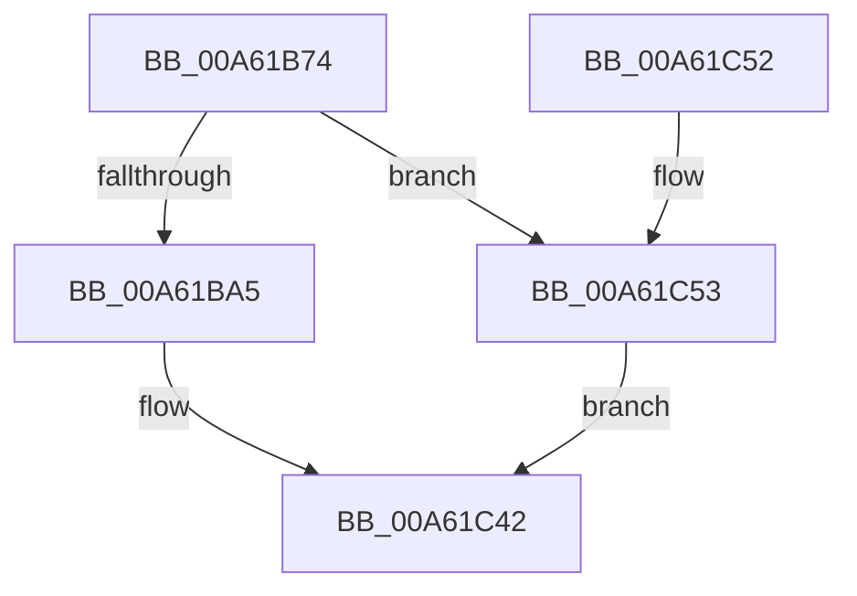

# MiInSwapStore

- RVA: `0x00A61B74`–`0x00A61C5A` (길이 `230` bytes)
- VA: `0x0000000140A61B74`
- 실행 섹션: `PAGE`
- PDB 이름 있음: `예`; PDB Function 태그: `아니요`
- unwind 정보 RVA: `0x00069D68`
- 디코드: `56`개 명령, `230/230` bytes 표시
- 미해석 바이트: `0` (있으면 어셈블리에 `.byte`로 보존)

> 이 문서는 커널 이미지의 기계어와 PDB 기호를 분석해 생성했습니다. 4번과 5번은 함수 원형과 자료형을 바이너리 사용 방식에서 추정한 C 해석이며 원본 소스 복구 결과는 아닙니다.

## 1. Dependencies

- 직접 호출 지점: **8**; 고유 호출 대상: **8**
- 직접 호출자로 확인된 함수: **1**
- RIP 상대 이미지 참조: **2**

### Outgoing calls
- `0x00A61B94` → [MiAllocatePool](../../text/35/MiAllocatePool_function_0035B540.md) (function, `0x0035B540`)
- `0x00A61BAE` → [KeInitializeEvent](../../text/40/KeInitializeEvent_function_0040DD10.md) (function, `0x0040DD10`)
- `0x00A61BCE` → [ObfReferenceObjectWithTag](../../text/21/ObfReferenceObjectWithTag_function_00210710.md) (function, `0x00210710`)
- `0x00A61BE7` → [KeQueryPriorityThread](../../text/38/KeQueryPriorityThread_function_0038F4F0.md) (function, `0x0038F4F0`)
- `0x00A61BF2` → [MiGetProcessPartition](../../text/44/MiGetProcessPartition_function_00443B10.md) (function, `0x00443B10`)
- `0x00A61C14` → [ExQueueWorkItemToPartition](../../text/35/ExQueueWorkItemToPartition_function_00356E2C.md) (function, `0x00356E2C`)
- `0x00A61C33` → [KeWaitForSingleObject](../../text/20/KeWaitForSingleObject_function_0020E6B0.md) (function, `0x0020E6B0`)
- `0x00A61C3B` → [MiInSwapStoreContextDereference](MiInSwapStoreContextDereference_function_00A61D98.md) (function, `0x00A61D98`)

### Direct callers
- [MmInSwapWorkingSet](../../text/45/MmInSwapWorkingSet_function_0045B6C4.md) at `0x0045B8C7`

### Static image references
- `0x00A61BB7` → RVA `0x00A61C60` (`MiInSwapStoreWorker`; read)
- `0x00A61C1C` → RVA `0x00011C80` (`.rdata`; read)

## 2. Other-region calls and transfers

- 다른 실행 섹션으로 향하는 call: **7**
  - `0x00A61B94` → [MiAllocatePool](../../text/35/MiAllocatePool_function_0035B540.md) (`PAGE` → `.text`)
  - `0x00A61BAE` → [KeInitializeEvent](../../text/40/KeInitializeEvent_function_0040DD10.md) (`PAGE` → `.text`)
  - `0x00A61BCE` → [ObfReferenceObjectWithTag](../../text/21/ObfReferenceObjectWithTag_function_00210710.md) (`PAGE` → `.text`)
  - `0x00A61BE7` → [KeQueryPriorityThread](../../text/38/KeQueryPriorityThread_function_0038F4F0.md) (`PAGE` → `.text`)
  - `0x00A61BF2` → [MiGetProcessPartition](../../text/44/MiGetProcessPartition_function_00443B10.md) (`PAGE` → `.text`)
  - `0x00A61C14` → [ExQueueWorkItemToPartition](../../text/35/ExQueueWorkItemToPartition_function_00356E2C.md) (`PAGE` → `.text`)
  - `0x00A61C33` → [KeWaitForSingleObject](../../text/20/KeWaitForSingleObject_function_0020E6B0.md) (`PAGE` → `.text`)
- 별도 외부 분기/꼬리 이동을 확인하지 못했습니다.

## 3. Assembly (complete function range)

```asm
00A61B74  48 89 5C 24 08                  mov qword ptr [rsp + 8], rbx
00A61B79  48 89 74 24 10                  mov qword ptr [rsp + 0x10], rsi
00A61B7E  57                              push rdi
00A61B7F  48 83 EC 30                     sub rsp, 0x30
00A61B83  BA 48 00 00 00                  mov edx, 0x48
00A61B88  48 8B F1                        mov rsi, rcx
00A61B8B  41 B8 4D 6D 53 73               mov r8d, 0x73536d4d
00A61B91  8D 4A F8                        lea ecx, [rdx - 8]
00A61B94  E8 A7 99 8F FF                  call 0x14035b540
00A61B99  48 8B F8                        mov rdi, rax
00A61B9C  48 85 C0                        test rax, rax
00A61B9F  0F 84 AE 00 00 00               je 0x140a61c53
00A61BA5  45 33 C0                        xor r8d, r8d
00A61BA8  48 8D 48 28                     lea rcx, [rax + 0x28]
00A61BAC  33 D2                           xor edx, edx
00A61BAE  E8 5D C1 9A FF                  call 0x14040dd10
00A61BB3  48 83 27 00                     and qword ptr [rdi], 0
00A61BB7  48 8D 05 A2 00 00 00            lea rax, [rip + 0xa2]
00A61BBE  BA 4D 6D 57 73                  mov edx, 0x73576d4d
00A61BC3  48 89 47 10                     mov qword ptr [rdi + 0x10], rax
00A61BC7  48 8B CE                        mov rcx, rsi
00A61BCA  48 89 7F 18                     mov qword ptr [rdi + 0x18], rdi
00A61BCE  E8 3D EB 7A FF                  call 0x140210710
00A61BD3  48 89 77 20                     mov qword ptr [rdi + 0x20], rsi
00A61BD7  C7 47 40 02 00 00 00            mov dword ptr [rdi + 0x40], 2
00A61BDE  65 48 8B 0C 25 88 01 00 00      mov rcx, qword ptr gs:[0x188]
00A61BE7  E8 04 D9 92 FF                  call 0x14038f4f0
00A61BEC  48 8B CE                        mov rcx, rsi
00A61BEF  44 8B C0                        mov r8d, eax
00A61BF2  E8 19 1F 9E FF                  call 0x140443b10
00A61BF7  41 83 F8 0F                     cmp r8d, 0xf
00A61BFB  41 8D 50 01                     lea edx, [r8 + 1]
00A61BFF  48 8B CF                        mov rcx, rdi
00A61C02  41 0F 4D D0                     cmovge edx, r8d
00A61C06  41 83 C8 FF                     or r8d, 0xffffffff
00A61C0A  4C 8B 88 B8 00 00 00            mov r9, qword ptr [rax + 0xb8]
00A61C11  83 C2 20                        add edx, 0x20
00A61C14  E8 13 52 8F FF                  call 0x140356e2c
00A61C19  45 33 C9                        xor r9d, r9d
00A61C1C  48 8D 05 5D 00 5B FF            lea rax, [rip - 0xa4ffa3]
00A61C23  45 33 C0                        xor r8d, r8d
00A61C26  48 89 44 24 20                  mov qword ptr [rsp + 0x20], rax
00A61C2B  48 8D 4F 28                     lea rcx, [rdi + 0x28]
00A61C2F  41 8D 51 1A                     lea edx, [r9 + 0x1a]
00A61C33  E8 78 CA 7A FF                  call 0x14020e6b0
00A61C38  48 8B CF                        mov rcx, rdi
00A61C3B  E8 58 01 00 00                  call 0x140a61d98
00A61C40  33 C0                           xor eax, eax
00A61C42  48 8B 5C 24 40                  mov rbx, qword ptr [rsp + 0x40]
00A61C47  48 8B 74 24 48                  mov rsi, qword ptr [rsp + 0x48]
00A61C4C  48 83 C4 30                     add rsp, 0x30
00A61C50  5F                              pop rdi
00A61C51  C3                              ret
00A61C52  CC                              int3
00A61C53  B8 9A 00 00 C0                  mov eax, 0xc000009a
00A61C58  EB E8                           jmp 0x140a61c42
```

## 4. C-style interpretation (structured pseudocode)

```c
__int64 __fastcall MiInSwapStore(__int64 a1)
{
    __int64 result;
    __int64 v_rsp;
    unsigned __int64 v_stack_m18;
    unsigned __int64 v_stack_p10;
    unsigned __int64 v_stack_p8;

    v_stack_p8 = v_rbx;
    v_stack_p10 = v_rsi;
    v_rsp = (v_rsp) - (48);
    result = MiAllocatePool(72 - 8, 72, (unsigned int)(0x73536D4DULL), a4);
    if (result == 0) goto loc_00A61C53;
    a3 = 0;
    a2 = 0;
    result = KeInitializeEvent(result + 40, a2, a3, a4);
    *(unsigned __int64 *)(result + 16) = v_rip + 162;
    *(unsigned __int64 *)(result + 24) = result;
    result = ObfReferenceObjectWithTag(a1, (unsigned int)(0x73576D4DULL), a3, a4);
    *(unsigned __int64 *)(result + 32) = a1;
    *(unsigned int *)(result + 64) = 2;
    result = KeQueryPriorityThread(*(unsigned __int64 *)(gs_base + (0 + 392)), (unsigned int)(0x73576D4DULL), a3, a4);
    result = MiGetProcessPartition(a1, (unsigned int)(0x73576D4DULL), (unsigned int)((unsigned int)(result)), a4);
    a2 = (unsigned int)((unsigned int)(result)) + 1;
    if (((unsigned int)((unsigned int)((unsigned int)(result)))) >= 15) { a2 = (unsigned int)((unsigned int)((unsigned int)(result))); }
    a3 = (unsigned int)(((unsigned int)((unsigned int)(result))) | (0xFFFFFFFFULL));
    a2 = (unsigned int)((a2) + (32));
    result = ExQueueWorkItemToPartition(result, a2, a3, *(unsigned __int64 *)(result + 184));
    a4 = 0;
    a3 = 0;
    v_stack_m18 = v_rip - 10813347;
    result = KeWaitForSingleObject(result + 40, a4 + 26, a3, a4);
    result = MiInSwapStoreContextDereference(result, a4 + 26, a3, a4);
    result = 0;
loc_00A61C42:
    v_rsp = (v_rsp) + (48);
    return result;
loc_00A61C53:
    goto loc_00A61C42;
}
```

## 5. (Beta) C Style

```c
int64_t MiInSwapStore(int64_t Arg1)
{
    int64_t result;
    int64_t local_rsp;
    uint64_t v_stack_m18;
    uint64_t v_stack_p10;
    uint64_t v_stack_p8;

    v_stack_p8 = local_rbx;
    v_stack_p10 = local_rsi;
    local_rsp = (local_rsp) - (48);
    result = MiAllocatePool(72 - 8, 72, (uint32_t)(0x73536D4DULL), a4);
    if (result == 0) goto loc_00A61C53;
    a3 = 0;
    a2 = 0;
    result = KeInitializeEvent(result + 40, a2, a3, a4);
    *(uint64_t *)(result + 0x10) = v_rip + 162;
    *(uint64_t *)(result + 0x18) = result;
    result = ObfReferenceObjectWithTag(Arg1, (uint32_t)(0x73576D4DULL), a3, a4);
    *(uint64_t *)(result + 0x20) = Arg1;
    *(uint32_t *)(result + 0x40) = 2;
    result = KeQueryPriorityThread(*(uint64_t *)(gs_base + (0 + 0x188)), (uint32_t)(0x73576D4DULL), a3, a4);
    result = MiGetProcessPartition(Arg1, (uint32_t)(0x73576D4DULL), (uint32_t)((uint32_t)(result)), a4);
    a2 = (uint32_t)((uint32_t)(result)) + 1;
    if (((uint32_t)((uint32_t)((uint32_t)(result)))) >= 15) { a2 = (uint32_t)((uint32_t)((uint32_t)(result))); }
    a3 = (uint32_t)(((uint32_t)((uint32_t)(result))) | (0xFFFFFFFFULL));
    a2 = (uint32_t)((a2) + (32));
    result = ExQueueWorkItemToPartition(result, a2, a3, *(uint64_t *)(result + 0xB8));
    a4 = 0;
    a3 = 0;
    v_stack_m18 = v_rip - 10813347;
    result = KeWaitForSingleObject(result + 40, a4 + 26, a3, a4);
    result = MiInSwapStoreContextDereference(result, a4 + 26, a3, a4);
    result = 0;
loc_00A61C42:
    local_rsp = (local_rsp) + (48);
    return result;
loc_00A61C53:
    goto loc_00A61C42;
}
```

## 6. Execution-region graph

[열기: 2D/3D 그래프와 함수 탐색 컨트롤 패널](../../../control-panel.html?section=page&rva=0x00A61B74&view=graph)

- 2D 그래프는 위에서 아래로 흐르고, 3D 그래프는 빈 공간을 드래그해 회전합니다. Shift+드래그는 이동, 휠은 확대·축소, 함수 노드 선택은 대상 보고서 이동입니다.

### Static fallback


