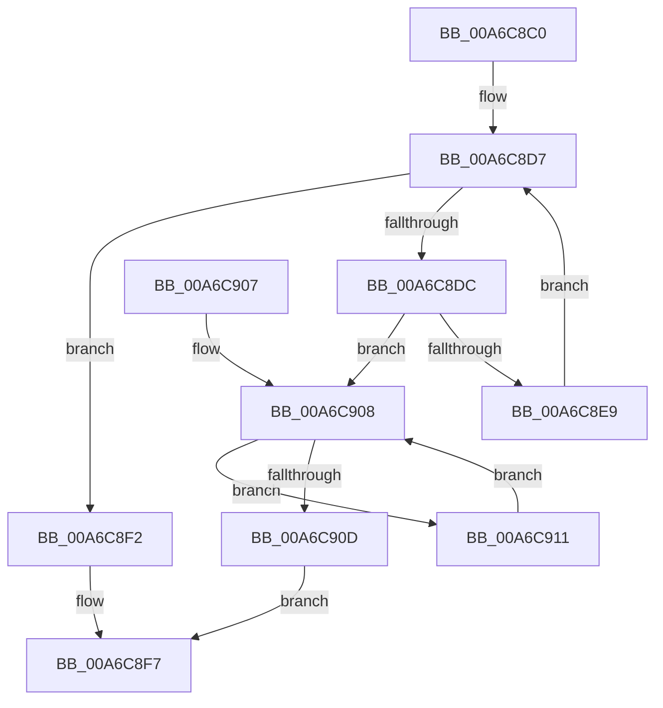

# MiLockPagedRange

- RVA: `0x00A6C8C0`–`0x00A6C923` (길이 `99` bytes)
- VA: `0x0000000140A6C8C0`
- 실행 섹션: `PAGE`
- PDB 이름 있음: `예`; PDB Function 태그: `아니요`
- unwind 정보 RVA: `0x00063C10`
- 디코드: `30`개 명령, `99/99` bytes 표시
- 미해석 바이트: `0` (있으면 어셈블리에 `.byte`로 보존)

> 이 문서는 커널 이미지의 기계어와 PDB 기호를 분석해 생성했습니다. 4번과 5번은 함수 원형과 자료형을 바이너리 사용 방식에서 추정한 C 해석이며 원본 소스 복구 결과는 아닙니다.

## 1. Dependencies

- 직접 호출 지점: **2**; 고유 호출 대상: **2**
- 직접 호출자로 확인된 함수: **2**
- RIP 상대 이미지 참조: **0**

### Outgoing calls
- `0x00A6C8E0` → [MiLockPagedAddress](../../text/48/MiLockPagedAddress_function_00484CDC.md) (function, `0x00484CDC`)
- `0x00A6C91C` → [MiUnlockPagedAddress](../../text/49/MiUnlockPagedAddress_function_00492FC4.md) (function, `0x00492FC4`)

### Direct callers
- [MiInsertNewCombineBlocks](../../text/48/MiInsertNewCombineBlocks_function_00485858.md) at `0x0048587C`
- [MiBuildNewCloneDescriptor](MiBuildNewCloneDescriptor_function_00A6C744.md) at `0x00A6C828`

### Static image references
- 디코드된 RIP-relative 메모리 참조가 없습니다.

## 2. Other-region calls and transfers

- 다른 실행 섹션으로 향하는 call: **2**
  - `0x00A6C8E0` → [MiLockPagedAddress](../../text/48/MiLockPagedAddress_function_00484CDC.md) (`PAGE` → `.text`)
  - `0x00A6C91C` → [MiUnlockPagedAddress](../../text/49/MiUnlockPagedAddress_function_00492FC4.md) (`PAGE` → `.text`)
- 별도 외부 분기/꼬리 이동을 확인하지 못했습니다.

## 3. Assembly (complete function range)

```asm
00A6C8C0  48 89 5C 24 08                  mov qword ptr [rsp + 8], rbx
00A6C8C5  48 89 74 24 10                  mov qword ptr [rsp + 0x10], rsi
00A6C8CA  57                              push rdi
00A6C8CB  48 83 EC 20                     sub rsp, 0x20
00A6C8CF  48 8B F2                        mov rsi, rdx
00A6C8D2  48 8B F9                        mov rdi, rcx
00A6C8D5  33 DB                           xor ebx, ebx
00A6C8D7  48 3B DE                        cmp rbx, rsi
00A6C8DA  73 16                           jae 0x140a6c8f2
00A6C8DC  48 8D 0C 3B                     lea rcx, [rbx + rdi]
00A6C8E0  E8 F7 83 A1 FF                  call 0x140484cdc
00A6C8E5  85 C0                           test eax, eax
00A6C8E7  74 1F                           je 0x140a6c908
00A6C8E9  48 81 C3 00 10 00 00            add rbx, 0x1000
00A6C8F0  EB E5                           jmp 0x140a6c8d7
00A6C8F2  B8 01 00 00 00                  mov eax, 1
00A6C8F7  48 8B 5C 24 30                  mov rbx, qword ptr [rsp + 0x30]
00A6C8FC  48 8B 74 24 38                  mov rsi, qword ptr [rsp + 0x38]
00A6C901  48 83 C4 20                     add rsp, 0x20
00A6C905  5F                              pop rdi
00A6C906  C3                              ret
00A6C907  CC                              int3
00A6C908  48 85 DB                        test rbx, rbx
00A6C90B  75 04                           jne 0x140a6c911
00A6C90D  33 C0                           xor eax, eax
00A6C90F  EB E6                           jmp 0x140a6c8f7
00A6C911  48 81 EB 00 10 00 00            sub rbx, 0x1000
00A6C918  48 8D 0C 3B                     lea rcx, [rbx + rdi]
00A6C91C  E8 A3 66 A2 FF                  call 0x140492fc4
00A6C921  EB E5                           jmp 0x140a6c908
```

## 4. C-style interpretation (structured pseudocode)

```c
__int64 __fastcall MiLockPagedRange(__int64 a1, __int64 a2)
{
    __int64 result;
    __int64 v_rbx;
    __int64 v_rsp;
    unsigned __int64 v_stack_p10;
    unsigned __int64 v_stack_p8;

    v_stack_p8 = v_rbx;
    v_stack_p10 = v_rsi;
    v_rsp = (v_rsp) - (32);
    v_rbx = 0;
loc_00A6C8D7:
    if (0 >= a2) goto loc_00A6C8F2;
    result = MiLockPagedAddress(v_rbx + a1 * 1, a2, a3, a4);
    if ((unsigned int)(result) == 0) goto loc_00A6C908;
    v_rbx = (v_rbx) + (0x1000ULL);
    goto loc_00A6C8D7;
loc_00A6C8F2:
loc_00A6C8F7:
    v_rsp = (v_rsp) + (32);
    return 1;
loc_00A6C908:
    if (v_stack_p8 != 0) goto loc_00A6C911;
    result = 0;
    goto loc_00A6C8F7;
loc_00A6C911:
    v_rbx = (v_stack_p8) - (0x1000ULL);
    result = MiUnlockPagedAddress(v_rbx + a1 * 1, a2, a3, a4);
    goto loc_00A6C908;
}
```

## 5. (Beta) C Style

```c
int64_t MiLockPagedRange(int64_t Arg1, int64_t Arg2)
{
    int64_t result;
    int64_t local_rbx;
    int64_t local_rsp;
    uint64_t v_stack_p10;
    uint64_t v_stack_p8;

    v_stack_p8 = local_rbx;
    v_stack_p10 = local_rsi;
    local_rsp = (local_rsp) - (32);
    local_rbx = 0;
loc_00A6C8D7:
    if (0 >= Arg2) goto loc_00A6C8F2;
    result = MiLockPagedAddress(local_rbx + Arg1 * 1, Arg2, a3, a4);
    if ((uint32_t)(result) == 0) goto loc_00A6C908;
    local_rbx = (local_rbx) + (0x1000ULL);
    goto loc_00A6C8D7;
loc_00A6C8F2:
loc_00A6C8F7:
    local_rsp = (local_rsp) + (32);
    return 1;
loc_00A6C908:
    if (v_stack_p8 != 0) goto loc_00A6C911;
    result = 0;
    goto loc_00A6C8F7;
loc_00A6C911:
    local_rbx = (v_stack_p8) - (0x1000ULL);
    result = MiUnlockPagedAddress(local_rbx + Arg1 * 1, Arg2, a3, a4);
    goto loc_00A6C908;
}
```

## 6. Execution-region graph

[열기: 2D/3D 그래프와 함수 탐색 컨트롤 패널](../../../control-panel.html?section=page&rva=0x00A6C8C0&view=graph)

- 2D 그래프는 위에서 아래로 흐르고, 3D 그래프는 빈 공간을 드래그해 회전합니다. Shift+드래그는 이동, 휠은 확대·축소, 함수 노드 선택은 대상 보고서 이동입니다.

### Static fallback


