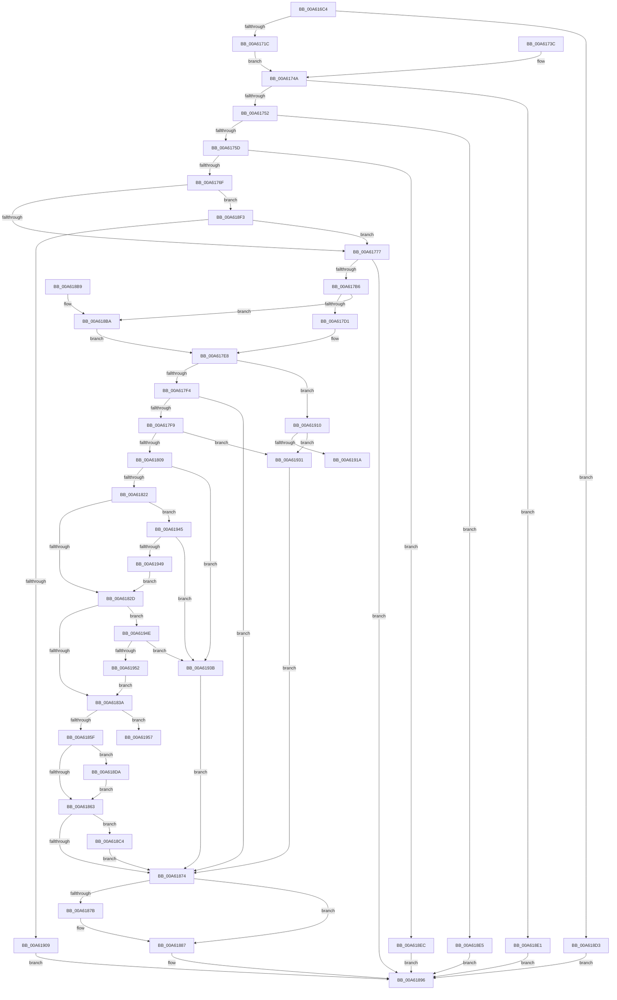

# MmProcessWorkingSetControl

- RVA: `0x00A616C4`–`0x00A61974` (길이 `688` bytes)
- VA: `0x0000000140A616C4`
- 실행 섹션: `PAGE`
- PDB 이름 있음: `예`; PDB Function 태그: `예`
- unwind 정보 RVA: `0x000B3248`
- 디코드: `179`개 명령, `688/688` bytes 표시
- 미해석 바이트: `0` (있으면 어셈블리에 `.byte`로 보존)

> 이 문서는 커널 이미지의 기계어와 PDB 기호를 분석해 생성했습니다. 4번과 5번은 함수 원형과 자료형을 바이너리 사용 방식에서 추정한 C 해석이며 원본 소스 복구 결과는 아닙니다.

## 1. Dependencies

- 직접 호출 지점: **12**; 고유 호출 대상: **12**
- 직접 호출자로 확인된 함수: **2**
- RIP 상대 이미지 참조: **3**

### Outgoing calls
- `0x00A617A7` → [ObpReferenceObjectByHandleWithTag](../86/ObpReferenceObjectByHandleWithTag_function_00869650.md) (function, `0x00869650`)
- `0x00A617E3` → [KiStackAttachProcess](../../text/21/KiStackAttachProcess_function_00216820.md) (function, `0x00216820`)
- `0x00A61846` → [MiLogWsEmptyControl](../../text/4B/MiLogWsEmptyControl_function_004B96C0.md) (function, `0x004B96C0`)
- `0x00A61869` → [MiEmptyWorkingSetPrivatePagesByVa](../../text/2A/MiEmptyWorkingSetPrivatePagesByVa_function_002A6AC0.md) (function, `0x002A6AC0`)
- `0x00A61882` → [KiUnstackDetachProcess](../../text/21/KiUnstackDetachProcess_function_00217D30.md) (function, `0x00217D30`)
- `0x00A6188F` → [ObfDereferenceObjectWithTag](../../text/2F/ObfDereferenceObjectWithTag_function_002F78E0.md) (function, `0x002F78E0`)
- `0x00A618A1` → [_security_check_cookie](../../text/6A/_security_check_cookie_function_006AC640.md) (function, `0x006AC640`)
- `0x00A618CC` → [SmStoreCompressionStop](SmStoreCompressionStop_function_00A6197C.md) (function, `0x00A6197C`)
- `0x00A618DA` → [SmStoreCompressionStart](SmStoreCompressionStart_function_00A61AD0.md) (function, `0x00A61AD0`)
- `0x00A618FC` → [SeSinglePrivilegeCheck](../87/SeSinglePrivilegeCheck_function_00871E20.md) (function, `0x00871E20`)
- `0x00A61926` → [PsSwapProcessWorkingSet](../78/PsSwapProcessWorkingSet_function_00781C24.md) (function, `0x00781C24`)
- `0x00A61969` → [MiEmptyWorkingSet](../../text/2A/MiEmptyWorkingSet_function_002A710C.md) (function, `0x002A710C`)

### Direct callers
- [VmpPauseResumeNotify](../7A/VmpPauseResumeNotify_function_007ADA08.md) at `0x007ADAD2`
- [VmpPauseResumeNotify](../7A/VmpPauseResumeNotify_function_007ADA08.md) at `0x007ADBB9`
- [NtSetInformationProcess](../AE/NtSetInformationProcess_function_00AE5370.md) at `0x00AE8C54`

### Static image references
- `0x00A616DD` → RVA `0x00E0A740` (`.data`; read)
- `0x00A61777` → RVA `0x00FC6A98` (`ALMOSTRO`; read)
- `0x00A618F5` → RVA `0x00FD9A80` (`PAGEDATA`; read)

## 2. Other-region calls and transfers

- 다른 실행 섹션으로 향하는 call: **7**
  - `0x00A617E3` → [KiStackAttachProcess](../../text/21/KiStackAttachProcess_function_00216820.md) (`PAGE` → `.text`)
  - `0x00A61846` → [MiLogWsEmptyControl](../../text/4B/MiLogWsEmptyControl_function_004B96C0.md) (`PAGE` → `.text`)
  - `0x00A61869` → [MiEmptyWorkingSetPrivatePagesByVa](../../text/2A/MiEmptyWorkingSetPrivatePagesByVa_function_002A6AC0.md) (`PAGE` → `.text`)
  - `0x00A61882` → [KiUnstackDetachProcess](../../text/21/KiUnstackDetachProcess_function_00217D30.md) (`PAGE` → `.text`)
  - `0x00A6188F` → [ObfDereferenceObjectWithTag](../../text/2F/ObfDereferenceObjectWithTag_function_002F78E0.md) (`PAGE` → `.text`)
  - `0x00A618A1` → [_security_check_cookie](../../text/6A/_security_check_cookie_function_006AC640.md) (`PAGE` → `.text`)
  - `0x00A61969` → [MiEmptyWorkingSet](../../text/2A/MiEmptyWorkingSet_function_002A710C.md) (`PAGE` → `.text`)
- call이 아닌 외부 분기/꼬리 이동: **2**
  - `0x00A6192C` → [sub_00B3E2AC](../B3/Unknown_function_00B3E2AC.md) (`tail-transfer`)
  - `0x00A6196F` → [sub_00B3E2AC](../B3/Unknown_function_00B3E2AC.md) (`tail-transfer`)

## 3. Assembly (complete function range)

```asm
00A616C4  4C 8B DC                        mov r11, rsp
00A616C7  45 88 4B 20                     mov byte ptr [r11 + 0x20], r9b
00A616CB  53                              push rbx
00A616CC  56                              push rsi
00A616CD  57                              push rdi
00A616CE  41 54                           push r12
00A616D0  41 55                           push r13
00A616D2  41 56                           push r14
00A616D4  41 57                           push r15
00A616D6  48 81 EC A0 00 00 00            sub rsp, 0xa0
00A616DD  48 8B 05 5C 90 3A 00            mov rax, qword ptr [rip + 0x3a905c]
00A616E4  48 33 C4                        xor rax, rsp
00A616E7  48 89 84 24 90 00 00 00         mov qword ptr [rsp + 0x90], rax
00A616EF  41 8A D9                        mov bl, r9b
00A616F2  48 8B F9                        mov rdi, rcx
00A616F5  48 89 4C 24 58                  mov qword ptr [rsp + 0x58], rcx
00A616FA  48 83 64 24 50 00               and qword ptr [rsp + 0x50], 0
00A61700  0F 57 C0                        xorps xmm0, xmm0
00A61703  0F 11 44 24 60                  movups xmmword ptr [rsp + 0x60], xmm0
00A61708  0F 11 44 24 70                  movups xmmword ptr [rsp + 0x70], xmm0
00A6170D  41 0F 11 43 A8                  movups xmmword ptr [r11 - 0x58], xmm0
00A61712  41 83 F8 0C                     cmp r8d, 0xc
00A61716  0F 82 B7 01 00 00               jb 0x140a618d3
00A6171C  33 C9                           xor ecx, ecx
00A6171E  33 C0                           xor eax, eax
00A61720  48 89 44 24 40                  mov qword ptr [rsp + 0x40], rax
00A61725  89 44 24 48                     mov dword ptr [rsp + 0x48], eax
00A61729  F2 0F 10 02                     movsd xmm0, qword ptr [rdx]
00A6172D  F2 0F 11 44 24 40               movsd qword ptr [rsp + 0x40], xmm0
00A61733  8B 42 08                        mov eax, dword ptr [rdx + 8]
00A61736  89 44 24 48                     mov dword ptr [rsp + 0x48], eax
00A6173A  EB 0E                           jmp 0x140a6174a
00A6173C  8B C8                           mov ecx, eax
00A6173E  8A 9C 24 F8 00 00 00            mov bl, byte ptr [rsp + 0xf8]
00A61745  48 8B 7C 24 58                  mov rdi, qword ptr [rsp + 0x58]
00A6174A  85 C9                           test ecx, ecx
00A6174C  0F 88 8F 01 00 00               js 0x140a618e1
00A61752  83 7C 24 40 03                  cmp dword ptr [rsp + 0x40], 3
00A61757  0F 85 88 01 00 00               jne 0x140a618e5
00A6175D  48 8B 44 24 40                  mov rax, qword ptr [rsp + 0x40]
00A61762  48 C1 E8 20                     shr rax, 0x20
00A61766  83 F8 02                        cmp eax, 2
00A61769  0F 83 7D 01 00 00               jae 0x140a618ec
00A6176F  85 C0                           test eax, eax
00A61771  0F 84 7C 01 00 00               je 0x140a618f3
00A61777  4C 8B 05 1A 53 56 00            mov r8, qword ptr [rip + 0x56531a]
00A6177E  48 83 64 24 38 00               and qword ptr [rsp + 0x38], 0
00A61784  48 83 64 24 30 00               and qword ptr [rsp + 0x30], 0
00A6178A  48 8D 44 24 50                  lea rax, [rsp + 0x50]
00A6178F  48 89 44 24 28                  mov qword ptr [rsp + 0x28], rax
00A61794  C7 44 24 20 4D 6D 57 73         mov dword ptr [rsp + 0x20], 0x73576d4d
00A6179C  44 8A CB                        mov r9b, bl
00A6179F  BA 00 20 00 00                  mov edx, 0x2000
00A617A4  48 8B CF                        mov rcx, rdi
00A617A7  E8 A4 7E E0 FF                  call 0x140869650
00A617AC  8B D8                           mov ebx, eax
00A617AE  85 C0                           test eax, eax
00A617B0  0F 88 E0 00 00 00               js 0x140a61896
00A617B6  65 48 8B 04 25 88 01 00 00      mov rax, qword ptr gs:[0x188]
00A617BF  48 8B 74 24 50                  mov rsi, qword ptr [rsp + 0x50]
00A617C4  48 39 B0 B8 00 00 00            cmp qword ptr [rax + 0xb8], rsi
00A617CB  0F 84 E9 00 00 00               je 0x140a618ba
00A617D1  C7 44 24 50 01 00 00 00         mov dword ptr [rsp + 0x50], 1
00A617D9  4C 8D 44 24 60                  lea r8, [rsp + 0x60]
00A617DE  33 D2                           xor edx, edx
00A617E0  48 8B CE                        mov rcx, rsi
00A617E3  E8 38 50 7B FF                  call 0x140216820
00A617E8  8B 44 24 44                     mov eax, dword ptr [rsp + 0x44]
00A617EC  85 C0                           test eax, eax
00A617EE  0F 84 1C 01 00 00               je 0x140a61910
00A617F4  83 F8 01                        cmp eax, 1
00A617F7  75 7B                           jne 0x140a61874
00A617F9  8B 5C 24 48                     mov ebx, dword ptr [rsp + 0x48]
00A617FD  F7 C3 C0 FF FF FF               test ebx, 0xffffffc0
00A61803  0F 85 28 01 00 00               jne 0x140a61931
00A61809  8B CB                           mov ecx, ebx
00A6180B  44 8B FB                        mov r15d, ebx
00A6180E  44 23 F8                        and r15d, eax
00A61811  33 C0                           xor eax, eax
00A61813  83 E1 02                        and ecx, 2
00A61816  0F 94 C0                        sete al
00A61819  44 3B F8                        cmp r15d, eax
00A6181C  0F 84 19 01 00 00               je 0x140a6193b
00A61822  8B FB                           mov edi, ebx
00A61824  83 E7 08                        and edi, 8
00A61827  0F 85 18 01 00 00               jne 0x140a61945
00A6182D  44 8B F3                        mov r14d, ebx
00A61830  41 83 E6 10                     and r14d, 0x10
00A61834  0F 85 14 01 00 00               jne 0x140a6194e
00A6183A  4C 8D AE 00 04 00 00            lea r13, [rsi + 0x400]
00A61841  8B D3                           mov edx, ebx
00A61843  49 8B CD                        mov rcx, r13
00A61846  E8 75 7E A5 FF                  call 0x1404b96c0
00A6184B  44 8B E3                        mov r12d, ebx
00A6184E  41 C1 EC 03                     shr r12d, 3
00A61852  41 83 E4 04                     and r12d, 4
00A61856  45 85 FF                        test r15d, r15d
00A61859  0F 84 F8 00 00 00               je 0x140a61957
00A6185F  85 FF                           test edi, edi
00A61861  75 77                           jne 0x140a618da
00A61863  41 8B D4                        mov edx, r12d
00A61866  49 8B CD                        mov rcx, r13
00A61869  E8 52 52 84 FF                  call 0x1402a6ac0
00A6186E  8B D8                           mov ebx, eax
00A61870  85 FF                           test edi, edi
00A61872  75 50                           jne 0x140a618c4
00A61874  83 7C 24 50 00                  cmp dword ptr [rsp + 0x50], 0
00A61879  74 0C                           je 0x140a61887
00A6187B  33 D2                           xor edx, edx
00A6187D  48 8D 4C 24 60                  lea rcx, [rsp + 0x60]
00A61882  E8 A9 64 7B FF                  call 0x140217d30
00A61887  BA 4D 6D 57 73                  mov edx, 0x73576d4d
00A6188C  48 8B CE                        mov rcx, rsi
00A6188F  E8 4C 60 89 FF                  call 0x1402f78e0
00A61894  8B C3                           mov eax, ebx
00A61896  48 8B 8C 24 90 00 00 00         mov rcx, qword ptr [rsp + 0x90]
00A6189E  48 33 CC                        xor rcx, rsp
00A618A1  E8 9A AD C4 FF                  call 0x1406ac640
00A618A6  48 81 C4 A0 00 00 00            add rsp, 0xa0
00A618AD  41 5F                           pop r15
00A618AF  41 5E                           pop r14
00A618B1  41 5D                           pop r13
00A618B3  41 5C                           pop r12
00A618B5  5F                              pop rdi
00A618B6  5E                              pop rsi
00A618B7  5B                              pop rbx
00A618B8  C3                              ret
00A618B9  CC                              int3
00A618BA  83 64 24 50 00                  and dword ptr [rsp + 0x50], 0
00A618BF  E9 24 FF FF FF                  jmp 0x140a617e8
00A618C4  33 C9                           xor ecx, ecx
00A618C6  45 85 F6                        test r14d, r14d
00A618C9  0F 95 C1                        setne cl
00A618CC  E8 AB 00 00 00                  call 0x140a6197c
00A618D1  EB A1                           jmp 0x140a61874
00A618D3  B8 04 00 00 C0                  mov eax, 0xc0000004
00A618D8  EB BC                           jmp 0x140a61896
00A618DA  E8 F1 01 00 00                  call 0x140a61ad0
00A618DF  EB 82                           jmp 0x140a61863
00A618E1  8B C1                           mov eax, ecx
00A618E3  EB B1                           jmp 0x140a61896
00A618E5  B8 59 00 00 C0                  mov eax, 0xc0000059
00A618EA  EB AA                           jmp 0x140a61896
00A618EC  B8 0D 00 00 C0                  mov eax, 0xc000000d
00A618F1  EB A3                           jmp 0x140a61896
00A618F3  8A D3                           mov dl, bl
00A618F5  48 8B 0D 84 81 57 00            mov rcx, qword ptr [rip + 0x578184]
00A618FC  E8 1F 05 E1 FF                  call 0x140871e20
00A61901  84 C0                           test al, al
00A61903  0F 85 6E FE FF FF               jne 0x140a61777
00A61909  B8 61 00 00 C0                  mov eax, 0xc0000061
00A6190E  EB 86                           jmp 0x140a61896
00A61910  F7 44 24 48 FE FF FF FF         test dword ptr [rsp + 0x48], 0xfffffffe
00A61918  75 17                           jne 0x140a61931
00A6191A  8A 54 24 48                     mov dl, byte ptr [rsp + 0x48]
00A6191E  F6 D2                           not dl
00A61920  80 E2 01                        and dl, 1
00A61923  48 8B CE                        mov rcx, rsi
00A61926  E8 F9 02 D2 FF                  call 0x140781c24
00A6192B  90                              nop
00A6192C  E9 7B C9 0D 00                  jmp 0x140b3e2ac
00A61931  BB 0D 00 00 C0                  mov ebx, 0xc000000d
00A61936  E9 39 FF FF FF                  jmp 0x140a61874
00A6193B  BB BB 00 00 C0                  mov ebx, 0xc00000bb
00A61940  E9 2F FF FF FF                  jmp 0x140a61874
00A61945  85 C9                           test ecx, ecx
00A61947  74 F2                           je 0x140a6193b
00A61949  E9 DF FE FF FF                  jmp 0x140a6182d
00A6194E  85 FF                           test edi, edi
00A61950  74 E9                           je 0x140a6193b
00A61952  E9 E3 FE FF FF                  jmp 0x140a6183a
00A61957  41 8B D4                        mov edx, r12d
00A6195A  83 CA 01                        or edx, 1
00A6195D  F6 44 24 48 04                  test byte ptr [rsp + 0x48], 4
00A61962  41 0F 44 D4                     cmove edx, r12d
00A61966  49 8B CD                        mov rcx, r13
00A61969  E8 9E 57 84 FF                  call 0x1402a710c
00A6196E  90                              nop
00A6196F  E9 38 C9 0D 00                  jmp 0x140b3e2ac
```

## 4. C-style interpretation (structured pseudocode)

```c
__int64 __fastcall MmProcessWorkingSetControl(__int64 a1, __int64 a2, int a3, unsigned __int8 a4)
{
    __int64 result;
    __int64 v_r12;
    __int64 v_r14;
    __int64 v_r15;
    __int64 v_rdi;
    __int64 v_rsp;
    unsigned __int64 v_stack_m48;
    unsigned __int64 v_stack_m68;
    unsigned __int64 v_stack_m78;
    unsigned __int64 v_stack_m80;
    unsigned __int64 v_stack_m88;
    unsigned int v_stack_m90;
    unsigned int v_stack_m94;
    unsigned __int64 v_stack_m98;
    unsigned __int64 v_stack_mA0;
    unsigned __int64 v_stack_mA8;
    unsigned __int64 v_stack_mB0;
    unsigned int v_stack_mB8;
    unsigned __int8 v_stack_p20;
    unsigned int v_stack_p48;
    unsigned int v_stack_p50;

    *(unsigned __int8 *)(v_rsp + 32) = a4;
    v_rsp = (v_rsp) - (160);
    result = (*(unsigned __int64 *)(v_rip + 3838044)) ^ (v_rsp);
    v_stack_m48 = result;
    v_stack_m80 = a1;
    v_stack_m78 = v_xmm0;
    v_stack_m68 = v_xmm0;
    *(unsigned __int64 *)(v_rsp - 88) = v_xmm0;
    if (a3 < 12) goto loc_00A618D3;
    a1 = 0;
    result = 0;
    v_stack_m98 = 0;
    v_stack_m90 = 0;
    v_stack_m98 = v_xmm0;
    v_stack_m90 = (unsigned int)((unsigned int)(*(unsigned int *)(a2 + 8)));
    goto loc_00A6174A;
loc_00A6174A:
    if (sign_flag) goto loc_00A618E1;
    if (v_stack_m98 != 3) goto loc_00A618E5;
    result = (v_stack_m98) >> (32);
    if (((unsigned int)(result)) >= 2) goto loc_00A618EC;
    if ((unsigned int)(result) == 0) goto loc_00A618F3;
loc_00A61777:
    v_stack_mB0 = v_stack_m88;
    v_stack_mB8 = 0x73576D4DULL;
    result = ObpReferenceObjectByHandleWithTag(0, (unsigned int)(0x2000ULL), *(unsigned __int64 *)(v_rip + 5657370), a4);
    if (sign_flag) goto loc_00A61896;
    if ((*(unsigned __int64 *)(*(unsigned __int64 *)(gs_base + (0 + 392)) + 184)) == v_stack_m88) goto loc_00A618BA;
    v_stack_m88 = 1;
    a2 = 0;
    result = KiStackAttachProcess(v_stack_m88, a2, v_stack_m78, a4);
loc_00A617E8:
    if ((unsigned int)((unsigned int)(v_stack_m94)) == 0) goto loc_00A61910;
    if (((unsigned int)((unsigned int)(v_stack_m94))) != 1) goto loc_00A61874;
    if ((((unsigned int)((unsigned int)(v_stack_m90))) & (0xFFFFFFC0ULL)) != 0) goto loc_00A61931;
    v_r15 = (unsigned int)(((unsigned int)((unsigned int)((unsigned int)(v_stack_m90)))) & ((unsigned int)((unsigned int)(v_stack_m94))));
    result = 0;
    a1 = (unsigned int)(((unsigned int)((unsigned int)((unsigned int)(v_stack_m90)))) & (2));
    result = (condition_is_equal) ? 1 : 0;
    if (((unsigned int)(v_r15)) == ((unsigned int)(result))) goto loc_00A6193B;
    v_rdi = (unsigned int)(((unsigned int)((unsigned int)((unsigned int)(v_stack_m90)))) & (8));
    if (condition_is_not_equal) goto loc_00A61945;
loc_00A6182D:
    v_r14 = (unsigned int)(((unsigned int)((unsigned int)((unsigned int)(v_stack_m90)))) & (16));
    if (condition_is_not_equal) goto loc_00A6194E;
loc_00A6183A:
    result = MiLogWsEmptyControl(v_stack_m88 + 1024, (unsigned int)((unsigned int)((unsigned int)(v_stack_m90))), v_stack_m78, a4);
    v_r12 = (unsigned int)(((unsigned int)((unsigned int)((unsigned int)(v_stack_m90)))) >> (3));
    v_r12 = (unsigned int)((v_r12) & (4));
    if ((unsigned int)(v_r15) == 0) goto loc_00A61957;
    if ((unsigned int)(v_rdi) != 0) goto loc_00A618DA;
loc_00A61863:
    result = MiEmptyWorkingSetPrivatePagesByVa(v_stack_m88 + 1024, (unsigned int)((unsigned int)(v_r12)), v_stack_m78, a4);
    if ((unsigned int)(v_rdi) != 0) goto loc_00A618C4;
loc_00A61874:
    if (v_stack_m88 != 0) {
        a2 = 0;
        a1 = v_stack_m78;
        result = KiUnstackDetachProcess(a1, a2, v_stack_m78, a4);
    }
    result = ObfDereferenceObjectWithTag(v_stack_m88, (unsigned int)(0x73576D4DULL), v_stack_m78, a4);
loc_00A61896:
    a1 = (v_stack_m48) ^ (v_rsp);
    result = _security_check_cookie(a1, (unsigned int)(0x73576D4DULL), v_stack_m78, a4);
    v_rsp = (v_rsp) + (160);
    return result;
loc_00A618BA:
    goto loc_00A617E8;
loc_00A618C4:
    a1 = 0;
    a1 = ((unsigned int)(v_r14) != 0) ? 1 : 0;
    result = SmStoreCompressionStop(a1, (unsigned int)(0x73576D4DULL), v_stack_m78, a4);
    goto loc_00A61874;
loc_00A618D3:
    goto loc_00A61896;
loc_00A618DA:
    result = SmStoreCompressionStart(a1, (unsigned int)(0x73576D4DULL), v_stack_m78, a4);
    goto loc_00A61863;
loc_00A618E1:
    goto loc_00A61896;
loc_00A618E5:
    goto loc_00A61896;
loc_00A618EC:
    goto loc_00A61896;
loc_00A618F3:
    result = SeSinglePrivilegeCheck(*(unsigned __int64 *)(v_rip + 5734788), (unsigned __int8)((unsigned int)((unsigned int)(result))), v_stack_m78, a4);
    if ((unsigned __int8)(result) != 0) goto loc_00A61777;
    goto loc_00A61896;
loc_00A61910:
    if (((v_stack_p48) & (0xFFFFFFFEULL)) != 0) goto loc_00A61931;
    a2 = (unsigned __int8)(~(v_stack_p48));
    a2 = (unsigned __int8)((a2) & (1));
    result = PsSwapProcessWorkingSet(v_stack_m88, a2, v_stack_m78, a4);
loc_00A61931:
    goto loc_00A61874;
loc_00A6193B:
    goto loc_00A61874;
loc_00A61945:
    if ((unsigned int)(v_stack_m88) == 0) goto loc_00A6193B;
    goto loc_00A6182D;
loc_00A6194E:
    if ((unsigned int)(v_rdi) == 0) goto loc_00A6193B;
    goto loc_00A6183A;
loc_00A61957:
    a2 = (unsigned int)(((unsigned int)((unsigned int)(v_r12))) | (1));
    if (((v_stack_p48) & (4)) == 0) { a2 = (unsigned int)(v_r12); }
    result = MiEmptyWorkingSet(v_stack_m88 + 1024, a2, v_stack_m78, a4);
}
```

## 5. (Beta) C Style

```c
int64_t MmProcessWorkingSetControl(int64_t Arg1, void *Arg2, int32_t Arg3, uint8_t Arg4)
{
    uint8_t *arg2 = (uint8_t *)Arg2;

    int64_t result;
    int64_t local_r12;
    int64_t local_r14;
    int64_t local_r15;
    int64_t local_rdi;
    int64_t local_rsp;
    uint64_t v_stack_m48;
    uint64_t v_stack_m68;
    uint64_t v_stack_m78;
    uint64_t v_stack_m80;
    uint64_t v_stack_m88;
    uint32_t v_stack_m90;
    uint32_t v_stack_m94;
    uint64_t v_stack_m98;
    uint64_t v_stack_mA0;
    uint64_t v_stack_mA8;
    uint64_t v_stack_mB0;
    uint32_t v_stack_mB8;
    uint8_t v_stack_p20;
    uint32_t v_stack_p48;
    uint32_t v_stack_p50;

    *(uint8_t *)(local_rsp + 0x20) = Arg4;
    local_rsp = (local_rsp) - (160);
    result = (*(uint64_t *)(v_rip + 0x3A905C)) ^ (local_rsp);
    v_stack_m48 = result;
    v_stack_m80 = Arg1;
    v_stack_m78 = v_xmm0;
    v_stack_m68 = v_xmm0;
    *(uint64_t *)(local_rsp - 0x58) = v_xmm0;
    if (Arg3 < 12) goto loc_00A618D3;
    Arg1 = 0;
    result = 0;
    v_stack_m98 = 0;
    v_stack_m90 = 0;
    v_stack_m98 = v_xmm0;
    v_stack_m90 = (uint32_t)((uint32_t)(*(uint32_t *)(arg2 + 0x8)));
    goto loc_00A6174A;
loc_00A6174A:
    if (sign_flag) goto loc_00A618E1;
    if (v_stack_m98 != 3) goto loc_00A618E5;
    result = (v_stack_m98) >> (32);
    if (((uint32_t)(result)) >= 2) goto loc_00A618EC;
    if ((uint32_t)(result) == 0) goto loc_00A618F3;
loc_00A61777:
    v_stack_mB0 = v_stack_m88;
    v_stack_mB8 = 0x73576D4DULL;
    result = ObpReferenceObjectByHandleWithTag(0, (uint32_t)(0x2000ULL), *(uint64_t *)(v_rip + 0x56531A), Arg4);
    if (sign_flag) goto loc_00A61896;
    if ((*(uint64_t *)(*(uint64_t *)(gs_base + (0 + 0x188)) + 0xB8)) == v_stack_m88) goto loc_00A618BA;
    v_stack_m88 = 1;
    Arg2 = 0;
    result = KiStackAttachProcess(v_stack_m88, Arg2, v_stack_m78, Arg4);
loc_00A617E8:
    if ((uint32_t)((uint32_t)(v_stack_m94)) == 0) goto loc_00A61910;
    if (((uint32_t)((uint32_t)(v_stack_m94))) != 1) goto loc_00A61874;
    if ((((uint32_t)((uint32_t)(v_stack_m90))) & (0xFFFFFFC0ULL)) != 0) goto loc_00A61931;
    local_r15 = (uint32_t)(((uint32_t)((uint32_t)((uint32_t)(v_stack_m90)))) & ((uint32_t)((uint32_t)(v_stack_m94))));
    result = 0;
    Arg1 = (uint32_t)(((uint32_t)((uint32_t)((uint32_t)(v_stack_m90)))) & (2));
    result = (condition_is_equal) ? 1 : 0;
    if (((uint32_t)(local_r15)) == ((uint32_t)(result))) goto loc_00A6193B;
    local_rdi = (uint32_t)(((uint32_t)((uint32_t)((uint32_t)(v_stack_m90)))) & (8));
    if (condition_is_not_equal) goto loc_00A61945;
loc_00A6182D:
    local_r14 = (uint32_t)(((uint32_t)((uint32_t)((uint32_t)(v_stack_m90)))) & (16));
    if (condition_is_not_equal) goto loc_00A6194E;
loc_00A6183A:
    result = MiLogWsEmptyControl(v_stack_m88 + 1024, (uint32_t)((uint32_t)((uint32_t)(v_stack_m90))), v_stack_m78, Arg4);
    local_r12 = (uint32_t)(((uint32_t)((uint32_t)((uint32_t)(v_stack_m90)))) >> (3));
    local_r12 = (uint32_t)((local_r12) & (4));
    if ((uint32_t)(local_r15) == 0) goto loc_00A61957;
    if ((uint32_t)(local_rdi) != 0) goto loc_00A618DA;
loc_00A61863:
    result = MiEmptyWorkingSetPrivatePagesByVa(v_stack_m88 + 1024, (uint32_t)((uint32_t)(local_r12)), v_stack_m78, Arg4);
    if ((uint32_t)(local_rdi) != 0) goto loc_00A618C4;
loc_00A61874:
    if (v_stack_m88 != 0) {
        Arg2 = 0;
        Arg1 = v_stack_m78;
        result = KiUnstackDetachProcess(Arg1, Arg2, v_stack_m78, Arg4);
    }
    result = ObfDereferenceObjectWithTag(v_stack_m88, (uint32_t)(0x73576D4DULL), v_stack_m78, Arg4);
loc_00A61896:
    Arg1 = (v_stack_m48) ^ (local_rsp);
    result = _security_check_cookie(Arg1, (uint32_t)(0x73576D4DULL), v_stack_m78, Arg4);
    local_rsp = (local_rsp) + (160);
    return result;
loc_00A618BA:
    goto loc_00A617E8;
loc_00A618C4:
    Arg1 = 0;
    Arg1 = ((uint32_t)(local_r14) != 0) ? 1 : 0;
    result = SmStoreCompressionStop(Arg1, (uint32_t)(0x73576D4DULL), v_stack_m78, Arg4);
    goto loc_00A61874;
loc_00A618D3:
    goto loc_00A61896;
loc_00A618DA:
    result = SmStoreCompressionStart(Arg1, (uint32_t)(0x73576D4DULL), v_stack_m78, Arg4);
    goto loc_00A61863;
loc_00A618E1:
    goto loc_00A61896;
loc_00A618E5:
    goto loc_00A61896;
loc_00A618EC:
    goto loc_00A61896;
loc_00A618F3:
    result = SeSinglePrivilegeCheck(*(uint64_t *)(v_rip + 0x578184), (uint8_t)((uint32_t)((uint32_t)(result))), v_stack_m78, Arg4);
    if ((uint8_t)(result) != 0) goto loc_00A61777;
    goto loc_00A61896;
loc_00A61910:
    if (((v_stack_p48) & (0xFFFFFFFEULL)) != 0) goto loc_00A61931;
    Arg2 = (uint8_t)(~(v_stack_p48));
    Arg2 = (uint8_t)((Arg2) & (1));
    result = PsSwapProcessWorkingSet(v_stack_m88, Arg2, v_stack_m78, Arg4);
loc_00A61931:
    goto loc_00A61874;
loc_00A6193B:
    goto loc_00A61874;
loc_00A61945:
    if ((uint32_t)(v_stack_m88) == 0) goto loc_00A6193B;
    goto loc_00A6182D;
loc_00A6194E:
    if ((uint32_t)(local_rdi) == 0) goto loc_00A6193B;
    goto loc_00A6183A;
loc_00A61957:
    Arg2 = (uint32_t)(((uint32_t)((uint32_t)(local_r12))) | (1));
    if (((v_stack_p48) & (4)) == 0) { Arg2 = (uint32_t)(local_r12); }
    result = MiEmptyWorkingSet(v_stack_m88 + 1024, Arg2, v_stack_m78, Arg4);
}
```

### 관측된 메모리 오프셋

구조체 형식이 확인되지 않은 접근은 인자 기준의 오프셋으로만 기록했습니다.

| 기준 인자 | 오프셋 표현 | 폭 (bit) | 접근 |
|---|---:|---:|---|
| `Arg2` | `+ 0x0` | `64` | `R` |
| `Arg2` | `+ 0x8` | `32` | `R` |

## 6. Execution-region graph

[열기: 2D/3D 그래프와 함수 탐색 컨트롤 패널](../../../control-panel.html?section=page&rva=0x00A616C4&view=graph)

- 2D 그래프는 위에서 아래로 흐르고, 3D 그래프는 빈 공간을 드래그해 회전합니다. Shift+드래그는 이동, 휠은 확대·축소, 함수 노드 선택은 대상 보고서 이동입니다.

### Static fallback


