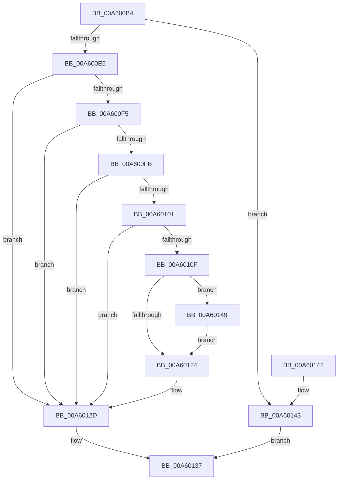

# MmSelectVsmEnclaveByAddress

- RVA: `0x00A600B4`–`0x00A60152` (길이 `158` bytes)
- VA: `0x0000000140A600B4`
- 실행 섹션: `PAGE`
- PDB 이름 있음: `예`; PDB Function 태그: `아니요`
- unwind 정보 RVA: `0x000B2EF4`
- 디코드: `50`개 명령, `158/158` bytes 표시
- 미해석 바이트: `0` (있으면 어셈블리에 `.byte`로 보존)

> 이 문서는 커널 이미지의 기계어와 PDB 기호를 분석해 생성했습니다. 4번과 5번은 함수 원형과 자료형을 바이너리 사용 방식에서 추정한 C 해석이며 원본 소스 복구 결과는 아닙니다.

## 1. Dependencies

- 직접 호출 지점: **2**; 고유 호출 대상: **2**
- 직접 호출자로 확인된 함수: **1**
- RIP 상대 이미지 참조: **0**

### Outgoing calls
- `0x00A600D8` → [MiObtainReferencedVadEx](../../text/31/MiObtainReferencedVadEx_function_00316690.md) (function, `0x00316690`)
- `0x00A60130` → [MiUnlockAndDereferenceVad](../../text/31/MiUnlockAndDereferenceVad_function_00316E60.md) (function, `0x00316E60`)

### Direct callers
- [PsCallEnclave](../A0/PsCallEnclave_function_00A0CF50.md) at `0x00A0D552`

### Static image references
- 디코드된 RIP-relative 메모리 참조가 없습니다.

## 2. Other-region calls and transfers

- 다른 실행 섹션으로 향하는 call: **2**
  - `0x00A600D8` → [MiObtainReferencedVadEx](../../text/31/MiObtainReferencedVadEx_function_00316690.md) (`PAGE` → `.text`)
  - `0x00A60130` → [MiUnlockAndDereferenceVad](../../text/31/MiUnlockAndDereferenceVad_function_00316E60.md) (`PAGE` → `.text`)
- 별도 외부 분기/꼬리 이동을 확인하지 못했습니다.

## 3. Assembly (complete function range)

```asm
00A600B4  48 8B C4                        mov rax, rsp
00A600B7  48 89 58 10                     mov qword ptr [rax + 0x10], rbx
00A600BB  48 89 48 08                     mov qword ptr [rax + 8], rcx
00A600BF  57                              push rdi
00A600C0  48 83 EC 20                     sub rsp, 0x20
00A600C4  49 83 20 00                     and qword ptr [r8], 0
00A600C8  49 8B F8                        mov rdi, r8
00A600CB  83 60 08 00                     and dword ptr [rax + 8], 0
00A600CF  4C 8D 40 08                     lea r8, [rax + 8]
00A600D3  48 8B CA                        mov rcx, rdx
00A600D6  33 D2                           xor edx, edx
00A600D8  E8 B3 65 8B FF                  call 0x140316690
00A600DD  48 8B D0                        mov rdx, rax
00A600E0  48 85 C0                        test rax, rax
00A600E3  74 5E                           je 0x140a60143
00A600E5  8B 40 30                        mov eax, dword ptr [rax + 0x30]
00A600E8  B9 18 00 00 C0                  mov ecx, 0xc0000018
00A600ED  8B D9                           mov ebx, ecx
00A600EF  0F BA E0 15                     bt eax, 0x15
00A600F3  73 38                           jae 0x140a6012d
00A600F5  0F BA E0 1A                     bt eax, 0x1a
00A600F9  72 32                           jb 0x140a6012d
00A600FB  0F BA E0 1B                     bt eax, 0x1b
00A600FF  73 2C                           jae 0x140a6012d
00A60101  8B 42 40                        mov eax, dword ptr [rdx + 0x40]
00A60104  41 B8 01 00 00 00               mov r8d, 1
00A6010A  41 84 C0                        test r8b, al
00A6010D  75 1E                           jne 0x140a6012d
00A6010F  48 8B 42 48                     mov rax, qword ptr [rdx + 0x48]
00A60113  41 8B C8                        mov ecx, r8d
00A60116  F0 48 0F C1 48 10               lock xadd qword ptr [rax + 0x10], rcx
00A6011C  49 03 C8                        add rcx, r8
00A6011F  49 3B C8                        cmp rcx, r8
00A60122  7E 25                           jle 0x140a60149
00A60124  48 8B 42 48                     mov rax, qword ptr [rdx + 0x48]
00A60128  33 DB                           xor ebx, ebx
00A6012A  48 89 07                        mov qword ptr [rdi], rax
00A6012D  48 8B CA                        mov rcx, rdx
00A60130  E8 2B 6D 8B FF                  call 0x140316e60
00A60135  8B C3                           mov eax, ebx
00A60137  48 8B 5C 24 38                  mov rbx, qword ptr [rsp + 0x38]
00A6013C  48 83 C4 20                     add rsp, 0x20
00A60140  5F                              pop rdi
00A60141  C3                              ret
00A60142  CC                              int3
00A60143  8B 44 24 30                     mov eax, dword ptr [rsp + 0x30]
00A60147  EB EE                           jmp 0x140a60137
00A60149  B9 0E 00 00 00                  mov ecx, 0xe
00A6014E  CD 29                           int 0x29
00A60150  EB D2                           jmp 0x140a60124
```

## 4. C-style interpretation (structured pseudocode)

```c
__int64 __fastcall MmSelectVsmEnclaveByAddress(__int64 a1, __int64 a2, __int64 a3)
{
    __int64 result;
    __int64 v_rbx;
    __int64 v_rsp;
    unsigned __int64 v_stack_p10;
    unsigned int v_stack_p30;

    *(unsigned __int64 *)(v_rsp + 16) = v_rbx;
    *(unsigned __int64 *)(v_rsp + 8) = a1;
    v_rsp = (v_rsp) - (32);
    a2 = 0;
    result = MiObtainReferencedVadEx(a2, a2, v_rsp + 8, a4);
    if (result == 0) goto loc_00A60143;
    if (condition_is_above_or_equal) goto loc_00A6012D;
    if (condition_is_below) goto loc_00A6012D;
    if (condition_is_above_or_equal) goto loc_00A6012D;
    if (((1) & ((unsigned __int8)((unsigned int)(*(unsigned int *)(result + 64))))) != 0) goto loc_00A6012D;
    a1 = (1) + (1);
    if (a1 <= 1) goto loc_00A60149;
loc_00A60124:
    v_rbx = 0;
    *(unsigned __int64 *)(a3) = *(unsigned __int64 *)(result + 72);
loc_00A6012D:
    result = MiUnlockAndDereferenceVad(result, result, 1, a4);
loc_00A60137:
    v_rsp = (v_rsp) + (32);
    return 0;
loc_00A60143:
    goto loc_00A60137;
loc_00A60149:
    goto loc_00A60124;
}
```

## 5. (Beta) C Style

```c
int64_t MmSelectVsmEnclaveByAddress(int64_t Arg1, int64_t Arg2, void *Arg3)
{
    uint8_t *arg3 = (uint8_t *)Arg3;

    int64_t result;
    int64_t local_rbx;
    int64_t local_rsp;
    uint64_t v_stack_p10;
    uint32_t v_stack_p30;

    *(uint64_t *)(local_rsp + 0x10) = local_rbx;
    *(uint64_t *)(local_rsp + 0x8) = Arg1;
    local_rsp = (local_rsp) - (32);
    Arg2 = 0;
    result = MiObtainReferencedVadEx(Arg2, Arg2, local_rsp + 8, a4);
    if (result == 0) goto loc_00A60143;
    if (condition_is_above_or_equal) goto loc_00A6012D;
    if (condition_is_below) goto loc_00A6012D;
    if (condition_is_above_or_equal) goto loc_00A6012D;
    if (((1) & ((uint8_t)((uint32_t)(*(uint32_t *)(result + 0x40))))) != 0) goto loc_00A6012D;
    Arg1 = (1) + (1);
    if (Arg1 <= 1) goto loc_00A60149;
loc_00A60124:
    local_rbx = 0;
    *(uint64_t *)(arg3) = *(uint64_t *)(result + 0x48);
loc_00A6012D:
    result = MiUnlockAndDereferenceVad(result, result, 1, a4);
loc_00A60137:
    local_rsp = (local_rsp) + (32);
    return 0;
loc_00A60143:
    goto loc_00A60137;
loc_00A60149:
    goto loc_00A60124;
}
```

### 관측된 메모리 오프셋

구조체 형식이 확인되지 않은 접근은 인자 기준의 오프셋으로만 기록했습니다.

| 기준 인자 | 오프셋 표현 | 폭 (bit) | 접근 |
|---|---:|---:|---|
| `Arg3` | `+ 0x0` | `64` | `R/W` |
| `Arg3` | `+ 0x0` | `64` | `W` |

## 6. Execution-region graph

[열기: 2D/3D 그래프와 함수 탐색 컨트롤 패널](../../../control-panel.html?section=page&rva=0x00A600B4&view=graph)

- 2D 그래프는 위에서 아래로 흐르고, 3D 그래프는 빈 공간을 드래그해 회전합니다. Shift+드래그는 이동, 휠은 확대·축소, 함수 노드 선택은 대상 보고서 이동입니다.

### Static fallback


