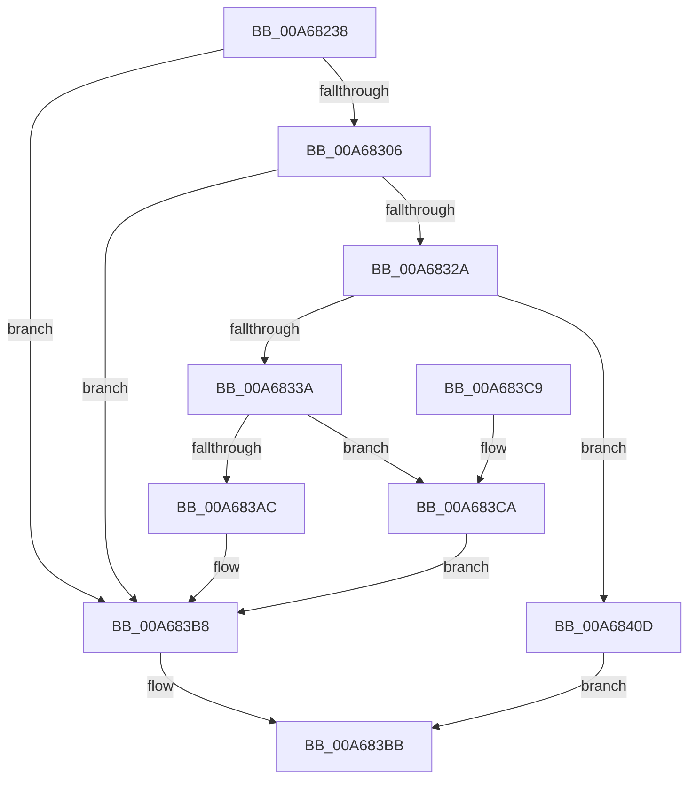

# MmStoreAllocateVirtualMemory

- RVA: `0x00A68238`–`0x00A68422` (길이 `490` bytes)
- VA: `0x0000000140A68238`
- 실행 섹션: `PAGE`
- PDB 이름 있음: `예`; PDB Function 태그: `아니요`
- unwind 정보 RVA: `0x000B3E08`
- 디코드: `123`개 명령, `490/490` bytes 표시
- 미해석 바이트: `0` (있으면 어셈블리에 `.byte`로 보존)

> 이 문서는 커널 이미지의 기계어와 PDB 기호를 분석해 생성했습니다. 4번과 5번은 함수 원형과 자료형을 바이너리 사용 방식에서 추정한 C 해석이며 원본 소스 복구 결과는 아닙니다.

## 1. Dependencies

- 직접 호출 지점: **12**; 고유 호출 대상: **10**
- 직접 호출자로 확인된 함수: **1**
- RIP 상대 이미지 참조: **1**

### Outgoing calls
- `0x00A68286` → [memset](../../text/6C/memset_function_006C6C40.md) (function, `0x006C6C40`)
- `0x00A682F6` → [MiAllocateVirtualMemory](../88/MiAllocateVirtualMemory_function_00883B40.md) (function, `0x00883B40`)
- `0x00A68319` → [MiObtainReferencedSecureVad](../../text/29/MiObtainReferencedSecureVad_function_00295688.md) (function, `0x00295688`)
- `0x00A6832D` → [MiMakeSecureExclusive](../../text/43/MiMakeSecureExclusive_function_00430CA4.md) (function, `0x00430CA4`)
- `0x00A68357` → [MiGetPteAddress](../../text/43/MiGetPteAddress_function_0043E130.md) (function, `0x0043E130`)
- `0x00A68362` → [MiGetPteAddress](../../text/43/MiGetPteAddress_function_0043E130.md) (function, `0x0043E130`)
- `0x00A68397` → [MiDecommitPages](../../text/24/MiDecommitPages_function_00241BD0.md) (function, `0x00241BD0`)
- `0x00A683A3` → [MiLockPageTableRange](../../text/49/MiLockPageTableRange_function_0049A850.md) (function, `0x0049A850`)
- `0x00A683AF` → [MiUnlockAndDereferenceVad](../../text/31/MiUnlockAndDereferenceVad_function_00316E60.md) (function, `0x00316E60`)
- `0x00A68406` → [MiFreeVadRange](../../text/2A/MiFreeVadRange_function_002A77AC.md) (function, `0x002A77AC`)
- `0x00A68410` → [MiUnlockAndDereferenceVad](../../text/31/MiUnlockAndDereferenceVad_function_00316E60.md) (function, `0x00316E60`)
- `0x00A68419` → [MmUnsecureVirtualMemory](../88/MmUnsecureVirtualMemory_function_0088A2A0.md) (function, `0x0088A2A0`)

### Direct callers
- [SmKmStoreHelperCommandProcess](../../text/3C/SmKmStoreHelperCommandProcess_function_003C3AA4.md) at `0x003C3C6B`

### Static image references
- `0x00A6830E` → RVA `0x00E2DB80` (`.data`; read)

## 2. Other-region calls and transfers

- 다른 실행 섹션으로 향하는 call: **10**
  - `0x00A68286` → [memset](../../text/6C/memset_function_006C6C40.md) (`PAGE` → `.text`)
  - `0x00A68319` → [MiObtainReferencedSecureVad](../../text/29/MiObtainReferencedSecureVad_function_00295688.md) (`PAGE` → `.text`)
  - `0x00A6832D` → [MiMakeSecureExclusive](../../text/43/MiMakeSecureExclusive_function_00430CA4.md) (`PAGE` → `.text`)
  - `0x00A68357` → [MiGetPteAddress](../../text/43/MiGetPteAddress_function_0043E130.md) (`PAGE` → `.text`)
  - `0x00A68362` → [MiGetPteAddress](../../text/43/MiGetPteAddress_function_0043E130.md) (`PAGE` → `.text`)
  - `0x00A68397` → [MiDecommitPages](../../text/24/MiDecommitPages_function_00241BD0.md) (`PAGE` → `.text`)
  - `0x00A683A3` → [MiLockPageTableRange](../../text/49/MiLockPageTableRange_function_0049A850.md) (`PAGE` → `.text`)
  - `0x00A683AF` → [MiUnlockAndDereferenceVad](../../text/31/MiUnlockAndDereferenceVad_function_00316E60.md) (`PAGE` → `.text`)
  - `0x00A68406` → [MiFreeVadRange](../../text/2A/MiFreeVadRange_function_002A77AC.md) (`PAGE` → `.text`)
  - `0x00A68410` → [MiUnlockAndDereferenceVad](../../text/31/MiUnlockAndDereferenceVad_function_00316E60.md) (`PAGE` → `.text`)
- 별도 외부 분기/꼬리 이동을 확인하지 못했습니다.

## 3. Assembly (complete function range)

```asm
00A68238  40 55                           push rbp
00A6823A  53                              push rbx
00A6823B  56                              push rsi
00A6823C  57                              push rdi
00A6823D  41 56                           push r14
00A6823F  48 8D 6C 24 C9                  lea rbp, [rsp - 0x37]
00A68244  48 81 EC 00 01 00 00            sub rsp, 0x100
00A6824B  0F 57 C0                        xorps xmm0, xmm0
00A6824E  45 33 F6                        xor r14d, r14d
00A68251  33 C0                           xor eax, eax
00A68253  4C 89 75 67                     mov qword ptr [rbp + 0x67], r14
00A68257  8B F2                           mov esi, edx
00A68259  48 89 45 27                     mov qword ptr [rbp + 0x27], rax
00A6825D  48 8B F9                        mov rdi, rcx
00A68260  4C 89 75 77                     mov qword ptr [rbp + 0x77], r14
00A68264  0F 11 45 F7                     movups xmmword ptr [rbp - 9], xmm0
00A68268  33 D2                           xor edx, edx
00A6826A  41 B8 80 00 00 00               mov r8d, 0x80
00A68270  0F 11 45 07                     movups xmmword ptr [rbp + 7], xmm0
00A68274  48 8D 4C 24 40                  lea rcx, [rsp + 0x40]
00A68279  0F 11 45 17                     movups xmmword ptr [rbp + 0x17], xmm0
00A6827D  65 48 8B 1C 25 88 01 00 00      mov rbx, qword ptr gs:[0x188]
00A68286  E8 B5 E9 C5 FF                  call 0x1406c6c40
00A6828B  48 8B 83 B8 00 00 00            mov rax, qword ptr [rbx + 0xb8]
00A68292  48 8D 4C 24 40                  lea rcx, [rsp + 0x40]
00A68297  48 89 45 D7                     mov qword ptr [rbp - 0x29], rax
00A6829B  45 33 C9                        xor r9d, r9d
00A6829E  48 89 45 CF                     mov qword ptr [rbp - 0x31], rax
00A682A2  45 33 C0                        xor r8d, r8d
00A682A5  48 B8 FF FF FE FF FF 7F 00 00   movabs rax, 0x7ffffffeffff
00A682AF  48 C7 45 87 00 00 01 00         mov qword ptr [rbp - 0x79], 0x10000
00A682B7  48 89 44 24 48                  mov qword ptr [rsp + 0x48], rax
00A682BC  33 D2                           xor edx, edx
00A682BE  48 8D 45 77                     lea rax, [rbp + 0x77]
00A682C2  48 89 7D 8F                     mov qword ptr [rbp - 0x71], rdi
00A682C6  48 89 45 BF                     mov qword ptr [rbp - 0x41], rax
00A682CA  48 8D 45 67                     lea rax, [rbp + 0x67]
00A682CE  48 89 44 24 20                  mov qword ptr [rsp + 0x20], rax
00A682D3  C7 45 9F 00 30 00 00            mov dword ptr [rbp - 0x61], 0x3000
00A682DA  C7 45 A3 02 00 00 00            mov dword ptr [rbp - 0x5d], 2
00A682E1  C7 45 B7 01 00 00 00            mov dword ptr [rbp - 0x49], 1
00A682E8  C7 45 BB 01 00 00 80            mov dword ptr [rbp - 0x45], 0x80000001
00A682EF  44 88 75 B0                     mov byte ptr [rbp - 0x50], r14b
00A682F3  89 75 AB                        mov dword ptr [rbp - 0x55], esi
00A682F6  E8 45 B8 E1 FF                  call 0x140883b40
00A682FB  89 45 6F                        mov dword ptr [rbp + 0x6f], eax
00A682FE  85 C0                           test eax, eax
00A68300  0F 88 B2 00 00 00               js 0x140a683b8
00A68306  48 8B 4D D7                     mov rcx, qword ptr [rbp - 0x29]
00A6830A  48 8D 55 6F                     lea rdx, [rbp + 0x6f]
00A6830E  48 33 0D 6B 58 3C 00            xor rcx, qword ptr [rip + 0x3c586b]
00A68315  48 33 4D 77                     xor rcx, qword ptr [rbp + 0x77]
00A68319  E8 6A D3 82 FF                  call 0x140295688
00A6831E  48 8B F8                        mov rdi, rax
00A68321  48 85 C0                        test rax, rax
00A68324  0F 84 8E 00 00 00               je 0x140a683b8
00A6832A  48 8B C8                        mov rcx, rax
00A6832D  E8 72 89 9C FF                  call 0x140430ca4
00A68332  85 C0                           test eax, eax
00A68334  0F 84 D3 00 00 00               je 0x140a6840d
00A6833A  8B 47 1C                        mov eax, dword ptr [rdi + 0x1c]
00A6833D  0F B6 5F 21                     movzx ebx, byte ptr [rdi + 0x21]
00A68341  48 8B 4D 67                     mov rcx, qword ptr [rbp + 0x67]
00A68345  48 C1 E3 20                     shl rbx, 0x20
00A68349  48 0B D8                        or rbx, rax
00A6834C  48 C1 E3 0C                     shl rbx, 0xc
00A68350  48 81 CB FF 0F 00 00            or rbx, 0xfff
00A68357  E8 D4 5D 9D FF                  call 0x14043e130
00A6835C  48 8B CB                        mov rcx, rbx
00A6835F  4C 8B D0                        mov r10, rax
00A68362  E8 C9 5D 9D FF                  call 0x14043e130
00A68367  4C 8B 4D D7                     mov r9, qword ptr [rbp - 0x29]
00A6836B  48 8D 4D F7                     lea rcx, [rbp - 9]
00A6836F  48 89 4C 24 38                  mov qword ptr [rsp + 0x38], rcx
00A68374  49 2B C2                        sub rax, r10
00A68377  48 C1 F8 03                     sar rax, 3
00A6837B  45 33 C0                        xor r8d, r8d
00A6837E  4C 89 74 24 30                  mov qword ptr [rsp + 0x30], r14
00A68383  49 8B CA                        mov rcx, r10
00A68386  C7 44 24 28 01 00 00 00         mov dword ptr [rsp + 0x28], 1
00A6838E  48 89 7C 24 20                  mov qword ptr [rsp + 0x20], rdi
00A68393  48 8D 50 01                     lea rdx, [rax + 1]
00A68397  E8 34 98 7D FF                  call 0x140241bd0
00A6839C  48 8B 4D 67                     mov rcx, qword ptr [rbp + 0x67]
00A683A0  48 8B D3                        mov rdx, rbx
00A683A3  E8 A8 24 A3 FF                  call 0x14049a850
00A683A8  85 C0                           test eax, eax
00A683AA  78 1E                           js 0x140a683ca
00A683AC  48 8B CF                        mov rcx, rdi
00A683AF  E8 AC EA 8A FF                  call 0x140316e60
00A683B4  4C 8B 75 67                     mov r14, qword ptr [rbp + 0x67]
00A683B8  49 8B C6                        mov rax, r14
00A683BB  48 81 C4 00 01 00 00            add rsp, 0x100
00A683C2  41 5E                           pop r14
00A683C4  5F                              pop rdi
00A683C5  5E                              pop rsi
00A683C6  5B                              pop rbx
00A683C7  5D                              pop rbp
00A683C8  C3                              ret
00A683C9  CC                              int3
00A683CA  8B 4F 18                        mov ecx, dword ptr [rdi + 0x18]
00A683CD  48 8D 55 6F                     lea rdx, [rbp + 0x6f]
00A683D1  44 0F B6 47 20                  movzx r8d, byte ptr [rdi + 0x20]
00A683D6  44 0F B6 4F 21                  movzx r9d, byte ptr [rdi + 0x21]
00A683DB  8B 47 1C                        mov eax, dword ptr [rdi + 0x1c]
00A683DE  49 C1 E0 20                     shl r8, 0x20
00A683E2  4C 0B C1                        or r8, rcx
00A683E5  4C 89 74 24 30                  mov qword ptr [rsp + 0x30], r14
00A683EA  48 8B 4D D7                     mov rcx, qword ptr [rbp - 0x29]
00A683EE  49 C1 E1 20                     shl r9, 0x20
00A683F2  44 89 74 24 28                  mov dword ptr [rsp + 0x28], r14d
00A683F7  4C 0B C8                        or r9, rax
00A683FA  48 89 4C 24 20                  mov qword ptr [rsp + 0x20], rcx
00A683FF  48 8B CF                        mov rcx, rdi
00A68402  44 88 75 6F                     mov byte ptr [rbp + 0x6f], r14b
00A68406  E8 A1 F3 83 FF                  call 0x1402a77ac
00A6840B  EB AB                           jmp 0x140a683b8
00A6840D  48 8B CF                        mov rcx, rdi
00A68410  E8 4B EA 8A FF                  call 0x140316e60
00A68415  48 8B 4D 77                     mov rcx, qword ptr [rbp + 0x77]
00A68419  E8 82 1E E2 FF                  call 0x14088a2a0
00A6841E  33 C0                           xor eax, eax
00A68420  EB 99                           jmp 0x140a683bb
```

## 4. C-style interpretation (structured pseudocode)

```c
__int64 __fastcall MmStoreAllocateVirtualMemory(__int64 a1, int a2, __int64 a3, int a4)
{
    __int64 result;
    __int64 v_r14;
    __int64 v_rbx;
    __int64 v_rsp;
    unsigned int v_stack_m100;
    unsigned __int64 v_stack_m108;
    unsigned __int64 v_stack_m38;
    unsigned __int64 v_stack_m48;
    unsigned __int64 v_stack_m58;
    unsigned __int64 v_stack_m5F;
    unsigned __int64 v_stack_m68;
    unsigned __int64 v_stack_m88;
    unsigned __int64 v_stack_m90;
    unsigned __int64 v_stack_mA0;
    unsigned int v_stack_mA4;
    unsigned int v_stack_mA8;
    unsigned __int8 v_stack_mAF;
    unsigned int v_stack_mB4;
    unsigned int v_stack_mBC;
    unsigned int v_stack_mC0;
    unsigned __int64 v_stack_mD0;
    unsigned __int64 v_stack_mD8;
    unsigned __int64 v_stack_mE0;
    unsigned __int64 v_stack_mE8;
    unsigned __int64 v_stack_mF0;
    unsigned __int64 v_stack_mF8;
    unsigned int v_stack_p10;
    unsigned __int64 v_stack_p18;
    unsigned __int64 v_stack_p20;
    unsigned int v_stack_p28;
    unsigned __int64 v_stack_p30;
    unsigned __int64 v_stack_p8;

    v_rsp = (v_rsp) - (256);
    v_r14 = 0;
    result = 0;
    v_stack_p8 = 0;
    v_stack_m38 = 0;
    v_stack_p18 = 0;
    v_stack_m68 = v_xmm0;
    a2 = 0;
    v_stack_m58 = v_xmm0;
    v_stack_m48 = v_xmm0;
    result = memset(v_stack_mE8, a2, 128, a4);
    v_stack_m88 = *(unsigned __int64 *)(*(unsigned __int64 *)(gs_base + (0 + 392)) + 184);
    a4 = 0;
    v_stack_m90 = *(unsigned __int64 *)(*(unsigned __int64 *)(gs_base + (0 + 392)) + 184);
    a3 = 0;
    v_stack_mD8 = 0x10000ULL;
    v_stack_mE0 = *(unsigned __int64 *)(*(unsigned __int64 *)(gs_base + (0 + 392)) + 184);
    a2 = 0;
    v_stack_mD0 = a1;
    v_stack_mA0 = v_stack_p18;
    v_stack_m108 = v_stack_p8;
    v_stack_mC0 = 0x3000ULL;
    v_stack_mBC = 2;
    v_stack_mA8 = 1;
    v_stack_mA4 = 0x80000001ULL;
    v_stack_mAF = 0;
    v_stack_mB4 = (unsigned int)((unsigned int)(a2));
    result = MiAllocateVirtualMemory(v_stack_mE8, a2, a3, a4);
    v_stack_p10 = (unsigned int)(result);
    if (sign_flag) goto loc_00A683B8;
    a1 = (v_stack_m88) ^ (*(unsigned __int64 *)(v_rip + 3954795));
    a1 = (a1) ^ (v_stack_p18);
    result = MiObtainReferencedSecureVad(a1, v_stack_p10, a3, a4);
    if (result == 0) goto loc_00A683B8;
    result = MiMakeSecureExclusive(result, v_stack_p10, a3, a4);
    if ((unsigned int)(result) == 0) goto loc_00A6840D;
    v_rbx = (*(unsigned __int8 *)(result + 33)) << (32);
    v_rbx = (v_rbx) | ((unsigned int)(*(unsigned int *)(result + 28)));
    v_rbx = (v_rbx) << (12);
    v_rbx = (v_rbx) | (0xFFFULL);
    result = MiGetPteAddress(v_stack_p8, v_stack_p10, a3, a4);
    result = MiGetPteAddress(v_rbx, v_stack_p10, a3, a4);
    v_stack_mF0 = v_stack_m68;
    result = (result) - (result);
    result = (result) >> (3);
    a3 = 0;
    v_stack_mF8 = 0;
    v_stack_m100 = 1;
    v_stack_m108 = result;
    result = MiDecommitPages(result, result + 1, a3, v_stack_m88);
    result = MiLockPageTableRange(v_stack_p8, v_rbx, a3, v_stack_m88);
    if (sign_flag) goto loc_00A683CA;
    result = MiUnlockAndDereferenceVad(result, v_rbx, a3, v_stack_m88);
loc_00A683B8:
loc_00A683BB:
    v_rsp = (v_rsp) + (256);
    return v_stack_p8;
loc_00A683CA:
    a3 = (*(unsigned __int8 *)(result + 32)) << (32);
    a3 = (a3) | ((unsigned int)(*(unsigned int *)(result + 24)));
    v_stack_p30 = v_stack_p8;
    a4 = (*(unsigned __int8 *)(result + 33)) << (32);
    v_stack_p28 = (unsigned int)(v_stack_p8);
    a4 = (a4) | ((unsigned int)(*(unsigned int *)(result + 28)));
    v_stack_p20 = v_stack_m88;
    v_stack_p10 = (unsigned __int8)(v_stack_p8);
    result = MiFreeVadRange(result, v_stack_p10, a3, a4);
    goto loc_00A683B8;
loc_00A6840D:
    result = MiUnlockAndDereferenceVad(result, v_stack_p10, a3, a4);
    result = MmUnsecureVirtualMemory(v_stack_p18, v_stack_p10, a3, a4);
    result = 0;
    goto loc_00A683BB;
}
```

## 5. (Beta) C Style

```c
int64_t MmStoreAllocateVirtualMemory(int64_t Arg1, int32_t Arg2, int64_t Arg3, int32_t Arg4)
{
    int64_t result;
    int64_t local_r14;
    int64_t local_rbx;
    int64_t local_rsp;
    uint32_t v_stack_m100;
    uint64_t v_stack_m108;
    uint64_t v_stack_m38;
    uint64_t v_stack_m48;
    uint64_t v_stack_m58;
    uint64_t v_stack_m5F;
    uint64_t v_stack_m68;
    uint64_t v_stack_m88;
    uint64_t v_stack_m90;
    uint64_t v_stack_mA0;
    uint32_t v_stack_mA4;
    uint32_t v_stack_mA8;
    uint8_t v_stack_mAF;
    uint32_t v_stack_mB4;
    uint32_t v_stack_mBC;
    uint32_t v_stack_mC0;
    uint64_t v_stack_mD0;
    uint64_t v_stack_mD8;
    uint64_t v_stack_mE0;
    uint64_t v_stack_mE8;
    uint64_t v_stack_mF0;
    uint64_t v_stack_mF8;
    uint32_t v_stack_p10;
    uint64_t v_stack_p18;
    uint64_t v_stack_p20;
    uint32_t v_stack_p28;
    uint64_t v_stack_p30;
    uint64_t v_stack_p8;

    local_rsp = (local_rsp) - (256);
    local_r14 = 0;
    result = 0;
    v_stack_p8 = 0;
    v_stack_m38 = 0;
    v_stack_p18 = 0;
    v_stack_m68 = v_xmm0;
    Arg2 = 0;
    v_stack_m58 = v_xmm0;
    v_stack_m48 = v_xmm0;
    result = memset(v_stack_mE8, Arg2, 128, Arg4);
    v_stack_m88 = *(uint64_t *)(*(uint64_t *)(gs_base + (0 + 0x188)) + 0xB8);
    Arg4 = 0;
    v_stack_m90 = *(uint64_t *)(*(uint64_t *)(gs_base + (0 + 0x188)) + 0xB8);
    Arg3 = 0;
    v_stack_mD8 = 0x10000ULL;
    v_stack_mE0 = *(uint64_t *)(*(uint64_t *)(gs_base + (0 + 0x188)) + 0xB8);
    Arg2 = 0;
    v_stack_mD0 = Arg1;
    v_stack_mA0 = v_stack_p18;
    v_stack_m108 = v_stack_p8;
    v_stack_mC0 = 0x3000ULL;
    v_stack_mBC = 2;
    v_stack_mA8 = 1;
    v_stack_mA4 = 0x80000001ULL;
    v_stack_mAF = 0;
    v_stack_mB4 = (uint32_t)((uint32_t)(Arg2));
    result = MiAllocateVirtualMemory(v_stack_mE8, Arg2, Arg3, Arg4);
    v_stack_p10 = (uint32_t)(result);
    if (sign_flag) goto loc_00A683B8;
    Arg1 = (v_stack_m88) ^ (*(uint64_t *)(v_rip + 0x3C586B));
    Arg1 = (Arg1) ^ (v_stack_p18);
    result = MiObtainReferencedSecureVad(Arg1, v_stack_p10, Arg3, Arg4);
    if (result == 0) goto loc_00A683B8;
    result = MiMakeSecureExclusive(result, v_stack_p10, Arg3, Arg4);
    if ((uint32_t)(result) == 0) goto loc_00A6840D;
    local_rbx = (*(uint8_t *)(result + 0x21)) << (32);
    local_rbx = (local_rbx) | ((uint32_t)(*(uint32_t *)(result + 0x1C)));
    local_rbx = (local_rbx) << (12);
    local_rbx = (local_rbx) | (0xFFFULL);
    result = MiGetPteAddress(v_stack_p8, v_stack_p10, Arg3, Arg4);
    result = MiGetPteAddress(local_rbx, v_stack_p10, Arg3, Arg4);
    v_stack_mF0 = v_stack_m68;
    result = (result) - (result);
    result = (result) >> (3);
    Arg3 = 0;
    v_stack_mF8 = 0;
    v_stack_m100 = 1;
    v_stack_m108 = result;
    result = MiDecommitPages(result, result + 1, Arg3, v_stack_m88);
    result = MiLockPageTableRange(v_stack_p8, local_rbx, Arg3, v_stack_m88);
    if (sign_flag) goto loc_00A683CA;
    result = MiUnlockAndDereferenceVad(result, local_rbx, Arg3, v_stack_m88);
loc_00A683B8:
loc_00A683BB:
    local_rsp = (local_rsp) + (256);
    return v_stack_p8;
loc_00A683CA:
    Arg3 = (*(uint8_t *)(result + 0x20)) << (32);
    Arg3 = (Arg3) | ((uint32_t)(*(uint32_t *)(result + 0x18)));
    v_stack_p30 = v_stack_p8;
    Arg4 = (*(uint8_t *)(result + 0x21)) << (32);
    v_stack_p28 = (uint32_t)(v_stack_p8);
    Arg4 = (Arg4) | ((uint32_t)(*(uint32_t *)(result + 0x1C)));
    v_stack_p20 = v_stack_m88;
    v_stack_p10 = (uint8_t)(v_stack_p8);
    result = MiFreeVadRange(result, v_stack_p10, Arg3, Arg4);
    goto loc_00A683B8;
loc_00A6840D:
    result = MiUnlockAndDereferenceVad(result, v_stack_p10, Arg3, Arg4);
    result = MmUnsecureVirtualMemory(v_stack_p18, v_stack_p10, Arg3, Arg4);
    result = 0;
    goto loc_00A683BB;
}
```

## 6. Execution-region graph

[열기: 2D/3D 그래프와 함수 탐색 컨트롤 패널](../../../control-panel.html?section=page&rva=0x00A68238&view=graph)

- 2D 그래프는 위에서 아래로 흐르고, 3D 그래프는 빈 공간을 드래그해 회전합니다. Shift+드래그는 이동, 휠은 확대·축소, 함수 노드 선택은 대상 보고서 이동입니다.

### Static fallback


