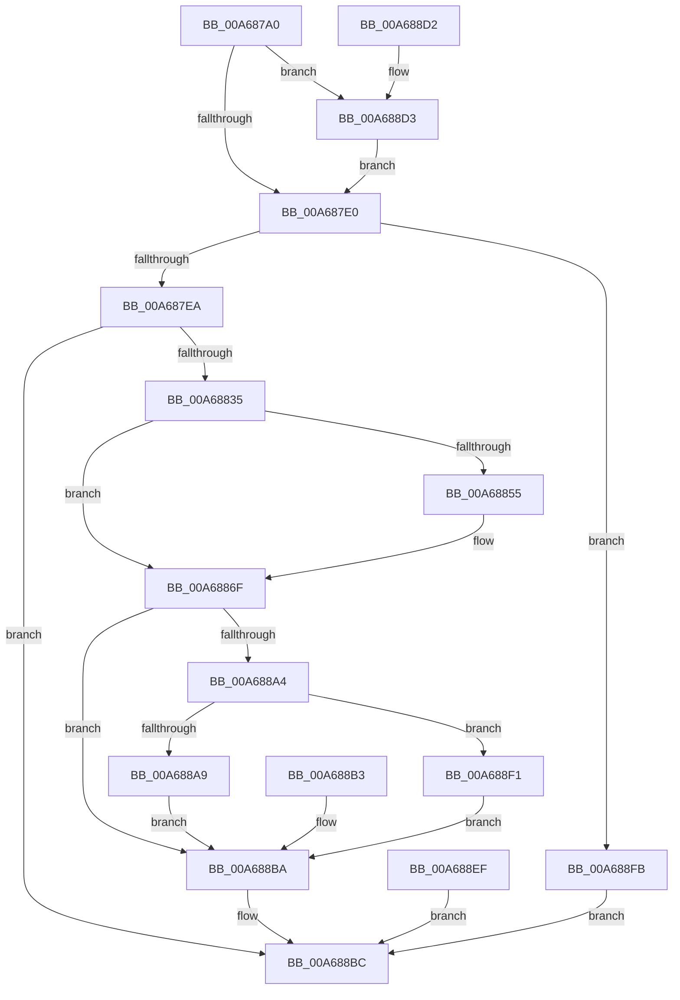

# NtAllocateReserveObject

- RVA: `0x00A687A0`–`0x00A68902` (길이 `354` bytes)
- VA: `0x0000000140A687A0`
- 실행 섹션: `PAGE`
- PDB 이름 있음: `예`; PDB Function 태그: `아니요`
- unwind 정보 RVA: `0x000B3F40`
- 디코드: `85`개 명령, `354/354` bytes 표시
- 미해석 바이트: `0` (있으면 어셈블리에 `.byte`로 보존)

> 이 문서는 커널 이미지의 기계어와 PDB 기호를 분석해 생성했습니다. 4번과 5번은 함수 원형과 자료형을 바이너리 사용 방식에서 추정한 C 해석이며 원본 소스 복구 결과는 아닙니다.

## 1. Dependencies

- 직접 호출 지점: **3**; 고유 호출 대상: **3**
- 직접 호출자로 확인된 함수: **0**
- RIP 상대 이미지 참조: **2**

### Outgoing calls
- `0x00A68828` → [ObCreateObjectEx](../89/ObCreateObjectEx_function_0089B1E0.md) (function, `0x0089B1E0`)
- `0x00A6884A` → [memset](../../text/6C/memset_function_006C6C40.md) (function, `0x006C6C40`)
- `0x00A68892` → [ObInsertObjectEx](../8B/ObInsertObjectEx_function_008B97A0.md) (function, `0x008B97A0`)

### Direct callers
- 이 함수 시작 RVA로 연결되는 직접 call은 확인되지 않았습니다. 간접 호출은 완전히 역산할 수 없습니다.

### Static image references
- `0x00A687EA` → RVA `0x00000000` (`image boundary/outside`; read)
- `0x00A6885C` → RVA `0x009F2240` (`PspIoMiniPacketCallbackRoutine`; read)

## 2. Other-region calls and transfers

- 다른 실행 섹션으로 향하는 call: **1**
  - `0x00A6884A` → [memset](../../text/6C/memset_function_006C6C40.md) (`PAGE` → `.text`)
- 별도 외부 분기/꼬리 이동을 확인하지 못했습니다.

## 3. Assembly (complete function range)

```asm
00A687A0  48 8B C4                        mov rax, rsp
00A687A3  48 89 58 08                     mov qword ptr [rax + 8], rbx
00A687A7  48 89 70 10                     mov qword ptr [rax + 0x10], rsi
00A687AB  57                              push rdi
00A687AC  41 54                           push r12
00A687AE  41 56                           push r14
00A687B0  48 83 EC 60                     sub rsp, 0x60
00A687B4  4D 63 F0                        movsxd r14, r8d
00A687B7  4C 8B C2                        mov r8, rdx
00A687BA  48 8B F9                        mov rdi, rcx
00A687BD  48 83 60 D8 00                  and qword ptr [rax - 0x28], 0
00A687C2  48 83 60 20 00                  and qword ptr [rax + 0x20], 0
00A687C7  65 48 8B 04 25 88 01 00 00      mov rax, qword ptr gs:[0x188]
00A687D0  40 8A B0 32 02 00 00            mov sil, byte ptr [rax + 0x232]
00A687D7  40 84 F6                        test sil, sil
00A687DA  0F 85 F3 00 00 00               jne 0x140a688d3
00A687E0  41 83 FE 01                     cmp r14d, 1
00A687E4  0F 87 11 01 00 00               ja 0x140a688fb
00A687EA  4C 8D 25 0F 78 59 FF            lea r12, [rip - 0xa687f1]
00A687F1  43 8B 84 F4 10 83 FD 00         mov eax, dword ptr [r12 + r14*8 + 0xfd8310]
00A687F9  4B 8B 94 F4 40 73 FC 00         mov rdx, qword ptr [r12 + r14*8 + 0xfc7340]
00A68801  48 83 64 24 48 00               and qword ptr [rsp + 0x48], 0
00A68807  48 8D 8C 24 98 00 00 00         lea rcx, [rsp + 0x98]
00A6880F  48 89 4C 24 40                  mov qword ptr [rsp + 0x40], rcx
00A68814  83 64 24 38 00                  and dword ptr [rsp + 0x38], 0
00A68819  83 64 24 30 00                  and dword ptr [rsp + 0x30], 0
00A6881E  89 44 24 28                     mov dword ptr [rsp + 0x28], eax
00A68822  44 8A CE                        mov r9b, sil
00A68825  40 8A CE                        mov cl, sil
00A68828  E8 B3 29 E3 FF                  call 0x14089b1e0
00A6882D  85 C0                           test eax, eax
00A6882F  0F 88 87 00 00 00               js 0x140a688bc
00A68835  4F 8B 84 F4 10 83 FD 00         mov r8, qword ptr [r12 + r14*8 + 0xfd8310]
00A6883D  33 D2                           xor edx, edx
00A6883F  48 8B 9C 24 98 00 00 00         mov rbx, qword ptr [rsp + 0x98]
00A68847  48 8B CB                        mov rcx, rbx
00A6884A  E8 F1 E3 C5 FF                  call 0x1406c6c40
00A6884F  41 83 FE 01                     cmp r14d, 1
00A68853  75 1A                           jne 0x140a6886f
00A68855  C7 43 18 04 00 00 00            mov dword ptr [rbx + 0x18], 4
00A6885C  48 8D 05 DD 99 F8 FF            lea rax, [rip - 0x76623]
00A68863  48 89 43 40                     mov qword ptr [rbx + 0x40], rax
00A68867  48 89 5B 48                     mov qword ptr [rbx + 0x48], rbx
00A6886B  C6 43 50 00                     mov byte ptr [rbx + 0x50], 0
00A6886F  48 8D 44 24 50                  lea rax, [rsp + 0x50]
00A68874  48 89 44 24 30                  mov qword ptr [rsp + 0x30], rax
00A68879  48 83 64 24 28 00               and qword ptr [rsp + 0x28], 0
00A6887F  83 64 24 20 00                  and dword ptr [rsp + 0x20], 0
00A68884  45 33 C9                        xor r9d, r9d
00A68887  33 D2                           xor edx, edx
00A68889  41 B8 03 00 0F 00               mov r8d, 0xf0003
00A6888F  48 8B CB                        mov rcx, rbx
00A68892  E8 09 0F E5 FF                  call 0x1408b97a0
00A68897  8B D0                           mov edx, eax
00A68899  89 84 24 98 00 00 00            mov dword ptr [rsp + 0x98], eax
00A688A0  85 C0                           test eax, eax
00A688A2  78 16                           js 0x140a688ba
00A688A4  40 84 F6                        test sil, sil
00A688A7  74 48                           je 0x140a688f1
00A688A9  48 8B 4C 24 50                  mov rcx, qword ptr [rsp + 0x50]
00A688AE  48 89 0F                        mov qword ptr [rdi], rcx
00A688B1  EB 07                           jmp 0x140a688ba
00A688B3  8B 94 24 98 00 00 00            mov edx, dword ptr [rsp + 0x98]
00A688BA  8B C2                           mov eax, edx
00A688BC  4C 8D 5C 24 60                  lea r11, [rsp + 0x60]
00A688C1  49 8B 5B 20                     mov rbx, qword ptr [r11 + 0x20]
00A688C5  49 8B 73 28                     mov rsi, qword ptr [r11 + 0x28]
00A688C9  49 8B E3                        mov rsp, r11
00A688CC  41 5E                           pop r14
00A688CE  41 5C                           pop r12
00A688D0  5F                              pop rdi
00A688D1  C3                              ret
00A688D2  CC                              int3
00A688D3  48 B9 00 00 FF FF FF 7F 00 00   movabs rcx, 0x7fffffff0000
00A688DD  48 3B F9                        cmp rdi, rcx
00A688E0  48 0F 42 CF                     cmovb rcx, rdi
00A688E4  48 8B 01                        mov rax, qword ptr [rcx]
00A688E7  48 89 01                        mov qword ptr [rcx], rax
00A688EA  E9 F1 FE FF FF                  jmp 0x140a687e0
00A688EF  EB CB                           jmp 0x140a688bc
00A688F1  48 8B 44 24 50                  mov rax, qword ptr [rsp + 0x50]
00A688F6  48 89 07                        mov qword ptr [rdi], rax
00A688F9  EB BF                           jmp 0x140a688ba
00A688FB  B8 0D 00 00 C0                  mov eax, 0xc000000d
00A68900  EB BA                           jmp 0x140a688bc
```

## 4. C-style interpretation (structured pseudocode)

```c
__int64 __fastcall NtAllocateReserveObject(__int64 a1, __int64 a2, int a3)
{
    __int64 result;
    __int64 v_rsp;
    unsigned __int64 v_stack_m10;
    unsigned __int64 v_stack_m18;
    unsigned __int64 v_stack_m28;
    unsigned __int64 v_stack_m30;
    unsigned __int64 v_stack_m38;
    unsigned int v_stack_m40;
    unsigned int v_stack_m48;
    unsigned int v_stack_m50;
    unsigned int v_stack_m58;
    unsigned __int64 v_stack_p20;

    *(unsigned __int64 *)(v_rsp + 8) = v_rbx;
    *(unsigned __int64 *)(v_rsp + 16) = v_rsi;
    v_rsp = (v_rsp) - (96);
    if ((unsigned __int8)(*(unsigned __int8 *)(*(unsigned __int64 *)(gs_base + (0 + 392)) + 562)) != 0) goto loc_00A688D3;
loc_00A687E0:
    if (((unsigned int)((int)(a3))) > 1) goto loc_00A688FB;
    v_stack_m38 = v_stack_p20;
    v_stack_m50 = (unsigned int)((unsigned int)(*(unsigned int *)(v_rip - 10913777 + (int)(a3) * 8 + 16614160)));
    result = ObCreateObjectEx((unsigned __int8)(*(unsigned __int8 *)(*(unsigned __int64 *)(gs_base + (0 + 392)) + 562)), *(unsigned __int64 *)(v_rip - 10913777 + (int)(a3) * 8 + 16544576), a2, (unsigned __int8)(*(unsigned __int8 *)(*(unsigned __int64 *)(gs_base + (0 + 392)) + 562)));
    if (sign_flag) goto loc_00A688BC;
    a2 = 0;
    result = memset(v_stack_p20, a2, *(unsigned __int64 *)(v_rip - 10913777 + (int)(a3) * 8 + 16614160), (unsigned __int8)(*(unsigned __int8 *)(*(unsigned __int64 *)(gs_base + (0 + 392)) + 562)));
    if (((unsigned int)((int)(a3))) == 1) {
        *(unsigned int *)(v_stack_p20 + 24) = 4;
        result = v_rip - 484899;
        *(unsigned __int64 *)(v_stack_p20 + 64) = result;
        *(unsigned __int64 *)(v_stack_p20 + 72) = v_stack_p20;
        *(unsigned __int8 *)(v_stack_p20 + 80) = 0;
    }
    v_stack_m48 = v_stack_m28;
    a4 = 0;
    a2 = 0;
    result = ObInsertObjectEx(v_stack_p20, a2, (unsigned int)(0xF0003ULL), a4);
    v_stack_p20 = (unsigned int)(result);
    if (sign_flag) goto loc_00A688BA;
    if ((unsigned __int8)(*(unsigned __int8 *)(*(unsigned __int64 *)(gs_base + (0 + 392)) + 562)) == 0) goto loc_00A688F1;
    *(unsigned __int64 *)(a1) = v_stack_m28;
    goto loc_00A688BA;
loc_00A688BA:
loc_00A688BC:
    return (unsigned int)((unsigned int)((unsigned int)((unsigned int)(result))));
loc_00A688D3:
    a1 = v_stack_m28;
    if (a1 < v_stack_m28) { a1 = a1; }
    *(unsigned __int64 *)(a1) = *(unsigned __int64 *)(a1);
    goto loc_00A687E0;
loc_00A688F1:
    *(unsigned __int64 *)(a1) = v_stack_m10;
    goto loc_00A688BA;
loc_00A688FB:
    goto loc_00A688BC;
}
```

## 5. (Beta) C Style

```c
int64_t NtAllocateReserveObject(int64_t Arg1, int64_t Arg2, int32_t Arg3)
{
    int64_t result;
    int64_t local_rsp;
    uint64_t v_stack_m10;
    uint64_t v_stack_m18;
    uint64_t v_stack_m28;
    uint64_t v_stack_m30;
    uint64_t v_stack_m38;
    uint32_t v_stack_m40;
    uint32_t v_stack_m48;
    uint32_t v_stack_m50;
    uint32_t v_stack_m58;
    uint64_t v_stack_p20;

    *(uint64_t *)(local_rsp + 0x8) = local_rbx;
    *(uint64_t *)(local_rsp + 0x10) = local_rsi;
    local_rsp = (local_rsp) - (96);
    if ((uint8_t)(*(uint8_t *)(*(uint64_t *)(gs_base + (0 + 0x188)) + 0x232)) != 0) goto loc_00A688D3;
loc_00A687E0:
    if (((uint32_t)((int32_t)(Arg3))) > 1) goto loc_00A688FB;
    v_stack_m38 = v_stack_p20;
    v_stack_m50 = (uint32_t)((uint32_t)(*(uint32_t *)(v_rip - 0xA687F1 + (int32_t)(Arg3) * 8 + 0xFD8310)));
    result = ObCreateObjectEx((uint8_t)(*(uint8_t *)(*(uint64_t *)(gs_base + (0 + 0x188)) + 0x232)), *(uint64_t *)(v_rip - 0xA687F1 + (int32_t)(Arg3) * 8 + 0xFC7340), Arg2, (uint8_t)(*(uint8_t *)(*(uint64_t *)(gs_base + (0 + 0x188)) + 0x232)));
    if (sign_flag) goto loc_00A688BC;
    Arg2 = 0;
    result = memset(v_stack_p20, Arg2, *(uint64_t *)(v_rip - 0xA687F1 + (int32_t)(Arg3) * 8 + 0xFD8310), (uint8_t)(*(uint8_t *)(*(uint64_t *)(gs_base + (0 + 0x188)) + 0x232)));
    if (((uint32_t)((int32_t)(Arg3))) == 1) {
        *(uint32_t *)(v_stack_p20 + 0x18) = 4;
        result = v_rip - 484899;
        *(uint64_t *)(v_stack_p20 + 0x40) = result;
        *(uint64_t *)(v_stack_p20 + 0x48) = v_stack_p20;
        *(uint8_t *)(v_stack_p20 + 0x50) = 0;
    }
    v_stack_m48 = v_stack_m28;
    a4 = 0;
    Arg2 = 0;
    result = ObInsertObjectEx(v_stack_p20, Arg2, (uint32_t)(0xF0003ULL), a4);
    v_stack_p20 = (uint32_t)(result);
    if (sign_flag) goto loc_00A688BA;
    if ((uint8_t)(*(uint8_t *)(*(uint64_t *)(gs_base + (0 + 0x188)) + 0x232)) == 0) goto loc_00A688F1;
    *(uint64_t *)(Arg1) = v_stack_m28;
    goto loc_00A688BA;
loc_00A688BA:
loc_00A688BC:
    return (uint32_t)((uint32_t)((uint32_t)((uint32_t)(result))));
loc_00A688D3:
    Arg1 = v_stack_m28;
    if (Arg1 < v_stack_m28) { Arg1 = Arg1; }
    *(uint64_t *)(Arg1) = *(uint64_t *)(Arg1);
    goto loc_00A687E0;
loc_00A688F1:
    *(uint64_t *)(Arg1) = v_stack_m10;
    goto loc_00A688BA;
loc_00A688FB:
    goto loc_00A688BC;
}
```

## 6. Execution-region graph

[열기: 2D/3D 그래프와 함수 탐색 컨트롤 패널](../../../control-panel.html?section=page&rva=0x00A687A0&view=graph)

- 2D 그래프는 위에서 아래로 흐르고, 3D 그래프는 빈 공간을 드래그해 회전합니다. Shift+드래그는 이동, 휠은 확대·축소, 함수 노드 선택은 대상 보고서 이동입니다.

### Static fallback


